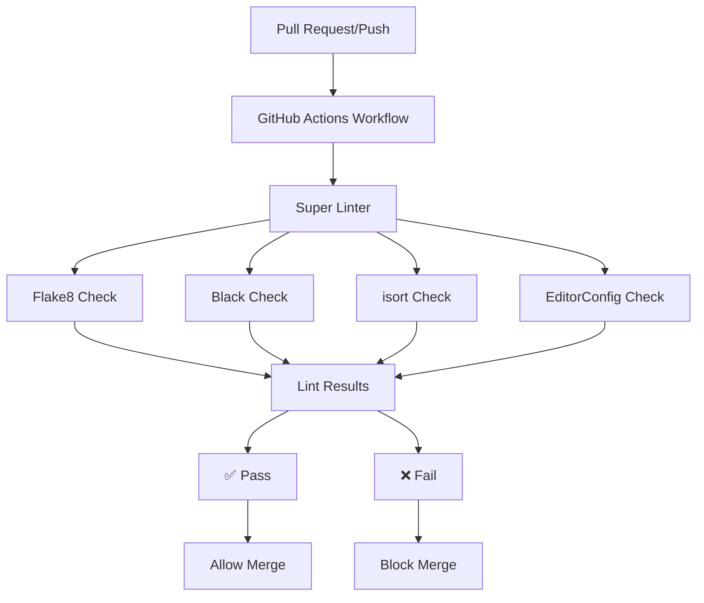
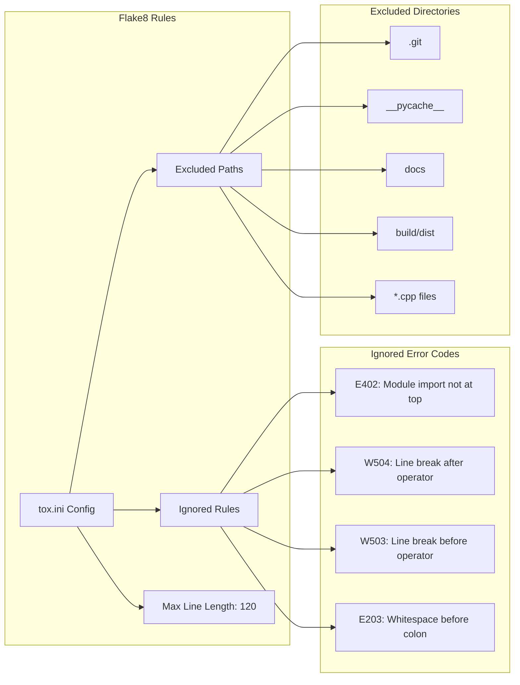
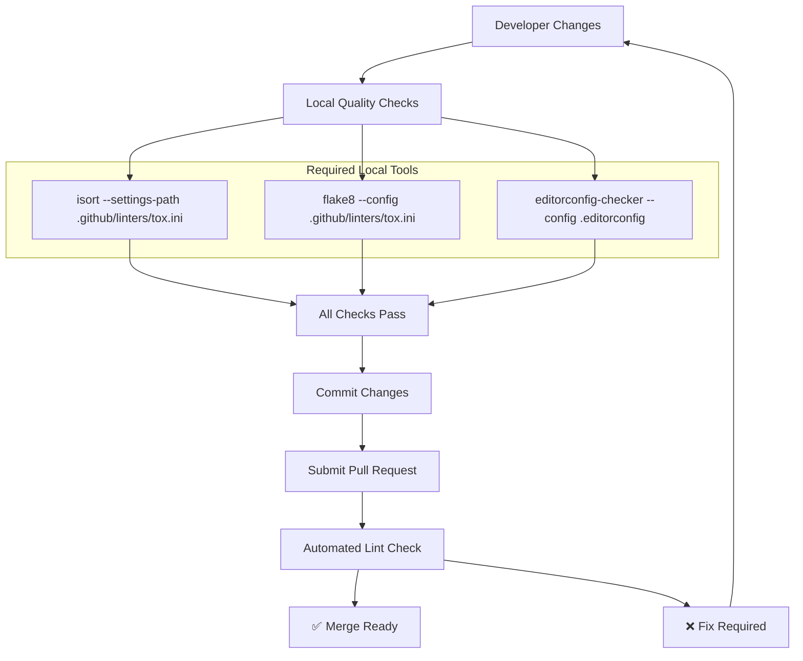
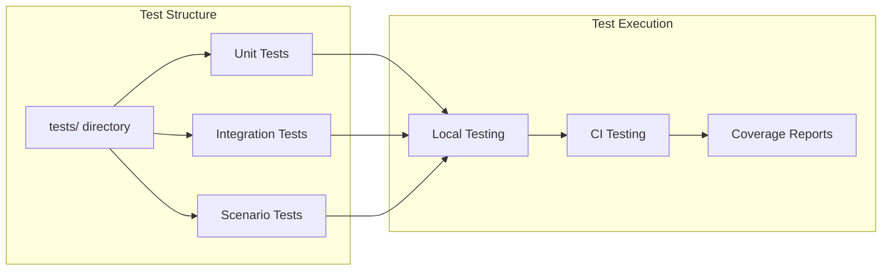

<!-- source: DeepWiki mcp.deepwiki.com · repo microsoft/maro · page 7.3 Code Quality and Testing · fetched 2026-10-26 -->

# Code Quality and Testing

<details>
<summary>Relevant source files</summary>

The following files were used as context for generating this wiki page:

- [.editorconfig](.editorconfig)
- [.github/linters/tox.ini](.github/linters/tox.ini)
- [.github/workflows/lint.yml](.github/workflows/lint.yml)
- [CONTRIBUTING.md](CONTRIBUTING.md)

</details>


This document covers the code quality standards, linting tools, and testing practices used in the MARO codebase. It provides guidance for contributors on maintaining consistent code formatting, passing quality checks, and writing effective tests.

For information about the CI/CD pipeline and automated builds, see [CI/CD Pipeline](#7.2). For development environment setup, see [Environment Setup](#7.1).

## Overview

MARO enforces code quality through automated linting tools, consistent formatting standards, and comprehensive testing practices. The quality control system is integrated into the GitHub Actions CI/CD pipeline and runs on every push and pull request.

### Code Quality Tools

The MARO project uses several industry-standard tools to maintain code quality:

| Tool | Purpose | Configuration File |
|------|---------|-------------------|
| `flake8` | Python linting and style checking | `.github/linters/tox.ini` |
| `black` | Python code formatting | `pyproject.toml` |
| `isort` | Import statement sorting | `pyproject.toml` |
| `editorconfig-checker` | Cross-file formatting consistency | `.editorconfig` |

## Automated Linting Workflow

### GitHub Actions Integration

The primary quality control mechanism is the automated lint workflow that runs on all code changes.



**Lint Workflow Components**

The workflow is defined in [.github/workflows/lint.yml:1-59]() and uses the GitHub Super Linter action with specific MARO configurations:

- **Trigger Events**: Runs on `push`, `pull_request`, and `workflow_dispatch` events [.github/workflows/lint.yml:17]()
- **Validation Scope**: Only validates files in the `maro/` directory, excluding test files [.github/workflows/lint.yml:55-56]()
- **Disabled Checks**: Pylint and MyPy are explicitly disabled as they are not configured [.github/workflows/lint.yml:48-49]()

Sources: `.github/workflows/lint.yml`

### Flake8 Configuration

Flake8 serves as the primary Python linting tool with customized rules for the MARO codebase.



**Key Configuration Details**:

- **Line Length**: Maximum of 120 characters [.github/linters/tox.ini:27]()
- **Import Exceptions**: `F401` (unused imports) ignored in `__init__.py` files [.github/linters/tox.ini:31]()
- **Special Cases**: Invalid escape sequences allowed in `maro.py` for banner display [.github/linters/tox.ini:33]()

Sources: `.github/linters/tox.ini`

## EditorConfig Standards

### Cross-Platform Consistency

EditorConfig ensures consistent formatting across different editors and platforms used by contributors.

| File Type | Indent Style | Indent Size | Line Endings |
|-----------|--------------|-------------|---------------|
| Python (`.py`, `.pyx`, `.pyd`) | Spaces | 4 | LF |
| Shell scripts (`.sh`) | Spaces | 4 | LF |
| YAML (`.yml`) | Spaces | 2 | LF |
| Windows scripts (`.bat`) | Tabs | - | CRLF |
| General files | Spaces | 2 | LF |

**Standard Rules Applied**:
- UTF-8 character encoding [.editorconfig:5]()
- Trim trailing whitespace [.editorconfig:6]()
- Insert final newline [.editorconfig:7]()
- Consistent indentation patterns [.editorconfig:8-9]()

Sources: `.editorconfig`

## Contributor Workflow

### Pre-Commit Quality Checks

Contributors must run local quality checks before submitting pull requests, as documented in the contributing guidelines.



**Installation Commands**:
```bash
pip install isort flake8 editorconfig-checker
```

Sources: `CONTRIBUTING.md`

### Manual Linting Commands

The following commands allow contributors to manually verify code quality:

| Tool | Command | Purpose |
|------|---------|---------|
| isort | `isort --settings-path .github/linters/tox.ini` | Automatically format import statements |
| flake8 | `flake8 --config .github/linters/tox.ini` | Check Python code style and errors |
| editorconfig-checker | `editorconfig-checker --config .editorconfig PATH` | Verify file formatting consistency |

Sources: `CONTRIBUTING.md`

## Testing Framework

### Test Organization

While specific test configuration files were not provided in the source materials, the MARO project includes comprehensive testing practices integrated with the development workflow.



**Test Categories**:
- **Unit Tests**: Component-level testing for individual modules
- **Integration Tests**: Cross-component interaction testing  
- **Scenario Tests**: End-to-end testing of simulation scenarios

Sources: `CONTRIBUTING.md`

## Quality Enforcement

### Automated Gatekeeping

The GitHub Actions workflow serves as an automated gatekeeper, preventing code that doesn't meet quality standards from being merged into the main branch.

**Enforcement Mechanisms**:
- **Required Status Checks**: Lint workflow must pass before merge
- **Branch Protection**: Quality checks are mandatory for the master branch [.github/workflows/lint.yml:57]()
- **Fail-Fast Approach**: Any linting failure blocks the entire workflow

**Token Configuration**: The workflow uses a dedicated `LINT_TOKEN` for GitHub API access [.github/workflows/lint.yml:58](), ensuring reliable execution across different repository contexts.

Sources: `.github/workflows/lint.yml`, `CONTRIBUTING.md`

---

