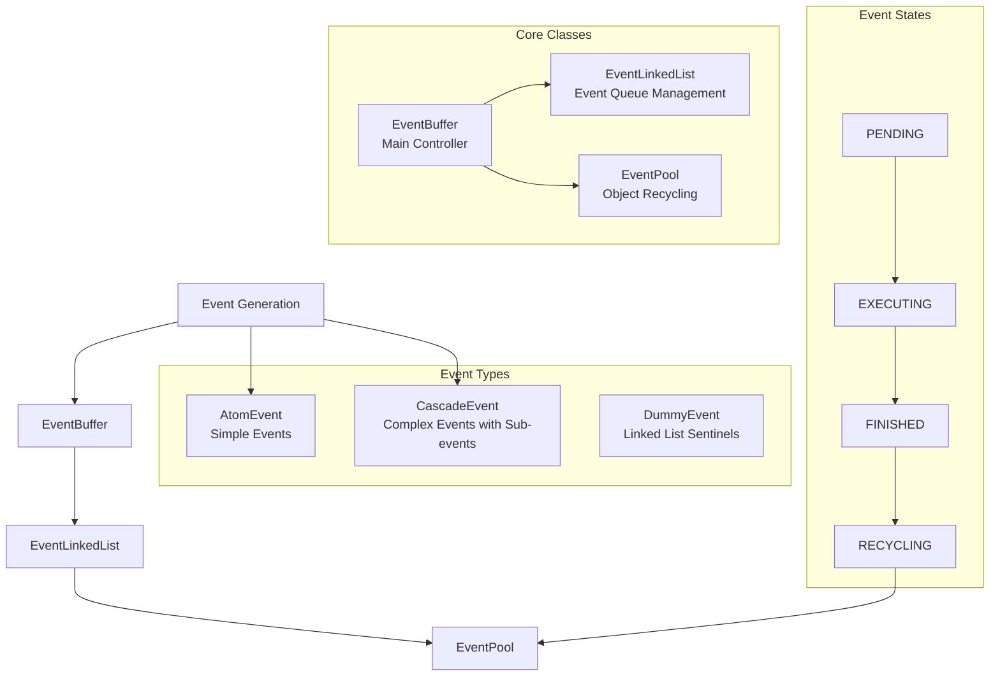
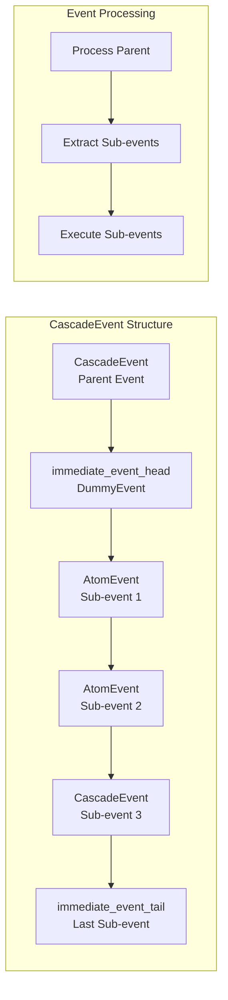
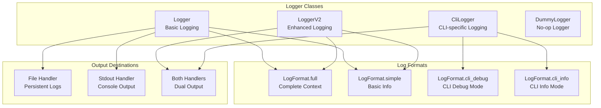
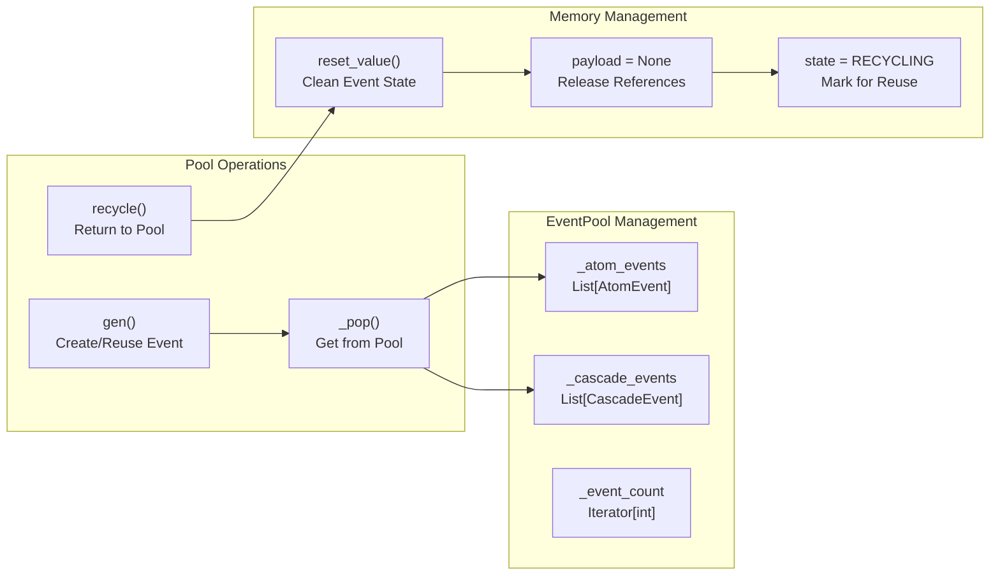

<!-- source: DeepWiki mcp.deepwiki.com · repo microsoft/maro · page 8 Advanced Topics · fetched 2026-10-26 -->

# Advanced Topics

<details>
<summary>Relevant source files</summary>

The following files were used as context for generating this wiki page:

- [examples/citi_bike/online_lp/launcher.py](examples/citi_bike/online_lp/launcher.py)
- [examples/vm_scheduling/offline_lp/launcher.py](examples/vm_scheduling/offline_lp/launcher.py)
- [maro/cli/inspector/env_data_process.py](maro/cli/inspector/env_data_process.py)
- [maro/event_buffer/__init__.py](maro/event_buffer/__init__.py)
- [maro/event_buffer/event.py](maro/event_buffer/event.py)
- [maro/event_buffer/event_linked_list.py](maro/event_buffer/event_linked_list.py)
- [maro/event_buffer/event_pool.py](maro/event_buffer/event_pool.py)
- [maro/utils/logger.py](maro/utils/logger.py)
- [tests/test_event_buffer.py](tests/test_event_buffer.py)

</details>


This document covers advanced technical details and internal architecture patterns within the MARO platform that are primarily relevant to contributors, advanced users, and those implementing custom scenarios or extensions. The material assumes familiarity with MARO's core concepts covered in the [Core Architecture](#2) section.

For getting started with MARO basics, see [Getting Started](#4). For scenario-specific documentation, see [Simulation Scenarios](#3). For deployment and development workflows, see [Development and Deployment](#7).

## Scope and Coverage

This section provides technical deep-dives into MARO's internal systems including:

- **Event-driven simulation architecture** - The `EventBuffer` system that powers discrete event simulation
- **High-performance data management** - C++ backends, object pooling, and memory optimization
- **Logging and debugging infrastructure** - Comprehensive logging framework and debugging utilities
- **Internal APIs and extension points** - Advanced interfaces for custom scenario development

The subsections [Event System](#8.1) and [Logging and Utilities](#8.2) provide detailed technical specifications for these systems.

## Event-Driven Architecture Overview

MARO's simulation engine is built around a sophisticated event-driven architecture that enables high-performance discrete event simulation. The core components form a layered system where events flow through multiple processing stages.

### Event Processing Pipeline



**Sources:** [maro/event_buffer/event.py:1-145](), [maro/event_buffer/event_buffer.py](), [maro/event_buffer/event_linked_list.py:1-155](), [maro/event_buffer/event_pool.py:1-92]()

The event system implements several advanced patterns:

| Component | Purpose | Key Classes |
|-----------|---------|-------------|
| **Event Hierarchy** | Type-safe event modeling | `AbsEvent`, `ActualEvent`, `AtomEvent`, `CascadeEvent` |
| **Event Buffer** | Central event controller | `EventBuffer` |
| **Event Queue** | Efficient event ordering | `EventLinkedList` |
| **Object Pooling** | Memory optimization | `EventPool` |
| **State Management** | Event lifecycle tracking | `EventState` enum |

### Advanced Event Features

The `CascadeEvent` class enables complex event composition patterns:



**Sources:** [maro/event_buffer/event.py:76-145](), [maro/event_buffer/event_linked_list.py:86-107](), [tests/test_event_buffer.py:19-52]()

Key capabilities include:

- **Immediate event chaining** - Sub-events execute immediately after parent completion via `add_immediate_event()`
- **Head/tail insertion** - Fine-grained control over sub-event execution order
- **Decision event batching** - Multiple decision events can be collected and processed together
- **Event state tracking** - Comprehensive lifecycle management through `EventState`

## Logging and Monitoring Framework

MARO provides a multi-layered logging system designed for both development and production environments. The logging framework supports multiple output formats, destinations, and verbosity levels.

### Logging Architecture



**Sources:** [maro/utils/logger.py:1-429](), [examples/vm_scheduling/offline_lp/launcher.py:19-28](), [examples/citi_bike/online_lp/launcher.py:1-288]()

### Logger Configuration Patterns

The logging system provides flexible configuration through multiple logger types:

| Logger Class | Use Case | Key Features |
|--------------|----------|--------------|
| `Logger` | General application logging | Basic file + stdout output, configurable formats |
| `LoggerV2` | Enhanced logging with more control | Separate file/stdout levels, optional file output |
| `CliLogger` | CLI command logging | Singleton pattern, automatic debug/info mode switching |
| `DummyLogger` | Disabled logging | No-op implementation for performance |

### Custom Log Levels

MARO extends Python's standard logging with domain-specific levels:

```python
# Custom log level for training progress
PROGRESS = 60  # Higher than CRITICAL
logging.addLevelName(PROGRESS, "PROGRESS")
```

**Sources:** [maro/utils/logger.py:72-83]()

The framework supports environment-variable based log level control via `LOG_LEVEL` and integrates with CLI global parameters through `CliGlobalParams`.

## Performance Optimization Systems

MARO employs several advanced performance optimization techniques for handling large-scale simulations efficiently.

### Object Pooling Architecture



**Sources:** [maro/event_buffer/event_pool.py:1-92](), [tests/test_event_buffer.py:97-120]()

The `EventPool` class implements object pooling patterns to minimize garbage collection overhead:

- **Pre-allocated object reuse** - Events are recycled rather than recreated
- **Type-specific pools** - Separate pools for `AtomEvent` and `CascadeEvent` objects
- **Automatic cleanup** - Payload references are cleared during recycling
- **Buffer allocation** - New objects created when pools are empty

### Data Backend Integration

MARO integrates with high-performance C++ backends for computation-intensive operations:

| Backend | Purpose | Integration Point |
|---------|---------|-------------------|
| **RawBackend** | Direct memory access | Frame system data storage |
| **NumpyBackend** | Scientific computing | NumPy array operations |
| **Frame System** | State management | Snapshot and historical data |

These backends provide the foundation for MARO's high-performance simulation capabilities while maintaining Python API compatibility.

## Internal APIs and Extension Points

MARO provides several extension points for advanced users implementing custom scenarios or analysis tools.

### Event Handler Registration

The event system supports dynamic handler registration for custom event processing:

```python
# Register custom event handlers
event_buffer.register_event_handler(event_type, callback_function)

# Custom event generation
custom_event = event_buffer.gen_cascade_event(tick, event_type, payload)
event_buffer.insert_event(custom_event)
```

**Sources:** [tests/test_event_buffer.py:151-175]()

### Debugging and Inspection Tools

MARO provides comprehensive debugging capabilities:

- **Event recording** - Optional event logging to CSV files for analysis
- **Finished event tracking** - Configurable retention of completed events
- **State inspection** - Access to pending and finished event queues
- **Metrics collection** - Built-in performance and simulation metrics

**Sources:** [tests/test_event_buffer.py:294-334](), [tests/test_event_buffer.py:281-293]()

Advanced users can leverage these systems to implement custom scenarios, analysis tools, and performance optimizations while maintaining compatibility with MARO's core architecture patterns.

---

