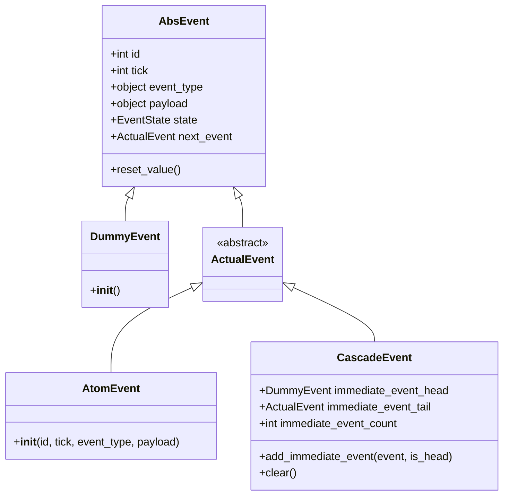
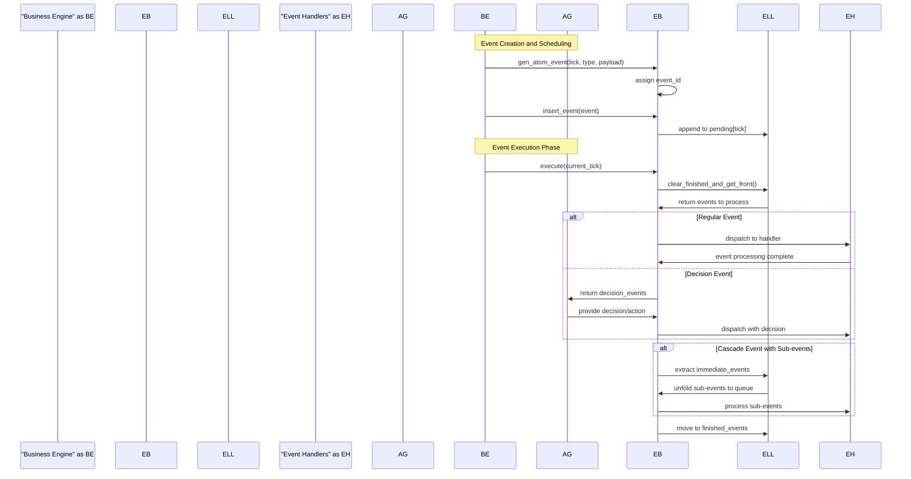
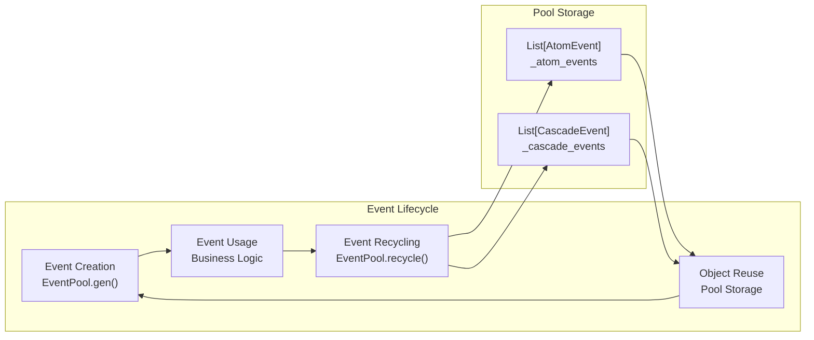
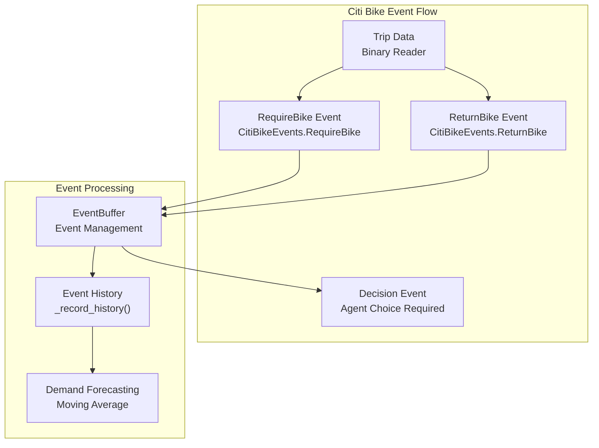

<!-- source: DeepWiki mcp.deepwiki.com · repo microsoft/maro · page 8.1 Event System · fetched 2026-10-26 -->

# Event System

<details>
<summary>Relevant source files</summary>

The following files were used as context for generating this wiki page:

- [examples/citi_bike/online_lp/launcher.py](examples/citi_bike/online_lp/launcher.py)
- [maro/event_buffer/__init__.py](maro/event_buffer/__init__.py)
- [maro/event_buffer/event.py](maro/event_buffer/event.py)
- [maro/event_buffer/event_linked_list.py](maro/event_buffer/event_linked_list.py)
- [maro/event_buffer/event_pool.py](maro/event_buffer/event_pool.py)
- [tests/test_event_buffer.py](tests/test_event_buffer.py)

</details>


## Purpose and Scope

This document covers MARO's event-driven simulation engine that manages temporal event processing, cascading event relationships, and memory-efficient event handling. The Event System provides the foundation for discrete-event simulation in MARO scenarios, enabling complex temporal logic and inter-component communication.

For information about the broader simulation framework that uses the Event System, see [Simulation Framework](#2.1). For details about specific scenario implementations that leverage events, see [Simulation Scenarios](#3).

## System Overview

The Event System implements a discrete-event simulation engine with support for:

- **Temporal Event Processing**: Events scheduled for specific simulation ticks
- **Cascading Events**: Events that trigger immediate sub-events
- **Event Pooling**: Memory-efficient event object reuse
- **Decision Events**: Special events that require external agent decisions
- **Event Recording**: Optional event logging for analysis

```mermaid
graph TB
    subgraph "Event System Architecture"
        EB["EventBuffer<br/>Main Event Manager"]
        
        subgraph "Event Types"
            AE["AbsEvent<br/>Abstract Base"]
            ACE["ActualEvent<br/>Concrete Base"]
            ATOM["AtomEvent<br/>Simple Events"]
            CASCADE["CascadeEvent<br/>Hierarchical Events"]
            DUMMY["DummyEvent<br/>Placeholder"]
        end
        
        subgraph "Management Components"
            ELL["EventLinkedList<br/>Event Queue"]
            EP["EventPool<br/>Object Pooling"]
            ES["EventState<br/>Lifecycle States"]
        end
        
        subgraph "Event Processing"
            PENDING["Pending Events<br/>Scheduled Future"]
            EXECUTING["Executing Events<br/>Current Tick"]
            FINISHED["Finished Events<br/>Historical"]
        end
    end
    
    EB --> ELL
    EB --> EP
    EB --> ES
    
    AE <|-- ACE
    ACE <|-- ATOM
    ACE <|-- CASCADE
    AE <|-- DUMMY
    
    ELL --> PENDING
    ELL --> EXECUTING
    ELL --> FINISHED
    
    EP --> ATOM
    EP --> CASCADE
```

Sources: [maro/event_buffer/__init__.py:1-18](), [maro/event_buffer/event_buffer.py](), [tests/test_event_buffer.py:15-18]()

## Core Components

### EventBuffer Class

The `EventBuffer` is the central event management system that orchestrates event scheduling, dispatching, and lifecycle management.

| Component | Class | Purpose |
|-----------|-------|---------|
| Main Manager | `EventBuffer` | Central event orchestration |
| Event Queue | `EventLinkedList` | Ordered event processing |
| Object Pool | `EventPool` | Memory-efficient event reuse |
| State Tracking | `EventState` | Event lifecycle management |

**Key EventBuffer Methods:**

| Method | Purpose | Return Type |
|--------|---------|-------------|
| `gen_atom_event()` | Create simple events | `AtomEvent` |
| `gen_cascade_event()` | Create hierarchical events | `CascadeEvent` |
| `gen_decision_event()` | Create decision events | `CascadeEvent` |
| `insert_event()` | Schedule event execution | `None` |
| `execute()` | Process events for tick | `List[CascadeEvent]` |
| `get_pending_events()` | Retrieve scheduled events | `EventLinkedList` |
| `get_finished_events()` | Retrieve completed events | `List[ActualEvent]` |

Sources: [maro/event_buffer/event_buffer.py](), [tests/test_event_buffer.py:121-137]()

### Event Hierarchy

The event type hierarchy supports different event complexities and processing patterns:



**Event Type Characteristics:**

- **AtomEvent**: Simple, self-contained events with no sub-events
- **CascadeEvent**: Complex events that can contain immediate sub-events
- **DummyEvent**: Placeholder events used in linked list management
- **Decision Events**: Special cascade events requiring agent decisions

Sources: [maro/event_buffer/event.py:10-145](), [tests/test_event_buffer.py:19-51]()

## Event Processing Workflow

The event processing follows a structured lifecycle with distinct phases:



**Event State Transitions:**

| State | Description | Next States |
|-------|-------------|-------------|
| `PENDING` | Scheduled for future execution | `EXECUTING` |
| `EXECUTING` | Currently being processed | `FINISHED` |
| `FINISHED` | Completed processing | `RECYCLING` |
| `RECYCLING` | Available for object pool reuse | `PENDING` |

Sources: [maro/event_buffer/event_state.py](), [maro/event_buffer/event_linked_list.py:117-137](), [tests/test_event_buffer.py:254-279]()

## Cascade Event Management

Cascade events enable hierarchical event structures where parent events trigger immediate sub-events:

```mermaid
graph TB
    subgraph "Cascade Event Structure"
        CE["CascadeEvent<br/>Parent Event"]
        
        subgraph "Immediate Events Queue"
            HEAD["DummyEvent<br/>immediate_event_head"]
            SUB1["AtomEvent<br/>Sub-event 1"]
            SUB2["CascadeEvent<br/>Sub-event 2"]
            SUB3["AtomEvent<br/>Sub-event 3"]
            TAIL["ActualEvent<br/>immediate_event_tail"]
        end
    end
    
    CE --> HEAD
    HEAD --> SUB1
    SUB1 --> SUB2
    SUB2 --> SUB3
    SUB3 --> TAIL
    
    subgraph "Processing Order"
        P1["1. Process Parent"]
        P2["2. Extract Sub-events"]
        P3["3. Process Sub-events"]
        P4["4. Continue Queue"]
    end
    
    P1 --> P2
    P2 --> P3
    P3 --> P4
```



**Cascade Event Operations:**

- **add_immediate_event()**: Insert sub-events at head or tail
- **Tick Validation**: Sub-events must have same tick as parent
- **Automatic Unfolding**: Sub-events extracted when parent finishes
- **Ordering Control**: Head insertion for priority, tail for sequence

Sources: [maro/event_buffer/event.py:76-145](), [maro/event_buffer/event_linked_list.py:86-92](), [tests/test_event_buffer.py:19-51]()

## Event Pooling and Memory Management

The `EventPool` provides memory-efficient event object reuse:



**Pool Management Features:**

- **Automatic ID Assignment**: Sequential event IDs via `itertools.count()`
- **Type-Specific Pools**: Separate pools for `AtomEvent` and `CascadeEvent`
- **Payload Cleanup**: Automatic payload clearing during recycling
- **State Reset**: Events reset to `PENDING` state when reused

Sources: [maro/event_buffer/event_pool.py:12-92](), [tests/test_event_buffer.py:97-120]()

## Usage Patterns and Integration

### Scenario Integration Example

The Citi Bike scenario demonstrates practical event system usage:



**Key Integration Patterns:**

- **Event Type Registration**: Custom event types via enum classes
- **Payload Structures**: Typed payload objects for event data
- **Handler Registration**: Event-to-handler mapping in EventBuffer
- **Historical Analysis**: Finished events used for learning/forecasting

Sources: [examples/citi_bike/online_lp/launcher.py:61-101](), [examples/citi_bike/online_lp/launcher.py:155-173]()

### Event Recording and Analysis

Optional event recording enables post-simulation analysis:

| Feature | Configuration | Output Format |
|---------|---------------|---------------|
| Event Recording | `record_events=True` | CSV format |
| File Path | `record_path="/path/to/file"` | Custom location |
| Episode Tracking | Automatic episode numbering | Episode column |
| Event Details | Tick, type, payload | Structured data |

**Recording Output Format:**
```
episode,tick,event_type,payload
0,1,1,"(1, 3)"
0,2,2,"custom_payload"
1,1,1,"(1, 3)"
```

Sources: [tests/test_event_buffer.py:294-334]()

---

