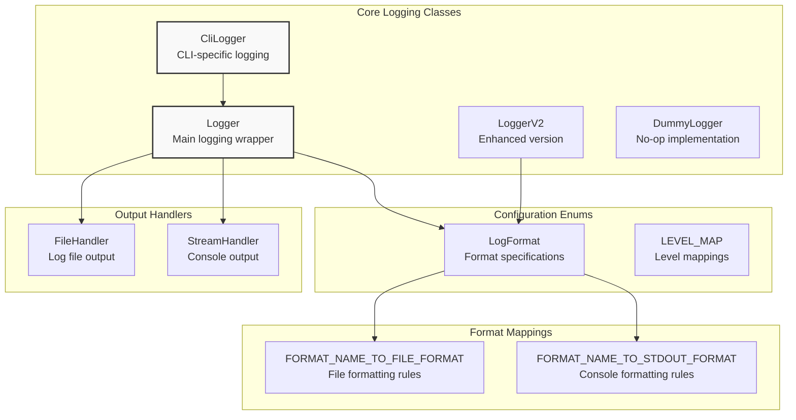
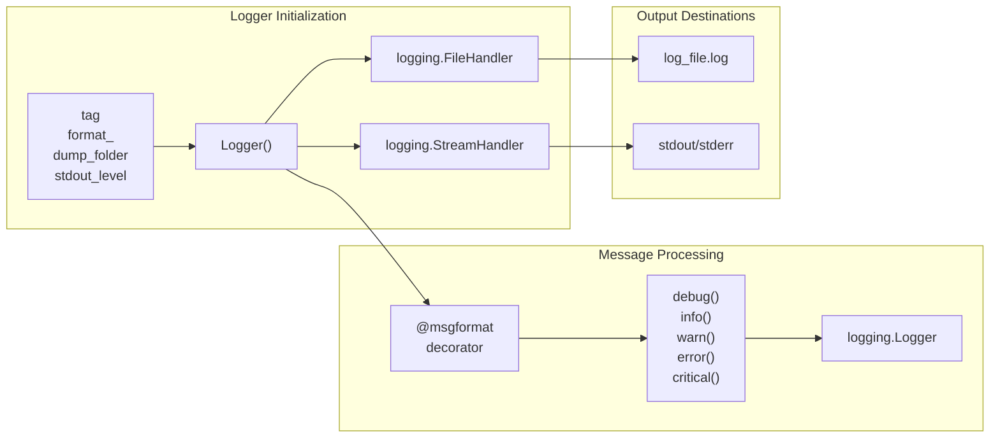
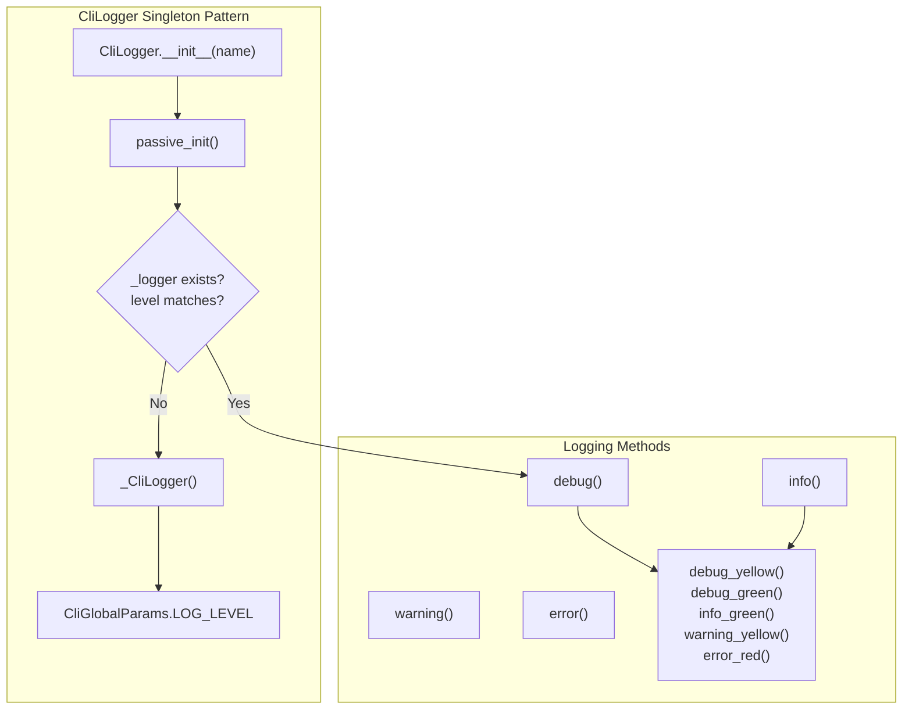
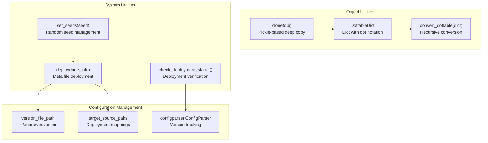
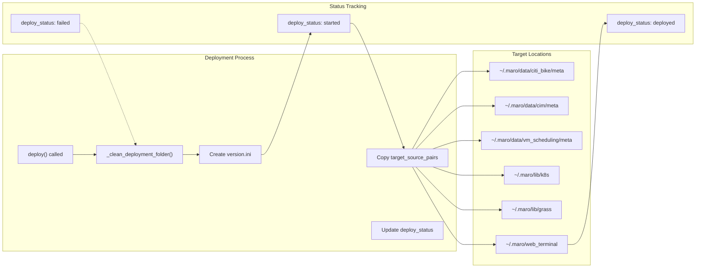
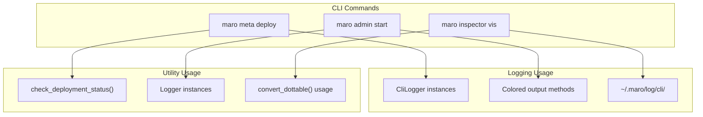
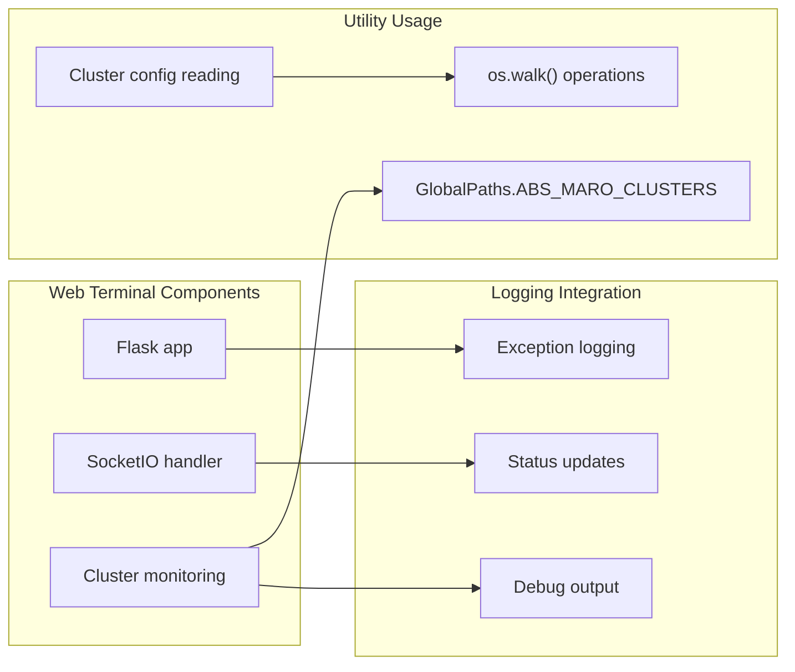

<!-- source: DeepWiki mcp.deepwiki.com · repo microsoft/maro · page 8.2 Logging and Utilities · fetched 2026-10-26 -->

# Logging and Utilities

<details>
<summary>Relevant source files</summary>

The following files were used as context for generating this wiki page:

- [docs/source/scenarios/citi_bike.rst](docs/source/scenarios/citi_bike.rst)
- [examples/vm_scheduling/offline_lp/launcher.py](examples/vm_scheduling/offline_lp/launcher.py)
- [examples/vm_scheduling/rule_based_algorithm/README.md](examples/vm_scheduling/rule_based_algorithm/README.md)
- [maro/cli/grass/lib/services/master_agent/agent.py](maro/cli/grass/lib/services/master_agent/agent.py)
- [maro/cli/inspector/env_data_process.py](maro/cli/inspector/env_data_process.py)
- [maro/cli/utils/node_admin.py](maro/cli/utils/node_admin.py)
- [maro/cli/utils/web_terminal/terminal-srv.py](maro/cli/utils/web_terminal/terminal-srv.py)
- [maro/data_lib/cim/vessel_sailing_plan_wrapper.py](maro/data_lib/cim/vessel_sailing_plan_wrapper.py)
- [maro/utils/logger.py](maro/utils/logger.py)
- [maro/utils/utils.py](maro/utils/utils.py)
- [maro/vector_env/vector_env.py](maro/vector_env/vector_env.py)

</details>


This page covers MARO's logging framework and general utility functions that support the platform's operations. The logging system provides structured, configurable logging across all MARO components, while the utilities module contains helper functions for object manipulation, seed management, and system deployment.

For information about CLI command-line interface tools, see [Command Line Interface](#5). For details about the event system and simulation debugging, see [Event System](#8.1).

## Logging Framework

MARO implements a comprehensive logging framework that supports multiple output formats, file and console handlers, and specialized loggers for different use cases.

### Logger Classes Architecture



**Logger Class Hierarchy and Responsibilities**

Sources: [maro/utils/logger.py:98-204](), [maro/utils/logger.py:227-347](), [maro/utils/logger.py:349-429]()

### Log Format Types

The logging framework supports multiple predefined formats through the `LogFormat` enum:

| Format Type | Use Case | File Output | Console Output |
|-------------|----------|-------------|----------------|
| `full` | Production systems | Complete metadata with host, user, PID | Same as file |
| `simple` | Development | Timestamp, tag, level, message | Same as file |
| `cli_debug` | CLI debugging | Full timestamp with thread info | Same as file |
| `cli_info` | CLI information | Full timestamp with thread info | Message only |
| `internal` | Internal components | Component-specific format | Same as file |

Sources: [maro/utils/logger.py:23-41](), [maro/utils/logger.py:43-71]()

### Logger Implementation Details



**Logger Message Flow and Processing**

The `Logger` class wraps Python's standard logging module with MARO-specific enhancements:

- **Message Formatting**: The `@msgformat` decorator handles message formatting and argument processing
- **Dual Output**: All loggers maintain both file and console handlers with independent level controls
- **Environment Override**: Log levels can be overridden via the `LOG_LEVEL` environment variable

Sources: [maro/utils/logger.py:86-96](), [maro/utils/logger.py:123-177](), [maro/utils/logger.py:179-203]()

### CLI Logger Implementation

The `CliLogger` implements a singleton pattern for CLI command lifecycle management:



**CLI Logger Initialization and Color Support**

The CLI logger provides colored output methods using ANSI escape codes for enhanced readability in terminal environments.

Sources: [maro/utils/logger.py:227-266](), [maro/utils/logger.py:276-347]()

## Utility Functions

MARO's utility module provides essential helper functions for object manipulation, configuration management, and system setup.

### Core Utility Functions



**Utility Function Dependencies and Relationships**

Sources: [maro/utils/utils.py:22-31](), [maro/utils/utils.py:34-57](), [maro/utils/utils.py:59-77]()

### DottableDict Implementation

The `DottableDict` class enables dot notation access to dictionary properties:

```python
# Usage example from codebase
config = convert_dottable(raw_config)
config.env.scenario  # Instead of config['env']['scenario']
```

**Key Features:**
- **Recursive Conversion**: `convert_dottable()` recursively converts nested dictionaries
- **Property Access**: Enables `dict.key` syntax instead of `dict['key']`
- **Backward Compatibility**: Maintains all standard dictionary functionality

Sources: [maro/utils/utils.py:34-57](), [examples/vm_scheduling/offline_lp/launcher.py:24]()

### Deployment Management System



**Deployment File Management and Status Tracking**

The deployment system manages MARO's meta files and library components:

- **Version Tracking**: Uses `~/.maro/version.ini` to track deployment status and data version
- **Atomic Operations**: Deployment status prevents partial installations
- **Skip Environment**: `SKIP_DEPLOYMENT=TRUE` environment variable bypasses checks

Sources: [maro/utils/utils.py:84-113](), [maro/utils/utils.py:116-165](), [maro/utils/utils.py:167-196]()

## Integration with MARO Systems

### CLI Integration

The logging and utilities are extensively integrated with MARO's CLI system:



**CLI System Dependencies on Logging and Utilities**

Sources: [maro/cli/inspector/env_data_process.py:19](), [maro/cli/utils/node_admin.py:6-35](), [maro/utils/utils.py:17-19]()

### Web Terminal Integration

The web terminal service demonstrates advanced logging integration:



**Web Terminal Logging and Utility Dependencies**

Sources: [maro/cli/utils/web_terminal/terminal-srv.py:180-238](), [maro/cli/utils/web_terminal/terminal-srv.py:221-237]()

### Example Usage Patterns

The VM scheduling example demonstrates typical logging patterns:

```python
# Logger initialization with specific formatting
simulation_logger = Logger(tag="simulation", format_=LogFormat.none, dump_folder=LOG_PATH, dump_mode="w")
ilp_logger = Logger(tag="ilp", format_=LogFormat.none, dump_folder=LOG_PATH, dump_mode="w")

# Environment variable control
os.environ["LOG_LEVEL"] = "CRITICAL"

# Configuration loading with utilities
config = convert_dottable(raw_config)
```

Sources: [examples/vm_scheduling/offline_lp/launcher.py:19-28](), [examples/vm_scheduling/offline_lp/launcher.py:84-90]()

## Configuration and Environment Variables

| Variable | Purpose | Default | Usage |
|----------|---------|---------|--------|
| `LOG_LEVEL` | Override stdout logging level | INFO | [maro/utils/logger.py:139]() |
| `SKIP_DEPLOYMENT` | Skip deployment checks | FALSE | [maro/utils/utils.py:174-176]() |
| `APIDOC_GEN` | Hide build paths in docs | Not set | [maro/utils/logger.py:19-20]() |

The logging and utilities system provides the foundational infrastructure for MARO's operational requirements, ensuring consistent logging across all components and providing essential utility functions for system management.

Sources: [maro/utils/logger.py:139](), [maro/utils/utils.py:174-176](), [maro/utils/logger.py:16-21]()