# Page: MARO Platform Overview

# MARO Platform Overview

<details>
<summary>Relevant source files</summary>

The following files were used as context for generating this wiki page:

- [LICENSE](LICENSE)
- [README.md](README.md)
- [docs/source/images/logo.svg](docs/source/images/logo.svg)
- [docs/source/images/maro_overview.svg](docs/source/images/maro_overview.svg)
- [docs/source/images/visualization/geographic/real_time_mode.gif](docs/source/images/visualization/geographic/real_time_mode.gif)
- [docs/source/index.rst](docs/source/index.rst)
- [maro/README.rst](maro/README.rst)
- [setup.py](setup.py)

</details>


## Purpose and Scope

This document provides a comprehensive overview of the Multi-Agent Resource Optimization (MARO) platform, covering its three core toolkits, main architectural components, and entry points. MARO is an instance of Reinforcement Learning as a Service (RaaS) designed for real-world resource optimization problems across industrial domains including container inventory management, bike repositioning, virtual machine provisioning, and asset management.

For detailed information about specific simulation scenarios, see [Simulation Scenarios](#3). For RL training specifics, see [Reinforcement Learning Framework](#2.2). For cluster deployment and management, see [Cluster Management](#5.1).

## Core Architecture Overview

MARO is built around three fundamental toolkits that work together to provide a complete resource optimization platform:

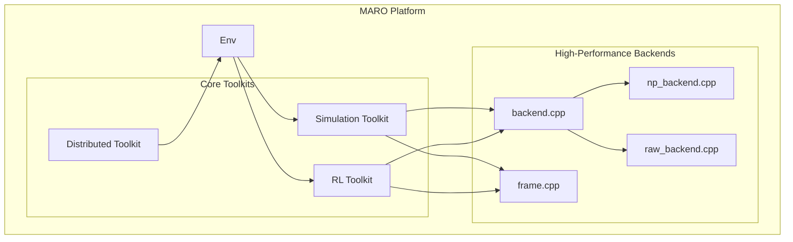

**Sources:** [README.md:41-48](), [setup.py:45-83]()

### Simulation Toolkit

The simulation toolkit provides predefined scenarios and reusable components for building new environments. The main entry point is the `Env` class which serves as the primary interface for all simulations.

| Component | Purpose | Code Location |
|-----------|---------|---------------|
| **Env Class** | Main simulation interface | `maro.simulator.Env` |
| **Business Engines** | Scenario-specific logic | `maro.simulator.scenarios` |
| **Event Buffer** | Event management system | Core simulation engine |
| **Data Model** | State representation | Frame system |

```mermaid
graph LR
    subgraph "Simulation Flow"
        ENV["Env"]
        BE["BusinessEngine"]
        EB["EventBuffer"]
        FRAME["Frame"]
    end
    
    subgraph "Scenarios"
        CIM["CIM"]
        CITIBIKE["CitiBike"]
        VM["VMScheduling"]
    end
    
    ENV --> BE
    BE --> EB
    BE --> FRAME
    BE <|-- CIM
    BE <|-- CITIBIKE
    BE <|-- VM
```

**Sources:** [README.md:43-44](), [setup.py:165-167](), [docs/source/index.rst:34-40]()

### RL Toolkit

The RL toolkit provides a full-stack abstraction for reinforcement learning, including agent management, algorithms, and various training components.

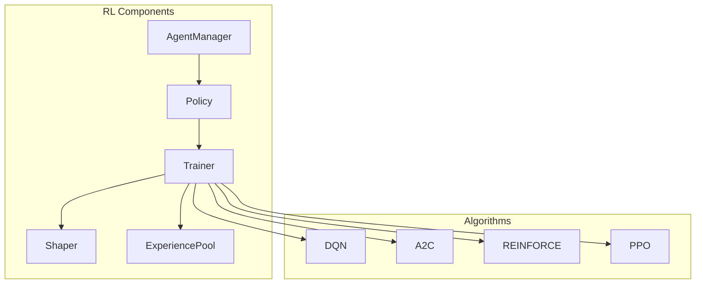

**Sources:** [README.md:45-46](), [docs/source/index.rst:25-26]()

### Distributed Toolkit

The distributed toolkit enables cluster provisioning, job orchestration, and distributed communication across multiple deployment targets.

| Deployment Type | Technology | CLI Command |
|-----------------|------------|-------------|
| **Azure VMs** | GraSS | `maro grass` |
| **Kubernetes** | AKS | `maro k8s`, `maro aks` |
| **Local** | Multi-process | `maro local` |

**Sources:** [README.md:47-48](), [setup.py:158-160]()

## Main Components and Code Entities

### Environment Interface

The `Env` class in `maro.simulator` serves as the primary interface for all MARO simulations:

```python
from maro.simulator import Env

env = Env(scenario="cim", topology="toy.5p_ssddd_l0.0", start_tick=0, durations=100)
metrics, decision_event, is_done = env.step(None)
```

**Sources:** [README.md:152-164](), [docs/source/index.rst:34-63]()

### High-Performance Backends

MARO uses C++ extensions for performance-critical operations:

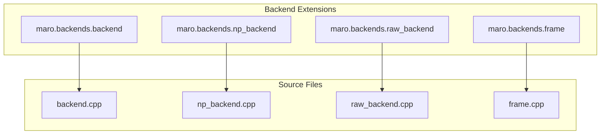

**Sources:** [setup.py:45-83](), [setup.py:28-31]()

### CLI Interface

The command-line interface provides comprehensive management capabilities:

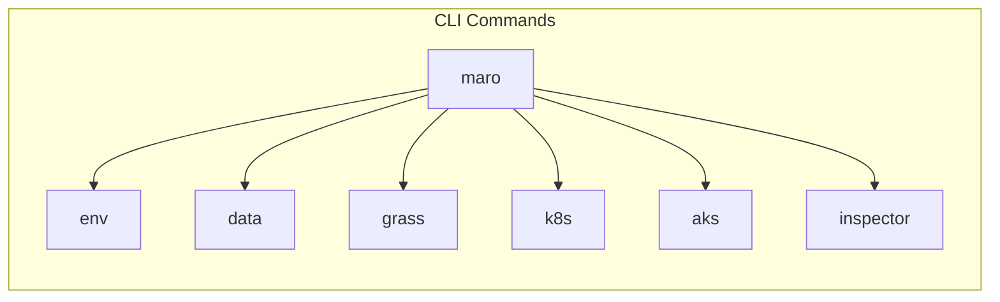

**Sources:** [setup.py:158-160]()

## Package Structure

The platform is distributed as the `pymaro` package with the following structure:

| Directory | Purpose |
|-----------|---------|
| `maro/` | Main source code |
| `docs/` | Documentation |
| `examples/` | Usage examples |
| `notebooks/` | Jupyter notebooks |

**Sources:** [README.md:54-59](), [setup.py:162]()

## Installation and Distribution

MARO supports multiple installation methods:

- **PyPI Package:** `pip install pymaro` (core functionality)
- **Source Installation:** Full CLI and visualization support
- **Docker Images:** `maro2020/maro` and `maro2020/playground`

The build system compiles C++ extensions using platform-specific compilers and supports cross-platform wheel distribution.

**Sources:** [README.md:63-81](), [setup.py:20-26](), [setup.py:87-106]()

## Quick Start

The basic usage pattern involves creating an environment and stepping through the simulation:

```python
from maro.simulator import Env

# Initialize environment
env = Env(scenario="cim", topology="toy.5p_ssddd_l0.0", start_tick=0, durations=100)

# Simulation loop
metrics, decision_event, is_done = env.step(None)
while not is_done:
    metrics, decision_event, is_done = env.step(None)

print(f"environment metrics: {env.metrics}")
```

For visualization and analysis:

```bash
# Enable data dumping
env = Env(scenario="cim", topology="toy.5p_ssddd_l0.0", 
          options={"enable-dump-snapshot": "./dump_data"})

# Launch dashboard
maro inspector dashboard --source_path ./dump_data/YOUR_SNAPSHOT_DUMP_FOLDER
```

**Sources:** [README.md:152-178](), [docs/source/index.rst:32-63]()

---

# Page: Core Architecture

# Core Architecture

<details>
<summary>Relevant source files</summary>

The following files were used as context for generating this wiki page:

- [LICENSE](LICENSE)
- [README.md](README.md)
- [docs/source/images/logo.svg](docs/source/images/logo.svg)
- [docs/source/images/maro_overview.svg](docs/source/images/maro_overview.svg)
- [docs/source/images/visualization/geographic/real_time_mode.gif](docs/source/images/visualization/geographic/real_time_mode.gif)
- [docs/source/index.rst](docs/source/index.rst)
- [maro/README.rst](maro/README.rst)
- [maro/simulator/abs_core.py](maro/simulator/abs_core.py)
- [maro/simulator/core.py](maro/simulator/core.py)
- [maro/simulator/scenarios/abs_business_engine.py](maro/simulator/scenarios/abs_business_engine.py)
- [maro/simulator/scenarios/cim/business_engine.py](maro/simulator/scenarios/cim/business_engine.py)
- [maro/simulator/scenarios/citi_bike/business_engine.py](maro/simulator/scenarios/citi_bike/business_engine.py)
- [maro/simulator/scenarios/citi_bike/station.py](maro/simulator/scenarios/citi_bike/station.py)
- [setup.py](setup.py)

</details>


This document provides a comprehensive overview of MARO's fundamental architectural components and their interactions. It covers the core design patterns, key abstractions, and integration points that enable MARO's three primary capabilities: simulation, reinforcement learning, and distributed execution.

For specific implementation details of the simulation engine, see [Simulation Framework](#2.1). For RL-specific components, see [Reinforcement Learning Framework](#2.2). For performance-critical data operations, see [High-Performance Data Backends](#2.3).

## Architectural Overview

MARO follows a layered architecture centered around the `Env` class, which serves as the primary interface between users and the simulation system. The architecture is built on several key design patterns:

- **Event-driven simulation** with centralized event processing
- **Pluggable business engines** for different scenarios
- **High-performance data backends** using C++ extensions
- **Snapshot-based state management** for time-series data access

### Core Architecture Diagram

```mermaid
graph TB
    subgraph "User Interface Layer"
        Env["Env<br/>(maro.simulator.core)"]
        CLI["maro CLI<br/>(maro.cli.maro)"]
    end
    
    subgraph "Simulation Core"
        BE["AbsBusinessEngine<br/>(abs_business_engine.py)"]
        EB["EventBuffer<br/>(maro.event_buffer)"]
        Frame["FrameBase<br/>(maro.backends.frame)"]
    end
    
    subgraph "Business Engines"
        CIM["CimBusinessEngine<br/>(cim/business_engine.py)"]
        CitiBike["CitibikeBusinessEngine<br/>(citi_bike/business_engine.py)"]
        VM["VmSchedulingEngine<br/>(vm_scheduling/business_engine.py)"]
    end
    
    subgraph "Data Backends"
        RawBackend["RawBackend<br/>(backends/raw_backend.cpp)"]
        NpBackend["NumpyBackend<br/>(backends/np_backend.cpp)"]
        Snapshots["SnapshotList<br/>(backends/frame)"]
    end
    
    subgraph "RL Components"
        Policy["Policy Classes<br/>(maro.rl)"]
        Trainer["Trainer Classes<br/>(maro.rl)"]
        Sampler["EnvSampler<br/>(maro.rl)"]
    end
    
    Env --> BE
    Env --> EB
    Env --> Frame
    BE <|-- CIM
    BE <|-- CitiBike
    BE <|-- VM
    Frame --> RawBackend
    Frame --> NpBackend
    Frame --> Snapshots
    Sampler --> Env
    Policy --> Env
    Trainer --> Policy
    CLI --> Env
```

**Sources:** [maro/simulator/core.py:20-382](), [maro/simulator/scenarios/abs_business_engine.py:14-236](), [setup.py:45-83]()

## Core Components

### Environment (Env)

The `Env` class in [maro/simulator/core.py:20-382]() serves as the primary simulation interface, implementing the `AbsEnv` abstract base class from [maro/simulator/abs_core.py:25-177](). It orchestrates all simulation components and provides the main `step()` method for simulation execution.

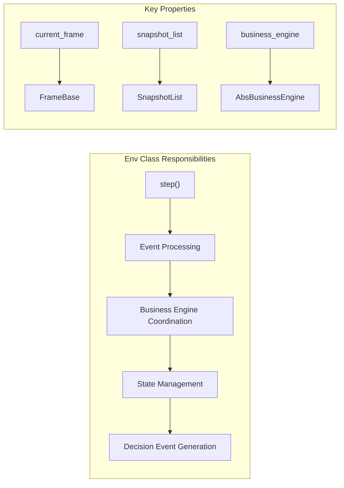

**Sources:** [maro/simulator/core.py:92-133](), [maro/simulator/abs_core.py:74-176]()

### Business Engine Abstraction

The `AbsBusinessEngine` class in [maro/simulator/scenarios/abs_business_engine.py:14-236]() defines the interface that all scenario implementations must follow. This abstraction enables MARO to support multiple simulation scenarios through a common interface.

| Method | Purpose | Called By |
|--------|---------|-----------|
| `step(tick)` | Execute scenario logic for current tick | `Env._simulate()` |
| `post_step(tick)` | Post-process after tick completion | `Env._simulate()` |
| `reset()` | Reset scenario state | `Env.reset()` |
| `get_metrics()` | Return scenario metrics | `Env.step()` |

**Key Business Engine Implementations:**

- **CimBusinessEngine** [maro/simulator/scenarios/cim/business_engine.py:37-831]() - Container inventory management
- **CitibikeBusinessEngine** [maro/simulator/scenarios/citi_bike/business_engine.py:46-602]() - Bike repositioning
- **VmSchedulingBusinessEngine** - Virtual machine resource allocation

**Sources:** [maro/simulator/scenarios/abs_business_engine.py:14-236](), [maro/simulator/scenarios/cim/business_engine.py:37-831]()

## Event-Driven Architecture

MARO implements a sophisticated event-driven simulation pattern where all state changes occur through events processed by the `EventBuffer`. This design ensures deterministic simulation execution and enables complex temporal dependencies.

### Event Processing Flow

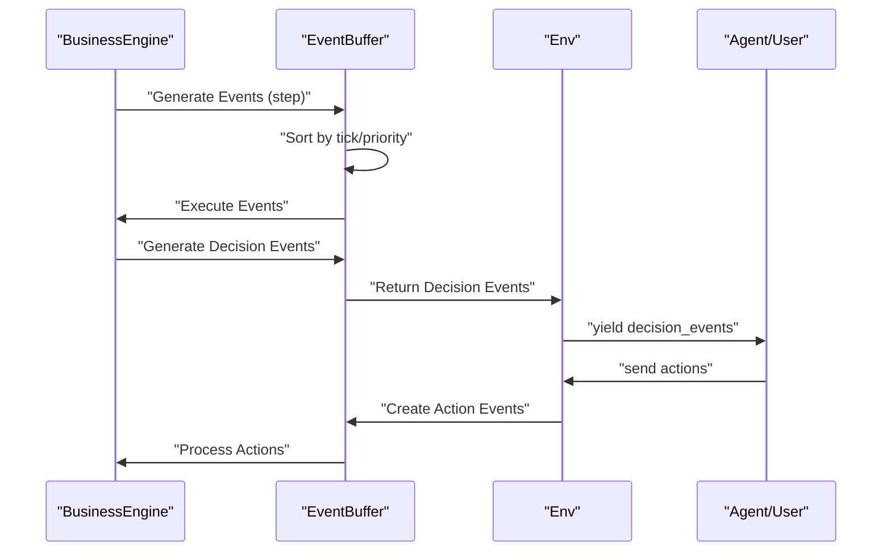

**Event Types:**
- **Atom Events** - Single-step events with immediate execution
- **Cascade Events** - Events that can spawn child events
- **Decision Events** - Special events that require agent input

**Sources:** [maro/simulator/core.py:336-381](), [maro/simulator/scenarios/cim/business_engine.py:358-370]()

## Data Management Architecture

MARO's data management is built around a frame-based system that provides efficient storage and time-series access to simulation state.

### Frame and Snapshot System

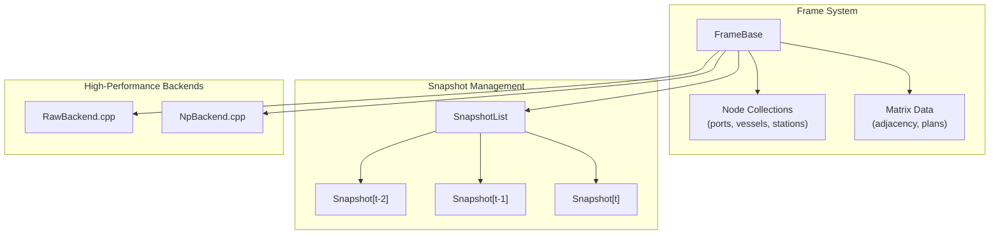

**Key Features:**
- **Snapshot Resolution** - Configurable frequency of state snapshots
- **Memory Management** - Automatic cleanup of old snapshots based on `max_snapshots`
- **Time-Series Access** - Query historical states at any snapshot point
- **High-Performance Storage** - C++ backends for memory-efficient operations

**Sources:** [maro/simulator/core.py:207-212](), [setup.py:75-83](), [maro/simulator/scenarios/abs_business_engine.py:115-129]()

## High-Performance Data Backends

MARO leverages C++ extensions for performance-critical data operations, compiled through Cython as defined in [setup.py:45-83]().

### Backend Architecture

| Backend | Purpose | Implementation |
|---------|---------|----------------|
| `RawBackend` | Low-level memory operations | [maro/backends/raw_backend.cpp]() |
| `NumpyBackend` | NumPy integration | [maro/backends/np_backend.cpp]() |
| `Frame` | Data structure management | [maro/backends/frame.cpp]() |

These backends provide:
- **Memory-efficient storage** for large-scale simulations
- **Fast data access** for time-series operations  
- **NumPy compatibility** for scientific computing workflows
- **Cross-platform compilation** with optimized C++ code

**Sources:** [setup.py:45-83](), [setup.py:153-156]()

## Integration and Extensibility

### Scenario Development Pattern

MARO's architecture supports easy extension through the business engine pattern:

1. **Inherit from AbsBusinessEngine** - Implement required abstract methods
2. **Define Frame Structure** - Create nodes and matrices for state representation
3. **Implement Event Handlers** - Register callbacks for event processing
4. **Configure Topology** - Define scenario-specific parameters

### Cross-Component Communication

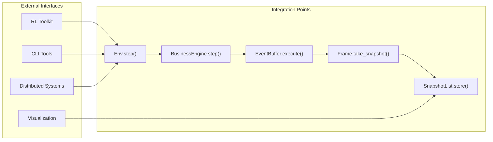

The architecture's loose coupling enables:
- **RL Framework Integration** - Seamless connection to training algorithms
- **Distributed Execution** - Cluster deployment through CLI tools
- **Visualization Support** - Dashboard and geographic visualization
- **Custom Extensions** - User-defined scenarios and business logic

**Sources:** [maro/simulator/core.py:92-133](), [maro/simulator/scenarios/abs_business_engine.py:166-201](), [setup.py:157-161]()

---

# Page: Simulation Framework

# Simulation Framework

<details>
<summary>Relevant source files</summary>

The following files were used as context for generating this wiki page:

- [examples/citi_bike/online_lp/launcher.py](examples/citi_bike/online_lp/launcher.py)
- [maro/event_buffer/__init__.py](maro/event_buffer/__init__.py)
- [maro/event_buffer/event.py](maro/event_buffer/event.py)
- [maro/event_buffer/event_linked_list.py](maro/event_buffer/event_linked_list.py)
- [maro/event_buffer/event_pool.py](maro/event_buffer/event_pool.py)
- [maro/simulator/abs_core.py](maro/simulator/abs_core.py)
- [maro/simulator/core.py](maro/simulator/core.py)
- [maro/simulator/scenarios/abs_business_engine.py](maro/simulator/scenarios/abs_business_engine.py)
- [maro/simulator/scenarios/cim/business_engine.py](maro/simulator/scenarios/cim/business_engine.py)
- [maro/simulator/scenarios/citi_bike/business_engine.py](maro/simulator/scenarios/citi_bike/business_engine.py)
- [maro/simulator/scenarios/citi_bike/station.py](maro/simulator/scenarios/citi_bike/station.py)
- [tests/test_event_buffer.py](tests/test_event_buffer.py)

</details>


The simulation framework forms the core engine that powers all MARO simulation scenarios. It provides an event-driven simulation environment where business logic is encapsulated in pluggable business engines, and simulation state is managed through a unified interface.

For information about the high-performance data storage that underlies this framework, see [High-Performance Data Backends](#2.3). For details about specific simulation scenarios, see [Simulation Scenarios](#3).

## Core Architecture

The simulation framework is built around the `Env` class, which serves as the main entry point for all simulations. It orchestrates the interaction between business engines, event processing, and state management through a standardized interface.

### Simulation Loop Architecture

```mermaid
graph TD
    subgraph "Main Simulation Loop"
        ENV["Env class<br/>maro.simulator.core.Env"]
        SIMGEN["_simulate() generator<br/>maro/simulator/core.py:317-381"]
    end
    
    subgraph "Business Logic Layer"
        ABE["AbsBusinessEngine<br/>Abstract Base Class"]
        CIM["CimBusinessEngine<br/>Container Management"]
        CITI["CitibikeBusinessEngine<br/>Bike Repositioning"]
        VM["VMBusinessEngine<br/>VM Scheduling"]
    end
    
    subgraph "Event Processing"
        EB["EventBuffer<br/>maro.event_buffer.EventBuffer"]
        EVTS["Events Processing<br/>execute() method"]
        DECISION["Decision Events<br/>PENDING_DECISION"]
    end
    
    subgraph "State Management"
        FRAME["FrameBase<br/>State Container"]
        SNAP["SnapshotList<br/>Historical States"]
    end
    
    ENV --> SIMGEN
    SIMGEN --> ABE
    ABE <|-- CIM
    ABE <|-- CITI
    ABE <|-- VM
    
    SIMGEN --> EB
    EB --> EVTS
    EVTS --> DECISION
    
    ABE --> FRAME
    FRAME --> SNAP
    
    DECISION -.->|"Actions"| SIMGEN
    SIMGEN -.->|"Metrics"| ENV
```

**Core Simulation Loop Flow**

The simulation operates through a generator-based loop that processes events and manages state transitions:

Sources: [maro/simulator/core.py:317-381](), [maro/simulator/abs_core.py:25-177]()

### Business Engine Integration

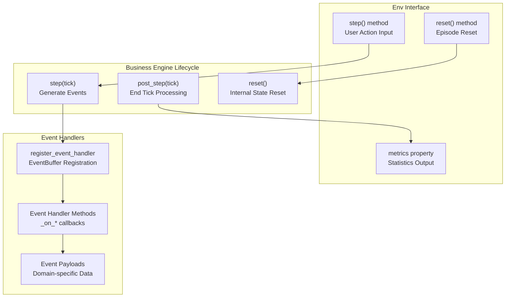

**Business Engine Responsibilities**

Each business engine implements scenario-specific logic while conforming to the `AbsBusinessEngine` interface:

| Method | Purpose | Implementation Example |
|--------|---------|----------------------|
| `step(tick)` | Generate events for current tick | [maro/simulator/scenarios/cim/business_engine.py:122-199]() |
| `post_step(tick)` | End-of-tick processing and metrics | [maro/simulator/scenarios/cim/business_engine.py:201-224]() |
| `reset()` | Reset simulation state | [maro/simulator/scenarios/cim/business_engine.py:226-242]() |
| Event handlers | Process domain events | [maro/simulator/scenarios/cim/business_engine.py:358-831]() |

Sources: [maro/simulator/scenarios/abs_business_engine.py:14-236](), [maro/simulator/scenarios/cim/business_engine.py:37-831]()

## Event-Driven Simulation Model

The framework uses an event-driven architecture where simulation progression is controlled by discrete events that trigger business logic and state changes.

### Event Types and Processing

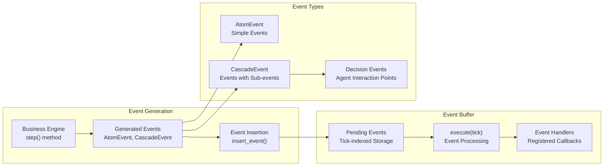

**Event Processing Flow**

1. **Event Generation**: Business engines create events during their `step()` method
2. **Event Buffering**: Events are stored in tick-indexed collections within `EventBuffer`
3. **Event Execution**: The simulation loop processes all events for the current tick
4. **Handler Dispatch**: Events trigger registered callback methods in business engines

Sources: [maro/event_buffer/event_buffer.py](), [tests/test_event_buffer.py:15-337]()

### Decision Events and Agent Interaction

Decision events represent points where external agents can influence the simulation through actions.

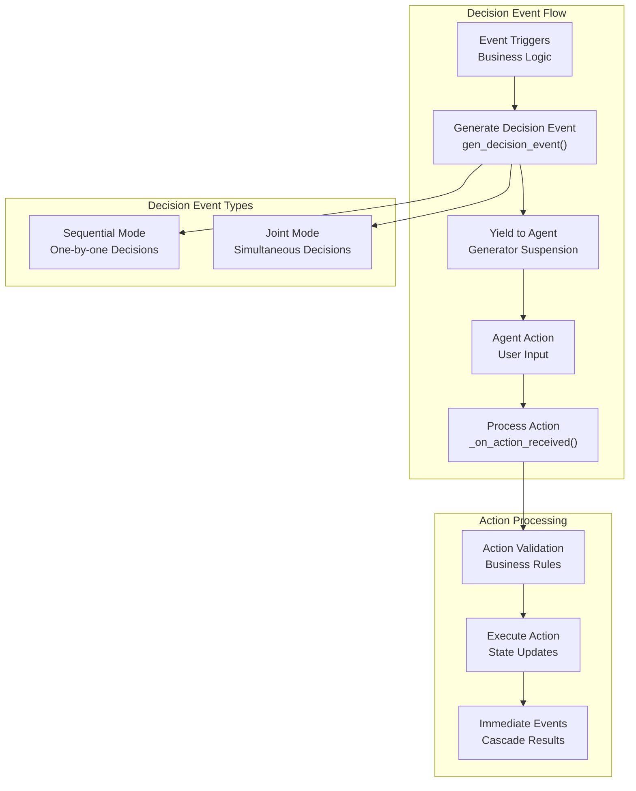

The framework supports two decision modes:
- **Sequential**: Agents make decisions one at a time
- **Joint**: Multiple agents make simultaneous decisions

Sources: [maro/simulator/core.py:301-381](), [maro/simulator/abs_core.py:14-23]()

## Key Classes and Components

### Env Class - Main Interface

The `Env` class provides the primary interface for simulation control and follows a standard reinforcement learning environment pattern.

**Core Methods:**
- `step(action)` - Advance simulation by one decision point
- `reset()` - Reset simulation to initial state  
- `set_seed(seed)` - Control randomness for reproducibility

**Key Properties:**
- `tick` - Current simulation time
- `metrics` - Performance statistics
- `snapshot_list` - Historical state data
- `agent_idx_list` - Available agent identifiers

Sources: [maro/simulator/core.py:20-382]()

### AbsBusinessEngine - Scenario Interface

The abstract business engine defines the contract that all scenario implementations must follow.

**Required Methods:**
- `step(tick)` - Generate events for the current tick
- `frame` property - Access to state data structure
- `snapshots` property - Access to historical snapshots
- `get_agent_idx_list()` - Return available agent identifiers

**Lifecycle Hooks:**
- `post_step(tick)` - End-of-tick processing
- `reset()` - Reset internal state
- `get_metrics()` - Return performance statistics

Sources: [maro/simulator/scenarios/abs_business_engine.py:14-236]()

### Business Engine Examples

#### CIM Business Engine

The Container Inventory Management engine demonstrates complex event-driven logistics simulation:

**Key Event Types:**
- `ORDER` - Customer container requests
- `VESSEL_ARRIVAL` - Ship arrival at ports
- `LOAD_FULL` - Container loading operations
- `DISCHARGE_FULL` - Container discharge operations

**State Management:**
- Port inventory tracking
- Vessel routing and capacity
- Order fulfillment metrics

Sources: [maro/simulator/scenarios/cim/business_engine.py:37-831]()

#### CitiBike Business Engine

The bike-sharing scenario shows real-time demand-supply simulation:

**Key Features:**
- Trip demand generation from historical data
- Station capacity constraints
- Weather and temporal feature integration
- Dynamic rebalancing decisions

Sources: [maro/simulator/scenarios/citi_bike/business_engine.py:46-602]()

## Integration with Other Systems

The simulation framework integrates with several other MARO components:

- **RL Toolkit**: Decision events serve as observation/action points for reinforcement learning agents
- **Data Backends**: Frame system provides high-performance state storage and querying
- **CLI Tools**: Environment management and execution through command-line interface
- **Visualization**: Real-time monitoring and post-simulation analysis

The framework's modular design allows new scenarios to be implemented by extending `AbsBusinessEngine` while leveraging the common event processing and state management infrastructure.

Sources: [maro/simulator/core.py:1-382](), [maro/simulator/scenarios/abs_business_engine.py:1-236](), [maro/event_buffer/__init__.py:1-18]()

---

# Page: Reinforcement Learning Framework

# Reinforcement Learning Framework

<details>
<summary>Relevant source files</summary>

The following files were used as context for generating this wiki page:

- [examples/cim/rl/algorithms/dqn.py](examples/cim/rl/algorithms/dqn.py)
- [examples/vm_scheduling/rl/algorithms/dqn.py](examples/vm_scheduling/rl/algorithms/dqn.py)
- [maro/__misc__.py](maro/__misc__.py)
- [maro/rl/__init__.py](maro/rl/__init__.py)
- [maro/rl/model/fc_block.py](maro/rl/model/fc_block.py)
- [maro/rl/policy/discrete_rl_policy.py](maro/rl/policy/discrete_rl_policy.py)
- [maro/rl/rollout/env_sampler.py](maro/rl/rollout/env_sampler.py)
- [maro/rl/training/algorithms/ddpg.py](maro/rl/training/algorithms/ddpg.py)
- [maro/rl/training/algorithms/sac.py](maro/rl/training/algorithms/sac.py)
- [maro/rl/training/replay_memory.py](maro/rl/training/replay_memory.py)
- [maro/rl/training/trainer.py](maro/rl/training/trainer.py)
- [maro/utils/exception/rl_toolkit_exception.py](maro/utils/exception/rl_toolkit_exception.py)
- [tests/rl/gym_wrapper/common.py](tests/rl/gym_wrapper/common.py)

</details>


## Purpose and Scope

The Reinforcement Learning (RL) Framework provides a comprehensive toolkit for training RL agents within MARO environments. This framework handles the complete RL pipeline from policy definition and environment interaction to algorithm implementation and distributed training. For information about the simulation environments that RL agents interact with, see [Simulation Framework](#2.1). For details on deploying RL training at scale, see [Cluster Management](#5.1).

The framework is designed around modular components that can be combined to create custom RL solutions for various scenarios like container inventory management, VM scheduling, and other optimization problems supported by MARO.

## Core Components Overview

The RL framework consists of four main architectural layers that work together to provide end-to-end RL training capabilities:

### RL Framework Architecture

```mermaid
graph TB
    subgraph "Environment Interface Layer"
        AbsEnvSampler["AbsEnvSampler<br/>Base Environment Sampler"]
        SimpleAgentWrapper["SimpleAgentWrapper<br/>Policy Coordination"]
        ExpElement["ExpElement<br/>Experience Storage"]
    end
    
    subgraph "Policy Layer"
        AbsPolicy["AbsPolicy<br/>Base Policy Interface"]
        DiscreteRLPolicy["DiscreteRLPolicy<br/>Discrete Action Policies"] 
        ValueBasedPolicy["ValueBasedPolicy<br/>Q-Value Based Policies"]
        DiscretePolicyGradient["DiscretePolicyGradient<br/>Policy Gradient Methods"]
    end
    
    subgraph "Training Layer" 
        AbsTrainer["AbsTrainer<br/>Base Trainer Interface"]
        SingleAgentTrainer["SingleAgentTrainer<br/>Single Policy Training"]
        MultiAgentTrainer["MultiAgentTrainer<br/>Multi-Policy Training"]
        AbsTrainOps["AbsTrainOps<br/>Training Operations"]
    end
    
    subgraph "Algorithm Layer"
        DQNTrainer["DQNTrainer<br/>Deep Q-Network"]
        DDPGOps["DDPGOps<br/>Deep Deterministic Policy Gradient"]
        SoftActorCriticOps["SoftActorCriticOps<br/>Soft Actor-Critic"]
        ReplayMemory["ReplayMemory<br/>Experience Replay"]
    end
    
    AbsEnvSampler --> SimpleAgentWrapper
    SimpleAgentWrapper --> AbsPolicy
    AbsPolicy <|-- DiscreteRLPolicy
    DiscreteRLPolicy <|-- ValueBasedPolicy
    DiscreteRLPolicy <|-- DiscretePolicyGradient
    
    AbsTrainer <|-- SingleAgentTrainer
    AbsTrainer <|-- MultiAgentTrainer
    SingleAgentTrainer --> AbsTrainOps
    AbsTrainOps <|-- DDPGOps
    AbsTrainOps <|-- SoftActorCriticOps
    DQNTrainer --|> SingleAgentTrainer
    
    AbsTrainOps --> ReplayMemory
    ExpElement --> ReplayMemory
```

**Sources:** [maro/rl/rollout/env_sampler.py:21-92](), [maro/rl/policy/discrete_rl_policy.py:17-48](), [maro/rl/training/trainer.py:28-153](), [maro/rl/training/algorithms/sac.py:28-73](), [maro/rl/training/algorithms/ddpg.py:42-73]()

## Policy Architecture

### Policy Hierarchy and Types

The policy system is built around a hierarchical class structure that supports both discrete and continuous action spaces:

```mermaid
graph TD
    AbsPolicy["AbsPolicy<br/>Abstract Base Policy"]
    RLPolicy["RLPolicy<br/>Reinforcement Learning Policy"]
    DiscreteRLPolicy["DiscreteRLPolicy<br/>Discrete Action Space"]
    ContinuousRLPolicy["ContinuousRLPolicy<br/>Continuous Action Space"]
    
    ValueBasedPolicy["ValueBasedPolicy<br/>Q-Value Based Learning"]
    DiscretePolicyGradient["DiscretePolicyGradient<br/>Policy Gradient Methods"]
    
    DiscreteQNet["DiscreteQNet<br/>Q-Network Model"]
    DiscretePolicyNet["DiscretePolicyNet<br/>Policy Network Model"]
    ExploreStrategy["ExploreStrategy<br/>Exploration Strategy"]
    
    AbsPolicy <|-- RLPolicy
    RLPolicy <|-- DiscreteRLPolicy
    RLPolicy <|-- ContinuousRLPolicy
    DiscreteRLPolicy <|-- ValueBasedPolicy
    DiscreteRLPolicy <|-- DiscretePolicyGradient
    
    ValueBasedPolicy --> DiscreteQNet
    ValueBasedPolicy --> ExploreStrategy
    DiscretePolicyGradient --> DiscretePolicyNet
```

**Sources:** [maro/rl/policy/discrete_rl_policy.py:17-48](), [maro/rl/policy/discrete_rl_policy.py:64-96](), [maro/rl/policy/discrete_rl_policy.py:239-267]()

### Policy Implementation Details

| Component | Purpose | Key Methods |
|-----------|---------|-------------|
| `DiscreteRLPolicy` | Base class for discrete action policies | `get_actions()`, `_get_random_actions_impl()` |
| `ValueBasedPolicy` | Q-value based decision making | `q_values_for_all_actions()`, `q_values()` |
| `DiscretePolicyGradient` | Direct policy optimization | `get_action_probs()`, `get_action_logps()` |

The `ValueBasedPolicy` class implements Q-learning approaches where actions are selected based on Q-value estimates. It uses a `DiscreteQNet` for value function approximation and supports exploration strategies like epsilon-greedy through the `ExploreStrategy` interface.

**Sources:** [maro/rl/policy/discrete_rl_policy.py:64-96](), [maro/rl/policy/discrete_rl_policy.py:168-194]()

## Training System

### Trainer Architecture

The training system is organized around trainer classes that coordinate policy updates and experience collection:

```mermaid
graph TB
    subgraph "Trainer Layer"
        AbsTrainer["AbsTrainer<br/>Base Trainer Interface"]
        SingleAgentTrainer["SingleAgentTrainer<br/>Single Policy Training"]
        MultiAgentTrainer["MultiAgentTrainer<br/>Multiple Policy Training"]
    end
    
    subgraph "Training Operations"
        AbsTrainOps["AbsTrainOps<br/>Training Logic"]
        RemoteOps["RemoteOps<br/>Distributed Training"]
        LocalOps["LocalOps<br/>Local Training"]
    end
    
    subgraph "Memory Management"
        ReplayMemory["ReplayMemory<br/>Experience Storage"]
        RandomReplayMemory["RandomReplayMemory<br/>Random Sampling"]
        PrioritizedReplayMemory["PrioritizedReplayMemory<br/>Priority Sampling"]
        FIFOReplayMemory["FIFOReplayMemory<br/>FIFO Sampling"]
    end
    
    subgraph "Experience Data"
        TransitionBatch["TransitionBatch<br/>Batch of Transitions"]
        ExpElement["ExpElement<br/>Single Experience"]
    end
    
    AbsTrainer <|-- SingleAgentTrainer
    AbsTrainer <|-- MultiAgentTrainer
    SingleAgentTrainer --> AbsTrainOps
    AbsTrainOps <|-- RemoteOps
    AbsTrainOps <|-- LocalOps
    
    ReplayMemory <|-- RandomReplayMemory
    ReplayMemory <|-- PrioritizedReplayMemory  
    ReplayMemory <|-- FIFOReplayMemory
    AbsTrainOps --> ReplayMemory
    
    ExpElement --> TransitionBatch
    TransitionBatch --> ReplayMemory
```

**Sources:** [maro/rl/training/trainer.py:28-153](), [maro/rl/training/trainer.py:155-194](), [maro/rl/training/replay_memory.py:233-273]()

### Training Process Flow

The training process follows a structured pipeline:

1. **Experience Collection**: `AbsEnvSampler` collects experiences from environment interactions
2. **Memory Storage**: Experiences are stored in `ReplayMemory` using various sampling strategies
3. **Batch Sampling**: Training batches are sampled from memory for policy updates
4. **Policy Updates**: `AbsTrainOps` implementations perform algorithm-specific updates

The `SingleAgentTrainer` class coordinates this process for individual policies, while `MultiAgentTrainer` handles scenarios with multiple interacting policies.

**Sources:** [maro/rl/training/trainer.py:247-272](), [maro/rl/training/trainer.py:155-194]()

## Environment Sampling

### Environment Sampler Architecture

The environment sampling system bridges MARO simulation environments with RL training:

```mermaid
graph TB
    subgraph "Environment Interface"
        AbsEnvSampler["AbsEnvSampler<br/>Base Environment Sampler"]
        learn_env["learn_env<br/>Training Environment"]
        test_env["test_env<br/>Testing Environment"]
    end
    
    subgraph "Agent Management"
        AbsAgentWrapper["AbsAgentWrapper<br/>Agent Coordination"]
        SimpleAgentWrapper["SimpleAgentWrapper<br/>Basic Implementation"]
        agent2policy["agent2policy<br/>Agent-Policy Mapping"]
    end
    
    subgraph "Experience Processing"
        ExpElement["ExpElement<br/>Experience Container"]
        CacheElement["CacheElement<br/>Cached Experience"]
        reward_eval_delay["reward_eval_delay<br/>Delayed Reward Calculation"]
    end
    
    subgraph "Data Flow"
        state_by_agent["state_by_agent<br/>Agent States"]
        action_dict["action_dict<br/>Agent Actions"]
        reward_dict["reward_dict<br/>Agent Rewards"]
        env_action_dict["env_action_dict<br/>Environment Actions"]
    end
    
    AbsEnvSampler --> learn_env
    AbsEnvSampler --> test_env
    AbsEnvSampler --> AbsAgentWrapper
    AbsAgentWrapper <|-- SimpleAgentWrapper
    SimpleAgentWrapper --> agent2policy
    
    state_by_agent --> action_dict
    action_dict --> env_action_dict
    env_action_dict --> reward_dict
    
    ExpElement --> CacheElement
    reward_eval_delay --> CacheElement
```

**Sources:** [maro/rl/rollout/env_sampler.py:238-310](), [maro/rl/rollout/env_sampler.py:93-138](), [maro/rl/rollout/env_sampler.py:140-180]()

### Sampling Methods

| Method | Purpose | Key Parameters |
|--------|---------|----------------|
| `sample()` | Collect training experiences | `policy_state`, `num_steps` |
| `eval()` | Evaluate policy performance | `policy_state`, `num_episodes` |
| `_get_global_and_agent_state()` | Extract observation states | `event`, `tick` |
| `_translate_to_env_action()` | Convert policy actions to environment actions | `action_dict`, `event` |

The `AbsEnvSampler` class provides abstract methods that must be implemented for specific environments. The `sample()` method runs the main experience collection loop, while `eval()` assesses policy performance without exploration.

**Sources:** [maro/rl/rollout/env_sampler.py:438-537](), [maro/rl/rollout/env_sampler.py:561-611]()

## Algorithms and Models

### Implemented RL Algorithms

The framework includes several state-of-the-art RL algorithms:

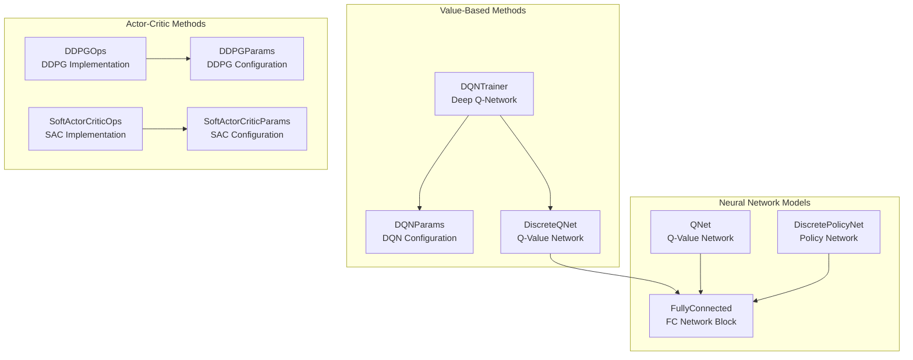

**Sources:** [maro/rl/training/algorithms/sac.py:16-26](), [maro/rl/training/algorithms/ddpg.py:16-40](), [maro/rl/model/fc_block.py:11-52]()

### Algorithm Implementations

#### Soft Actor-Critic (SAC)
The `SoftActorCriticOps` class implements the SAC algorithm for continuous control:

- **Critic Update**: Uses twin Q-networks to reduce overestimation bias
- **Actor Update**: Maximizes expected reward while maintaining entropy
- **Target Networks**: Soft updates for stable training

Key methods include `update_critic()`, `update_actor()`, and `soft_update_target()`.

#### Deep Deterministic Policy Gradient (DDPG)
The `DDPGOps` class provides DDPG implementation:

- **Deterministic Policy**: Direct action prediction without stochasticity
- **Experience Replay**: Off-policy learning from stored experiences  
- **Target Networks**: Separate target networks for stable Q-learning

**Sources:** [maro/rl/training/algorithms/sac.py:59-114](), [maro/rl/training/algorithms/ddpg.py:74-136]()

### Neural Network Components

The `FullyConnected` class provides flexible neural network building blocks:

| Parameter | Purpose | Default |
|-----------|---------|---------|
| `hidden_dims` | Layer dimensions | `[]` |
| `activation` | Activation function | `None` |
| `batch_norm` | Batch normalization | `False` |
| `dropout_p` | Dropout probability | `None` |
| `skip_connection` | Residual connections | `False` |

**Sources:** [maro/rl/model/fc_block.py:37-94]()

## Integration with Simulation Framework

The RL framework integrates seamlessly with MARO's simulation environments through standardized interfaces:

### Environment Integration Points

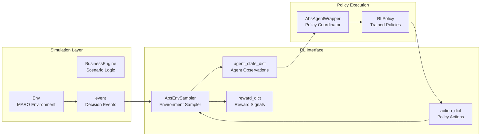

**Sources:** [maro/rl/rollout/env_sampler.py:254-265](), [maro/rl/rollout/env_sampler.py:326-348]()

The integration requires implementing environment-specific methods in `AbsEnvSampler` subclasses:

- `_get_global_and_agent_state_impl()`: Extract observations from simulation state
- `_translate_to_env_action()`: Convert policy outputs to environment actions  
- `_get_reward()`: Calculate reward signals based on environment feedback

This design allows the same RL algorithms to work across different MARO scenarios like CIM, VM scheduling, and Citi Bike repositioning with minimal code changes.

**Sources:** [maro/rl/rollout/env_sampler.py:350-388]()

---

# Page: High-Performance Data Backends

# High-Performance Data Backends

<details>
<summary>Relevant source files</summary>

The following files were used as context for generating this wiki page:

- [.gitignore](.gitignore)
- [maro/backends/backend.pxd](maro/backends/backend.pxd)
- [maro/backends/np_backend.pyx](maro/backends/np_backend.pyx)
- [maro/backends/raw/attribute.cpp](maro/backends/raw/attribute.cpp)
- [maro/backends/raw/common.h](maro/backends/raw/common.h)
- [maro/backends/raw/test/README.md](maro/backends/raw/test/README.md)
- [maro/backends/raw/test/main.cpp](maro/backends/raw/test/main.cpp)
- [maro/backends/raw/test/test_attribute.cpp](maro/backends/raw/test/test_attribute.cpp)
- [maro/backends/raw/test/test_frame.cpp](maro/backends/raw/test/test_frame.cpp)
- [maro/backends/raw/xmake.lua](maro/backends/raw/xmake.lua)
- [maro/backends/raw_backend.pyx](maro/backends/raw_backend.pyx)

</details>


The high-performance data backends provide the foundational data storage and access layer for MARO's simulation framework. These backends are designed to handle large-scale state management, historical data snapshots, and high-frequency data operations with optimal performance characteristics.

This document covers the backend architecture, data models, and performance optimizations. For information about the simulation framework that uses these backends, see [Simulation Framework](#2.1). For reinforcement learning data sampling, see [Reinforcement Learning Framework](#2.2).

## Backend Architecture

MARO implements two high-performance backend variants that share a common interface but use different underlying storage strategies:

```mermaid
graph TB
    subgraph "Backend Interface Layer"
        BackendAbc["BackendAbc<br/>Abstract Base Class"]
        SnapshotListAbc["SnapshotListAbc<br/>Snapshot Interface"]
    end
    
    subgraph "Raw Backend Implementation"
        RawBackend["RawBackend<br/>C++ Memory Management"]
        RawSnapshotList["RawSnapshotList<br/>C++ Snapshot Storage"]
        CppFrame["Frame<br/>C++ Native Structure"]
    end
    
    subgraph "NumPy Backend Implementation"
        NumpyBackend["NumpyBackend<br/>NumPy Array Storage"]
        NPSnapshotList["NPSnapshotList<br/>NumPy Snapshot Arrays"]
        NumpyArrays["Structured NumPy Arrays<br/>Scientific Computing"]
    end
    
    subgraph "Attribute Access Layer"
        AttributeAccessor["AttributeAccessor<br/>Type-Safe Operations"]
        AttrCharAccessor["AttributeCharAccessor"]
        AttrIntAccessor["AttributeIntAccessor"]
        AttrFloatAccessor["AttributeFloatAccessor"]
    end
    
    BackendAbc --> RawBackend
    BackendAbc --> NumpyBackend
    SnapshotListAbc --> RawSnapshotList
    SnapshotListAbc --> NPSnapshotList
    
    RawBackend --> CppFrame
    RawBackend --> AttributeAccessor
    AttributeAccessor --> AttrCharAccessor
    AttributeAccessor --> AttrIntAccessor
    AttributeAccessor --> AttrFloatAccessor
    
    NumpyBackend --> NumpyArrays
    RawSnapshotList --> CppFrame
    NPSnapshotList --> NumpyArrays
```

**Backend Architecture Overview**

The backend system uses a two-tier inheritance model where both `RawBackend` and `NumpyBackend` implement the `BackendAbc` interface, providing consistent APIs while optimizing for different use cases.

Sources: [maro/backends/backend.pxd:70-158](), [maro/backends/raw_backend.pyx:99-256](), [maro/backends/np_backend.pyx:153-590]()

## Data Model and Node Structure

The backend data model organizes simulation state using a hierarchical structure of nodes, attributes, and slots:

```mermaid
graph TB
    subgraph "Node Management"
        NodeType["NODE_TYPE<br/>Unique Node Identifier"]
        NodeInfo["NodeInfo<br/>name, type, number"]
        NodeNumber["NODE_INDEX<br/>Instance Count"]
    end
    
    subgraph "Attribute Definition"
        AttrType["ATTR_TYPE<br/>Attribute Identifier"] 
        AttrInfo["AttrInfo<br/>name, dtype, slot_number"]
        DataTypes["Supported Types<br/>Byte, Short, Int, Long<br/>Float, Double, UByte, etc."]
    end
    
    subgraph "Data Storage"
        SlotIndex["SLOT_INDEX<br/>Array Element Index"]
        AttributeData["Attribute Data<br/>Fixed or Dynamic Arrays"]
        MemoryLayout["Memory Layout<br/>Contiguous or Structured"]
    end
    
    subgraph "Access Patterns"
        SetValue["set_attr_value()<br/>Single Value Write"]
        GetValue["get_attr_value()<br/>Single Value Read"]
        SetValues["set_attr_values()<br/>Batch Write"]
        GetValues["get_attr_values()<br/>Batch Read"]
    end
    
    NodeType --> AttrType
    NodeInfo --> AttrInfo
    AttrType --> SlotIndex
    AttrInfo --> DataTypes
    SlotIndex --> AttributeData
    DataTypes --> MemoryLayout
    
    MemoryLayout --> SetValue
    MemoryLayout --> GetValue
    MemoryLayout --> SetValues
    MemoryLayout --> GetValues
```

**Data Model Structure**

Each node represents a simulation entity (e.g., vessel, port, VM) with multiple typed attributes. Attributes can be fixed-size arrays or dynamic lists, with slots representing individual array elements.

Sources: [maro/backends/backend.pxd:31-40](), [maro/backends/np_backend.pyx:111-152](), [maro/backends/raw_backend.pyx:107-135]()

## Type System and Attribute Accessors

The backend implements a comprehensive type system with specialized accessors for performance optimization:

| Data Type | Range | Backend Usage | Memory Size |
|-----------|-------|---------------|-------------|
| `ATTR_CHAR` | -128 to 127 | Flags, small integers | 1 byte |
| `ATTR_UCHAR` | 0 to 255 | Counters, indices | 1 byte |
| `ATTR_SHORT` | -32,768 to 32,767 | Medium integers | 2 bytes |
| `ATTR_USHORT` | 0 to 65,535 | IDs, small counts | 2 bytes |
| `ATTR_INT` | -2,147,483,648 to 2,147,483,647 | Standard integers | 4 bytes |
| `ATTR_UINT` | 0 to 4,294,967,295 | Large counts, IDs | 4 bytes |
| `ATTR_LONG` | -9,223,372,036,854,775,808 to 9,223,372,036,854,775,807 | Large integers | 8 bytes |
| `ATTR_ULONG` | 0 to 18,446,744,073,709,551,615 | Large unsigned values | 8 bytes |
| `ATTR_FLOAT` | IEEE 754 single precision | Approximate values | 4 bytes |
| `ATTR_DOUBLE` | IEEE 754 double precision | High precision values | 8 bytes |

The raw backend uses type-specific accessor classes for optimal performance:

```mermaid
graph TB
    subgraph "Attribute Accessor Pattern"
        BaseAccessor["AttributeAccessor<br/>Base Class"]
        
        CharAccessor["AttributeCharAccessor<br/>[-128, 127] validation"]
        UCharAccessor["AttributeUCharAccessor<br/>[0, 255] validation"]
        IntAccessor["AttributeIntAccessor<br/>32-bit integer ops"]
        UIntAccessor["AttributeUIntAccessor<br/>32-bit unsigned ops"]
        FloatAccessor["AttributeFloatAccessor<br/>Precision warnings"]
        DoubleAccessor["AttributeDoubleAccessor<br/>High precision ops"]
    end
    
    subgraph "Access Operations"
        SetValue["set_value()<br/>Type-safe assignment"]
        GetValue["get_value()<br/>Type-safe retrieval"]
        AppendValue["append_value()<br/>Dynamic list append"]
        InsertValue["insert_value()<br/>Dynamic list insert"]
    end
    
    BaseAccessor --> CharAccessor
    BaseAccessor --> UCharAccessor  
    BaseAccessor --> IntAccessor
    BaseAccessor --> UIntAccessor
    BaseAccessor --> FloatAccessor
    BaseAccessor --> DoubleAccessor
    
    CharAccessor --> SetValue
    CharAccessor --> GetValue
    CharAccessor --> AppendValue
    CharAccessor --> InsertValue
```

**Type-Safe Attribute Access**

Each data type has a dedicated accessor class that provides range validation and type-specific optimizations, preventing data corruption and improving performance.

Sources: [maro/backends/raw_backend.pyx:74-566](), [maro/backends/backend.pxd:17-44](), [maro/backends/raw/common.h:34-62]()

## Memory Layout Strategies

The backends implement different memory layout strategies optimized for various use cases:

```mermaid
graph TB
    subgraph "Raw Backend Memory Layout"
        RawFrame["C++ Frame Structure<br/>Native memory management"]
        RawNodes["Node Arrays<br/>Contiguous C++ allocation"]
        RawAttrs["Attribute Storage<br/>Type-specific layouts"]
    end
    
    subgraph "NumPy Backend - Standard Mode"
        NPArrays["Individual NumPy Arrays<br/>Per-node allocation"]
        NPStructured["Structured Data Types<br/>Named field access"]
        NPMemory["Python memory management<br/>Reference counting"]
    end
    
    subgraph "NumPy Backend - ONE_BLOCK Mode"
        SingleBlock["Single Memory Block<br/>PyMem_Malloc allocation"]
        NPViews["NumPy Array Views<br/>Memory mapped access"]
        ContiguousLayout["Contiguous Layout<br/>Cache-friendly access"]
    end
    
    subgraph "Snapshot Integration"
        FrameData["Frame Data<br/>[0] current state"]
        SnapshotData["Snapshot Data<br/>[1..n] historical states"]
        SnapshotIndex["Snapshot Indexing<br/>tick to index mapping"]
    end
    
    RawFrame --> RawNodes
    RawNodes --> RawAttrs
    
    NPArrays --> NPStructured
    NPStructured --> NPMemory
    
    SingleBlock --> NPViews
    NPViews --> ContiguousLayout
    
    RawAttrs --> FrameData
    NPMemory --> FrameData
    ContiguousLayout --> FrameData
    
    FrameData --> SnapshotData
    SnapshotData --> SnapshotIndex
```

**Memory Layout Comparison**

The raw backend uses C++ native memory management for maximum performance, while the NumPy backend offers two modes: individual arrays for flexibility or a single memory block for cache efficiency.

Sources: [maro/backends/np_backend.pyx:282-344](), [maro/backends/raw_backend.pyx:197-221](), [maro/backends/np_backend.pyx:56-73]()

## Snapshot Management System

The snapshot system provides historical state management with efficient storage and querying capabilities:

```mermaid
graph TB
    subgraph "Snapshot Storage"
        SnapshotList["SnapshotList<br/>Historical state container"]
        TickIndex["Tick Index Mapping<br/>tick -> internal_index"]
        MaxSize["Max Size Limit<br/>Circular buffer behavior"]
    end
    
    subgraph "Snapshot Operations"
        TakeSnapshot["take_snapshot(tick)<br/>Capture current state"]
        QuerySnapshot["query(node_type, ticks, nodes, attrs)<br/>Retrieve historical data"]
        FrameIndices["get_frame_index_list()<br/>Available tick list"]
    end
    
    subgraph "Query Processing"
        PrepareQuery["prepare()<br/>Calculate result dimensions"]
        QueryShape["SnapshotQueryResultShape<br/>tick_number, max_node_number<br/>attr_number, max_slot_number"]
        ResultArray["Result Array<br/>4D QUERY_FLOAT array"]
    end
    
    subgraph "Storage Backends"
        NPMemmap["NPBufferedMmap<br/>Disk-based history"]
        NPArraySnapshot["NumPy Array Snapshot<br/>Memory-based storage"]
        RawSnapshot["Raw C++ Snapshot<br/>Native memory storage"]
    end
    
    SnapshotList --> TakeSnapshot
    SnapshotList --> QuerySnapshot
    SnapshotList --> FrameIndices
    TakeSnapshot --> TickIndex
    QuerySnapshot --> PrepareQuery
    PrepareQuery --> QueryShape
    QueryShape --> ResultArray
    
    TickIndex --> MaxSize
    
    ResultArray --> NPMemmap
    ResultArray --> NPArraySnapshot
    ResultArray --> RawSnapshot
```

**Snapshot System Architecture**

The snapshot system supports time-series queries with configurable storage backends, enabling analysis of simulation state evolution over time.

Sources: [maro/backends/raw_backend.pyx:257-348](), [maro/backends/np_backend.pyx:457-590](), [maro/backends/backend.pxd:46-68]()

## Performance Features and Optimizations

### Dynamic List Support

The raw backend provides dynamic list functionality for attributes that need runtime resizing:

- `append_to_list()` - Add elements to dynamic arrays
- `resize_list()` - Change array capacity
- `clear_list()` - Remove all elements
- `remove_from_list()` - Delete specific elements
- `insert_to_list()` - Insert at specific positions

Sources: [maro/backends/raw_backend.pyx:175-192](), [maro/backends/backend.pxd:117-130]()

### Query Optimization

Both backends implement optimized filtering operations for high-performance data access:

- `where()` - Custom filter functions
- `slots_greater_than()` / `slots_less_than()` - Numeric comparisons
- `slots_equal()` / `slots_not_equal()` - Equality checks
- `slots_greater_equal()` / `slots_less_equal()` - Inclusive comparisons

The NumPy backend leverages vectorized operations through `np.where()` for superior performance on large datasets.

Sources: [maro/backends/raw_backend.pyx:222-256](), [maro/backends/np_backend.pyx:416-451]()

### Memory Management

**Raw Backend:**
- C++ native memory allocation through frame structures
- Manual memory management for optimal performance
- Direct pointer access for minimal overhead

**NumPy Backend:**
- Optional `ONE_BLOCK` mode for contiguous memory allocation
- Memory-mapped files for large snapshot histories
- Reference counting through Python memory management

Sources: [maro/backends/np_backend.pyx:319-344](), [maro/backends/np_backend.pyx:81-110]()

## Backend Selection Guidelines

| Use Case | Recommended Backend | Justification |
|----------|-------------------|---------------|
| Maximum Performance | RawBackend | C++ native operations, minimal overhead |
| Scientific Computing | NumpyBackend | NumPy integration, vectorized operations |
| Large Memory Footprints | NumpyBackend (ONE_BLOCK) | Contiguous allocation, cache efficiency |
| Dynamic Attribute Sizes | RawBackend | Native dynamic list support |
| Historical Analysis | NumpyBackend | Memory-mapped file support |
| Small State Spaces | Either | Performance difference negligible |

The choice between backends depends on specific simulation requirements, with the raw backend optimized for pure performance and the NumPy backend optimized for scientific computing workflows.

Sources: [maro/backends/raw_backend.pyx:104-106](), [maro/backends/np_backend.pyx:266-347]()

---

# Page: Simulation Scenarios

# Simulation Scenarios

<details>
<summary>Relevant source files</summary>

The following files were used as context for generating this wiki page:

- [docs/source/images/badges/cim.svg](docs/source/images/badges/cim.svg)
- [docs/source/images/badges/citi_bike.svg](docs/source/images/badges/citi_bike.svg)
- [docs/source/images/badges/platform.svg](docs/source/images/badges/platform.svg)
- [docs/source/images/badges/platforms.svg](docs/source/images/badges/platforms.svg)
- [maro/data_lib/cim/cim_data_loader.py](maro/data_lib/cim/cim_data_loader.py)
- [maro/data_lib/cim/utils.py](maro/data_lib/cim/utils.py)
- [maro/data_lib/cim/vessel_future_stops_prediction.py](maro/data_lib/cim/vessel_future_stops_prediction.py)
- [maro/data_lib/cim/vessel_past_stops_wrapper.py](maro/data_lib/cim/vessel_past_stops_wrapper.py)
- [maro/data_lib/cim/vessel_reachable_stops_wrapper.py](maro/data_lib/cim/vessel_reachable_stops_wrapper.py)
- [maro/simulator/scenarios/cim/meta/cim.stops.meta.yml](maro/simulator/scenarios/cim/meta/cim.stops.meta.yml)
- [maro/simulator/scenarios/cim/vessel.py](maro/simulator/scenarios/cim/vessel.py)
- [maro/simulator/scenarios/citi_bike/meta/source_urls.yml](maro/simulator/scenarios/citi_bike/meta/source_urls.yml)
- [maro/simulator/utils/sim_random.py](maro/simulator/utils/sim_random.py)
- [tests/cim/test_cim_scenario.py](tests/cim/test_cim_scenario.py)
- [tests/citi_bike/test_bike_scenario.py](tests/citi_bike/test_bike_scenario.py)

</details>


This document provides an overview of the built-in simulation scenarios available in MARO and explains how they integrate with the simulation framework. Simulation scenarios are domain-specific implementations of business logic that define the rules, entities, and dynamics of particular optimization problems.

For detailed information about the core simulation engine that powers these scenarios, see [Simulation Framework](#2.1). For specific implementation details of individual scenarios, see [Container Inventory Management (CIM)](#3.1), [VM Scheduling](#3.2), and [Citi Bike Repositioning](#3.3).

## Overview

MARO provides three primary simulation scenarios out of the box, each targeting different optimization domains:

| Scenario | Code Name | Business Domain | Primary Optimization Challenge |
|----------|-----------|-----------------|-------------------------------|
| Container Inventory Management | `cim` | Maritime logistics | Vessel routing and container allocation |
| VM Scheduling | `vm_scheduling` | Cloud computing | Resource allocation and virtual machine placement |
| Citi Bike Repositioning | `citi_bike` | Urban mobility | Bike-sharing system rebalancing |

Each scenario implements the abstract `BusinessEngine` interface and provides domain-specific state representations, action spaces, and reward functions suitable for reinforcement learning applications.

Sources: [tests/cim/test_cim_scenario.py:22-26](), [tests/citi_bike/test_bike_scenario.py:9-10](), [docs/source/images/badges/cim.svg:1](), [docs/source/images/badges/citi_bike.svg:1]()

## Scenario Architecture

The following diagram shows how simulation scenarios integrate with MARO's core simulation framework:

**Scenario Integration Architecture**

```mermaid
graph TB
    subgraph "User Interface"
        ENV["Env Class<br/>Main Interface"]
        CONFIG["YAML Configuration<br/>Topology Definition"]
    end
    
    subgraph "Simulation Core"
        BE["BusinessEngine<br/>Abstract Base Class"]
        EB["EventBuffer<br/>Event Management"]
        FRAME["Frame System<br/>State Storage"]
    end
    
    subgraph "Scenario Implementations"
        CIM_BE["CimBusinessEngine<br/>Maritime Logistics"]
        VM_BE["VmSchedulingBusinessEngine<br/>Cloud Resources"]
        BIKE_BE["CitibikeBusinessEngine<br/>Urban Mobility"]
    end
    
    subgraph "Data Infrastructure"
        LOADER["Data Loaders<br/>CSV/Binary/Config"]
        ENTITIES["Entity Definitions<br/>Vessels, Ports, VMs, Stations"]
        SNAPSHOTS["Snapshot System<br/>Historical States"]
    end
    
    ENV --> BE
    CONFIG --> BE
    BE --> EB
    BE --> FRAME
    
    BE <|-- CIM_BE
    BE <|-- VM_BE
    BE <|-- BIKE_BE
    
    CIM_BE --> LOADER
    VM_BE --> LOADER
    BIKE_BE --> LOADER
    
    LOADER --> ENTITIES
    FRAME --> SNAPSHOTS
    
    CIM_BE -.-> ENTITIES
    VM_BE -.-> ENTITIES
    BIKE_BE -.-> ENTITIES
```

Sources: [maro/simulator/scenarios/cim/business_engine.py:1](), [tests/cim/test_cim_scenario.py:48-57](), [tests/citi_bike/test_bike_scenario.py:50-61]()

## Common Scenario Interface

All scenarios implement a consistent interface through the `BusinessEngine` base class, providing standardized methods for initialization, state management, and simulation stepping:

**Scenario Lifecycle and Methods**

```mermaid
graph LR
    subgraph "Initialization Phase"
        INIT["__init__()<br/>Load Configuration"]
        SETUP["setup()<br/>Initialize Entities"]
        RESET["reset()<br/>Reset to Initial State"]
    end
    
    subgraph "Runtime Phase"
        STEP["step()<br/>Process Actions"]
        EVENT["Event Processing<br/>Business Logic"]
        STATE["State Updates<br/>Frame Management"]
    end
    
    subgraph "Data Access"
        SNAPSHOT["get_snapshot()<br/>Current State"]
        MAPPING["get_node_mapping()<br/>Entity Indices"]
        METRICS["get_metrics()<br/>Performance Data"]
    end
    
    INIT --> SETUP
    SETUP --> RESET
    RESET --> STEP
    STEP --> EVENT
    EVENT --> STATE
    STATE --> STEP
    
    STATE --> SNAPSHOT
    STATE --> MAPPING
    STATE --> METRICS
```

Key interface methods include:
- `step(actions)`: Process agent actions and advance simulation by one tick
- `get_node_mapping()`: Retrieve entity name-to-index mappings
- `reset()`: Reset simulation to initial state
- `get_event_payload_detail()`: Get event type definitions
- `get_agent_idx_list()`: Get list of decision-making agent indices

Sources: [tests/cim/test_cim_scenario.py:457-461](), [tests/cim/test_cim_scenario.py:87-89](), [tests/cim/test_cim_scenario.py:107-109]()

## Scenario Data Loading Patterns

MARO scenarios support flexible data loading from multiple sources with consistent patterns across all implementations:

**Data Loading Architecture**

```mermaid
graph TB
    subgraph "Configuration Sources"
        YAML_CONFIG["YAML Config<br/>config.yml"]
        DUMP_FOLDER["Dump Folder<br/>Pre-processed Data"]
        REAL_DATA["Real Data<br/>CSV/Binary Files"]
    end
    
    subgraph "Data Loaders"
        CONFIG_LOADER["load_from_config()<br/>Parse YAML"]
        DUMP_LOADER["load_from_folder()<br/>Read Dumps"]
        REAL_LOADER["load_real_data_from_folder()<br/>Process Raw Data"]
    end
    
    subgraph "Data Collections"
        SYNTHETIC["CimSyntheticDataCollection<br/>Generated Data"]
        REAL_COLLECTION["CimRealDataCollection<br/>Historical Data"]
        META_DATA["Metadata<br/>Schema Definitions"]
    end
    
    subgraph "Entity Creation"
        VESSELS["VesselSetting<br/>Capacity, Route, Speed"]
        PORTS["PortSetting<br/>Capacity, Buffers"]
        STOPS["Stop<br/>Arrival/Departure Times"]
        ORDERS["Order<br/>Source, Dest, Quantity"]
    end
    
    YAML_CONFIG --> CONFIG_LOADER
    DUMP_FOLDER --> DUMP_LOADER
    REAL_DATA --> REAL_LOADER
    
    CONFIG_LOADER --> SYNTHETIC
    DUMP_LOADER --> SYNTHETIC
    REAL_LOADER --> REAL_COLLECTION
    
    SYNTHETIC --> VESSELS
    SYNTHETIC --> PORTS
    REAL_COLLECTION --> STOPS
    REAL_COLLECTION --> ORDERS
    
    META_DATA -.-> STOPS
    META_DATA -.-> ORDERS
```

Sources: [maro/data_lib/cim/cim_data_loader.py:360-406](), [maro/data_lib/cim/cim_data_loader.py:409-450](), [tests/cim/test_cim_scenario.py:29-32](), [tests/cim/test_cim_scenario.py:111-116]()

## Scenario-Specific Features

### Random Number Management

All scenarios use the `SimRandom` system for reproducible simulations with multiple independent random streams:

```python
# Random streams used in CIM scenario
ORDER_INIT_RAND_KEY = "order_init"
ROUTE_INIT_RAND_KEY = "route_init" 
ORDER_NUM_RAND_KEY = "order_number"
BUFFER_TICK_RAND_KEY = "buffer_time"
```

Sources: [maro/data_lib/cim/utils.py:8-11](), [maro/simulator/utils/sim_random.py:96-102]()

### Event-Driven Simulation

Scenarios implement event-driven logic using the `EventBuffer` system with scenario-specific event types:

| Scenario | Key Event Types | Purpose |
|----------|----------------|---------|
| CIM | `VESSEL_ARRIVAL`, `PENDING_DECISION`, `VESSEL_DEPARTURE` | Vessel routing and port operations |
| Citi Bike | `RequireBike`, `ReturnBike` | Bike demand and return events |
| VM Scheduling | `VmRequestEvent`, `VmCompleteEvent` | Resource allocation lifecycle |

Sources: [tests/cim/test_cim_scenario.py:438-456](), [tests/citi_bike/test_bike_scenario.py:83-90]()

### State Snapshot System

All scenarios provide frame-based state snapshots for observation and analysis:

```python
# Example: Accessing CIM port states
states = business_engine.snapshots["ports"][::[
    "empty", "full", "booking", "shortage"
]]

# Example: Accessing Citi Bike station states  
states = business_engine.snapshots["stations"][::[
    "bikes", "shortage", "trip_requirement", "fulfillment"
]]
```

Sources: [tests/cim/test_cim_scenario.py:103-124](), [tests/citi_bike/test_bike_scenario.py:103-137]()

## Working with Scenarios

### Environment Initialization

Create a scenario environment by specifying the scenario name and configuration:

```python
from maro.simulator import Env

# Initialize CIM scenario
env = Env(
    scenario="cim",
    topology="path/to/config",
    start_tick=0,
    durations=200,
    options={"enable-dump-snapshot": "/tmp"}
)

# Initialize Citi Bike scenario
env = Env(
    scenario="citi_bike", 
    topology="path/to/bike_config",
    start_tick=0,
    durations=100
)
```

### Data Processing Pipeline

Scenarios support preprocessing pipelines for converting raw data into optimized binary formats:

**CIM Data Pipeline**
```mermaid
graph LR
    CSV["Raw CSV Files<br/>vessels.csv, ports.csv"]
    YAML["Configuration<br/>config.yml"]
    DUMP["dump_from_config()<br/>Preprocessing"]
    BIN["Binary Files<br/>stops.bin, orders.bin"]
    ENV["Environment<br/>Fast Loading"]
    
    CSV --> DUMP
    YAML --> DUMP
    DUMP --> BIN
    BIN --> ENV
```

Sources: [tests/cim/test_cim_scenario.py:138-150](), [maro/data_lib/cim/__init__.py:1]()

### Testing and Validation

Each scenario includes comprehensive test suites covering:

- **Deterministic Behavior**: Consistent results with same random seeds
- **Data Loading**: Multiple data source formats (YAML, CSV, binary)
- **State Transitions**: Proper entity state updates
- **Event Processing**: Correct event sequencing and handling
- **Serialization**: Pickle-safe decision events and states

Example seed management for reproducible tests:

```python
# Test deterministic behavior
env.reset(keep_seed=True)  # Same random sequence
env.reset(keep_seed=False) # New random sequence
```

Sources: [tests/cim/test_cim_scenario.py:326-362](), [tests/citi_bike/test_bike_scenario.py:139-170](), [tests/cim/test_cim_scenario.py:391-435]()

---

# Page: Container Inventory Management (CIM)

# Container Inventory Management (CIM)

<details>
<summary>Relevant source files</summary>

The following files were used as context for generating this wiki page:

- [maro/data_lib/cim/cim_data_loader.py](maro/data_lib/cim/cim_data_loader.py)
- [maro/data_lib/cim/utils.py](maro/data_lib/cim/utils.py)
- [maro/data_lib/cim/vessel_future_stops_prediction.py](maro/data_lib/cim/vessel_future_stops_prediction.py)
- [maro/data_lib/cim/vessel_past_stops_wrapper.py](maro/data_lib/cim/vessel_past_stops_wrapper.py)
- [maro/data_lib/cim/vessel_reachable_stops_wrapper.py](maro/data_lib/cim/vessel_reachable_stops_wrapper.py)
- [maro/simulator/scenarios/cim/vessel.py](maro/simulator/scenarios/cim/vessel.py)
- [maro/simulator/utils/sim_random.py](maro/simulator/utils/sim_random.py)
- [notebooks/container_inventory_management/rl_formulation.ipynb](notebooks/container_inventory_management/rl_formulation.ipynb)
- [tests/cim/test_cim_scenario.py](tests/cim/test_cim_scenario.py)
- [tests/citi_bike/test_bike_scenario.py](tests/citi_bike/test_bike_scenario.py)

</details>


## Purpose and Scope

This document covers the Container Inventory Management (CIM) scenario in MARO, which simulates the optimization of empty container repositioning in global shipping networks. The CIM scenario models the complex logistics of managing container inventory across multiple ports to minimize shortages while considering vessel capacity constraints and routing schedules.

For information about reinforcement learning training with CIM, see the RL Framework documentation ([2.2](#2.2)). For setting up and running CIM simulations, see the Getting Started guide ([4](#4)).

## Overview

The CIM scenario consists of a network of ports connected by vessel routes. Vessels transport both full (laden) and empty containers between ports according to predefined schedules. The challenge is to decide when vessels arrive at ports whether to load or discharge empty containers, and in what quantities, to minimize future container shortages across the network.

```mermaid
graph TB
    subgraph "CIM Simulation Components"
        BE["CimBusinessEngine<br/>Main simulation logic"]
        
        subgraph "Physical Entities"
            PORTS["Ports<br/>Container storage & decisions"]
            VESSELS["Vessels<br/>Container transport"]
            ROUTES["Routes<br/>Vessel movement patterns"]
        end
        
        subgraph "Data Management"
            STOPS["Vessel Stops<br/>Scheduled arrivals/departures"]
            ORDERS["Orders<br/>Container demand"]
            EVENTS["Decision Events<br/>RL interaction points"]
        end
        
        subgraph "Data Sources"
            SYNTHETIC["Synthetic Data<br/>Generated scenarios"]
            REAL["Real Data<br/>Historical data"]
            CONFIG["Configuration<br/>YAML-based setup"]
        end
    end
    
    BE --> PORTS
    BE --> VESSELS
    BE --> ROUTES
    VESSELS --> STOPS
    PORTS --> ORDERS
    BE --> EVENTS
    
    SYNTHETIC --> BE
    REAL --> BE
    CONFIG --> BE
    
    PORTS -.-> VESSELS
    VESSELS -.-> PORTS
```

**Diagram: CIM System Architecture**

Sources: [tests/cim/test_cim_scenario.py:23-24](), [maro/simulator/scenarios/cim/vessel.py:10-125](), [maro/data_lib/cim/cim_data_loader.py:360-406]()

## Business Logic Components

### Ports

Ports are the primary decision-making agents in the CIM scenario. Each port manages:

- **Container Inventory**: Empty and full container storage with capacity limits
- **Order Generation**: Demand for containers to other destinations
- **Loading/Discharging Decisions**: Actions taken when vessels arrive

```mermaid
graph LR
    PORT["Port"] --> EMPTY["empty<br/>Empty containers"]
    PORT --> FULL["full<br/>Full containers"]
    PORT --> BOOKING["booking<br/>Pending orders"]
    PORT --> SHORTAGE["shortage<br/>Unmet demand"]
    PORT --> CAPACITY["capacity<br/>Storage limit"]
    
    ORDERS["Orders"] --> PORT
    VESSEL_ARRIVAL["Vessel Arrival"] --> DECISION["DecisionEvent"]
    DECISION --> ACTION["Action<br/>LOAD/DISCHARGE"]
    ACTION --> PORT
```

**Diagram: Port State and Decision Flow**

Sources: [tests/cim/test_cim_scenario.py:285-324](), [maro/data_lib/cim/cim_data_loader.py:223-269]()

### Vessels

Vessels transport containers along predefined routes with the following key attributes:

| Attribute | Description | Code Reference |
|-----------|-------------|----------------|
| `capacity` | Maximum container volume | [maro/simulator/scenarios/cim/vessel.py:14]() |
| `empty` | Current empty container count | [maro/simulator/scenarios/cim/vessel.py:17]() |
| `full` | Current full container count | [maro/simulator/scenarios/cim/vessel.py:20]() |
| `remaining_space` | Available capacity | [maro/simulator/scenarios/cim/vessel.py:23]() |
| `early_discharge` | Containers for early unloading | [maro/simulator/scenarios/cim/vessel.py:26]() |

```mermaid
stateDiagram-v2
    [*] --> Sailing
    Sailing --> Arriving: "Reach port"
    Arriving --> Parking: "Decision event"
    Parking --> Loading: "LOAD action"
    Parking --> Discharging: "DISCHARGE action"
    Loading --> Departing
    Discharging --> Departing
    Departing --> Sailing: "Next route segment"
    
    note right of Parking
        DecisionEvent triggered
        Agent chooses action
    end note
```

**Diagram: Vessel State Machine**

Sources: [maro/simulator/scenarios/cim/vessel.py:47-125](), [tests/cim/test_cim_scenario.py:232-280]()

### Routes and Vessel Movement

Vessels follow circular routes defined by sequences of ports with distances and travel times. The system supports:

- **Route Points**: Port sequences with distances between stops
- **Vessel Scheduling**: Arrival/departure times with parking durations
- **Noise Application**: Random variations in travel and parking times

```mermaid
graph TB
    subgraph "Route Definition"
        RP1["RoutePoint 1<br/>Port A, distance=100"]
        RP2["RoutePoint 2<br/>Port B, distance=150"] 
        RP3["RoutePoint 3<br/>Port C, distance=200"]
        RP4["RoutePoint 4<br/>Port A, distance=120"]
    end
    
    subgraph "Vessel Stops"
        STOP1["Stop 1<br/>arrival_tick=0<br/>departure_tick=5"]
        STOP2["Stop 2<br/>arrival_tick=15<br/>departure_tick=20"]
        STOP3["Stop 3<br/>arrival_tick=35<br/>departure_tick=40"]
        STOP4["Stop 4<br/>arrival_tick=55<br/>departure_tick=60"]
    end
    
    RP1 --> RP2 --> RP3 --> RP4 --> RP1
    RP1 -.-> STOP1
    RP2 -.-> STOP2
    RP3 -.-> STOP3
    RP4 -.-> STOP4
```

**Diagram: Route Definition and Vessel Stop Generation**

Sources: [maro/data_lib/cim/cim_data_loader.py:111-134](), [tests/cim/test_cim_scenario.py:152-230]()

## Data Model and Entities

### Data Collections

CIM supports multiple data loading approaches through specialized data collection classes:

| Collection Type | Purpose | Key Components |
|----------------|---------|----------------|
| `CimSyntheticDataCollection` | Generated scenarios | Order proportions, global distributions |
| `CimRealDataCollection` | Historical data | Pre-recorded orders and vessel schedules |

### Key Entity Classes

```mermaid
classDiagram
    class VesselSetting {
        +index: int
        +name: str
        +capacity: int
        +route_name: str
        +start_port_name: str
        +sailing_speed: float
        +parking_duration: int
    }
    
    class PortSetting {
        +index: int
        +name: str
        +capacity: int
        +empty: int
        +empty_return_buffer: NoisedItem
        +full_return_buffer: NoisedItem
    }
    
    class Stop {
        +index: int
        +arrival_tick: int
        +leave_tick: int
        +port_idx: int
        +vessel_idx: int
    }
    
    class Order {
        +tick: int
        +src_port_idx: int
        +dest_port_idx: int
        +quantity: int
    }
    
    VesselSetting --> Stop
    PortSetting --> Order
```

**Diagram: Core CIM Entity Classes**

Sources: [maro/data_lib/cim/cim_data_loader.py:52-79](), [maro/data_lib/cim/cim_data_loader.py:272-307]()

### Data Loading Pipeline

```mermaid
flowchart TD
    CONFIG["config.yml"] --> LOADER["Data Loader"]
    CSV["CSV Files<br/>ports.csv<br/>vessels.csv<br/>routes.csv"] --> LOADER
    BIN["Binary Files<br/>stops.bin<br/>orders.bin"] --> LOADER
    
    LOADER --> SYNTHETIC["CimSyntheticDataCollection"]
    LOADER --> REAL["CimRealDataCollection"]
    
    SYNTHETIC --> ENGINE["CimBusinessEngine"]
    REAL --> ENGINE
    
    ENGINE --> SIM["Simulation Runtime"]
```

**Diagram: CIM Data Loading Architecture**

Sources: [maro/data_lib/cim/cim_data_loader.py:360-450](), [tests/cim/test_cim_scenario.py:59-71]()

## Reinforcement Learning Integration

### Decision Events and Actions

The CIM scenario exposes RL decision points through `DecisionEvent` objects when vessels arrive at ports:

```python
# From notebooks/container_inventory_management/rl_formulation.ipynb
class DecisionEvent:
    port_idx: int           # Port making the decision
    vessel_idx: int         # Arriving vessel
    action_scope: ActionScope  # Available load/discharge quantities
    early_discharge: int    # Containers available for early discharge
```

Actions are defined by the `Action` class with `ActionType` enum:

| Action Type | Description | Parameters |
|-------------|-------------|------------|
| `LOAD` | Load empty containers onto vessel | `quantity`, `vessel_idx`, `port_idx` |
| `DISCHARGE` | Discharge empty containers from vessel | `quantity`, `vessel_idx`, `port_idx` |

Sources: [notebooks/container_inventory_management/rl_formulation.ipynb:24](), [tests/cim/test_cim_scenario.py:404-416]()

### Environment Sampler Implementation

The `CIMEnvSampler` provides the interface between the simulation and RL algorithms:

```mermaid
sequenceDiagram
    participant RL as "RL Algorithm"
    participant ENV as "CIMEnvSampler"
    participant SIM as "CIM Simulation"
    
    RL->>ENV: get_state()
    ENV->>SIM: snapshot_list query
    SIM-->>ENV: port/vessel states
    ENV-->>RL: shaped state vector
    
    RL->>ENV: take_action(action)
    ENV->>ENV: translate to Action object
    ENV->>SIM: step(action)
    SIM-->>ENV: next DecisionEvent
    
    ENV->>ENV: calculate reward
    ENV-->>RL: reward, next_state
```

**Diagram: RL-CIM Interaction Flow**

### State Representation

The state vector includes historical and current information:

- **Port Attributes**: `empty`, `full`, `booking`, `shortage`, `fulfillment`
- **Vessel Attributes**: `empty`, `full`, `remaining_space`
- **Temporal Context**: Look-back window for historical states
- **Route Context**: Future ports in vessel's route

Sources: [notebooks/container_inventory_management/rl_formulation.ipynb:76-89](), [notebooks/container_inventory_management/rl_formulation.ipynb:52-53]()

### Reward Shaping

Rewards are calculated based on future fulfillment and shortage with time decay:

```python
# Reward components from rl_formulation.ipynb
reward = (fulfillment_factor * future_fulfillment - 
          shortage_factor * future_shortage) * time_decay
```

Sources: [notebooks/container_inventory_management/rl_formulation.ipynb:119-134]()

## Advanced Features

### Vessel Future Stops Prediction

The `VesselFutureStopsPrediction` class enables agents to anticipate vessel movements:

```mermaid
graph LR
    VESSEL["Vessel Current State"] --> PREDICTOR["VesselFutureStopsPrediction"]
    ROUTE["Route Definition"] --> PREDICTOR
    PREDICTOR --> STOPS["Predicted Future Stops<br/>no noise applied"]
    STOPS --> AGENT["RL Agent State"]
```

**Diagram: Future Stops Prediction System**

Sources: [maro/data_lib/cim/vessel_future_stops_prediction.py:11-85]()

### Early Discharge Mechanism

Vessels can discharge containers at intermediate ports before their final destination to optimize space utilization:

```python
# Early discharge calculation from vessel.py
early_discharge_available = vessel.early_discharge
plan_action = percent * (action_scope.discharge + early_discharge) - early_discharge
```

Sources: [tests/cim/test_cim_scenario.py:391-435](), [notebooks/container_inventory_management/rl_formulation.ipynb:111-113]()

### Configuration Options

CIM scenarios support extensive configuration through YAML files and topology specifications:

| Configuration | Purpose | Example Values |
|---------------|---------|----------------|
| `topology` | Scenario definition | `"toy.4p_ssdd_l0.0"`, custom folder path |
| `durations` | Simulation length | `500`, `1000` |
| `reward_shaping_conf` | RL reward parameters | `time_window: 99`, `shortage_factor: 1.0` |
| `state_shaping_conf` | State representation | `look_back: 7`, `max_ports_downstream: 2` |

Sources: [notebooks/container_inventory_management/rl_formulation.ipynb:42-58](), [tests/cim/test_cim_scenario.py:50-56]()

---

# Page: VM Scheduling

# VM Scheduling

<details>
<summary>Relevant source files</summary>

The following files were used as context for generating this wiki page:

- [maro/simulator/scenarios/vm_scheduling/business_engine.py](maro/simulator/scenarios/vm_scheduling/business_engine.py)
- [maro/simulator/scenarios/vm_scheduling/common.py](maro/simulator/scenarios/vm_scheduling/common.py)
- [maro/simulator/scenarios/vm_scheduling/physical_machine.py](maro/simulator/scenarios/vm_scheduling/physical_machine.py)
- [maro/simulator/scenarios/vm_scheduling/topologies/azure.2019.10k.oversubscription/config.yml](maro/simulator/scenarios/vm_scheduling/topologies/azure.2019.10k.oversubscription/config.yml)
- [maro/simulator/scenarios/vm_scheduling/topologies/azure.2019.10k/config.yml](maro/simulator/scenarios/vm_scheduling/topologies/azure.2019.10k/config.yml)
- [maro/simulator/scenarios/vm_scheduling/topologies/azure.2019.336k.oversubscription.multi_clusters/config.yml](maro/simulator/scenarios/vm_scheduling/topologies/azure.2019.336k.oversubscription.multi_clusters/config.yml)
- [maro/simulator/scenarios/vm_scheduling/topologies/azure.2019.336k.oversubscription/config.yml](maro/simulator/scenarios/vm_scheduling/topologies/azure.2019.336k.oversubscription/config.yml)
- [maro/simulator/scenarios/vm_scheduling/topologies/azure.2019.336k/config.yml](maro/simulator/scenarios/vm_scheduling/topologies/azure.2019.336k/config.yml)
- [maro/simulator/scenarios/vm_scheduling/virtual_machine.py](maro/simulator/scenarios/vm_scheduling/virtual_machine.py)
- [tests/data/vm_scheduling/config.yml](tests/data/vm_scheduling/config.yml)
- [tests/vm_scheduling/test_vm_scheduling_scenario.py](tests/vm_scheduling/test_vm_scheduling_scenario.py)

</details>


This document covers the VM Scheduling simulation scenario in MARO, which models virtual machine allocation and resource management in cloud data centers. The VM Scheduling scenario simulates the challenge of efficiently placing virtual machines (VMs) onto physical machines (PMs) while optimizing for resource utilization, energy consumption, and service level agreements.

For information about other simulation scenarios, see [Container Inventory Management (CIM)](#3.1) and [Citi Bike Repositioning](#3.3). For details on the underlying simulation framework, see [Simulation Framework](#2.1).

## System Architecture

The VM Scheduling scenario implements a hierarchical data center architecture with real-world workload patterns based on Microsoft Azure trace data. The system models the complete lifecycle of VM requests, resource allocation decisions, and performance monitoring.

```mermaid
graph TB
    subgraph "VmSchedulingBusinessEngine"
        BE["VmSchedulingBusinessEngine<br/>(business_engine.py)"]
        
        subgraph "Data Sources"
            VMT["VM_TABLE<br/>(vmtable.bin)"]
            CPU["CPU_READINGS<br/>(vm_cpu_readings.bin)"]
        end
        
        subgraph "Core Components"
            VM["VirtualMachine<br/>(virtual_machine.py)"]
            PM["PhysicalMachine<br/>(physical_machine.py)"]
            CR["CpuReader<br/>(cpu_reader.py)"]
        end
        
        subgraph "Actions & Events"
            ACT["Action, AllocateAction,<br/>PostponeAction<br/>(common.py)"]
            EVT["DecisionEvent,<br/>VmRequestPayload<br/>(common.py)"]
        end
        
        subgraph "Infrastructure Hierarchy"
            REG["Regions"]
            ZON["Zones"]
            DC["DataCenters"]
            CLU["Clusters"]
            RAC["Racks"]
            PMS["PhysicalMachines"]
        end
    end
    
    BE --> VMT
    BE --> CPU
    BE --> VM
    BE --> PM
    BE --> CR
    BE --> ACT
    BE --> EVT
    
    REG --> ZON
    ZON --> DC
    DC --> CLU
    CLU --> RAC
    RAC --> PMS
    
    VM -.-> PM
    CR --> CPU
```

**Sources:** [maro/simulator/scenarios/vm_scheduling/business_engine.py:50-98](), [maro/simulator/scenarios/vm_scheduling/common.py:1-156](), [maro/simulator/scenarios/vm_scheduling/physical_machine.py:12-151](), [maro/simulator/scenarios/vm_scheduling/virtual_machine.py:9-95]()

## Data Center Infrastructure

The VM Scheduling scenario models a realistic data center hierarchy with configurable topologies. The infrastructure is defined through YAML configuration files that specify the physical layout and resource capacities.

```mermaid
graph TD
    subgraph "Infrastructure Components"
        Region["`Region
        _regions: FrameList`"]
        Zone["`Zone
        _zones: FrameList`"]
        DataCenter["`DataCenter
        _data_centers: FrameList`"]
        Cluster["`Cluster
        _clusters: FrameList`"]
        Rack["`Rack
        _racks: FrameList`"]
        PM["`PhysicalMachine
        _machines: FrameList`"]
    end
    
    subgraph "Configuration Structure"
        CONFIG["config.yml"]
        ARCH["architecture"]
        COMP["components"]
        PMCONF["pm: cpu, memory, power_curve"]
        RACKCONF["rack: pm types & amounts"]
        CLUSTCONF["cluster: rack types & amounts"]
    end
    
    Region --> Zone
    Zone --> DataCenter
    DataCenter --> Cluster
    Cluster --> Rack
    Rack --> PM
    
    CONFIG --> ARCH
    CONFIG --> COMP
    COMP --> PMCONF
    COMP --> RACKCONF
    COMP --> CLUSTCONF
    
    ARCH -.-> Region
    COMP -.-> PM
```

**Sources:** [maro/simulator/scenarios/vm_scheduling/business_engine.py:229-399](), [maro/simulator/scenarios/vm_scheduling/topologies/azure.2019.10k/config.yml:39-70](), [maro/simulator/scenarios/vm_scheduling/physical_machine.py:65-110]()

## Virtual Machine Lifecycle

The system processes VM requests through a complete lifecycle from creation to deletion, with dynamic workload patterns and resource allocation decisions.

```mermaid
graph LR
    subgraph "VM Request Processing"
        REQ["VM Request<br/>(VmRequestPayload)"]
        VALID["Valid PM Check<br/>(_get_valid_pms)"]
        DEC["Decision Event<br/>(DecisionEvent)"]
        ACTION["Agent Action<br/>(AllocateAction/PostponeAction)"]
        ALLOC["Resource Allocation<br/>(pm.allocate_vms)"]
    end
    
    subgraph "VM Execution"
        LIVE["Live VM<br/>(_live_vms dict)"]
        WORKLOAD["CPU Utilization<br/>(CpuReader)"]
        MONITOR["Performance Monitoring<br/>(_update_vm_workload)"]
        COMPLETE["Task Completion<br/>(_process_finished_vm)"]
    end
    
    subgraph "VM Categories"
        DELAY["DELAY_INSENSITIVE<br/>(oversubscribable)"]
        INTER["INTERACTIVE<br/>(non-oversubscribable)"]
        UNK["UNKNOWN<br/>(non-oversubscribable)"]
    end
    
    REQ --> VALID
    VALID --> DEC
    DEC --> ACTION
    ACTION --> ALLOC
    ALLOC --> LIVE
    LIVE --> WORKLOAD
    WORKLOAD --> MONITOR
    MONITOR --> COMPLETE
    
    REQ --> DELAY
    REQ --> INTER
    REQ --> UNK
```

**Sources:** [maro/simulator/scenarios/vm_scheduling/business_engine.py:805-846](), [maro/simulator/scenarios/vm_scheduling/business_engine.py:847-896](), [maro/simulator/scenarios/vm_scheduling/virtual_machine.py:25-95](), [maro/simulator/scenarios/vm_scheduling/common.py:57-77]()

## Core Classes and Data Structures

### VmSchedulingBusinessEngine

The main business engine class that orchestrates the entire VM scheduling simulation. It inherits from `AbsBusinessEngine` and implements the core simulation logic.

| Method | Purpose | Line Reference |
|--------|---------|----------------|
| `step(tick)` | Process VM requests and update system state | [449-497]() |
| `post_step(tick)` | Update metrics and handle overload conditions | [498-525]() |
| `_on_vm_required()` | Handle incoming VM requests | [805-846]() |
| `_on_action_received()` | Process agent allocation decisions | [847-896]() |
| `_get_valid_pms()` | Find eligible physical machines for VM placement | [713-741]() |

**Sources:** [maro/simulator/scenarios/vm_scheduling/business_engine.py:50-98]()

### PhysicalMachine

Represents physical server hardware with resource capacities and current allocations. Uses the Frame system for efficient data storage and snapshot capabilities.

| Attribute | Type | Description |
|-----------|------|-------------|
| `cpu_cores_capacity` | `NodeAttribute("i2")` | Total CPU cores available |
| `memory_capacity` | `NodeAttribute("i2")` | Total memory in GB |
| `cpu_cores_allocated` | `NodeAttribute("i2")` | Currently allocated CPU cores |
| `memory_allocated` | `NodeAttribute("i2")` | Currently allocated memory |
| `cpu_utilization` | `NodeAttribute("f")` | Current CPU usage percentage |
| `energy_consumption` | `NodeAttribute("f")` | Current energy consumption |
| `oversubscribable` | `NodeAttribute("i2")` | PM state for oversubscription policy |

**Sources:** [maro/simulator/scenarios/vm_scheduling/physical_machine.py:12-151]()

### VirtualMachine

Represents a virtual machine instance with resource requirements and dynamic workload patterns.

| Attribute | Type | Description |
|-----------|------|-------------|
| `cpu_cores_requirement` | `int` | Required CPU cores |
| `memory_requirement` | `int` | Required memory in GB |
| `lifetime` | `int` | VM duration in ticks |
| `category` | `VmCategory` | VM type affecting placement policy |
| `_utilization_series` | `List[float]` | Historical CPU utilization data |

**Sources:** [maro/simulator/scenarios/vm_scheduling/virtual_machine.py:9-95]()

## Resource Management and Oversubscription

The system supports sophisticated resource management policies including oversubscription for different VM categories.

```mermaid
graph TB
    subgraph "Resource Allocation Logic"
        VMCAT["VM Category Check<br/>(VmCategory enum)"]
        
        subgraph "Non-Oversubscribable Path"
            NONOVER["Interactive/Unknown VMs"]
            NOVALID["_get_valid_non_oversubscribable_pms()"]
            NOCHECK["allocated + required <= capacity"]
        end
        
        subgraph "Oversubscribable Path"
            OVER["Delay-Insensitive VMs"]
            OVALID["_get_valid_oversubscribable_pms()"]
            OCHECK1["allocated + required <= max_oversubscription * capacity"]
            OCHECK2["utilization + required <= max_utilization * capacity"]
        end
    end
    
    subgraph "PM State Management"
        EMPTY["PmState.EMPTY<br/>(initial state)"]
        NONSUB["PmState.NON_OVERSUBSCRIBABLE<br/>(interactive VMs)"]
        OVERSUB["PmState.OVERSUBSCRIBABLE<br/>(delay-insensitive VMs)"]
    end
    
    VMCAT --> NONOVER
    VMCAT --> OVER
    NONOVER --> NOVALID
    NOVALID --> NOCHECK
    OVER --> OVALID
    OVALID --> OCHECK1
    OVALID --> OCHECK2
    
    EMPTY --> NONSUB
    EMPTY --> OVERSUB
```

**Sources:** [maro/simulator/scenarios/vm_scheduling/business_engine.py:743-780](), [maro/simulator/scenarios/vm_scheduling/enums.py](), [maro/simulator/scenarios/vm_scheduling/business_engine.py:885-895]()

## Performance Metrics and Monitoring

The system tracks comprehensive metrics for evaluating allocation efficiency, energy consumption, and service quality.

### Key Metrics

| Metric | Description | Calculation |
|--------|-------------|-------------|
| `total_incomes` | Revenue from VM allocations | `vm.unit_price * duration` |
| `energy_consumption_cost` | Power usage costs | `pm.energy_consumption * unit_price * PUE` |
| `total_profit` | Net profit | `total_incomes - energy_consumption_cost` |
| `successful_allocation` | Successfully placed VMs | Count of allocated VMs |
| `failed_allocation` | Failed VM placements | Count of rejected VMs |
| `total_oversubscriptions` | Oversubscription events | PM-tick count of oversubscribed machines |
| `total_latency` | Cumulative delays | `Latency.due_to_agent + Latency.due_to_resource` |

**Sources:** [maro/simulator/scenarios/vm_scheduling/business_engine.py:27-45](), [maro/simulator/scenarios/vm_scheduling/business_engine.py:550-574](), [maro/simulator/scenarios/vm_scheduling/common.py:138-156]()

### Energy Consumption Model

The system uses a realistic power consumption model based on CPU utilization with configurable power curves for different PM types.

```python
# Energy calculation formula from business_engine.py:673-688
energy_consumption_per_hour = idle_power + (busy_power - idle_power) * (
    2 * cpu_utilization - pow(cpu_utilization, power)
)
energy_per_tick = (energy_consumption_per_hour / ticks_per_hour) / 1000
```

**Sources:** [maro/simulator/scenarios/vm_scheduling/business_engine.py:673-688](), [maro/simulator/scenarios/vm_scheduling/topologies/azure.2019.10k/config.yml:44-48]()

## Configuration and Topologies

The VM Scheduling scenario provides multiple pre-configured topologies based on real Azure data center traces.

### Available Topologies

| Topology | VMs | Description |
|----------|-----|-------------|
| `azure.2019.10k` | 10,000 | Small-scale dataset for development |
| `azure.2019.336k` | 336,000 | Large-scale dataset for research |
| `azure.2019.10k.oversubscription` | 10,000 | With oversubscription policies |
| `azure.2019.336k.oversubscription` | 336,000 | Large-scale with oversubscription |

### Configuration Parameters

| Parameter | Purpose | Default |
|-----------|---------|---------|
| `BUFFER_TIME_BUDGET` | Maximum delay allowed for VM placement | 0 |
| `DELAY_DURATION` | Ticks to wait when postponing placement | 1 |
| `MAX_CPU_OVERSUBSCRIPTION_RATE` | CPU oversubscription limit | 1.0-1.15 |
| `MAX_MEM_OVERSUBSCRIPTION_RATE` | Memory oversubscription limit | 1.0 |
| `KILL_ALL_VMS_IF_OVERLOAD` | Overload handling policy | True |

**Sources:** [maro/simulator/scenarios/vm_scheduling/topologies/azure.2019.10k/config.yml:1-70](), [maro/simulator/scenarios/vm_scheduling/topologies/azure.2019.336k/config.yml:1-70](), [maro/simulator/scenarios/vm_scheduling/business_engine.py:118-137]()

## Agent Integration

Agents interact with the VM Scheduling environment through the standard MARO agent interface, receiving decision events and returning allocation actions.

### Decision Events

The `DecisionEvent` provides agents with the information needed to make placement decisions:

```python
# Key fields in DecisionEvent
frame_index: int                    # Current simulation state
valid_pms: List[int]               # Eligible physical machines
vm_id: int                         # VM to be allocated
vm_cpu_cores_requirement: int      # Required CPU cores
vm_memory_requirement: int         # Required memory
remaining_buffer_time: int         # Time budget for decision
```

### Agent Actions

Agents can respond with two types of actions:

- **AllocateAction**: Place VM on specified PM
- **PostponeAction**: Delay placement decision

**Sources:** [maro/simulator/scenarios/vm_scheduling/common.py:79-135](), [maro/simulator/scenarios/vm_scheduling/common.py:11-55](), [maro/simulator/scenarios/vm_scheduling/business_engine.py:847-896]()

---

# Page: Citi Bike Repositioning

# Citi Bike Repositioning

<details>
<summary>Relevant source files</summary>

The following files were used as context for generating this wiki page:

- [docs/source/images/badges/cim.svg](docs/source/images/badges/cim.svg)
- [docs/source/images/badges/citi_bike.svg](docs/source/images/badges/citi_bike.svg)
- [docs/source/images/badges/platform.svg](docs/source/images/badges/platform.svg)
- [docs/source/images/badges/platforms.svg](docs/source/images/badges/platforms.svg)
- [maro/simulator/scenarios/cim/meta/cim.stops.meta.yml](maro/simulator/scenarios/cim/meta/cim.stops.meta.yml)
- [maro/simulator/scenarios/citi_bike/meta/source_urls.yml](maro/simulator/scenarios/citi_bike/meta/source_urls.yml)

</details>


## Purpose and Scope

This document covers the Citi Bike Repositioning scenario, one of the built-in simulation environments in MARO. This scenario models the bike-sharing repositioning problem using real-world data from New York City's Citi Bike system. The simulation allows users to experiment with reinforcement learning policies for optimally redistributing bikes across stations to meet demand patterns.

For information about other simulation scenarios, see [Container Inventory Management (CIM)](#3.1) and [VM Scheduling](#3.2). For details on the core simulation framework architecture, see [Simulation Framework](#2.1).

## Bike Sharing Repositioning Problem

The bike-sharing repositioning problem involves managing the distribution of bicycles across a network of stations to minimize user wait times and maximize system utilization. Key challenges include:

- **Demand Imbalance**: Popular destinations accumulate bikes while departure points become empty
- **Temporal Patterns**: Rush hour flows create predictable but challenging redistribution needs  
- **Weather Dependencies**: External conditions significantly impact ridership patterns
- **Capacity Constraints**: Limited truck capacity and station dock availability

The MARO Citi Bike scenario provides a realistic environment for testing repositioning strategies using historical trip data, weather information, and station characteristics from New York City's bike-sharing system.

## Data Sources and Integration

The Citi Bike scenario integrates multiple real-world data sources to create a comprehensive simulation environment:

### Trip Data Sources
**Citi Bike Trip Records**: Historical trip data from Amazon S3 containing pickup/dropoff locations, timestamps, and user information for months spanning 2018-2020.

### Weather Data Integration  
**NOAA Weather Services**: Daily weather summaries from Central Park station including precipitation, snow, temperature, and wind data that influence ridership patterns.

### Station Information
**GBFS Station Data**: Real-time station information from Citi Bike's General Bikeshare Feed Specification API providing station locations, capacities, and operational status.

### Data Source Configuration

```mermaid
flowchart TD
    subgraph "External Data Sources"
        S3["S3 Trip Data<br/>201801-202006"]
        NOAA["NOAA Weather API<br/>Central Park Station"]
        GBFS["Citi Bike GBFS API<br/>Station Information"]
    end
    
    subgraph "Data Processing Pipeline" 
        URLS[source_urls.yml]
        PROCESSOR["Data Processor"]
        CACHE["Local Data Cache<br/>~/.maro/data/citi_bike/"]
    end
    
    subgraph "Simulation Environment"
        ENGINE["CitiBike Business Engine"]
        CONFIG["Scenario Configuration"]
        TOY["Toy Scenarios<br/>3s_4t, 4s_4t, 5s_6t"]
    end
    
    S3 --> URLS
    NOAA --> URLS  
    GBFS --> URLS
    URLS --> PROCESSOR
    PROCESSOR --> CACHE
    CACHE --> ENGINE
    CONFIG --> ENGINE
    TOY --> ENGINE
```

**Citi Bike Data Source Architecture**

The scenario supports both real NYC data and simplified toy scenarios for development and testing purposes.

Sources: [maro/simulator/scenarios/citi_bike/meta/source_urls.yml:1-136]()

## Data Source Details

### Trip Data Coverage

| Time Period | Data Source | Coverage |
|-------------|-------------|----------|
| 2018-01 to 2020-06 | S3 Trip Data | Monthly CSV files with full trip records |
| 2018-01 to 2020-06 | NOAA Weather | Daily weather summaries for NYC |
| Real-time | GBFS API | Current station information and status |

### Toy Scenarios

The scenario includes simplified toy datasets for development and testing:

- **toy.3s_4t**: 3 stations, 4 time periods
- **toy.4s_4t**: 4 stations, 4 time periods  
- **toy.5s_6t**: 5 stations, 6 time periods

These toy scenarios enable rapid prototyping and unit testing without requiring large dataset downloads.

Sources: [maro/simulator/scenarios/citi_bike/meta/source_urls.yml:62-67]()

## Simulation Architecture

The Citi Bike simulation follows MARO's standard business engine pattern, implementing bike-sharing specific logic within the broader simulation framework:

```mermaid
graph TB
    subgraph "MARO Simulation Framework"
        ENV["Env Class"]
        BE["Business Engine Interface"]
        EB["Event Buffer"]
        FRAME["Frame System"]
    end
    
    subgraph "Citi Bike Implementation"
        CBENGINE["CitiBikeBusinessEngine"]
        CBFRAME["CitiBike Frame Schema"]
        CBEVENTS["CitiBike Event Types"]
    end
    
    subgraph "Simulation State"
        STATIONS["Station States<br/>bike_count, capacity"]
        TRIPS["Trip Events<br/>pickup, dropoff"]
        WEATHER["Weather Conditions<br/>daily_summary"]
        REPOSITION["Repositioning Actions<br/>truck_movements"]
    end
    
    subgraph "External Integration"
        DATALOADER["Data Loader"]
        TRIPGEN["Trip Generator"]
        WEATHERSIM["Weather Simulator"]
    end
    
    ENV --> BE
    BE <|-- CBENGINE
    EB --> CBEVENTS
    FRAME --> CBFRAME
    
    CBENGINE --> STATIONS
    CBENGINE --> TRIPS
    CBENGINE --> WEATHER
    CBENGINE --> REPOSITION
    
    DATALOADER --> TRIPGEN
    DATALOADER --> WEATHERSIM
    TRIPGEN --> CBENGINE
    WEATHERSIM --> CBENGINE
```

**Citi Bike Business Engine Architecture**

The `CitiBikeBusinessEngine` manages station states, processes trip events, and handles repositioning actions within the standard MARO simulation framework.

Sources: [maro/simulator/scenarios/citi_bike/meta/source_urls.yml:1-136]()

## Environment Configuration

### Scenario Selection

The Citi Bike environment supports multiple configuration options through the scenario naming convention:

```
citi_bike:<topology>.<duration_suffix>
```

Where:
- **topology**: Defines the station network and data source (e.g., `ny` for New York, `toy` for test scenarios)
- **duration_suffix**: Specifies the time period (e.g., `201801` for January 2018)

### Example Configurations

| Scenario Name | Description | Use Case |
|---------------|-------------|----------|
| `citi_bike:toy.3s_4t` | 3 stations, 4 time periods | Unit testing, development |
| `citi_bike:toy.5s_6t` | 5 stations, 6 time periods | Algorithm prototyping |
| `citi_bike:ny.201801` | NYC data, January 2018 | Full-scale experimentation |
| `citi_bike:ny.201907` | NYC data, July 2019 | Summer ridership patterns |

### Data Download and Caching

The simulation automatically downloads and caches required data from external sources on first use. Data is stored locally in `~/.maro/data/citi_bike/` for subsequent runs.

Sources: [maro/simulator/scenarios/citi_bike/meta/source_urls.yml:62-67]()

## Reinforcement Learning Formulation

### State Space

The Citi Bike environment provides state information including:

- **Station States**: Current bike inventory, capacity, and availability for each station
- **Weather Conditions**: Current weather parameters affecting demand patterns
- **Time Context**: Hour of day, day of week, seasonal indicators
- **Trip Patterns**: Recent trip volume and directional flows

### Action Space

Repositioning actions typically include:

- **Truck Dispatch**: Send repositioning vehicles between stations
- **Bike Transfers**: Specify number of bikes to move between locations
- **Route Planning**: Optimize multi-stop repositioning routes
- **No Action**: Maintain current distribution

### Reward Formulation

Common reward structures for bike repositioning include:

- **Service Level**: Reward successful trip fulfillment, penalize denied requests
- **Efficiency**: Encourage minimal repositioning cost while maintaining service
- **Balance**: Reward maintaining balanced bike distribution across stations
- **Customer Satisfaction**: Minimize wait times and travel distance to available bikes

The environment provides flexibility for implementing custom reward functions based on specific optimization objectives.

Sources: [maro/simulator/scenarios/citi_bike/meta/source_urls.yml:1-136]()

---

# Page: Getting Started

# Getting Started

<details>
<summary>Relevant source files</summary>

The following files were used as context for generating this wiki page:

- [docs/source/key_components/dashboard_visualization.rst](docs/source/key_components/dashboard_visualization.rst)
- [examples/hello_world/cim/hello.py](examples/hello_world/cim/hello.py)
- [examples/hello_world/cim/hello_geo_vis.py](examples/hello_world/cim/hello_geo_vis.py)
- [examples/hello_world/cim/hello_streamlit.py](examples/hello_world/cim/hello_streamlit.py)
- [maro/cli/maro_real_time_vis/.env](maro/cli/maro_real_time_vis/.env)
- [maro/cli/maro_real_time_vis/docker-compose.yaml](maro/cli/maro_real_time_vis/docker-compose.yaml)
- [playground.md](playground.md)

</details>


This page provides a practical introduction to the MARO platform for new users. It covers basic installation, core concepts, and walks through simple examples to get you started with simulation environments and reinforcement learning. For comprehensive architecture details, see [Core Architecture](#2). For specific scenario documentation, see [Simulation Scenarios](#3). For production deployment guides, see [Development and Deployment](#7).

## MARO Platform Overview

MARO (Multi-Agent Resource Optimization) is a platform for building and running complex simulations with reinforcement learning capabilities. The platform centers around three core toolkits:

- **Simulation Toolkit**: Provides business scenarios like Container Inventory Management (CIM), VM Scheduling, and Citi Bike repositioning
- **RL Toolkit**: Includes policies, trainers, and algorithms for multi-agent reinforcement learning  
- **Distributed Toolkit**: Enables scaling to cloud clusters using Azure, Kubernetes, and native VM management

**Core MARO Workflow**
```mermaid
flowchart TD
    ENV["Env(scenario, topology)"] 
    RESET["env.reset()"]
    STEP["env.step(action)"]
    EVENT["DecisionEvent"]
    ACTION["Action"]
    METRICS["env.metrics"]
    
    ENV --> RESET
    RESET --> STEP
    STEP --> EVENT
    EVENT --> ACTION
    ACTION --> STEP
    STEP --> METRICS
    
    EVENT -.->|"action_scope"| ACTION
    STEP -.->|"metrics, decision_event, is_done"| EVENT
```

Sources: [examples/hello_world/cim/hello.py:10-41]()

## Installation Options

### Option 1: MARO Playground (Recommended for Beginners)

The playground provides a pre-configured environment with Jupyter Lab, examples, and visualization tools:

| Service | Description | Host |
|---------|-------------|------|
| `Jupyter Lab` | MARO environment with examples and notebooks | http://127.0.0.1:40010 |
| `Redis Commander` | Redis Web GUI for data inspection | http://127.0.0.1:40009 |

The playground includes:
- `examples/` - Showcases of predefined scenarios
- `notebooks/` - Quick-start tutorials

Sources: [playground.md:1-22]()

### Option 2: Local Installation

Install MARO directly using pip:

```bash
pip install maro
```

For development installations with visualization dependencies:

```bash
pip install streamlit altair
```

Sources: [docs/source/key_components/dashboard_visualization.rst:21-25]()

## Hello World Example

The most basic MARO program demonstrates the core simulation loop using the Container Inventory Management (CIM) scenario:

**Basic Simulation Loop**
```mermaid
graph LR
    subgraph "Core Classes"
        ENV["Env"]
        ACTION["Action"]
        EVENT["DecisionEvent"]
    end
    
    subgraph "CIM Scenario"
        VESSEL["vessel_idx"]
        PORT["port_idx"]
        SCOPE["action_scope"]
        DISCHARGE["ActionType.DISCHARGE"]
        LOAD["ActionType.LOAD"]
    end
    
    ENV -->|"step(action)"| EVENT
    EVENT --> VESSEL
    EVENT --> PORT  
    EVENT --> SCOPE
    SCOPE --> ACTION
    ACTION --> DISCHARGE
    ACTION --> LOAD
    ACTION -->|"step(action)"| ENV
```

### Key Components

The hello world example in [examples/hello_world/cim/hello.py:10-11]() shows the essential initialization:

```python
env = Env(scenario="cim", topology="global_trade.22p_l0.1", start_tick=0, durations=100)
```

**Core Classes and Their Roles:**

| Class | Purpose | Key Methods |
|-------|---------|-------------|
| `Env` | Main simulation interface | `step()`, `reset()`, `summary`, `metrics` |
| `Action` | Represents agent decisions | Constructor with vessel_idx, port_idx, quantity, action_type |
| `DecisionEvent` | Contains decision context | `action_scope`, `vessel_idx`, `port_idx` |
| `ActionType` | Enum for action types | `DISCHARGE`, `LOAD` |

Sources: [examples/hello_world/cim/hello.py:6-7](), [examples/hello_world/cim/hello.py:27-32]()

### Complete Example Walkthrough

The basic pattern follows these steps:

1. **Environment Creation**: [examples/hello_world/cim/hello.py:11]()
2. **Reset**: [examples/hello_world/cim/hello.py:14]()  
3. **Episode Loop**: [examples/hello_world/cim/hello.py:19-41]()
4. **Action Selection**: [examples/hello_world/cim/hello.py:24-32]()
5. **Environment Step**: [examples/hello_world/cim/hello.py:35]()
6. **Metrics Collection**: [examples/hello_world/cim/hello.py:39]()

The decision-making logic in [examples/hello_world/cim/hello.py:24-32]() shows how to extract action constraints from the `DecisionEvent` and create valid `Action` objects.

Sources: [examples/hello_world/cim/hello.py:1-42]()

## Visualization Options

MARO provides two main visualization approaches for experiment analysis:

### Dashboard Visualization

Post-experiment analysis using Streamlit-based dashboards. Enable data collection by configuring the environment options:

```python
opts = {"enable-dump-snapshot": "./dump_data"}
env = Env(scenario="cim", topology="global_trade.22p_l0.1", options=opts)
```

Launch the dashboard:
```bash
maro inspector dashboard --source_path SNAPSHOT_DUMP_DATA_FOLDER --force true
```

**Dashboard Architecture**
```mermaid
graph TD
    ENV["Env(options)"] 
    DUMP["Snapshot Dump"]
    DASHBOARD["maro inspector dashboard"]
    
    subgraph "Dashboard Features"
        INTRA["Intra-epoch View"]
        INTER["Inter-epoch View"] 
        FORMULA["Formula Calculation"]
        SAMPLING["Sampling Controls"]
    end
    
    ENV -->|"enable-dump-snapshot"| DUMP
    DUMP --> DASHBOARD
    DASHBOARD --> INTRA
    DASHBOARD --> INTER
    DASHBOARD --> FORMULA
    DASHBOARD --> SAMPLING
```

Sources: [examples/hello_world/cim/hello_streamlit.py:13-28](), [docs/source/key_components/dashboard_visualization.rst:32-61](), [docs/source/key_components/dashboard_visualization.rst:73-78]()

### Real-time Geographic Visualization

For scenarios with spatial components, enable real-time streaming:

```python
import os
os.environ["MARO_STREAMIT_ENABLED"] = "true"
os.environ["MARO_STREAMIT_EXPERIMENT_NAME"] = "experiment_example"

from maro.streamit import streamit

with streamit:
    env = Env(scenario="cim", topology="global_trade.22p_l0.1")
    # ... simulation loop
    streamit.episode(ep)  # Mark episode boundaries
```

Sources: [examples/hello_world/cim/hello_geo_vis.py:5-31]()

## Available Scenarios and Topologies

MARO includes several pre-built scenarios:

| Scenario | Description | Example Topology |
|----------|-------------|------------------|
| `"cim"` | Container Inventory Management | `"global_trade.22p_l0.1"`, `"toy.5p_ssddd_l0.0"` |
| `"vm_scheduling"` | Virtual Machine Scheduling | Various VM cluster configurations |
| `"citi_bike"` | Bike Sharing Repositioning | Urban bike-sharing network topologies |

The topology parameter specifies the specific configuration within a scenario, controlling factors like network size, complexity, and data sources.

Sources: [examples/hello_world/cim/hello.py:11](), [examples/hello_world/cim/hello_streamlit.py:24](), [docs/source/key_components/dashboard_visualization.rst:55]()

## Next Steps

After completing the hello world examples, explore these areas:

1. **Scenario Deep Dives**: Learn specific scenarios in [Simulation Scenarios](#3)
2. **RL Integration**: Implement learning agents using [Reinforcement Learning Framework](#2.2)  
3. **Custom Scenarios**: Build new simulation environments following the patterns in [Simulation Framework](#2.1)
4. **Production Deployment**: Scale to clusters using [Command Line Interface](#5) and [Cluster Management](#5.1)
5. **Advanced Visualization**: Explore dashboard features in [Visualization and Monitoring](#6)

For comprehensive examples and tutorials, start with the playground environment or explore the `examples/` directory in the repository.

Sources: [playground.md:14-20]()

---

# Page: Hello World Examples

# Hello World Examples

<details>
<summary>Relevant source files</summary>

The following files were used as context for generating this wiki page:

- [docs/source/key_components/dashboard_visualization.rst](docs/source/key_components/dashboard_visualization.rst)
- [examples/hello_world/cim/hello.py](examples/hello_world/cim/hello.py)
- [examples/hello_world/cim/hello_geo_vis.py](examples/hello_world/cim/hello_geo_vis.py)
- [examples/hello_world/cim/hello_streamlit.py](examples/hello_world/cim/hello_streamlit.py)
- [maro/cli/maro_real_time_vis/.env](maro/cli/maro_real_time_vis/.env)
- [maro/cli/maro_real_time_vis/docker-compose.yaml](maro/cli/maro_real_time_vis/docker-compose.yaml)

</details>


This page provides step-by-step tutorials demonstrating basic MARO usage through simple examples. These examples introduce the core simulation workflow using the Container Inventory Management (CIM) scenario and show how to integrate with MARO's visualization tools. For detailed information about specific scenarios, see [Simulation Scenarios](#3). For visualization setup and configuration, see [Visualization and Monitoring](#6).

## Basic Simulation Loop

The fundamental MARO workflow follows a gym-like pattern with environment initialization, reset, and step-based interaction. All hello world examples use the CIM scenario to demonstrate core concepts.

### Core Workflow Pattern

```mermaid
flowchart TD
    A["Import MARO modules"] --> B["Create Env instance"]
    B --> C["env.reset()"]
    C --> D["env.step(None)"]
    D --> E{"is_done?"}
    E -->|No| F["Generate Action"]
    F --> G["env.step(action)"]
    G --> E
    E -->|Yes| H["Check env.metrics"]
    H --> I{"More episodes?"}
    I -->|Yes| C
    I -->|No| J["End"]
```

The basic hello world example demonstrates this pattern with random action generation:

**Key Components:**
- `Env` class: Main simulation interface
- `Action` class: Represents agent decisions  
- `ActionType` enum: DISCHARGE or LOAD operations
- `env.step()`: Advances simulation and returns metrics, events, done status
- `env.reset()`: Reinitializes environment state
- `env.metrics`: Final episode performance metrics

Sources: [examples/hello_world/cim/hello.py:1-42]()

### Environment Initialization

```mermaid
graph LR
    A["Env constructor"] --> B["scenario='cim'"]
    A --> C["topology='global_trade.22p_l0.1'"]
    A --> D["start_tick=0"]
    A --> E["durations=100"]
    A --> F["options=dict (optional)"]
    
    B --> G["CIM Business Engine"]
    C --> H["Port/Vessel Configuration"]
    D --> I["Simulation Start Time"]
    E --> J["Episode Length"]
    F --> K["Additional Features"]
```

The `Env` constructor parameters configure the simulation scenario, topology file, time parameters, and optional features like data dumping or visualization.

Sources: [examples/hello_world/cim/hello.py:10-11](), [examples/hello_world/cim/hello_streamlit.py:22-28]()

## Hello World Variants

### Basic Example

The simplest example demonstrates core simulation mechanics with random actions:

**Key Methods and Classes:**
- `Env(scenario, topology, start_tick, durations)`: Environment initialization
- `env.summary`: Environment configuration and business instance information  
- `decision_event.action_scope`: Available action constraints (discharge/load limits)
- `Action(vessel_idx, port_idx, quantity, ActionType)`: Agent decision representation
- `env.metrics`: Final episode performance metrics

The example runs 2 episodes with 100 ticks each, using random discharge/load decisions within action scope constraints.

Sources: [examples/hello_world/cim/hello.py:1-42]()

### Visualization-Enabled Example

The streamlit variant enables data dumping for post-experiment dashboard analysis:

```mermaid
graph TD
    A["options dict"] --> B["enable-dump-snapshot key"]
    B --> C{"Value specified?"}
    C -->|"Empty string"| D["Dump to current folder"]
    C -->|"Path specified"| E["Dump to specified folder"]
    D --> F["Snapshot data files"]
    E --> F
    F --> G["Dashboard visualization"]
    
    H["Env initialization"] --> I["Automatic data dumping"]
    I --> J["Timestamped folder creation"]
    J --> K["CSV files per epoch"]
```

**Configuration Pattern:**
- `opts["enable-dump-snapshot"] = "YOUR_FOLDER_NAME"`: Specify dump location
- `opts["enable-dump-snapshot"] = ""`: Dump to current directory
- Generates timestamped folders with CSV files for each epoch
- Compatible with `maro inspector dashboard` command

Sources: [examples/hello_world/cim/hello_streamlit.py:13-28](), [docs/source/key_components/dashboard_visualization.rst:36-65]()

### Real-Time Geographic Visualization

The geo-visualization variant enables real-time data streaming for geographic scenarios:

```mermaid
graph LR
    A["Environment Variables"] --> B["MARO_STREAMIT_ENABLED=true"]
    A --> C["MARO_STREAMIT_EXPERIMENT_NAME"]
    B --> D["streamit module activation"]
    C --> E["Experiment identification"]
    
    F["streamit context manager"] --> G["with streamit:"]
    G --> H["Env initialization"]
    H --> I["streamit.episode(ep)"]
    I --> J["Real-time data streaming"]
```

**Real-Time Integration:**
- Environment variables configure streamit module activation
- `with streamit:` context manager wraps simulation
- `streamit.episode(ep)` marks episode boundaries for streaming
- Enables real-time geographic visualization during simulation

Sources: [examples/hello_world/cim/hello_geo_vis.py:6-31]()

## Action Generation Pattern

All examples follow the same action generation logic for CIM scenarios:

```mermaid
flowchart TD
    A["decision_event received"] --> B["Extract action_scope"]
    B --> C["Check discharge > 0"]
    C --> D["Random choice: discharge or load"]
    D --> E["Generate random quantity"]
    E --> F["Create Action object"]
    F --> G["Action(vessel_idx, port_idx, quantity, ActionType)"]
    
    H["ActionType.DISCHARGE"] --> I["Remove containers from vessel"]
    J["ActionType.LOAD"] --> K["Add containers to vessel"]
    
    G --> L["env.step(action)"]
```

The action generation demonstrates key CIM concepts:
- `decision_event.vessel_idx`: Current vessel requiring decision
- `decision_event.port_idx`: Current port location
- `action_scope.discharge`: Maximum containers that can be discharged
- `action_scope.load`: Maximum containers that can be loaded
- Random action selection within feasible action space

Sources: [examples/hello_world/cim/hello.py:24-35](), [examples/hello_world/cim/hello_streamlit.py:37-49]()

## Integration Points

### Dashboard Visualization Workflow

```mermaid
sequenceDiagram
    participant Script as "Hello World Script"
    participant Env as "MARO Environment"
    participant Files as "Snapshot Files"
    participant CLI as "maro inspector"
    participant Dashboard as "Streamlit Dashboard"
    
    Script->>Env: Create with dump options
    Env->>Files: Generate timestamped folder
    Env->>Files: Write epoch CSV files
    Script->>CLI: maro inspector dashboard --source_path
    CLI->>Files: Read snapshot data
    CLI->>Dashboard: Launch visualization
```

**File Structure Generated:**
- `epoch_#/`: Folders for each epoch's data
- `{resource_holder}.csv`: Attributes per epoch
- `manifest.yml`: Scenario metadata
- `index_name_mapping`: Resource holder name mappings
- `{resource_holder}_summary.csv`: Cross-epoch summaries

Sources: [docs/source/key_components/dashboard_visualization.rst:86-98]()

### Environment Summary Information

The `env.summary` property provides comprehensive environment configuration details including business instances, attributes, and topology information useful for understanding the simulation setup.

Sources: [examples/hello_world/cim/hello.py:16-17]()

---

# Page: Playground Environment

# Playground Environment

<details>
<summary>Relevant source files</summary>

The following files were used as context for generating this wiki page:

- [.dockerignore](.dockerignore)
- [docker_files/cpu.runtime.df](docker_files/cpu.runtime.df)
- [docker_files/gpu.runtime.df](docker_files/gpu.runtime.df)
- [playground.md](playground.md)
- [scripts/run_playground.sh](scripts/run_playground.sh)

</details>


## Purpose and Scope

The Playground Environment provides a containerized, standalone MARO development environment for experimentation and learning. It combines pre-configured Docker containers with Jupyter Lab notebooks and example scenarios to enable immediate hands-on experience with MARO scenarios and RL training workflows.

For production cluster deployment and management, see [Cluster Management](#5.1). For detailed scenario documentation, see [Simulation Scenarios](#3).

## Architecture Overview

The playground consists of a Docker-based environment that packages MARO with supporting services and example content into a ready-to-use development platform.

**Playground Architecture**
```mermaid
graph TB
    subgraph "Docker Container"
        subgraph "Core Services"
            REDIS["redis-server:6379"]
            REDIS_CMD["redis-commander:40009"] 
            JUPYTER["jupyter lab:40010"]
        end
        
        subgraph "MARO Environment"
            PYMARO["pymaro package"]
            EXAMPLES["examples/ folder"]
            NOTEBOOKS["notebooks/ folder"]
        end
        
        subgraph "Dependencies"
            PYTHON36["Python 3.6"]
            TORCH["PyTorch"]
            NUMPY["NumPy"]
            CYTHON["Cython"]
        end
    end
    
    subgraph "Host System"
        BROWSER["Web Browser"]
        DOCKER_ENGINE["Docker Engine"]
    end
    
    DOCKER_ENGINE --> REDIS
    DOCKER_ENGINE --> REDIS_CMD
    DOCKER_ENGINE --> JUPYTER
    
    JUPYTER --> PYMARO
    JUPYTER --> EXAMPLES
    JUPYTER --> NOTEBOOKS
    
    PYMARO --> PYTHON36
    PYMARO --> TORCH
    PYMARO --> NUMPY
    PYMARO --> CYTHON
    
    BROWSER --> REDIS_CMD
    BROWSER --> JUPYTER
    
    REDIS_CMD --> REDIS
```

Sources: [playground.md:1-22](), [scripts/run_playground.sh:1-10]()

## Docker Environment Configuration

The playground provides two Docker image variants optimized for different hardware configurations.

### Runtime Variants

| Variant | Base Image | GPU Support | PyTorch Version |
|---------|------------|-------------|-----------------|
| CPU | `python:3.6-buster` | No | `1.6.0` |
| GPU | `nvidia/cuda:11.0-runtime-ubuntu18.04` | CUDA 11.0 | `1.6.0+cu101` |

### Dependency Stack

Both variants install identical Python dependencies with version-locked packages:

**Core Dependencies**
```mermaid
graph TB
    subgraph "System Packages"
        GCC["gcc compiler"]
        CURL["libcurl4 + openssl"]
        ZMQ["libzmq3-dev"]
    end
    
    subgraph "Python Packages"
        CYTHON["Cython==0.29.14"]
        NUMPY["numpy==1.19.1"] 
        TORCH["torch==1.6.0"]
        REDIS_PY["redis client"]
        PSUTIL["psutil==5.7.2"]
        ZMQ_PY["pyzmq==19.0.2"]
        TABULATE["tabulate==0.8.5"]
        DEEPDIFF["deepdiff==5.0.2"]
        PYAML["pyaml==20.4.0"]
    end
    
    subgraph "MARO Package"
        PYMARO["pymaro"]
    end
    
    GCC --> CYTHON
    CURL --> PYMARO
    ZMQ --> ZMQ_PY
    
    CYTHON --> PYMARO
    NUMPY --> PYMARO
    TORCH --> PYMARO
    REDIS_PY --> PYMARO
```

Sources: [docker_files/cpu.runtime.df:14-27](), [docker_files/gpu.runtime.df:19-32]()

## Service Components

The playground startup script configures three key services that provide the development environment interface.

### Service Configuration

**Service Startup Sequence**
```mermaid
sequenceDiagram
    participant SCRIPT as "run_playground.sh"
    participant REDIS as "redis-server"
    participant COMMANDER as "redis-commander" 
    participant JUPYTER as "jupyter lab"
    
    SCRIPT->>REDIS: Start on port 6379 (background)
    SCRIPT->>COMMANDER: Start on port 40009 (background)
    SCRIPT->>JUPYTER: Start on port 40010 (foreground)
    
    Note over JUPYTER: --allow-root --ip 0.0.0.0<br/>--NotebookApp.token=''
```

### Service Details

| Service | Component | Port | Purpose | Configuration |
|---------|-----------|------|---------|---------------|
| Data Store | `redis-server` | 6379 | State persistence | Default config |
| Web GUI | `redis-commander` | 40009 | Redis management | Web interface |
| Development | `jupyter lab` | 40010 | Interactive coding | Token disabled |

The `jupyter lab` service is configured for playground convenience with [scripts/run_playground.sh:9]():
- `--allow-root`: Permits root execution in container
- `--ip 0.0.0.0`: Binds to all interfaces for host access  
- `--NotebookApp.token=''`: Disables authentication for local use

Sources: [scripts/run_playground.sh:5-9](), [playground.md:7-11]()

## Content Organization

The playground provides structured learning materials organized into two main directories.

### Directory Structure

| Directory | Content Type | Purpose |
|-----------|--------------|---------|
| `examples/` | Scenario showcases | Complete MARO scenario implementations |
| `notebooks/` | Tutorial notebooks | Step-by-step learning materials |

### Learning Path

**Content Progression Flow**
```mermaid
graph LR
    subgraph "notebooks/"
        QUICKSTART["Quick-start tutorials"]
        INTRO["MARO introduction"]
        CONCEPTS["Core concepts"]
    end
    
    subgraph "examples/" 
        CIM_EX["CIM scenario example"]
        VM_EX["VM scheduling example"] 
        CITIBIKE_EX["CitiBike example"]
        RL_EX["RL training examples"]
    end
    
    QUICKSTART --> INTRO
    INTRO --> CONCEPTS
    CONCEPTS --> CIM_EX
    CONCEPTS --> VM_EX
    CONCEPTS --> CITIBIKE_EX
    CIM_EX --> RL_EX
    VM_EX --> RL_EX
    CITIBIKE_EX --> RL_EX
```

The `examples/` directory contains complete implementations demonstrating production-ready usage patterns, while `notebooks/` provides guided tutorials for understanding MARO concepts and APIs.

Sources: [playground.md:14-20]()

## Development Workflow

The playground enables immediate experimentation with MARO scenarios through its integrated environment.

### Access Pattern

**User Interaction Flow**
```mermaid
graph TB
    subgraph "Host Browser"
        JUPYTER_UI["Jupyter Lab Interface<br/>127.0.0.1:40010"]
        REDIS_UI["Redis Commander<br/>127.0.0.1:40009"]
    end
    
    subgraph "Container Environment"
        NOTEBOOKS_DIR["notebooks/ tutorials"]
        EXAMPLES_DIR["examples/ scenarios"]
        MARO_ENV["MARO simulation environment"]
        REDIS_DATA["Redis data store"]
    end
    
    JUPYTER_UI --> NOTEBOOKS_DIR
    JUPYTER_UI --> EXAMPLES_DIR
    REDIS_UI --> REDIS_DATA
    
    NOTEBOOKS_DIR --> MARO_ENV
    EXAMPLES_DIR --> MARO_ENV
    MARO_ENV --> REDIS_DATA
```

Users access the playground through web interfaces that connect to the containerized MARO environment. The Jupyter Lab interface provides direct access to tutorials and examples, while Redis Commander enables inspection of simulation state data.

### Container Isolation

The playground uses Docker's `.dockerignore` configuration to optimize build performance and container size by excluding development artifacts:

- CLI components (`maro_cli/`)
- Log files (`examples/**/*.log`)
- Cache directories (`**/__pycache__`)
- IDE configuration (`.idea/`, `.vscode/`)

Sources: [playground.md:7-12](), [.dockerignore:1-10]()

---

# Page: Command Line Interface

# Command Line Interface

<details>
<summary>Relevant source files</summary>

The following files were used as context for generating this wiki page:

- [docs/source/scenarios/citi_bike.rst](docs/source/scenarios/citi_bike.rst)
- [examples/vm_scheduling/rule_based_algorithm/README.md](examples/vm_scheduling/rule_based_algorithm/README.md)
- [maro/cli/grass/data.py](maro/cli/grass/data.py)
- [maro/cli/grass/executors/grass_azure_executor.py](maro/cli/grass/executors/grass_azure_executor.py)
- [maro/cli/grass/lib/services/master_agent/agent.py](maro/cli/grass/lib/services/master_agent/agent.py)
- [maro/cli/maro.py](maro/cli/maro.py)
- [maro/cli/utils/node_admin.py](maro/cli/utils/node_admin.py)
- [maro/cli/utils/params.py](maro/cli/utils/params.py)
- [maro/cli/utils/web_terminal/terminal-srv.py](maro/cli/utils/web_terminal/terminal-srv.py)
- [maro/data_lib/cim/vessel_sailing_plan_wrapper.py](maro/data_lib/cim/vessel_sailing_plan_wrapper.py)
- [maro/utils/utils.py](maro/utils/utils.py)
- [maro/vector_env/vector_env.py](maro/vector_env/vector_env.py)
- [tests/cli/speed/test_k8s_copy.py](tests/cli/speed/test_k8s_copy.py)

</details>


The MARO Command Line Interface (CLI) provides a comprehensive set of tools for managing MARO environments, distributed clusters, data processing, and visualization. The CLI serves as the primary interface for deploying and orchestrating MARO simulations across different execution environments, from local development to cloud-scale distributed clusters.

This document covers the complete CLI system architecture and command reference. For details about specific cluster deployment configurations, see [Cluster Management](#5.1). For environment-specific simulation setup, see [Environment and Data Commands](#5.2).

## CLI Architecture Overview

The MARO CLI is built around a hierarchical command structure with the main entry point at `maro` and multiple specialized subcommands. The system supports multiple execution modes and cloud platforms through pluggable executor patterns.

### Main CLI Entry Point

```mermaid
graph TB
    subgraph "CLI Entry Point"
        MainCLI["maro (main)"]
        GlobalParser["ArgumentParser"]
        MainFunc["main()"]
    end
    
    subgraph "Core Subcommands"
        EnvCmd["env"]
        DataCmd["data"] 
        MetaCmd["meta"]
        InspectorCmd["inspector"]
        ProjectCmd["project"]
        AdminCmd["admin"]
    end
    
    subgraph "Cluster Management"
        GrassCmd["grass"]
        K8sCmd["k8s"]
        AksCmd["aks"]
        LocalCmd["local"]
    end
    
    subgraph "Executors"
        GrassAzureExec["GrassAzureExecutor"]
        GrassOnPremExec["GrassOnPremisesExecutor"]
        K8sAksExec["K8sAksExecutor"]
        LocalExec["LocalExecutor"]
    end
    
    MainCLI --> GlobalParser
    GlobalParser --> MainFunc
    MainFunc --> EnvCmd
    MainFunc --> DataCmd
    MainFunc --> MetaCmd
    MainFunc --> GrassCmd
    MainFunc --> K8sCmd
    MainFunc --> AksCmd
    MainFunc --> LocalCmd
    MainFunc --> InspectorCmd
    MainFunc --> ProjectCmd
    MainFunc --> AdminCmd
    
    GrassCmd --> GrassAzureExec
    GrassCmd --> GrassOnPremExec
    K8sCmd --> K8sAksExec
    AksCmd --> K8sAksExec
    LocalCmd --> LocalExec
```

**CLI Architecture and Command Structure**

Sources: [maro/cli/maro.py:33-162]()

### Command Loading and Execution Pattern

```mermaid
graph LR
    subgraph "Command Parsing"
        ArgParser["ArgumentParser"]
        SubParsers["add_subparsers()"]
        LoadParser["load_parser_*()"]
    end
    
    subgraph "Function Resolution" 
        SetDefaults["set_defaults(func=)"]
        GetActualArgs["_get_actual_args()"]
        FuncCall["args.func(**actual_args)"]
    end
    
    subgraph "Error Handling"
        CliError["CliError"]
        CmdNotFound["CommandNotFoundError"]
        DebugMode["args.debug"]
    end
    
    ArgParser --> SubParsers
    SubParsers --> LoadParser
    LoadParser --> SetDefaults
    SetDefaults --> GetActualArgs
    GetActualArgs --> FuncCall
    FuncCall --> CliError
    FuncCall --> CmdNotFound
    DebugMode --> CliError
```

**Command Loading and Execution Flow**

Sources: [maro/cli/maro.py:138-161](), [maro/cli/maro.py:311-634]()

## Main Commands

### Environment Commands (`maro env`)

The `env` command group manages MARO simulation environments and scenario configurations.

| Command | Function | Description |
|---------|----------|-------------|
| `maro env list` | `list_scenarios()` | List available built-in scenarios |
| `maro env topology -s <scenario>` | `list_topologies()` | List topologies for a scenario |
| `maro env data generate -s <scenario> -t <topology>` | `generate()` | Generate scenario data files |
| `maro env data list` | `list_env()` | List environments requiring data generation |

Sources: [maro/cli/maro.py:636-716]()

### Data Commands (`maro data`)

The `data` command processes CSV data files to MARO's binary format for efficient simulation loading.

```bash
maro data build --meta <meta_file> --file <csv_file> --output <binary_file>
```

Sources: [maro/cli/maro.py:57-64]()

### Meta Commands (`maro meta`)

The `meta` command manages MARO's metadata and deployment files, handling the installation of required libraries and configuration files to `~/.maro/`.

```mermaid
graph TB
    subgraph "Meta Deployment Process"
        CheckStatus["check_deployment_status()"]
        Deploy["deploy()"]
        CleanFolder["_clean_deployment_folder()"]
    end
    
    subgraph "Target Locations"
        CitiBikeMeta["~/.maro/data/citi_bike/meta"]
        CimMeta["~/.maro/data/cim/meta"] 
        VmMeta["~/.maro/data/vm_scheduling/meta"]
        K8sLib["~/.maro/lib/k8s"]
        GrassLib["~/.maro/lib/grass"]
        VisTemplates["~/.maro/vis/templates"]
        WebTerminal["~/.maro/web_terminal"]
    end
    
    subgraph "Source Locations"
        ProjectRoot["LOCAL_MARO_ROOT/maro"]
        ScenarioMeta["simulator/scenarios/*/meta"]
        CliLibs["cli/*/lib"]
        InspectorTemplates["cli/inspector"]
        TerminalUtils["cli/utils/web_terminal"]
    end
    
    CheckStatus --> Deploy
    Deploy --> CleanFolder
    Deploy --> CitiBikeMeta
    Deploy --> CimMeta
    Deploy --> VmMeta
    Deploy --> K8sLib
    Deploy --> GrassLib
    Deploy --> VisTemplates
    Deploy --> WebTerminal
    
    ProjectRoot --> ScenarioMeta
    ProjectRoot --> CliLibs
    ProjectRoot --> InspectorTemplates
    ProjectRoot --> TerminalUtils
```

**Meta Deployment Architecture**

Sources: [maro/utils/utils.py:84-196]()

## Cluster Management Commands

### Grass Commands (`maro grass`)

Grass (MARO's native cluster orchestration) supports Azure and on-premises deployments with comprehensive cluster lifecycle management.

#### Core Grass Operations

| Operation | Azure Function | On-Premises Function | Description |
|-----------|----------------|---------------------|-------------|
| `create` | `GrassAzureExecutor.create()` | `GrassOnPremisesExecutor.create()` | Create new cluster |
| `delete` | `executor.delete()` | `executor.delete()` | Delete entire cluster |
| `node scale` | `executor.scale_node()` | `executor.scale_node()` | Scale nodes to target count |
| `node start/stop` | `executor.start_node()/stop_node()` | `executor.start_node()/stop_node()` | Control node state |
| `job start` | `executor.start_job()` | `executor.start_job()` | Submit training jobs |
| `data push/pull` | `executor.push_data()/pull_data()` | `executor.push_data()/pull_data()` | Transfer data files |

Sources: [maro/cli/maro.py:311-634]()

#### Azure Cluster Creation Process

```mermaid
graph TB
    subgraph "Cluster Creation (_create)"
        StandardizeDetails["_standardize_cluster_details()"]
        CreateResourceGroup["_create_resource_group()"]
        CreateVnet["_create_vnet()"]
    end
    
    subgraph "Parallel Initialization"
        BuildNodeImage["_build_node_image()"]
        CreateInitMaster["_create_and_init_master()"]
    end
    
    subgraph "Master Setup"
        CreateMasterVM["_create_master_vm()"]
        InitMaster["_init_master()"]
        CreateUser["_create_user()"]
    end
    
    subgraph "Azure Resources"
        AzureController["AzureController"]
        ArmTemplates["ARM Templates"]
        VMOperations["VM Operations"]
    end
    
    StandardizeDetails --> CreateResourceGroup
    CreateResourceGroup --> CreateVnet
    CreateVnet --> BuildNodeImage
    CreateVnet --> CreateInitMaster
    
    CreateInitMaster --> CreateMasterVM
    CreateMasterVM --> InitMaster
    InitMaster --> CreateUser
    
    CreateResourceGroup --> AzureController
    CreateVnet --> ArmTemplates
    BuildNodeImage --> VMOperations
```

**Azure Grass Cluster Creation Flow**

Sources: [maro/cli/grass/executors/grass_azure_executor.py:54-321]()

### Kubernetes Commands (`maro k8s` and `maro aks`)

Kubernetes support provides container orchestration for MARO workloads with both generic K8s and Azure Kubernetes Service (AKS) backends.

#### K8s Command Structure

| Command Group | Operations | Functions |
|---------------|------------|-----------|
| `cluster` | `create`, `delete` | Cluster lifecycle management |
| `node` | `scale`, `list` | Node pool management |
| `image` | `push`, `list` | Container image operations |
| `data` | `push`, `pull`, `remove` | Data volume management |
| `job` | `start`, `stop`, `list`, `logs` | Job execution control |
| `schedule` | `start`, `stop` | Scheduled job management |

Sources: [maro/cli/maro.py:718-978]()

### Local Commands (`maro local`)

The local execution mode provides job management for single-machine deployments with Redis-based coordination.

```mermaid
graph TB
    subgraph "Local Job Manager"
        InitManager["init()"]
        RedisServer["Redis Server"]
        JobQueue["Job Queue"]
        ResourceMonitor["Resource Monitor"]
    end
    
    subgraph "Job Operations"
        AddJob["add_job()"]
        RemoveJob["remove_jobs()"]
        ListJobs["list_jobs()"]
        JobLogs["get_job_logs()"]
        DescribeJob["describe_job()"]
    end
    
    subgraph "Configuration"
        MaxRunning["--max-running"]
        QueryInterval["--query-every"]
        Timeout["--timeout"]
        Containerize["--containerize"]
    end
    
    InitManager --> RedisServer
    RedisServer --> JobQueue
    JobQueue --> ResourceMonitor
    
    AddJob --> JobQueue
    RemoveJob --> JobQueue
    ListJobs --> JobQueue
    JobLogs --> JobQueue
    DescribeJob --> JobQueue
    
    MaxRunning --> InitManager
    QueryInterval --> InitManager
    Timeout --> InitManager
    Containerize --> InitManager
```

**Local Job Management Architecture**

Sources: [maro/cli/maro.py:163-309]()

## Environment and Data Commands

### Data Generation Workflow

The CLI provides automated data preparation for scenarios requiring external datasets:

```bash
# List environments needing data generation
maro env data list

# Generate data for specific scenario/topology
maro env data generate -s citi_bike -t ny.201802 -f

# Build binary data from CSV
maro data build --meta ~/.maro/data/citibike/meta/trips.yml \
                --file ~/.maro/data/citibike/source/_clean/ny201801/trip.csv \
                --output ~/.maro/data/citibike/_build/ny201801/trip.bin
```

Sources: [docs/source/scenarios/citi_bike.rst:513-600]()

### Global Configuration Parameters

The CLI uses centralized configuration through `GlobalParams` and `GlobalPaths` classes:

| Parameter | Default Value | Description |
|-----------|---------------|-------------|
| `PARALLELS` | 5 | Concurrent operation limit |
| `LOG_LEVEL` | `logging.INFO` | Default logging level |
| `DEFAULT_REDIS_PORT` | 6379 | Redis server port |
| `DEFAULT_SSH_PORT` | 22 | SSH connection port |
| `MARO_CLUSTERS` | `~/.maro/clusters` | Cluster configuration path |
| `MARO_DATA` | `~/.maro/data` | Data storage path |

Sources: [maro/cli/utils/params.py:9-41]()

## Visualization and Admin Commands

### Inspector Command (`maro inspector`)

The inspector provides web-based visualization for experimental data and cluster monitoring.

Sources: [maro/cli/maro.py:102-109]()

### Admin Commands (`maro admin`)

Admin commands control the web terminal service for cluster monitoring:

```mermaid
graph LR
    subgraph "Admin Operations"
        StartAdmin["start_admin()"]
        StopAdmin["stop_admin()"]
        ReqAdmin["requirements_admin()"]
    end
    
    subgraph "Web Terminal Service"
        TerminalSrv["terminal-srv.py"]
        FlaskApp["Flask App"]
        SocketIO["SocketIO"]
        ClusterMonitor["Cluster Monitor"]
    end
    
    subgraph "Terminal Features"
        PTYInput["pty-input"]
        PTYOutput["pty-output"]
        ClusterList["cluster_list"]
        ClusterStatus["cluster_status"]
    end
    
    StartAdmin --> TerminalSrv
    TerminalSrv --> FlaskApp
    FlaskApp --> SocketIO
    SocketIO --> ClusterMonitor
    
    SocketIO --> PTYInput
    SocketIO --> PTYOutput
    SocketIO --> ClusterList
    SocketIO --> ClusterStatus
    
    StopAdmin --> TerminalSrv
    ReqAdmin --> TerminalSrv
```

**Web Terminal Service Architecture**

Sources: [maro/cli/utils/node_admin.py:9-35](), [maro/cli/utils/web_terminal/terminal-srv.py:22-318]()

### Version and Deployment Management

The CLI includes automatic deployment verification and version management:

```python
# Check if deployment is needed
if not check_deployment_status():
    deploy(hide_info=False)
```

The deployment process copies essential files from the MARO installation to user directories, including scenario metadata, cluster management libraries, and visualization templates.

Sources: [maro/utils/utils.py:167-196]()

---

# Page: Cluster Management

# Cluster Management

<details>
<summary>Relevant source files</summary>

The following files were used as context for generating this wiki page:

- [maro/cli/grass/data.py](maro/cli/grass/data.py)
- [maro/cli/grass/executors/grass_azure_executor.py](maro/cli/grass/executors/grass_azure_executor.py)
- [maro/cli/maro.py](maro/cli/maro.py)
- [maro/cli/utils/params.py](maro/cli/utils/params.py)
- [tests/cli/speed/test_k8s_copy.py](tests/cli/speed/test_k8s_copy.py)

</details>


This document covers the MARO cluster management system, which provides distributed computing capabilities across multiple cloud platforms and local environments. The cluster management system is part of MARO's distributed toolkit and enables users to deploy, manage, and execute MARO workloads on various infrastructure platforms including Azure VMs, Kubernetes clusters, and local machines.

For information about the simulation framework and RL components that run on these clusters, see [Core Architecture](#2). For visualization and monitoring of cluster resources, see [Visualization and Monitoring](#6).

## Overview

MARO's cluster management system supports four primary deployment modes, each optimized for different use cases and infrastructure requirements:

```mermaid
graph TB
    CLI["maro CLI<br/>Main Entry Point"]
    
    subgraph "Deployment Modes"
        GRASS["grass<br/>Native VM Clusters"]
        K8S["k8s<br/>Kubernetes Clusters"] 
        AKS["aks<br/>Azure Kubernetes Service"]
        LOCAL["local<br/>Local Execution"]
    end
    
    subgraph "Cloud Platforms"
        AZURE["Azure Cloud Services<br/>VMs, Storage, Networking"]
        KUBERNETES["Kubernetes API<br/>Pods, Services, Deployments"]
        DOCKER["Docker Runtime<br/>Container Management"]
    end
    
    CLI --> GRASS
    CLI --> K8S
    CLI --> AKS
    CLI --> LOCAL
    
    GRASS --> AZURE
    K8S --> KUBERNETES
    AKS --> AZURE
    AKS --> KUBERNETES
    LOCAL --> DOCKER
```

**Sources:** [maro/cli/maro.py:75-135]()

## CLI Command Structure

The cluster management commands follow a hierarchical structure accessible through the `maro` CLI tool:

| Mode | Commands | Purpose |
|------|----------|---------|
| `grass` | `create`, `delete`, `node`, `image`, `data`, `job`, `schedule`, `clean`, `status`, `template` | Native VM cluster management |
| `k8s` | `create`, `delete`, `node`, `image`, `data`, `job`, `schedule`, `status`, `template` | Kubernetes cluster management |
| `aks` | `init`, `exit`, `job` | Azure Kubernetes Service integration |
| `local` | `init`, `exit`, `run`, `job` | Local development and testing |

Each mode provides a consistent interface for cluster lifecycle management, job execution, and data transfer operations.

**Sources:** [maro/cli/maro.py:311-635](), [maro/cli/maro.py:718-979](), [maro/cli/maro.py:981-1062](), [maro/cli/maro.py:163-309]()

## Core Architecture Components

The cluster management system is built around several key architectural components:

```mermaid
graph TB
    subgraph "CLI Layer"
        PARSER["ArgumentParser<br/>Command Parsing"]
        EXAMPLES["CliExamples<br/>Usage Examples"]
        PARAMS["GlobalParams<br/>Configuration"]
    end
    
    subgraph "Execution Layer" 
        GRASS_EXEC["GrassAzureExecutor<br/>Azure VM Management"]
        K8S_EXEC["K8sExecutor<br/>Kubernetes Management"]
        LOCAL_EXEC["LocalExecutor<br/>Local Job Management"]
    end
    
    subgraph "Infrastructure Layer"
        AZURE_CTRL["AzureController<br/>Azure Resource Management"]
        K8S_CLIENT["KubernetesClient<br/>K8s API Operations"]
        DOCKER_RUNTIME["Docker Runtime<br/>Container Operations"]
    end
    
    subgraph "Support Services"
        DETAILS_READER["DetailsReader<br/>Cluster Configuration"]
        FILE_SYNC["FileSynchronizer<br/>Data Transfer"]
        MASTER_API["MasterApiClientV1<br/>Cluster Communication"]
    end
    
    PARSER --> GRASS_EXEC
    PARSER --> K8S_EXEC  
    PARSER --> LOCAL_EXEC
    
    GRASS_EXEC --> AZURE_CTRL
    K8S_EXEC --> K8S_CLIENT
    LOCAL_EXEC --> DOCKER_RUNTIME
    
    GRASS_EXEC --> DETAILS_READER
    GRASS_EXEC --> FILE_SYNC
    GRASS_EXEC --> MASTER_API
```

**Sources:** [maro/cli/utils/params.py:9-41](), [maro/cli/grass/executors/grass_azure_executor.py:33-48]()

## Configuration and Global Parameters

The system uses centralized configuration through `GlobalParams` and `GlobalPaths` classes:

```mermaid
graph LR
    subgraph "Global Configuration"
        PARAMS["GlobalParams<br/>PARALLELS: 5<br/>LOG_LEVEL: INFO<br/>DEFAULT_REDIS_PORT: 6379<br/>DEFAULT_FLUENTD_PORT: 24224<br/>DEFAULT_SSH_PORT: 22"]
        
        PATHS["GlobalPaths<br/>MARO_CLUSTERS: ~/.maro/clusters<br/>MARO_DATA: ~/.maro/data<br/>MARO_LOCAL: ~/.maro-local<br/>MARO_SHARED: ~/.maro-shared"]
        
        LOCAL_PARAMS["LocalParams<br/>RESOURCE_REDIS_PORT: 7376<br/>CPU_USAGE: local_resource:cpu_usage<br/>MEMORY_USAGE: local_resource:memory<br/>GPU_USAGE: local_resource:gpu_memory"]
    end
```

These configuration classes provide system-wide defaults for networking, storage paths, and resource monitoring parameters.

**Sources:** [maro/cli/utils/params.py:9-41]()

## Grass Mode: Native VM Clusters

Grass mode provides native virtual machine cluster management on Azure and on-premises infrastructure. The `GrassAzureExecutor` serves as the primary orchestrator:

### Cluster Lifecycle Management

```mermaid
graph TD
    CREATE["create<br/>GrassAzureExecutor.create()"]
    VALIDATE["DeploymentValidator<br/>validate_and_fill_dict()"]
    RESOURCE_GROUP["AzureController<br/>create_resource_group()"]
    VNET["_create_vnet()<br/>ARM Template Deployment"]
    
    subgraph "Parallel Operations"
        BUILD_IMAGE["_build_node_image()<br/>Custom VM Image Creation"]
        CREATE_MASTER["_create_and_init_master()<br/>Master Node Setup"]
    end
    
    SAVE_DETAILS["DetailsWriter<br/>save_cluster_details()"]
    
    CREATE --> VALIDATE
    VALIDATE --> RESOURCE_GROUP
    RESOURCE_GROUP --> VNET
    VNET --> BUILD_IMAGE
    VNET --> CREATE_MASTER
    BUILD_IMAGE --> SAVE_DETAILS
    CREATE_MASTER --> SAVE_DETAILS
```

### Node Management Operations

The system supports dynamic node scaling with parallel operations:

| Operation | Method | Description |
|-----------|--------|-------------|
| Scale | `scale_node(replicas, node_size)` | Adjust node count to target replicas |
| Create | `_create_nodes(num, node_size)` | Add new nodes in parallel |
| Delete | `_delete_nodes(num, node_size)` | Remove idle nodes in parallel |
| Start | `start_node(replicas, node_size)` | Start stopped VM instances |
| Stop | `stop_node(replicas, node_size)` | Stop running VM instances |

**Sources:** [maro/cli/grass/executors/grass_azure_executor.py:54-100](), [maro/cli/grass/executors/grass_azure_executor.py:407-444](), [maro/cli/grass/executors/grass_azure_executor.py:455-486]()

### ARM Template Integration

Grass mode uses Azure Resource Manager (ARM) templates for infrastructure provisioning:

```mermaid
graph LR
    subgraph "ARM Template System"
        BUILDER["ArmTemplateParameterBuilder"]
        VNET_TEMPLATE["create_vnet()<br/>Virtual Network Setup"]
        MASTER_TEMPLATE["create_master()<br/>Master VM Configuration"] 
        NODE_TEMPLATE["create_node()<br/>Worker Node Setup"]
        BUILD_TEMPLATE["create_build_node_image_vm()<br/>Image Builder VM"]
    end
    
    subgraph "Azure Resources"
        AZURE_VNET["Virtual Network<br/>Subnets & Security Groups"]
        AZURE_MASTER["Master VM<br/>Control Plane"]
        AZURE_NODES["Worker VMs<br/>Compute Nodes"]
        AZURE_IMAGE["Custom VM Image<br/>MARO Runtime"]
    end
    
    VNET_TEMPLATE --> AZURE_VNET
    MASTER_TEMPLATE --> AZURE_MASTER
    NODE_TEMPLATE --> AZURE_NODES
    BUILD_TEMPLATE --> AZURE_IMAGE
```

**Sources:** [maro/cli/grass/executors/grass_azure_executor.py:884-1028]()

## Data Management

The cluster management system provides unified data transfer capabilities across all deployment modes:

```mermaid
graph TB
    subgraph "Data Operations"
        PUSH["push_data()<br/>Local to Remote Transfer"]
        PULL["pull_data()<br/>Remote to Local Transfer"]
        SYNC["FileSynchronizer<br/>Cross-platform File Transfer"]
    end
    
    subgraph "Transfer Methods"
        SSH_SCP["SSH/SCP<br/>Grass Mode"]
        KUBECTL_EXEC["kubectl exec<br/>Kubernetes Mode"]
        AZCOPY["AzCopy<br/>Azure Storage"]
        TAR_PIPELINE["TAR Pipeline<br/>Compressed Transfer"]
    end
    
    PUSH --> SSH_SCP
    PUSH --> KUBECTL_EXEC
    PUSH --> AZCOPY
    
    PULL --> SSH_SCP
    PULL --> KUBECTL_EXEC
    PULL --> AZCOPY
    
    SYNC --> TAR_PIPELINE
```

The data management system automatically selects the appropriate transfer method based on the cluster mode and optimizes for different file sizes and types.

**Sources:** [maro/cli/grass/data.py:11-48](), [tests/cli/speed/test_k8s_copy.py:130-427]()

## Job and Schedule Management

All cluster modes support job execution and scheduling through a consistent API:

### Job Lifecycle

| Stage | Grass Commands | K8s Commands | Local Commands |
|-------|---------------|--------------|----------------|
| Submit | `maro grass job start` | `maro k8s job start` | `maro local job add` |
| Monitor | `maro grass job list` | `maro k8s job list` | `maro local job ls` |
| Logs | `maro grass job logs` | `maro k8s job logs` | `maro local job logs` |
| Stop | `maro grass job stop` | `maro k8s job stop` | `maro local job rm` |

### Resource Management

The system provides cluster-wide resource monitoring and cleanup:

```mermaid
graph LR
    subgraph "Resource Tracking"
        NODES["Node Status<br/>NodeStatus.RUNNING<br/>NodeStatus.STOPPED"]
        CONTAINERS["Container Status<br/>ContainerStatus.RUNNING"]
        JOBS["Job Management<br/>Scheduling & Execution"]
    end
    
    subgraph "Cleanup Operations"
        CLEAN["clean()<br/>Remove Jobs & Containers"]
        DELETE["delete()<br/>Destroy Infrastructure"]
        STOP["stop()<br/>Halt Resources"]
    end
    
    NODES --> CLEAN
    CONTAINERS --> CLEAN
    JOBS --> CLEAN
```

**Sources:** [maro/cli/grass/executors/grass_azure_executor.py:847-855](), [maro/cli/grass/utils/params.py]()

## Error Handling and Validation

The cluster management system implements comprehensive error handling and validation:

- **Deployment Validation**: `DeploymentValidator.validate_and_fill_dict()` ensures configuration correctness
- **Connection Retry**: `retry_connection()` handles network instability during node setup
- **Resource Cleanup**: Automatic cleanup on failure prevents orphaned resources
- **Status Verification**: Continuous monitoring of cluster and job states

**Sources:** [maro/cli/grass/executors/grass_azure_executor.py:93-98](), [maro/cli/grass/executors/grass_azure_executor.py:132-141]()

---

# Page: Environment and Data Commands

# Environment and Data Commands

<details>
<summary>Relevant source files</summary>

The following files were used as context for generating this wiki page:

- [docs/source/scenarios/citi_bike.rst](docs/source/scenarios/citi_bike.rst)
- [examples/vm_scheduling/rule_based_algorithm/README.md](examples/vm_scheduling/rule_based_algorithm/README.md)
- [maro/cli/grass/lib/services/master_agent/agent.py](maro/cli/grass/lib/services/master_agent/agent.py)
- [maro/cli/utils/node_admin.py](maro/cli/utils/node_admin.py)
- [maro/cli/utils/web_terminal/terminal-srv.py](maro/cli/utils/web_terminal/terminal-srv.py)
- [maro/data_lib/cim/vessel_sailing_plan_wrapper.py](maro/data_lib/cim/vessel_sailing_plan_wrapper.py)
- [maro/utils/utils.py](maro/utils/utils.py)
- [maro/vector_env/vector_env.py](maro/vector_env/vector_env.py)

</details>


This document covers the MARO CLI commands for environment data management, metadata deployment, and administrative operations. These commands handle downloading, processing, and deploying scenario data files, managing metadata, and providing administrative tools for MARO installations.

For cluster management operations, see [Cluster Management](#5.1). For visualization and monitoring commands, see [Visualization and Monitoring](#6).

## Command Categories Overview

The environment and data commands fall into three main categories:

```mermaid
graph TB
    subgraph "Environment Data Commands"
        ENV_LIST["maro env data list"]
        ENV_GEN["maro env data generate"]
        DATA_BUILD["maro data build"]
    end
    
    subgraph "Meta Commands"
        META_DEPLOY["maro meta deploy"]
        META_CHECK["check_deployment_status()"]
    end
    
    subgraph "Admin Commands"
        ADMIN_START["maro admin start"]
        ADMIN_STOP["maro admin stop"]
        ADMIN_REQ["maro admin req"]
    end
    
    ENV_LIST --> ENV_GEN
    ENV_GEN --> DATA_BUILD
    META_DEPLOY --> META_CHECK
    ADMIN_START --> ADMIN_STOP
```

**Sources:** [docs/source/scenarios/citi_bike.rst:530-600](), [maro/utils/utils.py:116-196](), [maro/cli/utils/node_admin.py:9-35]()

## Environment Data Commands

### Data List Command

The `maro env data list` command displays all available scenario-topology combinations that require data file generation:

| Command | Purpose | Output |
|---------|---------|---------|
| `maro env data list` | List environments needing data files | Scenario-topology pairs |

Example output:
```
scenario: citi_bike, topology: ny.201801
scenario: citi_bike, topology: ny.201802
scenario: cim, topology: toy.4p_ssdd_l0.0
```

### Data Generate Command

The `maro env data generate` command automatically downloads and processes scenario data:

```mermaid
graph LR
    CMD["maro env data generate"]
    ARGS["-s scenario<br/>-t topology<br/>-f force"]
    DOWNLOAD["Download<br/>Raw Data"]
    CLEAN["Clean<br/>Data"]
    BUILD["Build<br/>Binary Files"]
    DEPLOY["Deploy to<br/>~/.maro/data"]
    
    CMD --> ARGS
    ARGS --> DOWNLOAD
    DOWNLOAD --> CLEAN
    CLEAN --> BUILD
    BUILD --> DEPLOY
```

**Command syntax:**
```bash
maro env data generate -s citi_bike -t ny.201802 [-f]
```

**Parameters:**
- `-s`: Scenario name (required)
- `-t`: Topology name (required)  
- `-f`: Force regeneration of existing files (optional)

**Sources:** [docs/source/scenarios/citi_bike.rst:548-566]()

### Data Build Command

The `maro data build` command converts CSV data files to binary format for simulator use:

```bash
maro data build --meta META_FILE --file SOURCE_FILE --output TARGET_FILE
```

**Parameters:**
- `--meta`: Path to metadata YAML file defining column mappings
- `--file`: Path to source CSV file (or file list with `@` prefix)
- `--output`: Path for output binary file

**Sources:** [docs/source/scenarios/citi_bike.rst:582-600]()

## Data Directory Structure

The environment data commands work with a standardized directory structure:

```mermaid
graph TB
    subgraph "~/.maro Directory Structure"
        MARO_ROOT["~/.maro/"]
        DATA_DIR["data/"]
        SCENARIO_DIR["scenario_name/"]
        BUILD_DIR[".build/<br/>topology/"]
        SOURCE_DIR[".source/<br/>.download/<br/>.clean/"]
        TEMP_DIR["temp/"]
        
        MARO_ROOT --> DATA_DIR
        MARO_ROOT --> TEMP_DIR
        DATA_DIR --> SCENARIO_DIR
        SCENARIO_DIR --> BUILD_DIR
        SCENARIO_DIR --> SOURCE_DIR
        
        BUILD_DIR --> BIN_FILES["*.bin<br/>Binary Data"]
        SOURCE_DIR --> CSV_FILES["*.csv<br/>Raw/Clean Data"]
        TEMP_DIR --> DOWNLOAD_FILES["Downloaded<br/>Archives"]
    end
```

**Target source pairs defined in code:**
- Citi Bike: `~/.maro/data/citi_bike/meta` ← `maro/simulator/scenarios/citi_bike/meta`
- CIM: `~/.maro/data/cim/meta` ← `maro/simulator/scenarios/cim/meta`  
- VM Scheduling: `~/.maro/data/vm_scheduling/meta` ← `maro/simulator/scenarios/vm_scheduling/meta`

**Sources:** [docs/source/scenarios/citi_bike.rst:568-581](), [maro/utils/utils.py:84-113]()

## Meta Deployment System

The meta deployment system manages MARO's core files and ensures proper installation:

```mermaid
graph TB
    subgraph "Meta Deployment Process"
        CHECK["check_deployment_status()"]
        VERSION_FILE["~/.maro/version.ini"]
        DEPLOY["deploy()"]
        COPY_FILES["Copy target_source_pairs"]
        UPDATE_STATUS["Update deploy_status"]
        
        CHECK --> VERSION_FILE
        VERSION_FILE --> DEPLOY
        DEPLOY --> COPY_FILES
        COPY_FILES --> UPDATE_STATUS
        
        subgraph "Deployment Targets"
            META_FILES["Scenario Metadata"]
            LIB_FILES["K8s/Grass Libraries"]
            VIS_TEMPLATES["Visualization Templates"]
            WEB_TERMINAL["Web Terminal Files"]
        end
        
        COPY_FILES --> META_FILES
        COPY_FILES --> LIB_FILES
        COPY_FILES --> VIS_TEMPLATES
        COPY_FILES --> WEB_TERMINAL
    end
```

### Deployment Status Management

The system tracks deployment status through `version.ini`:

```ini
[MARO_DATA]
version = 1.0.0
deploy_time = 1640995200
deploy_status = deployed
```

**Status values:**
- `started`: Deployment in progress
- `deployed`: Successfully deployed
- `failed`: Deployment failed

**Sources:** [maro/utils/utils.py:116-196]()

### Auto-deployment Check

Before any MARO operation, the system checks if deployment is needed:

```python
def check_deployment_status() -> bool:
    # Returns True if deployment is current, False if needed
    # Checks SKIP_DEPLOYMENT environment variable
    # Validates version and status in version.ini
```

**Sources:** [maro/utils/utils.py:167-189]()

## Admin Commands

The admin commands provide web-based management tools:

```mermaid
graph LR
    subgraph "Admin Command Flow"
        START["maro admin start"]
        TERMINAL_SRV["terminal-srv.py"]
        WEB_UI["Web Interface<br/>Port 8080"]
        CLUSTER_MONITOR["Cluster Monitoring"]
        
        STOP["maro admin stop"]
        KILL_PROC["pkill terminal-srv.py"]
        
        REQ["maro admin req"]
        INSTALL_DEPS["pip install -r<br/>requirements.txt"]
        
        START --> TERMINAL_SRV
        TERMINAL_SRV --> WEB_UI
        WEB_UI --> CLUSTER_MONITOR
        
        STOP --> KILL_PROC
        REQ --> INSTALL_DEPS
    end
```

### Admin Start

Launches the web-based admin interface:

```bash
maro admin start
```

This starts `terminal-srv.py` with:
- Web terminal on port 8080
- Cluster status monitoring
- Resource usage tracking
- Job management interface

### Admin Stop

Terminates the admin interface:

```bash
maro admin stop
```

Kills all processes matching the terminal server path.

### Admin Requirements

Installs dependencies for the admin tools:

```bash
maro admin req
```

Installs packages from the requirements file in the web terminal directory.

**Sources:** [maro/cli/utils/node_admin.py:9-35](), [maro/cli/utils/web_terminal/terminal-srv.py:1-318]()

## Web Terminal Integration

The admin system includes a comprehensive web terminal with cluster management capabilities:

```mermaid
graph TB
    subgraph "Web Terminal Architecture"
        FLASK_APP["Flask Application<br/>terminal-srv.py"]
        SOCKET_IO["SocketIO Server"]
        PTY_INTERFACE["PTY Interface"]
        
        subgraph "Dashboard Features"
            CLUSTER_LIST["Cluster List<br/>update_cluster_list()"]
            RESOURCE_MON["Resource Monitoring<br/>update_resource_dynamic()"]
            JOB_DETAILS["Job Details<br/>get_job_details()"]
        end
        
        subgraph "Executor Types"
            PROCESS_EXEC["ProcessExecutor"]
            GRASS_EXEC["GrassExecutor"]
            K8S_EXEC["K8sExecutor"]
        end
        
        FLASK_APP --> SOCKET_IO
        SOCKET_IO --> PTY_INTERFACE
        SOCKET_IO --> CLUSTER_LIST
        CLUSTER_LIST --> RESOURCE_MON
        RESOURCE_MON --> JOB_DETAILS
        
        JOB_DETAILS --> PROCESS_EXEC
        JOB_DETAILS --> GRASS_EXEC
        JOB_DETAILS --> K8S_EXEC
    end
```

The web terminal supports multiple dashboard types:
- `DashboardType.PROCESS`: Local process monitoring
- `DashboardType.LOCAL`: Local Grass clusters  
- `DashboardType.AZURE`: Azure-based clusters
- `DashboardType.ONPREMISES`: On-premises clusters

**Sources:** [maro/cli/utils/web_terminal/terminal-srv.py:34-154](), [maro/cli/utils/web_terminal/terminal-srv.py:180-238]()

## Command Integration Workflow

The environment and data commands work together in a typical workflow:

```mermaid
graph TD
    START["New MARO Installation"]
    CHECK_META["Check Meta Deployment"]
    DEPLOY_META["maro meta deploy"]
    LIST_ENV["maro env data list"]
    GEN_DATA["maro env data generate"]
    BUILD_DATA["maro data build"]
    READY["Ready for Simulation"]
    
    ADMIN_START["maro admin start"]
    MONITOR["Monitor via Web UI"]
    
    START --> CHECK_META
    CHECK_META -->|Not Deployed| DEPLOY_META
    CHECK_META -->|Already Deployed| LIST_ENV
    DEPLOY_META --> LIST_ENV
    LIST_ENV --> GEN_DATA
    GEN_DATA --> BUILD_DATA
    BUILD_DATA --> READY
    
    READY --> ADMIN_START
    ADMIN_START --> MONITOR
    
    style START fill:#e1f5fe
    style READY fill:#e8f5e8
    style MONITOR fill:#fff3e0
```

This workflow ensures all necessary data files and metadata are properly deployed before running MARO scenarios or using administrative tools.

**Sources:** [maro/utils/utils.py:116-196](), [docs/source/scenarios/citi_bike.rst:515-566](), [maro/cli/utils/node_admin.py:9-35]()

---

# Page: Visualization and Monitoring

# Visualization and Monitoring

<details>
<summary>Relevant source files</summary>

The following files were used as context for generating this wiki page:

- [docs/source/key_components/dashboard_visualization.rst](docs/source/key_components/dashboard_visualization.rst)
- [examples/hello_world/cim/hello.py](examples/hello_world/cim/hello.py)
- [examples/hello_world/cim/hello_geo_vis.py](examples/hello_world/cim/hello_geo_vis.py)
- [examples/hello_world/cim/hello_streamlit.py](examples/hello_world/cim/hello_streamlit.py)
- [maro/cli/maro_real_time_vis/.env](maro/cli/maro_real_time_vis/.env)
- [maro/cli/maro_real_time_vis/back_end/vis_app/app.py](maro/cli/maro_real_time_vis/back_end/vis_app/app.py)
- [maro/cli/maro_real_time_vis/back_end/vis_app/data_process/request/request_decision.py](maro/cli/maro_real_time_vis/back_end/vis_app/data_process/request/request_decision.py)
- [maro/cli/maro_real_time_vis/back_end/vis_app/data_process/request/request_exp_info.py](maro/cli/maro_real_time_vis/back_end/vis_app/data_process/request/request_exp_info.py)
- [maro/cli/maro_real_time_vis/back_end/vis_app/data_process/request/request_order.py](maro/cli/maro_real_time_vis/back_end/vis_app/data_process/request/request_order.py)
- [maro/cli/maro_real_time_vis/back_end/vis_app/data_process/request/request_port.py](maro/cli/maro_real_time_vis/back_end/vis_app/data_process/request/request_port.py)
- [maro/cli/maro_real_time_vis/back_end/vis_app/data_process/request/request_vessel.py](maro/cli/maro_real_time_vis/back_end/vis_app/data_process/request/request_vessel.py)
- [maro/cli/maro_real_time_vis/back_end/vis_app/data_process/request/utils.py](maro/cli/maro_real_time_vis/back_end/vis_app/data_process/request/utils.py)
- [maro/cli/maro_real_time_vis/docker-compose.yaml](maro/cli/maro_real_time_vis/docker-compose.yaml)
- [maro/cli/maro_real_time_vis/start_maro_geo_vis.py](maro/cli/maro_real_time_vis/start_maro_geo_vis.py)

</details>


This document covers MARO's visualization and monitoring capabilities, which provide tools for analyzing simulation experiments and monitoring real-time execution. MARO offers two primary visualization systems: dashboard visualization for post-experimental analysis and geographic visualization for real-time monitoring.

For information about the core simulation framework that generates the data visualized by these tools, see [Simulation Framework](#2.1). For details about the CLI commands that launch these visualization tools, see [Command Line Interface](#5).

## Overview

MARO provides two distinct visualization systems serving different use cases:

```mermaid
graph TB
    subgraph "Post-Experimental Analysis"
        ENV1["Env with options={'enable-dump-snapshot': path}"]
        DUMP["Snapshot Dump Files<br/>CSV + manifest.yml"]
        DASH["Dashboard Visualization<br/>Streamlit + Altair"]
        CLI1["maro inspector dashboard"]
    end
    
    subgraph "Real-Time Monitoring"
        ENV2["Env with streamit context"]
        QUESTDB["QuestDB Database<br/>Time-series storage"]
        FLASK["Flask Backend API<br/>app.py REST endpoints"]
        FRONTEND["Geographic Front-end<br/>Docker container"]
        CLI2["maro inspector geo-vis"]
    end
    
    ENV1 --> DUMP
    DUMP --> CLI1
    CLI1 --> DASH
    
    ENV2 --> QUESTDB
    QUESTDB --> FLASK
    FLASK --> FRONTEND
    CLI2 --> FRONTEND
    CLI2 --> FLASK
    
    DASH --> |"Intra-epoch analysis<br/>Inter-epoch trends"| USERS["Users"]
    FRONTEND --> |"Real-time spatial<br/>visualization"| USERS
```

**Sources:** [docs/source/key_components/dashboard_visualization.rst:1-205](), [maro/cli/maro_real_time_vis/start_maro_geo_vis.py:19-94](), [examples/hello_world/cim/hello_streamlit.py:1-56](), [examples/hello_world/cim/hello_geo_vis.py:1-55]()

## Dashboard Visualization

The dashboard visualization system provides post-experimental analysis capabilities using Streamlit and Altair. It operates on snapshot data dumped during simulation execution.

### Data Generation and Structure

Dashboard visualization requires snapshot data to be generated during simulation by specifying the `enable-dump-snapshot` option when creating an `Env` object:

| Option | Description | Example |
|--------|-------------|---------|
| `{"enable-dump-snapshot": ""}` | Dump to current directory | Creates timestamped folder in working directory |
| `{"enable-dump-snapshot": "./dump_data"}` | Dump to specific path | Creates timestamped folder in specified path |

The generated folder structure follows this format:

```
SNAPSHOT_DUMP_DATA_FOLDER/
├── epoch_0/                     # Epoch-specific data folders
│   ├── ports.csv               # Port attributes for this epoch
│   ├── vessels.csv             # Vessel attributes for this epoch
│   └── ...                     # Other resource holders
├── epoch_1/
├── manifest.yml                # Basic experiment metadata
├── index_name_mapping           # Resource holder index mappings
└── ports_summary.csv           # Cross-epoch summary data
```

### Launch and Features

The dashboard is launched using the CLI command:
```bash
maro inspector dashboard --source_path SNAPSHOT_DUMP_DATA_FOLDER --force {true/false}
```

The system provides two main analysis modes:

| View Mode | Purpose | Features |
|-----------|---------|----------|
| **Intra-epoch** | Detailed analysis within single epoch | Resource holder selection, tick-based analysis, formula calculation |
| **Inter-epoch** | Cross-epoch trend analysis | Epoch sampling, convergence analysis, algorithm evaluation |

**Sources:** [docs/source/key_components/dashboard_visualization.rst:32-105](), [examples/hello_world/cim/hello_streamlit.py:13-28]()

## Geographic Visualization

The geographic visualization system provides real-time monitoring of spatial simulation scenarios using a web-based interface with geographic mapping capabilities.

### Architecture Components

```mermaid
graph TB
    subgraph "Data Flow"
        SIM["Simulation with streamit context"]
        STREAMIT["streamit.episode() calls"]
        QUESTDB["QuestDB Database<br/>maro.experiments table"]
    end
    
    subgraph "Backend API Service"
        APP["app.py Flask Application"]
        
        subgraph "Request Handlers"
            VESSEL["request_vessel.py<br/>get_vessel_data()"]
            PORT["request_port.py<br/>get_port_data()"]
            ORDER["request_order.py<br/>get_order_data()"]
            DECISION["request_decision.py<br/>get_decision_data()"]
            EXPINFO["request_exp_info.py<br/>get_experiment_info()"]
        end
    end
    
    subgraph "Frontend Service"
        FRONTEND["Docker Container<br/>maro2020/geo_front_service"]
        WEBUI["Web Interface<br/>Port 8080"]
    end
    
    subgraph "Launch Process"
        GEOVIS["start_maro_geo_vis.py"]
        DATABASE_CMD["start='database'<br/>Launch QuestDB"]
        SERVICE_CMD["start='service'<br/>Launch visualization"]
    end
    
    SIM --> STREAMIT
    STREAMIT --> QUESTDB
    
    QUESTDB --> VESSEL
    QUESTDB --> PORT
    QUESTDB --> ORDER
    QUESTDB --> DECISION
    QUESTDB --> EXPINFO
    
    VESSEL --> APP
    PORT --> APP
    ORDER --> APP
    DECISION --> APP
    EXPINFO --> APP
    
    APP --> FRONTEND
    FRONTEND --> WEBUI
    
    GEOVIS --> DATABASE_CMD
    GEOVIS --> SERVICE_CMD
    SERVICE_CMD --> APP
    SERVICE_CMD --> FRONTEND
```

**Sources:** [maro/cli/maro_real_time_vis/back_end/vis_app/app.py:1-262](), [maro/cli/maro_real_time_vis/start_maro_geo_vis.py:19-94]()

### REST API Endpoints

The Flask backend exposes several REST endpoints for real-time data access:

| Endpoint | Purpose | Handler Function |
|----------|---------|------------------|
| `/experiment_info` | Get basic experiment metadata | `get_experiment_info()` |
| `/get_snapshot_vessel` | Vessel data for single tick | `get_vessel_data()` |
| `/get_snapshot_port` | Port data for single tick | `get_port_data()` |
| `/get_acc_snapshot_vessel` | Vessel data for tick range | `get_acc_vessel_data()` |
| `/get_acc_snapshot_port` | Port data for tick range | `get_acc_port_data()` |
| `/get_snapshot_order` | Order data for single tick | `get_order_data()` |
| `/get_snapshot_decision` | Decision data for single tick | `get_decision_data()` |

### Launch Process

The geographic visualization system is started using a two-step process:

1. **Database Setup**: `maro inspector geo-vis start database`
   - Starts QuestDB container via Docker
   - Initializes database schema

2. **Service Launch**: `maro inspector geo-vis start service --experiment_name <name>`
   - Validates experiment exists in database
   - Creates `pending_experiments` table
   - Launches frontend Docker container
   - Starts Flask backend service

**Sources:** [maro/cli/maro_real_time_vis/start_maro_geo_vis.py:21-93](), [maro/cli/maro_real_time_vis/back_end/vis_app/app.py:67-255]()

## Data Processing and Formatting

Both visualization systems include sophisticated data processing pipelines to transform raw simulation data into visualization-ready formats.

### Geographic Data Processing

```mermaid
graph LR
    subgraph "Raw Data"
        QUESTDB_RAW["QuestDB Raw Tables<br/>vessel_details, port_details"]
    end
    
    subgraph "Processing Pipeline"
        UTILS["utils.py<br/>get_data_in_format()"]
        VESSEL_PROC["request_vessel.py<br/>process_vessel_data()"]
        PORT_PROC["request_port.py<br/>process_port_data()"]
        
        subgraph "Configuration Files"
            CONFIG["config.json<br/>Topology information"]
            PORT_LIST["port_list.json<br/>Port metadata"]
            PORT_JSON["port.json<br/>Geographic coordinates"]
        end
    end
    
    subgraph "Formatted Output"
        VESSEL_JSON["Vessel JSON<br/>With route/position data"]
        PORT_JSON_OUT["Port JSON<br/>With geographic coordinates"]
    end
    
    QUESTDB_RAW --> UTILS
    UTILS --> VESSEL_PROC
    UTILS --> PORT_PROC
    
    CONFIG --> VESSEL_PROC
    PORT_LIST --> PORT_PROC
    PORT_JSON --> PORT_PROC
    
    VESSEL_PROC --> VESSEL_JSON
    PORT_PROC --> PORT_JSON_OUT
```

The processing pipeline enriches raw simulation data with:
- **Vessel Data**: Route information, sailing speed, geographic positioning
- **Port Data**: Geographic coordinates, status classification (surplus/demand/balance)
- **Order Data**: Cargo movement and booking information
- **Decision Data**: Agent actions and their spatial context

**Sources:** [maro/cli/maro_real_time_vis/back_end/vis_app/data_process/request/request_vessel.py:72-188](), [maro/cli/maro_real_time_vis/back_end/vis_app/data_process/request/request_port.py:91-131](), [maro/cli/maro_real_time_vis/back_end/vis_app/data_process/request/utils.py:7-37]()

## Configuration and Setup

### Dashboard Prerequisites

The dashboard visualization requires specific Python dependencies:

```bash
pip install streamlit altair
```

### Geographic Visualization Prerequisites

The geographic visualization system requires Docker for container orchestration and uses the following key containers:

| Container | Image | Purpose |
|-----------|-------|---------|
| Frontend | `maro2020/geo_front_service` | Web interface on port 8080 |
| Backend | Built from `back_end/vis_app/` | Flask API service on port 5000 |
| Database | `questdb/questdb` | Time-series data storage |

### Environment Variables

Real-time visualization can be enabled in simulation code using environment variables:

```python
import os
os.environ["MARO_STREAMIT_ENABLED"] = "true"
os.environ["MARO_STREAMIT_EXPERIMENT_NAME"] = "experiment_example"
```

**Sources:** [docs/source/key_components/dashboard_visualization.rst:12-26](), [maro/cli/maro_real_time_vis/start_maro_geo_vis.py:15-16](), [examples/hello_world/cim/hello_geo_vis.py:6-10](), [maro/cli/maro_real_time_vis/docker-compose.yaml:1-62]()

---

# Page: Dashboard Visualization

# Dashboard Visualization

<details>
<summary>Relevant source files</summary>

The following files were used as context for generating this wiki page:

- [.github/ISSUE_TEMPLATE/---bug-report.md](.github/ISSUE_TEMPLATE/---bug-report.md)
- [.github/PULL_REQUEST_TEMPLATE.md](.github/PULL_REQUEST_TEMPLATE.md)
- [.github/workflows/test_with_cli.yml](.github/workflows/test_with_cli.yml)
- [docs/source/installation/grass_on_premises_cluster_provisioning.rst](docs/source/installation/grass_on_premises_cluster_provisioning.rst)
- [docs/source/installation/multi_processes_localhost_provisioning.rst](docs/source/installation/multi_processes_localhost_provisioning.rst)
- [docs/source/installation/pip_install.rst](docs/source/installation/pip_install.rst)
- [docs/source/key_components/dashboard_visualization.rst](docs/source/key_components/dashboard_visualization.rst)
- [docs/source/key_components/geographic_visualization.rst](docs/source/key_components/geographic_visualization.rst)
- [examples/hello_world/cim/hello.py](examples/hello_world/cim/hello.py)
- [examples/hello_world/cim/hello_geo_vis.py](examples/hello_world/cim/hello_geo_vis.py)
- [examples/hello_world/cim/hello_streamlit.py](examples/hello_world/cim/hello_streamlit.py)
- [maro/cli/maro_real_time_vis/.env](maro/cli/maro_real_time_vis/.env)
- [maro/cli/maro_real_time_vis/docker-compose.yaml](maro/cli/maro_real_time_vis/docker-compose.yaml)
- [scripts/build_manylinux.sh](scripts/build_manylinux.sh)

</details>


The Dashboard Visualization system provides post-experimental analysis capabilities for MARO simulation environments. It enables users to explore and analyze dumped simulation data through interactive web-based visualizations built on Streamlit and Altair. This tool is designed for analyzing completed experiments to guide algorithm design and fine-tuning decisions.

For real-time geographic visualization of running experiments, see [Geographic Visualization](#6.2).

## System Architecture

The dashboard visualization system operates as a standalone analysis tool that processes pre-generated snapshot data from MARO simulation environments.

**Dashboard System Components**
```mermaid
graph TB
    subgraph "Simulation Environment"
        ENV["Env Class"]
        OPTS["options Parameter"]
        DUMP["Snapshot Dumping"]
    end
    
    subgraph "CLI Interface"
        INSPECTOR["maro inspector dashboard"]
        PARAMS["--source_path, --force"]
    end
    
    subgraph "Dashboard Engine"
        STREAMLIT["Streamlit Framework"]
        ALTAIR["Altair Visualization"]
        PROCESSOR["Data Processor"]
    end
    
    subgraph "Data Storage"
        MANIFEST["manifest.yml"]
        EPOCHS["epoch_# folders"]
        CSV["CSV files"]
        SUMMARY["summary CSV files"]
        MAPPING["index_name_mapping"]
    end
    
    subgraph "Visualization Views"
        INTRA["Intra-epoch View"]
        INTER["Inter-epoch View"]
        CHARTS["Interactive Charts"]
    end
    
    ENV --> OPTS
    OPTS --> DUMP
    DUMP --> EPOCHS
    DUMP --> MANIFEST
    DUMP --> CSV
    DUMP --> SUMMARY
    DUMP --> MAPPING
    
    INSPECTOR --> PARAMS
    PARAMS --> PROCESSOR
    PROCESSOR --> STREAMLIT
    STREAMLIT --> ALTAIR
    
    EPOCHS --> PROCESSOR
    MANIFEST --> PROCESSOR
    CSV --> PROCESSOR
    SUMMARY --> PROCESSOR
    MAPPING --> PROCESSOR
    
    STREAMLIT --> INTRA
    STREAMLIT --> INTER
    ALTAIR --> CHARTS
```

Sources: [docs/source/key_components/dashboard_visualization.rst:1-205](), [examples/hello_world/cim/hello_streamlit.py:1-56]()

## Data Pipeline and Processing Flow

The dashboard system requires a specific data generation and processing pipeline to transform simulation results into interactive visualizations.

**Data Generation and Visualization Pipeline**
```mermaid
graph LR
    subgraph "Simulation Phase"
        ENV_INIT["Env() with options"]
        ENABLE_DUMP["enable-dump-snapshot"]
        SIM_RUN["Simulation Execution"]
        AUTO_DUMP["Automatic Data Dump"]
    end
    
    subgraph "Data Processing Phase"
        CLI_CMD["maro inspector dashboard"]
        DATA_LOAD["Load Snapshot Data"]
        SUMMARY_GEN["Generate Summary Data"]
        VALIDATION["Validate Folder Structure"]
    end
    
    subgraph "Visualization Phase"
        STREAMLIT_LAUNCH["Streamlit Server Launch"]
        PORT_FIND["Find Free Port (8501+)"]
        WEB_INTERFACE["Web Dashboard Interface"]
    end
    
    subgraph "User Interaction"
        EPOCH_SELECT["Epoch Selection"]
        RESOURCE_SELECT["Resource Holder Selection"]
        FORMULA_CALC["Formula Calculations"]
        SAMPLING["Data Sampling Controls"]
    end
    
    ENV_INIT --> ENABLE_DUMP
    ENABLE_DUMP --> SIM_RUN
    SIM_RUN --> AUTO_DUMP
    
    AUTO_DUMP --> CLI_CMD
    CLI_CMD --> DATA_LOAD
    DATA_LOAD --> VALIDATION
    VALIDATION --> SUMMARY_GEN
    
    SUMMARY_GEN --> STREAMLIT_LAUNCH
    STREAMLIT_LAUNCH --> PORT_FIND
    PORT_FIND --> WEB_INTERFACE
    
    WEB_INTERFACE --> EPOCH_SELECT
    WEB_INTERFACE --> RESOURCE_SELECT
    WEB_INTERFACE --> FORMULA_CALC
    WEB_INTERFACE --> SAMPLING
```

Sources: [docs/source/key_components/dashboard_visualization.rst:32-98](), [examples/hello_world/cim/hello_streamlit.py:13-28]()

## Dependencies and Setup

The dashboard visualization system requires specific Python packages to function properly.

### Required Dependencies

| Package | Purpose | Installation |
|---------|---------|--------------|
| `streamlit` | Web application framework | `pip install streamlit` |
| `altair` | Statistical visualization library | `pip install altair` |

Both dependencies must be installed before using the dashboard:

```bash
pip install streamlit altair
```

Sources: [docs/source/key_components/dashboard_visualization.rst:11-26]()

## Data Generation Process

### Environment Configuration

To generate dashboard-compatible data, configure the simulation environment with the `enable-dump-snapshot` option:

```python
# Dump to specific folder
opts = {"enable-dump-snapshot": "./dump_data"}

# Dump to current directory  
opts = {"enable-dump-snapshot": ""}

env = Env(scenario="cim", topology="toy.5p_ssddd_l0.0",
          start_tick=0, durations=100, options=opts)
```

The data dumping occurs automatically when the `Env` object is initialized. Each experiment generates a data folder with a timestamp suffix.

### Required Folder Structure

The dashboard expects a specific directory structure:

```
./SNAPSHOT_DUMP_DATA_FOLDER
    epoch_#/                          # folders for each epoch
        {resource_holder}.csv         # attributes of current epoch
    manifest.yml                      # basic experiment info
    index_name_mapping               # resource holder index mapping
    {resource_holder}_summary.csv    # cross-epoch summary data
```

Sources: [docs/source/key_components/dashboard_visualization.rst:32-98](), [examples/hello_world/cim/hello_streamlit.py:13-28]()

## Dashboard Launch and Usage

### CLI Command

Launch the dashboard using the `maro inspector dashboard` command:

```bash
maro inspector dashboard --source_path SNAPSHOT_DUMP_DATA_FOLDER --force {true/false}
```

**Parameters:**
- `source_path`: Path to the dumped snapshot data folder
- `force`: Whether to regenerate cross-epoch summary data (default: true)

### Port Selection

The dashboard automatically finds an available port starting from 8501. The selected port is displayed in the command line output.

Sources: [docs/source/key_components/dashboard_visualization.rst:70-108]()

## Visualization Features

### Supported Scenarios

The dashboard currently supports visualization for:
- **Container Inventory Management (CIM)**: Complex multi-resource analysis with ports and vessels
- **Citi Bike**: Station-based resource analysis with simpler data structures

### View Types

**Intra-epoch View**
- Detailed analysis of specific resource holders or time ticks
- Time dimension: Resource holder property changes over time
- Space dimension: All resource holder states at selected time points
- Epoch/Snapshot/Resource Holder index selection via sliders
- Sampling ratio controls for data filtering

**Inter-epoch View**  
- Cross-epoch analysis for convergence and trend analysis
- Important attribute summaries from each epoch
- Epoch sampling ratio selection
- Line charts and bar charts for trend visualization

### Interactive Controls

| Feature | Description | Availability |
|---------|-------------|--------------|
| Index Selection | Select specific epoch/snapshot/resource holder | Both views |
| Sampling Ratio | Control data density for performance | Both views |
| Formula Calculation | Generate custom attributes using predefined formulas | Both views |
| Time Window Selection | Select analysis time ranges | Intra-epoch only |

### Formula Calculation System

The dashboard provides a formula calculation feature that allows users to:
- Generate custom attributes using predefined mathematical formulas
- Reuse formula calculation results as inputs for additional formulas
- Create derived metrics for deeper analysis

Sources: [docs/source/key_components/dashboard_visualization.rst:109-205]()

---

# Page: Geographic Visualization

# Geographic Visualization

<details>
<summary>Relevant source files</summary>

The following files were used as context for generating this wiki page:

- [.github/ISSUE_TEMPLATE/---bug-report.md](.github/ISSUE_TEMPLATE/---bug-report.md)
- [.github/PULL_REQUEST_TEMPLATE.md](.github/PULL_REQUEST_TEMPLATE.md)
- [.github/workflows/test_with_cli.yml](.github/workflows/test_with_cli.yml)
- [docs/source/installation/grass_on_premises_cluster_provisioning.rst](docs/source/installation/grass_on_premises_cluster_provisioning.rst)
- [docs/source/installation/multi_processes_localhost_provisioning.rst](docs/source/installation/multi_processes_localhost_provisioning.rst)
- [docs/source/installation/pip_install.rst](docs/source/installation/pip_install.rst)
- [docs/source/key_components/geographic_visualization.rst](docs/source/key_components/geographic_visualization.rst)
- [maro/cli/maro_real_time_vis/back_end/vis_app/app.py](maro/cli/maro_real_time_vis/back_end/vis_app/app.py)
- [maro/cli/maro_real_time_vis/back_end/vis_app/data_process/request/request_decision.py](maro/cli/maro_real_time_vis/back_end/vis_app/data_process/request/request_decision.py)
- [maro/cli/maro_real_time_vis/back_end/vis_app/data_process/request/request_exp_info.py](maro/cli/maro_real_time_vis/back_end/vis_app/data_process/request/request_exp_info.py)
- [maro/cli/maro_real_time_vis/back_end/vis_app/data_process/request/request_order.py](maro/cli/maro_real_time_vis/back_end/vis_app/data_process/request/request_order.py)
- [maro/cli/maro_real_time_vis/back_end/vis_app/data_process/request/request_port.py](maro/cli/maro_real_time_vis/back_end/vis_app/data_process/request/request_port.py)
- [maro/cli/maro_real_time_vis/back_end/vis_app/data_process/request/request_vessel.py](maro/cli/maro_real_time_vis/back_end/vis_app/data_process/request/request_vessel.py)
- [maro/cli/maro_real_time_vis/back_end/vis_app/data_process/request/utils.py](maro/cli/maro_real_time_vis/back_end/vis_app/data_process/request/utils.py)
- [maro/cli/maro_real_time_vis/start_maro_geo_vis.py](maro/cli/maro_real_time_vis/start_maro_geo_vis.py)
- [scripts/build_manylinux.sh](scripts/build_manylinux.sh)

</details>


The Geographic Visualization system provides real-time and post-experiment visualization capabilities for spatially-aware MARO scenarios. This tool displays simulation data on interactive maps with time-series charts, enabling users to analyze container shipping routes, port operations, and vessel movements in the Container Inventory Management (CIM) scenario.

For general experiment visualization and analysis, see [Dashboard Visualization](#6.1). For CLI management commands, see [Environment and Data Commands](#5.2).

## System Architecture

The geographic visualization system operates as a three-tier architecture with a database layer, backend API services, and frontend interface, all orchestrated through Docker containers.

### High-Level Architecture

```mermaid
graph TB
    subgraph "CLI Interface"
        CLI["maro inspector geo"]
        START_DB["--start database"]
        START_SVC["--start service"]
    end
    
    subgraph "Database Layer"
        STREAMIT_DB["StreamIt Database<br/>Docker Container"]
        REDIS_STORE["Redis Data Store"]
        MARO_DB["maro.experiments table"]
        PENDING_DB["pending_experiments table"]
    end
    
    subgraph "Backend Services"
        FLASK_APP["Flask Backend<br/>app.py"]
        REQUEST_MODULES["Request Processors<br/>request_*.py"]
        DATA_PROCESS["Data Processing<br/>JSON transformation"]
    end
    
    subgraph "Frontend Services"
        GEO_FRONT["Geographic Frontend<br/>Docker: maro2020/geo_front_service"]
        NGINX_STATIC["Static Assets<br/>config.json, port.json"]
    end
    
    subgraph "MARO Experiment"
        ENV_INIT["Environment Initialization"]
        STREAMIT_PKG["streamit package"]
        EXP_DATA["Experiment Data<br/>Episodes & Ticks"]
    end
    
    CLI --> START_DB
    CLI --> START_SVC
    START_DB --> STREAMIT_DB
    START_SVC --> FLASK_APP
    START_SVC --> GEO_FRONT
    
    FLASK_APP --> REQUEST_MODULES
    REQUEST_MODULES --> DATA_PROCESS
    REQUEST_MODULES --> STREAMIT_DB
    STREAMIT_DB --> MARO_DB
    STREAMIT_DB --> PENDING_DB
    
    GEO_FRONT --> NGINX_STATIC
    GEO_FRONT --> FLASK_APP
    
    ENV_INIT --> STREAMIT_PKG
    STREAMIT_PKG --> EXP_DATA
    EXP_DATA --> STREAMIT_DB
```

Sources: [maro/cli/maro_real_time_vis/start_maro_geo_vis.py:19-94](), [docs/source/key_components/geographic_visualization.rst:28-34](), [maro/cli/maro_real_time_vis/back_end/vis_app/app.py:15-16]()

## Component Architecture

### Core Components and Data Flow

```mermaid
graph LR
    subgraph "start_maro_geo_vis.py"
        START_GEO_VIS["start_geo_vis()"]
        DB_START["database mode"]
        SVC_START["service mode"]
    end
    
    subgraph "Flask Backend (app.py)"
        APP_BACKEND["app_backend = Flask(__name__)"]
        ROUTE_HANDLERS["Route Handlers"]
        
        subgraph "API Endpoints"
            GET_EXP_INFO["/experiment_info"]
            GET_VESSEL["/get_snapshot_vessel"]
            GET_PORT["/get_snapshot_port"]
            GET_ORDER["/get_snapshot_order"]
            GET_DECISION["/get_snapshot_decision"]
        end
    end
    
    subgraph "Request Processors"
        REQ_EXP["request_exp_info.py"]
        REQ_VESSEL["request_vessel.py"]
        REQ_PORT["request_port.py"]
        REQ_ORDER["request_order.py"]
        REQ_DECISION["request_decision.py"]
    end
    
    subgraph "Database Queries"
        REQUEST_SETTINGS["request_settings.request_url"]
        REQUEST_HEADERS["request_settings.request_header"]
        SQL_QUERIES["SQL Query Generation"]
    end
    
    START_GEO_VIS --> DB_START
    START_GEO_VIS --> SVC_START
    SVC_START --> APP_BACKEND
    
    APP_BACKEND --> ROUTE_HANDLERS
    ROUTE_HANDLERS --> GET_EXP_INFO
    ROUTE_HANDLERS --> GET_VESSEL
    ROUTE_HANDLERS --> GET_PORT
    ROUTE_HANDLERS --> GET_ORDER
    ROUTE_HANDLERS --> GET_DECISION
    
    GET_EXP_INFO --> REQ_EXP
    GET_VESSEL --> REQ_VESSEL
    GET_PORT --> REQ_PORT
    GET_ORDER --> REQ_ORDER
    GET_DECISION --> REQ_DECISION
    
    REQ_EXP --> REQUEST_SETTINGS
    REQ_VESSEL --> REQUEST_SETTINGS
    REQ_PORT --> REQUEST_SETTINGS
    REQ_ORDER --> REQUEST_SETTINGS
    REQ_DECISION --> REQUEST_SETTINGS
    
    REQUEST_SETTINGS --> SQL_QUERIES
```

Sources: [maro/cli/maro_real_time_vis/start_maro_geo_vis.py:19](), [maro/cli/maro_real_time_vis/back_end/vis_app/app.py:15-262](), [maro/cli/maro_real_time_vis/back_end/vis_app/data_process/request/request_vessel.py:15-38]()

## Database Integration

The geographic visualization system relies on a containerized database that stores experiment data from MARO simulations. The system supports both real-time data streaming during active experiments and historical data analysis for completed experiments.

### Database Schema and Tables

| Table Name | Purpose | Key Columns |
|------------|---------|------------|
| `maro.experiments` | Experiment metadata | `name`, `scenario`, `topology` |
| `pending_experiments` | Active experiment queue | `name`, `time` |
| `{experiment_name}.port_details` | Port state data | `episode`, `tick`, `index`, `empty`, `booking` |
| `{experiment_name}.vessel_details` | Vessel state data | `episode`, `tick`, `index`, `loc_idx`, `payload` |
| `{experiment_name}.full_on_ports` | Order data | `episode`, `tick`, `index`, `action` |
| `{experiment_name}.full_on_vessels` | Decision data | `episode`, `tick`, `index`, `action` |

### Data Collection Process

The system integrates with MARO experiments through the `streamit` package, which automatically sends simulation data to the database when specific environment variables are configured.

**Required Environment Variables:**
- `MARO_STREAMIT_ENABLED="true"` - Enables data transmission
- `MARO_STREAMIT_EXPERIMENT_NAME` - Sets experiment identifier (optional)

**Integration Code Pattern:**
```python
# Import streamit before environment initialization
from maro.streamit import streamit

# Initialize environment 
env = Env(scenario="cim", topology="global_trade.22p_l0.1",
          start_tick=0, durations=100)

# Send data by episode
for ep in range(EPISODE_NUMBER):
    streamit.episode(ep)
```

Sources: [docs/source/key_components/geographic_visualization.rst:88-128](), [maro/cli/maro_real_time_vis/back_end/vis_app/data_process/request/request_exp_info.py:13-29]()

## Service Management

### Database Service Startup

The `start_geo_vis()` function in [maro/cli/maro_real_time_vis/start_maro_geo_vis.py:19-94]() handles two distinct startup modes:

**Database Mode:**
```bash
maro inspector geo --start database
```
- Executes `sh run_docker.sh` in `streamit/server` directory
- Starts containerized database accessible at `localhost:9000`
- Creates required database schemas and tables

**Service Mode:**
```bash
maro inspector geo --start service --experiment_name EXPERIMENT_NAME --front_end_port 8080
```

### Service Architecture

```mermaid
graph TD
    subgraph "Service Startup Process"
        CLI_CMD["maro inspector geo --start service"]
        VALIDATE_EXP["Validate experiment_name"]
        CREATE_PENDING["Create pending_experiments table"]
        INSERT_EXP["Insert experiment into queue"]
        PULL_DOCKER["docker pull maro2020/geo_front_service"]
        START_FRONTEND["Start frontend container"]
        START_BACKEND["python app.py"]
    end
    
    subgraph "Runtime Services"
        FRONTEND_CONTAINER["geo-vis container<br/>Port: 8080 (default)"]
        BACKEND_FLASK["Flask Backend<br/>Port: 5000+ (auto-discover)"]
        DATABASE_CONTAINER["StreamIt Database<br/>Port: 9000"]
    end
    
    CLI_CMD --> VALIDATE_EXP
    VALIDATE_EXP --> CREATE_PENDING
    CREATE_PENDING --> INSERT_EXP
    INSERT_EXP --> PULL_DOCKER
    PULL_DOCKER --> START_FRONTEND
    START_FRONTEND --> START_BACKEND
    
    START_FRONTEND --> FRONTEND_CONTAINER
    START_BACKEND --> BACKEND_FLASK
    BACKEND_FLASK --> DATABASE_CONTAINER
```

Sources: [maro/cli/maro_real_time_vis/start_maro_geo_vis.py:30-94](), [docs/source/key_components/geographic_visualization.rst:134-152]()

## Data Processing Pipeline

### Request Processing Architecture

The backend Flask application processes geographic data through specialized request handlers that transform database records into frontend-compatible JSON formats.

```mermaid
graph LR
    subgraph "Request Flow"
        HTTP_REQ["HTTP Request<br/>experiment_name, episode, tick"]
        ROUTE_HANDLER["Flask Route Handler"]
        REQUEST_PROCESSOR["Request Processor"]
        DB_QUERY["Database Query"]
        DATA_TRANSFORM["Data Transformation"]
        JSON_RESPONSE["JSON Response"]
    end
    
    subgraph "Vessel Data Processing"
        GET_VESSEL_DATA["get_vessel_data()"]
        PROCESS_VESSEL["process_vessel_data()"]
        VESSEL_CONFIG["config.json<br/>vessels, routes"]
        ROUTE_CALC["Route Distance Calculation"]
    end
    
    subgraph "Port Data Processing"
        GET_PORT_DATA["get_port_data()"]
        PROCESS_PORT["process_port_data()"]
        PORT_CONFIG["port.json, port_list.json"]
        STATUS_CALC["Status Calculation<br/>surplus/demand/balance"]
    end
    
    HTTP_REQ --> ROUTE_HANDLER
    ROUTE_HANDLER --> REQUEST_PROCESSOR
    REQUEST_PROCESSOR --> DB_QUERY
    DB_QUERY --> DATA_TRANSFORM
    DATA_TRANSFORM --> JSON_RESPONSE
    
    REQUEST_PROCESSOR --> GET_VESSEL_DATA
    GET_VESSEL_DATA --> PROCESS_VESSEL
    PROCESS_VESSEL --> VESSEL_CONFIG
    VESSEL_CONFIG --> ROUTE_CALC
    
    REQUEST_PROCESSOR --> GET_PORT_DATA
    GET_PORT_DATA --> PROCESS_PORT
    PROCESS_PORT --> PORT_CONFIG
    PORT_CONFIG --> STATUS_CALC
```

### Key Data Transformations

**Vessel Data Processing** ([maro/cli/maro_real_time_vis/back_end/vis_app/data_process/request/request_vessel.py:72-126]()):
- Maps vessel indices to vessel names using topology configuration
- Calculates route distances and positions
- Groups vessels by route for geographic display

**Port Status Calculation** ([maro/cli/maro_real_time_vis/back_end/vis_app/data_process/request/request_port.py:122-127]()):
```python
"status": list(
    map(
        lambda x, y: "surplus" if (x - y * 5 > 50) else ("demand" if (x - y * 5 < -50) else "balance"),
        original_port_data["empty"],
        original_port_data["booking"],
    ),
)
```

Sources: [maro/cli/maro_real_time_vis/back_end/vis_app/data_process/request/request_vessel.py:15-189](), [maro/cli/maro_real_time_vis/back_end/vis_app/data_process/request/request_port.py:35-131]()

## Visualization Modes

### Real-time vs Local Mode Detection

The system automatically determines the appropriate visualization mode based on data completeness in the database:

```mermaid
graph TD
    EXP_QUERY["Query experiment metadata"]
    CALC_END_EPOCH["Calculate end_epoch_num and end_tick_num"]
    CHECK_FINAL_DATA["Query final tick data"]
    DATA_EXISTS{"Final data exists?"}
    SET_LOCAL["display_type = 'local'"]
    SET_REALTIME["display_type = 'real_time'"]
    
    EXP_QUERY --> CALC_END_EPOCH
    CALC_END_EPOCH --> CHECK_FINAL_DATA
    CHECK_FINAL_DATA --> DATA_EXISTS
    DATA_EXISTS -->|Yes| SET_LOCAL
    DATA_EXISTS -->|No| SET_REALTIME
```

**Mode Detection Logic** ([maro/cli/maro_real_time_vis/back_end/vis_app/data_process/request/request_exp_info.py:88-104]()):
- **Local Mode**: Complete dataset available for historical analysis
- **Real-time Mode**: Incomplete dataset, data arriving during experiment execution

### Frontend Capabilities

| Feature | Real-time Mode | Local Mode |
|---------|---------------|------------|
| Time window selection | ❌ | ✅ |
| Playback speed control | Limited | Full control |
| Data completeness | Partial | Complete |
| Mode switching | ✅ (to local for completed portions) | ✅ |

Sources: [maro/cli/maro_real_time_vis/back_end/vis_app/data_process/request/request_exp_info.py:90-106](), [docs/source/key_components/geographic_visualization.rst:164-208]()

## Configuration and Topology Integration

The geographic visualization requires topology files with geographic coordinates for meaningful spatial display. Configuration files define the mapping between simulation entities and their geographic representations.

### Required Configuration Files

| File | Location | Purpose |
|------|----------|---------|
| `config.json` | `nginx/static/` | Vessel and route definitions |
| `port.json` | `nginx/static/` | Port coordinates and metadata |
| `port_list.json` | `nginx/static/` | Port name mappings |

### Topology Requirements

The system only supports CIM scenario topologies that include geographic information. Topology files must contain:
- Port coordinates (`position` field)
- Route definitions with distance calculations
- Vessel specifications and route assignments

Sources: [maro/cli/maro_real_time_vis/back_end/vis_app/data_process/request/request_vessel.py:84-90](), [maro/cli/maro_real_time_vis/back_end/vis_app/data_process/request/request_port.py:101-108](), [docs/source/key_components/geographic_visualization.rst:96-99]()

---

# Page: Development and Deployment

# Development and Deployment

<details>
<summary>Relevant source files</summary>

The following files were used as context for generating this wiki page:

- [.github/workflows/build_wheel.yml](.github/workflows/build_wheel.yml)
- [.github/workflows/deploy_docker_image.yml](.github/workflows/deploy_docker_image.yml)
- [.github/workflows/deploy_gh_pages.yml](.github/workflows/deploy_gh_pages.yml)
- [.github/workflows/test.yml](.github/workflows/test.yml)
- [.github/workflows/vulnerability_scan.yml](.github/workflows/vulnerability_scan.yml)
- [maro/cli/maro_real_time_vis/back_end/vis_app/requirements.txt](maro/cli/maro_real_time_vis/back_end/vis_app/requirements.txt)
- [maro/requirements.build.txt](maro/requirements.build.txt)
- [notebooks/requirements.nb.txt](notebooks/requirements.nb.txt)
- [pyproject.toml](pyproject.toml)
- [requirements.dev.txt](requirements.dev.txt)
- [scripts/compile_cython.bat](scripts/compile_cython.bat)
- [scripts/compile_cython.sh](scripts/compile_cython.sh)
- [tests/requirements.test.txt](tests/requirements.test.txt)

</details>


This page provides a comprehensive guide for developers working on the MARO platform and deploying MARO-based applications. It covers development environment setup, the build system, CI/CD pipelines, testing practices, and deployment processes. For specific environment configuration details, see [Environment Setup](#7.1). For CI/CD pipeline specifics, see [CI/CD Pipeline](#7.2). For code quality standards, see [Code Quality and Testing](#7.3).

## Overview

MARO's development and deployment infrastructure is built around a multi-stage pipeline that handles cross-platform compilation, testing, and distribution. The system supports Python 3.7-3.9 across Linux, Windows, and macOS platforms, with specialized handling for Cython-based high-performance components.

## Development Environment Architecture

### Dependency Management

MARO uses a hierarchical dependency structure with specialized requirements files for different use cases:

| Requirements File | Purpose | Key Dependencies |
|------------------|---------|------------------|
| `maro/requirements.build.txt` | Core build dependencies | Cython, NumPy, PyJWT |
| `requirements.dev.txt` | Full development environment | Azure SDK, Flask, Kubernetes client, Testing tools |
| `tests/requirements.test.txt` | Testing-specific dependencies | pytest, coverage, Redis |
| `notebooks/requirements.nb.txt` | Jupyter notebook environment | IPython, JupyterLab, visualization tools |

```mermaid
graph TB
    subgraph "Development Dependencies"
        BUILD["maro/requirements.build.txt<br/>Cython==0.29.14<br/>numpy>=1.19.0<br/>PyJWT>=2.4.0"]
        DEV["requirements.dev.txt<br/>Azure SDK<br/>Kubernetes client<br/>Flask ecosystem<br/>Testing tools"]
        TEST["tests/requirements.test.txt<br/>pytest>=7.1.2<br/>coverage>=6.4.1<br/>Redis client"]
        NB["notebooks/requirements.nb.txt<br/>JupyterLab<br/>Visualization tools"]
    end
    
    subgraph "Build Process"
        CYTHON["Cython Compilation<br/>backend.pyx<br/>np_backend.pyx<br/>raw_backend.pyx<br/>frame.pyx"]
        SETUP["setup.py<br/>Build Configuration"]
        WHEEL["Wheel Generation<br/>Cross-platform"]
    end
    
    BUILD --> CYTHON
    DEV --> CYTHON
    CYTHON --> SETUP
    SETUP --> WHEEL
    
    TEST --> WHEEL
```

**Sources:** [maro/requirements.build.txt:1-7](), [requirements.dev.txt:1-59](), [tests/requirements.test.txt:1-18](), [notebooks/requirements.nb.txt:1-18]()

### Cython Compilation System

The core performance components in MARO are implemented in Cython and require compilation before use. The compilation process is standardized across platforms:

```mermaid
graph LR
    subgraph "Cython Sources"
        BACKEND["backend.pyx<br/>Core Backend Interface"]
        NP_BACKEND["np_backend.pyx<br/>NumPy Backend"]
        RAW_BACKEND["raw_backend.pyx<br/>Raw C++ Backend"]
        FRAME["frame.pyx<br/>Frame Management"]
    end
    
    subgraph "Compilation Scripts"
        UNIX["scripts/compile_cython.sh<br/>Unix/Linux/macOS"]
        WIN["scripts/compile_cython.bat<br/>Windows"]
    end
    
    subgraph "Compilation Process"
        CYTHON_CMD["cython --cplus -3<br/>-E NODES_MEMORY_LAYOUT=ONE_BLOCK<br/>-X embedsignature=True"]
        CPP_FILES["Generated C++ Files<br/>backend.cpp<br/>np_backend.cpp<br/>raw_backend.cpp<br/>frame.cpp"]
    end
    
    BACKEND --> CYTHON_CMD
    NP_BACKEND --> CYTHON_CMD
    RAW_BACKEND --> CYTHON_CMD
    FRAME --> CYTHON_CMD
    
    UNIX --> CYTHON_CMD
    WIN --> CYTHON_CMD
    
    CYTHON_CMD --> CPP_FILES
```

**Sources:** [scripts/compile_cython.sh:16-18](), [scripts/compile_cython.bat:14-16](), [.github/workflows/test.yml:30-32]()

## CI/CD Pipeline Architecture

### GitHub Actions Workflow System

MARO employs a comprehensive CI/CD system using GitHub Actions with specialized workflows for different aspects of development and deployment:

```mermaid
graph TB
    subgraph "Trigger Events"
        PUSH["Push to master/branches"]
        PR["Pull Requests"]
        TAG["Version Tags<br/>maro-X.Y.Z"]
        MANUAL["workflow_dispatch"]
    end
    
    subgraph "Core Workflows"
        TEST[".github/workflows/test.yml<br/>Cross-platform Testing<br/>Python 3.7-3.9<br/>Ubuntu/Windows/macOS"]
        BUILD[".github/workflows/build_wheel.yml<br/>PyPI Wheel Building<br/>Manylinux Support"]
        DOCKER[".github/workflows/deploy_docker_image.yml<br/>Docker Image Publishing"]
        DOCS[".github/workflows/deploy_gh_pages.yml<br/>Documentation Deployment"]
        VULN[".github/workflows/vulnerability_scan.yml<br/>Security Scanning"]
    end
    
    subgraph "Deployment Targets"
        PYPI["PyPI Package Registry"]
        DOCKERHUB["Docker Hub Registry"]
        GHPAGES["GitHub Pages Documentation"]
        CODECOV["Codecov Coverage Reports"]
    end
    
    PUSH --> TEST
    PR --> TEST
    PR --> VULN
    TAG --> BUILD
    TAG --> DOCKER
    MANUAL --> DOCS
    
    TEST --> CODECOV
    BUILD --> PYPI
    DOCKER --> DOCKERHUB
    DOCS --> GHPAGES
```

**Sources:** [.github/workflows/test.yml:1-82](), [.github/workflows/build_wheel.yml:1-82](), [.github/workflows/deploy_docker_image.yml:1-42](), [.github/workflows/deploy_gh_pages.yml:1-68]()

### Cross-Platform Build Matrix

The testing and build system supports multiple platform and Python version combinations:

| Platform | Python Versions | Special Considerations |
|----------|----------------|----------------------|
| `ubuntu-18.04` / `ubuntu-latest` | 3.7, 3.8, 3.9 | Manylinux wheel building, CodeCov reporting |
| `windows-latest` | 3.7, 3.8, 3.9 | PyTorch installation, PYTHONPATH handling |
| `macos-latest` | 3.7, 3.8, 3.9 | Standard wheel building |

```mermaid
graph TB
    subgraph "Build Matrix Strategy"
        STRATEGY["strategy.matrix<br/>os: [ubuntu-18.04, windows-latest, macos-latest]<br/>python-version: [3.7, 3.8, 3.9]"]
    end
    
    subgraph "Platform-Specific Steps"
        LINUX["Linux Steps<br/>Manylinux wheel building<br/>RalfG/python-wheels-manylinux-build@v0.3.1<br/>CodeCov upload"]
        WINDOWS["Windows Steps<br/>PyTorch installation<br/>PYTHONPATH: .;./tests<br/>Standard wheel building"]
        MACOS["macOS Steps<br/>Standard wheel building<br/>PYTHONPATH: .:./tests"]
    end
    
    subgraph "Common Steps"
        CHECKOUT["actions/checkout@v2"]
        PYTHON_SETUP["actions/setup-python@v2"]
        DEPS["Install dependencies<br/>requirements.build.txt"]
        CYTHON_COMPILE["Cython compilation"]
        BUILD_INPLACE["python setup.py build_ext -i"]
    end
    
    STRATEGY --> LINUX
    STRATEGY --> WINDOWS
    STRATEGY --> MACOS
    
    CHECKOUT --> PYTHON_SETUP
    PYTHON_SETUP --> DEPS
    DEPS --> CYTHON_COMPILE
    CYTHON_COMPILE --> BUILD_INPLACE
```

**Sources:** [.github/workflows/test.yml:12-17](), [.github/workflows/build_wheel.yml:12-17](), [.github/workflows/test.yml:38-42](), [.github/workflows/build_wheel.yml:49-60]()

## Testing and Quality Assurance

### Testing Pipeline

The testing system includes code quality checks, unit testing, and coverage reporting:

```mermaid
graph LR
    subgraph "Code Quality"
        FLAKE8["flake8 Linting<br/>Syntax errors: E9,F63,F7,F82<br/>Complexity check: max 10"]
        FORMAT["Code Formatting<br/>black==22.3.0<br/>editorconfig-checker"]
    end
    
    subgraph "Testing Execution"
        COVERAGE["coverage run<br/>--rcfile=./tests/.coveragerc"]
        PYTEST["Test Discovery<br/>PYTHONPATH configuration"]
        REPORT["coverage report/xml<br/>Platform-specific output"]
    end
    
    subgraph "External Services"
        CODECOV["Codecov Upload<br/>Linux only<br/>codecov/codecov-action@v1"]
        SECURITY["CodeQL Analysis<br/>Vulnerability scanning"]
    end
    
    FLAKE8 --> COVERAGE
    FORMAT --> COVERAGE
    COVERAGE --> PYTEST
    PYTEST --> REPORT
    REPORT --> CODECOV
    SECURITY --> CODECOV
```

**Sources:** [.github/workflows/test.yml:49-54](), [.github/workflows/test.yml:61-81](), [requirements.dev.txt:9](), [requirements.dev.txt:15-16]()

### Coverage Configuration

Testing uses a centralized coverage configuration in `.coveragerc` with platform-specific PYTHONPATH settings:

- **Windows**: `PYTHONPATH: .;./tests`
- **Linux/macOS**: `PYTHONPATH: .:./tests`

**Sources:** [.github/workflows/test.yml:58-70]()

## Deployment Processes

### PyPI Package Distribution

The wheel building process creates cross-platform distributions with special handling for Linux manylinux wheels:

```mermaid
graph TB
    subgraph "Wheel Building Process"
        TAG_TRIGGER["Version Tag<br/>maro-[0-9]+\\.[0-9]+\\.*"]
        
        subgraph "Platform Builds"
            WIN_MAC["Windows/macOS<br/>python setup.py bdist_wheel"]
            LINUX["Linux Manylinux<br/>RalfG/python-wheels-manylinux-build<br/>cp37-cp37m cp38-cp38 cp39-cp39"]
            SOURCE["Source Distribution<br/>python setup.py sdist<br/>Windows Python 3.7 only"]
        end
        
        subgraph "Publication"
            ARTIFACT["GitHub Artifacts<br/>local-wheels"]
            TWINE["Twine Upload<br/>TWINE_USERNAME: __token__<br/>TWINE_PASSWORD: PyPI token"]
        end
    end
    
    TAG_TRIGGER --> WIN_MAC
    TAG_TRIGGER --> LINUX
    TAG_TRIGGER --> SOURCE
    
    WIN_MAC --> ARTIFACT
    LINUX --> ARTIFACT
    SOURCE --> ARTIFACT
    
    ARTIFACT --> TWINE
```

**Sources:** [.github/workflows/build_wheel.yml:5-7](), [.github/workflows/build_wheel.yml:39-47](), [.github/workflows/build_wheel.yml:49-66](), [.github/workflows/build_wheel.yml:75-81]()

### Docker Image Publishing

Docker images are built and published for tagged releases with version-specific tagging:

```mermaid
graph LR
    subgraph "Docker Build Process"
        VERSION_EXTRACT["Version Extraction<br/>grep __version__ maro/__misc__.py<br/>egrep -o [0-9].[0-9].[0-9,a-z]+"]
        
        subgraph "Image Building"
            DOCKERFILE["docker_files/cpu.playground.df<br/>CPU playground image"]
            TAGS["Image Tags<br/>maro:cpu<br/>maro:latest<br/>maro:cpu-$version"]
        end
        
        subgraph "Publication"
            LOGIN["Docker Hub Login<br/>DOCKER_HUB_USERNAME<br/>DOCKER_HUB_PASSWORD"]
            PUSH["docker push<br/>All tagged variants"]
        end
    end
    
    VERSION_EXTRACT --> DOCKERFILE
    DOCKERFILE --> TAGS
    TAGS --> LOGIN
    LOGIN --> PUSH
```

**Sources:** [.github/workflows/deploy_docker_image.yml:29-34](), [.github/workflows/deploy_docker_image.yml:35-41]()

### Documentation Deployment

Documentation is built using Sphinx and deployed to GitHub Pages:

```mermaid
graph LR
    subgraph "Documentation Build"
        SPHINX_DEPS["Sphinx Dependencies<br/>docs/requirements.docs.txt"]
        APIDOC["sphinx-apidoc -f -o ./source/apidoc ../maro/"]
        MAKE_HTML["make html<br/>PYTHONPATH: ."]
    end
    
    subgraph "Deployment"
        PAGES_ACTION["JamesIves/github-pages-deploy-action@3.6.1<br/>BRANCH: gh-pages<br/>FOLDER: docs/_build/html/"]
    end
    
    SPHINX_DEPS --> APIDOC
    APIDOC --> MAKE_HTML
    MAKE_HTML --> PAGES_ACTION
```

**Sources:** [.github/workflows/deploy_gh_pages.yml:24-47](), [.github/workflows/deploy_gh_pages.yml:49-55]()

## Build System Configuration

### Core Build Components

The build system is configured through several key files that define dependencies and build behavior:

| File | Purpose | Key Configuration |
|------|---------|------------------|
| `pyproject.toml` | Modern Python build configuration | Build system requirements, NumPy version constraints |
| `setup.py` | Legacy build configuration | Extension compilation, package metadata |
| Cython compilation scripts | Platform-specific compilation | Compiler flags, memory layout options |

**Sources:** [pyproject.toml:1-3]()

The build process consistently uses the `NODES_MEMORY_LAYOUT=ONE_BLOCK` configuration for optimal memory performance in the C++ backends, and enables embedsignature for better debugging support.

**Sources:** [.github/workflows/build_wheel.yml:37](), [.github/workflows/test.yml:32](), [scripts/compile_cython.sh:18]()

---

# Page: Environment Setup

# Environment Setup

<details>
<summary>Relevant source files</summary>

The following files were used as context for generating this wiki page:

- [.dockerignore](.dockerignore)
- [docker_files/cpu.runtime.df](docker_files/cpu.runtime.df)
- [docker_files/gpu.runtime.df](docker_files/gpu.runtime.df)
- [maro/cli/maro_real_time_vis/back_end/vis_app/requirements.txt](maro/cli/maro_real_time_vis/back_end/vis_app/requirements.txt)
- [maro/requirements.build.txt](maro/requirements.build.txt)
- [notebooks/requirements.nb.txt](notebooks/requirements.nb.txt)
- [pyproject.toml](pyproject.toml)
- [requirements.dev.txt](requirements.dev.txt)
- [scripts/run_playground.sh](scripts/run_playground.sh)
- [tests/requirements.test.txt](tests/requirements.test.txt)

</details>


This document covers the setup of development environments for working on the MARO platform codebase. It includes configuration of dependencies, build systems, testing environments, and containerized development workflows. This guide is intended for developers contributing to MARO itself.

For information about setting up MARO for end-user applications, see [Getting Started](#4). For CI/CD pipeline details, see [CI/CD Pipeline](#7.2). For testing practices, see [Code Quality and Testing](#7.3).

## Development Dependencies Overview

The MARO project uses multiple requirement files to manage different types of dependencies across various development scenarios.

### Dependency Structure

```mermaid
graph TB
    subgraph "Core Dependencies"
        BUILD[requirements.build.txt<br/>"Core build requirements"]
        DEV[requirements.dev.txt<br/>"Full development stack"]
    end
    
    subgraph "Specialized Requirements"
        TEST[requirements.test.txt<br/>"Testing dependencies"]
        NB[requirements.nb.txt<br/>"Jupyter notebook tools"]
        VIS[vis_app/requirements.txt<br/>"Visualization backend"]
    end
    
    subgraph "Build System"
        PYPROJECT[pyproject.toml<br/>"PEP 518 build config"]
        CYTHON["Cython==0.29.14"]
        NUMPY["numpy>=1.19.0"]
    end
    
    subgraph "Container Environments"
        CPU_DF[cpu.runtime.df<br/>"CPU runtime container"]
        GPU_DF[gpu.runtime.df<br/>"GPU runtime container"]
        PLAYGROUND[run_playground.sh<br/>"Local development"]
    end
    
    BUILD --> PYPROJECT
    DEV --> BUILD
    DEV --> TEST
    DEV --> NB
    
    PYPROJECT --> CYTHON
    PYPROJECT --> NUMPY
    
    CPU_DF --> BUILD
    GPU_DF --> BUILD
    PLAYGROUND --> DEV
```

**Sources:** [requirements.dev.txt:1-58](), [maro/requirements.build.txt:1-7](), [tests/requirements.test.txt:1-18](), [notebooks/requirements.nb.txt:1-18](), [pyproject.toml:1-3]()

### Core Build Dependencies

The minimal build requirements are defined in `maro/requirements.build.txt` and include essential packages for compiling MARO:

| Package | Version | Purpose |
|---------|---------|---------|
| `PyJWT` | >=2.4.0 | Authentication tokens |
| `numpy` | >=1.19.0 | Numerical computing foundation |
| `cython` | >=0.29.14 | C++ extension compilation |
| `altair` | >=4.1.0 | Visualization |
| `streamlit` | >=0.69.1 | Dashboard framework |
| `tqdm` | >=4.51.0 | Progress bars |

**Sources:** [maro/requirements.build.txt:1-7]()

### Development Dependencies

The complete development environment includes 58 packages in `requirements.dev.txt`, categorized as follows:

#### Core Development Tools
- **Code Quality**: `black==22.3.0`, `flake8==4.0.1`, `editorconfig-checker==2.4.0`, `pre-commit==2.19.0`
- **Testing**: `deepdiff>=5.7.0`, `coverage` (via test requirements)
- **Build Tools**: `Cython==0.29.14`, `setuptools==65.5.1`

#### Cloud and Distributed Computing
- **Azure Integration**: `azure-identity`, `azure-mgmt-authorization`, `azure-mgmt-containerservice`, `azure-mgmt-resource`, `azure-mgmt-storage`, `azure-storage-file-share`
- **Kubernetes**: `kubernetes>=21.7.0`
- **Container Management**: `docker`

#### Scientific Computing and ML
- **Core Libraries**: `numpy>=1.19.5`, `pandas>=0.25.3`, `scipy>=1.7.0`
- **Machine Learning**: `torch==1.13.1`, `torchsummary==1.5.1`
- **Visualization**: `matplotlib==3.5.2`, `altair>=4.1.0`, `palettable==3.3.0`

**Sources:** [requirements.dev.txt:1-58]()

## Build System Configuration

### PEP 518 Build Backend

The build system is configured using `pyproject.toml` following PEP 518 standards:

```toml
[build-system]
requires = ["setuptools", "wheel", "numpy<1.20.0"]
```

This configuration ensures that `setuptools`, `wheel`, and a compatible version of `numpy` are available during the build process, which is critical for compiling Cython extensions.

**Sources:** [pyproject.toml:1-3]()

### Build Environment Setup

```mermaid
graph LR
    subgraph "Build Process"
        SETUP["setup.py execution"]
        CYTHON_COMPILE["Cython compilation"]
        CPP_BUILD["C++ extension build"]
        WHEEL_CREATE["Wheel generation"]
    end
    
    subgraph "Dependencies"
        NUMPY_VERSION["numpy<1.20.0"]
        CYTHON_VERSION["Cython==0.29.14"]
        SETUPTOOLS["setuptools==65.5.1"]
    end
    
    NUMPY_VERSION --> CYTHON_COMPILE
    CYTHON_VERSION --> CYTHON_COMPILE
    SETUPTOOLS --> SETUP
    SETUP --> CYTHON_COMPILE
    CYTHON_COMPILE --> CPP_BUILD
    CPP_BUILD --> WHEEL_CREATE
```

**Sources:** [pyproject.toml:1-3](), [requirements.dev.txt:12](), [requirements.dev.txt:44]()

## Docker Environment Setup

### Runtime Container Configuration

MARO provides two Docker runtime environments optimized for different hardware configurations:

#### CPU Runtime Environment

The CPU runtime uses `python:3.6-buster` as the base image and includes essential system packages:

```dockerfile
FROM python:3.6-buster
# System packages: gcc, libcurl4, libssl-dev, libzmq3-dev
# Python packages: Cython==0.29.14, numpy==1.19.1, torch==1.6.0
```

#### GPU Runtime Environment

The GPU runtime uses `nvidia/cuda:11.0-runtime-ubuntu18.04` for CUDA support:

```dockerfile
FROM nvidia/cuda:11.0-runtime-ubuntu18.04
# Python packages: torch==1.6.0+cu101, torchvision==0.7.0+cu101
```

Both environments install MARO via `pip install pymaro` and include the same core Python dependencies.

**Sources:** [docker_files/cpu.runtime.df:1-28](), [docker_files/gpu.runtime.df:1-33]()

### Container Dependency Matrix

| Package | CPU Version | GPU Version | Purpose |
|---------|-------------|-------------|---------|
| `Cython` | 0.29.14 | 0.29.14 | Extension compilation |
| `numpy` | 1.19.1 | 1.19.1 | Numerical computing |
| `torch` | 1.6.0 | 1.6.0+cu101 | Deep learning |
| `pyzmq` | 19.0.2 | 19.0.2 | Messaging |
| `redis` | latest | latest | Data store |
| `psutil` | 5.7.2 | 5.7.2 | System monitoring |

**Sources:** [docker_files/cpu.runtime.df:15-28](), [docker_files/gpu.runtime.df:20-33]()

## Testing Environment

### Test Dependencies

The testing environment is defined in `tests/requirements.test.txt` with 17 specialized packages:

#### Testing Framework
- **Core**: `pytest>=7.1.2`, `coverage>=6.4.1`
- **Data Validation**: `deepdiff>=5.7.0`

#### Cloud Testing
- **Azure**: `azure-storage-blob<12.9.0`, `azure-storage-common`
- **Kubernetes**: `kubernetes>=21.7.0`
- **Messaging**: `redis>=3.5.3`, `pyzmq>=19.0.2`

#### Scenario Testing
- **Geographic**: `geopy>=2.0.0`
- **Temporal**: `holidays>=0.10.3`
- **Visualization**: `streamlit>=0.69.1`, `termgraph>=0.5.3`

**Sources:** [tests/requirements.test.txt:1-18]()

## Playground Environment

### Playground Service Configuration

The playground environment provides an interactive development setup through `scripts/run_playground.sh`:

```mermaid
graph TB
    subgraph "Playground Services"
        REDIS_SERVER["redis-server --port 6379"]
        REDIS_CMD["redis-commander --port 40009"]
        JUPYTER["jupyter lab --port 40010"]
    end
    
    subgraph "Configuration"
        NO_TOKEN["--NotebookApp.token=''"]
        ALLOW_ROOT["--allow-root"]
        BIND_ALL["--ip 0.0.0.0"]
    end
    
    REDIS_SERVER --> REDIS_CMD
    NO_TOKEN --> JUPYTER
    ALLOW_ROOT --> JUPYTER
    BIND_ALL --> JUPYTER
```

The playground launches three services:
1. **Redis Server**: Data storage backend on port 6379
2. **Redis Commander**: Web-based Redis management on port 40009
3. **Jupyter Lab**: Interactive development environment on port 40010

**Sources:** [scripts/run_playground.sh:1-10]()

### Notebook Development Dependencies

For Jupyter notebook development, additional packages are specified in `notebooks/requirements.nb.txt`:

#### Jupyter Ecosystem
- **Core**: `jupyter>=1.0.0`, `jupyterlab`, `jupyterlab-server`
- **Extensions**: `jupyter-contrib-nbextensions`, `jupyter-nbextensions-configurator`, `jupyter-highlight-selected-word`
- **Themes**: `jupyterthemes`

#### Data Science Tools
- **Visualization**: `matplotlib>=3.1.2`, `seaborn>=0.9.0`
- **ML Interpretability**: `shap>=0.32.1`

**Sources:** [notebooks/requirements.nb.txt:1-18]()

## Visualization Backend Setup

### Real-time Visualization Dependencies

The real-time visualization backend has specific requirements in `maro/cli/maro_real_time_vis/back_end/vis_app/requirements.txt`:

```mermaid
graph LR
    subgraph "Web Framework"
        FLASK["flask==1.1.2"]
        CORS["flask-cors==3.0.10"]
        GUNICORN["gunicorn==20.0.4"]
    end
    
    subgraph "Data Processing"
        NUMPY["numpy<1.20.0"]
        PANDAS["pandas==0.25.3"]
        YAML["pyyaml==5.4"]
    end
    
    subgraph "Communication"
        REQUESTS["requests==2.25.1"]
    end
    
    FLASK --> CORS
    GUNICORN --> FLASK
    NUMPY --> PANDAS
    PANDAS --> YAML
```

This lightweight stack provides a web API for the visualization dashboard with minimal dependencies to reduce deployment complexity.

**Sources:** [maro/cli/maro_real_time_vis/back_end/vis_app/requirements.txt:1-8]()

## Development Workflow Environment Matrix

| Environment | Purpose | Key Dependencies | Entry Point |
|-------------|---------|------------------|-------------|
| **Build** | Package compilation | `cython`, `numpy<1.20.0` | `pyproject.toml` |
| **Development** | Full development stack | 58 packages including cloud/ML tools | `requirements.dev.txt` |
| **Testing** | Automated testing | `pytest`, `coverage`, cloud clients | `requirements.test.txt` |
| **Notebooks** | Interactive development | Jupyter ecosystem, visualization | `requirements.nb.txt` |
| **Playground** | Local experimentation | Redis, Jupyter Lab, MARO core | `run_playground.sh` |
| **Visualization** | Real-time dashboard | Flask, lightweight data tools | `vis_app/requirements.txt` |
| **CPU Runtime** | Production deployment | Core MARO + essential tools | `cpu.runtime.df` |
| **GPU Runtime** | GPU-accelerated deployment | CUDA + PyTorch GPU support | `gpu.runtime.df` |

**Sources:** [requirements.dev.txt:1-58](), [maro/requirements.build.txt:1-7](), [tests/requirements.test.txt:1-18](), [notebooks/requirements.nb.txt:1-18](), [scripts/run_playground.sh:1-10](), [maro/cli/maro_real_time_vis/back_end/vis_app/requirements.txt:1-8](), [docker_files/cpu.runtime.df:1-28](), [docker_files/gpu.runtime.df:1-33](), [pyproject.toml:1-3]()

---

# Page: CI/CD Pipeline

# CI/CD Pipeline

<details>
<summary>Relevant source files</summary>

The following files were used as context for generating this wiki page:

- [.editorconfig](.editorconfig)
- [.github/linters/tox.ini](.github/linters/tox.ini)
- [.github/workflows/build_wheel.yml](.github/workflows/build_wheel.yml)
- [.github/workflows/deploy_docker_image.yml](.github/workflows/deploy_docker_image.yml)
- [.github/workflows/deploy_gh_pages.yml](.github/workflows/deploy_gh_pages.yml)
- [.github/workflows/lint.yml](.github/workflows/lint.yml)
- [.github/workflows/test.yml](.github/workflows/test.yml)
- [.github/workflows/vulnerability_scan.yml](.github/workflows/vulnerability_scan.yml)
- [CONTRIBUTING.md](CONTRIBUTING.md)
- [scripts/compile_cython.bat](scripts/compile_cython.bat)
- [scripts/compile_cython.sh](scripts/compile_cython.sh)

</details>


This document describes the automated build, test, and deployment workflows that ensure code quality and reliable releases for the MARO platform. The CI/CD pipeline encompasses multiple GitHub Actions workflows that handle testing, building, packaging, and deployment across different platforms and environments.

For information about setting up development environments and dependencies, see [Environment Setup](#7.1). For details about code quality standards and testing practices, see [Code Quality and Testing](#7.3).

## Pipeline Overview

The MARO CI/CD system consists of six primary automated workflows that handle different aspects of the development lifecycle:

```mermaid
graph TB
    subgraph "Trigger Events"
        PUSH["Push to Branches"]
        PR["Pull Requests"]
        TAG["Version Tags"]
        SCHEDULE["Scheduled Jobs"]
        MANUAL["Manual Dispatch"]
    end
    
    subgraph "CI/CD Workflows"
        TEST["test.yml<br/>Multi-platform Testing"]
        LINT["lint.yml<br/>Code Quality"]
        VULN["vulnerability_scan.yml<br/>Security Analysis"]
        BUILD["build_wheel.yml<br/>Package Building"]
        DOCKER["deploy_docker_image.yml<br/>Container Images"]
        DOCS["deploy_gh_pages.yml<br/>Documentation"]
    end
    
    subgraph "Outputs"
        PYPI["PyPI Packages"]
        DOCKERHUB["Docker Hub Images"]
        PAGES["GitHub Pages"]
        CODECOV["Code Coverage"]
    end
    
    PUSH --> TEST
    PUSH --> LINT
    PUSH --> VULN
    PR --> TEST
    PR --> LINT
    PR --> VULN
    TAG --> BUILD
    TAG --> DOCKER
    SCHEDULE --> VULN
    MANUAL --> DOCS
    MANUAL --> BUILD
    MANUAL --> DOCKER
    
    TEST --> CODECOV
    BUILD --> PYPI
    DOCKER --> DOCKERHUB
    DOCS --> PAGES
```

Sources: [.github/workflows/test.yml:1-82](), [.github/workflows/lint.yml:1-59](), [.github/workflows/vulnerability_scan.yml:1-73](), [.github/workflows/build_wheel.yml:1-82](), [.github/workflows/deploy_docker_image.yml:1-42](), [.github/workflows/deploy_gh_pages.yml:1-68]()

## Testing Pipeline

The testing workflow provides comprehensive validation across multiple platforms and Python versions:

| Component | Configuration |
|-----------|---------------|
| **Operating Systems** | ubuntu-18.04, windows-latest, macos-latest |
| **Python Versions** | 3.7, 3.8, 3.9 |
| **Trigger Events** | Push to master/v0.1/v0.2/v0.3, Pull Requests |
| **Test Framework** | pytest with coverage |
| **Linting** | flake8 |

### Test Execution Flow

```mermaid
graph TD
    START["Checkout Repository"]
    PYTHON["Setup Python Matrix"]
    DEPS["Install Build Dependencies"]
    CYTHON["Compile Cython Files"]
    BUILD["Build Extension In-Place"]
    TORCH["Install PyTorch (Windows)"]
    TESTDEPS["Install Test Dependencies"]
    FLAKE8["Run flake8 Linting"]
    COVERAGE["Execute Coverage Tests"]
    CODECOV["Upload to Codecov"]
    
    START --> PYTHON
    PYTHON --> DEPS
    DEPS --> CYTHON
    CYTHON --> BUILD
    BUILD --> TORCH
    TORCH --> TESTDEPS
    TESTDEPS --> FLAKE8
    FLAKE8 --> COVERAGE
    COVERAGE --> CODECOV
    
    CYTHON -.->|"cython ./maro/backends/*.pyx"| CYTHON_CMD["--cplus -3 -E NODES_MEMORY_LAYOUT=ONE_BLOCK"]
    COVERAGE -.->|"Platform-specific"| WIN_COV["Windows: coverage run"]
    COVERAGE -.->|"Platform-specific"| UNIX_COV["Linux/macOS: coverage xml"]
```

The Cython compilation step is critical and uses specific parameters: [.github/workflows/test.yml:30-32]()

Sources: [.github/workflows/test.yml:10-82]()

## Build and Release Pipeline

The wheel building workflow creates distributable packages for PyPI:

### Build Matrix and Artifacts

```mermaid
graph TB
    subgraph "Build Triggers"
        TAG_MATCH["maro-[0-9]+\\.[0-9]+\\.*"]
        WORKFLOW_DISPATCH["Manual Trigger"]
    end
    
    subgraph "Platform Builds"
        UBUNTU["Ubuntu Latest<br/>Python 3.7, 3.8, 3.9"]
        WINDOWS["Windows Latest<br/>Python 3.7, 3.8, 3.9"]
        MACOS["macOS Latest<br/>Python 3.7, 3.8, 3.9"]
    end
    
    subgraph "Build Processes"
        MANYLINUX["manylinux2010_x86_64<br/>RalfG/python-wheels-manylinux-build@v0.3.1"]
        STANDARD["Standard bdist_wheel"]
        SDIST["Source Distribution"]
    end
    
    subgraph "Artifacts"
        WHEEL_LINUX["Linux .whl files"]
        WHEEL_WIN["Windows .whl files"]
        WHEEL_MAC["macOS .whl files"]
        SOURCE_PKG["Source .tar.gz"]
    end
    
    TAG_MATCH --> UBUNTU
    TAG_MATCH --> WINDOWS
    TAG_MATCH --> MACOS
    WORKFLOW_DISPATCH --> UBUNTU
    WORKFLOW_DISPATCH --> WINDOWS
    WORKFLOW_DISPATCH --> MACOS
    
    UBUNTU --> MANYLINUX
    WINDOWS --> STANDARD
    MACOS --> STANDARD
    WINDOWS --> SDIST
    
    MANYLINUX --> WHEEL_LINUX
    STANDARD --> WHEEL_WIN
    STANDARD --> WHEEL_MAC
    SDIST --> SOURCE_PKG
```

The manylinux build uses specific configurations for maximum compatibility: [.github/workflows/build_wheel.yml:51-59]()

Sources: [.github/workflows/build_wheel.yml:4-82]()

## Code Quality Pipeline

### Linting Configuration

The linting pipeline uses GitHub's super-linter with MARO-specific configurations:

| Tool | Configuration File | Purpose |
|------|-------------------|---------|
| **flake8** | `.github/linters/tox.ini` | Python style and error checking |
| **black** | `pyproject.toml` | Code formatting |
| **isort** | `pyproject.toml` | Import sorting |
| **editorconfig** | `.editorconfig` | Editor consistency |

### Quality Gates

```mermaid
graph LR
    COMMIT["Code Commit"]
    LINT_TRIGGER["Lint Workflow Trigger"]
    SUPER_LINTER["github/super-linter@latest"]
    
    subgraph "Validation Steps"
        FLAKE8_CHECK["flake8 Style Check"]
        BLACK_CHECK["black Format Check"]
        ISORT_CHECK["isort Import Check"]
        EDITOR_CHECK["EditorConfig Check"]
    end
    
    RESULT["Quality Gate Result"]
    
    COMMIT --> LINT_TRIGGER
    LINT_TRIGGER --> SUPER_LINTER
    SUPER_LINTER --> FLAKE8_CHECK
    SUPER_LINTER --> BLACK_CHECK
    SUPER_LINTER --> ISORT_CHECK
    SUPER_LINTER --> EDITOR_CHECK
    FLAKE8_CHECK --> RESULT
    BLACK_CHECK --> RESULT
    ISORT_CHECK --> RESULT
    EDITOR_CHECK --> RESULT
```

The flake8 configuration excludes specific directories and ignores certain rules: [.github/linters/tox.ini:12-26]()

Sources: [.github/workflows/lint.yml:44-58](), [.github/linters/tox.ini:1-34](), [.editorconfig:1-40]()

## Docker Image Pipeline

The Docker deployment workflow builds and publishes container images:

### Docker Build Process

```mermaid
graph TD
    TAG_TRIGGER["Version Tag<br/>maro-[0-9]+\\.[0-9]+\\.[0-9]+"]
    MANUAL_TRIGGER["workflow_dispatch"]
    
    CHECKOUT["Checkout Repository"]
    PYTHON_SETUP["Setup Python 3.7"]
    BUILD_DEPS["Install Build Dependencies"]
    CYTHON_COMPILE["Compile Cython Extensions"]
    VERSION_EXTRACT["Extract Version from __misc__.py"]
    
    subgraph "Image Builds"
        CPU_IMAGE["CPU Image Build"]
        LATEST_TAG["latest Tag"]
        VERSION_TAG["Version-specific Tag"]
    end
    
    DOCKER_LOGIN["Docker Hub Login"]
    PUSH["Push All Images"]
    
    TAG_TRIGGER --> CHECKOUT
    MANUAL_TRIGGER --> CHECKOUT
    CHECKOUT --> PYTHON_SETUP
    PYTHON_SETUP --> BUILD_DEPS
    BUILD_DEPS --> CYTHON_COMPILE
    CYTHON_COMPILE --> VERSION_EXTRACT
    VERSION_EXTRACT --> CPU_IMAGE
    VERSION_EXTRACT --> LATEST_TAG
    VERSION_EXTRACT --> VERSION_TAG
    CPU_IMAGE --> DOCKER_LOGIN
    LATEST_TAG --> DOCKER_LOGIN
    VERSION_TAG --> DOCKER_LOGIN
    DOCKER_LOGIN --> PUSH
```

The Docker build uses the playground Dockerfile and extracts version information dynamically: [.github/workflows/deploy_docker_image.yml:29-33]()

Sources: [.github/workflows/deploy_docker_image.yml:7-42]()

## Documentation Pipeline

The documentation deployment workflow builds and publishes API documentation:

```mermaid
graph LR
    MANUAL_DISPATCH["Manual Workflow Dispatch"]
    
    subgraph "Build Process"
        CHECKOUT["Checkout Code"]
        PYTHON_SETUP["Setup Python 3.7"]
        DOCS_DEPS["Install Docs Dependencies"]
        BUILD_DEPS["Install Build Dependencies"]
        CYTHON_BUILD["Compile & Build Extensions"]
        SPHINX_APIDOC["sphinx-apidoc Generation"]
        MAKE_HTML["make html"]
    end
    
    DEPLOY["Deploy to gh-pages<br/>JamesIves/github-pages-deploy-action"]
    
    MANUAL_DISPATCH --> CHECKOUT
    CHECKOUT --> PYTHON_SETUP
    PYTHON_SETUP --> DOCS_DEPS
    DOCS_DEPS --> BUILD_DEPS
    BUILD_DEPS --> CYTHON_BUILD
    CYTHON_BUILD --> SPHINX_APIDOC
    SPHINX_APIDOC --> MAKE_HTML
    MAKE_HTML --> DEPLOY
```

The Sphinx API documentation is generated from the compiled MARO modules: [.github/workflows/deploy_gh_pages.yml:41-47]()

Sources: [.github/workflows/deploy_gh_pages.yml:11-56]()

## Security and Vulnerability Scanning

The vulnerability scanning workflow uses GitHub's CodeQL for security analysis:

| Trigger | Schedule |
|---------|----------|
| **Push Events** | master, v0.1, v0.2, v0.3 branches |
| **Pull Requests** | master branch |
| **Scheduled** | Weekly (Monday 11:00 UTC) |
| **Manual** | workflow_dispatch |

The CodeQL analysis targets Python code specifically and runs automated vulnerability detection: [.github/workflows/vulnerability_scan.yml:45-72]()

Sources: [.github/workflows/vulnerability_scan.yml:8-73]()

## Cython Compilation Process

The Cython compilation is a critical step across multiple workflows, handled by dedicated scripts:

### Compilation Parameters

```mermaid
graph TD
    INPUT["Cython Source Files"]
    
    subgraph "Source Files"
        BACKEND["./maro/backends/backend.pyx"]
        NP_BACKEND["./maro/backends/np_backend.pyx"]
        RAW_BACKEND["./maro/backends/raw_backend.pyx"]
        FRAME["./maro/backends/frame.pyx"]
    end
    
    subgraph "Compilation Flags"
        CPLUS["--cplus (C++ mode)"]
        PYTHON3["-3 (Python 3)"]
        MEMORY_LAYOUT["-E NODES_MEMORY_LAYOUT=ONE_BLOCK"]
        EMBED_SIG["-X embedsignature=True"]
    end
    
    CPP_OUTPUT["Generated .cpp Files"]
    
    INPUT --> BACKEND
    INPUT --> NP_BACKEND
    INPUT --> RAW_BACKEND
    INPUT --> FRAME
    
    BACKEND --> CPLUS
    NP_BACKEND --> PYTHON3
    RAW_BACKEND --> MEMORY_LAYOUT
    FRAME --> EMBED_SIG
    
    CPLUS --> CPP_OUTPUT
    PYTHON3 --> CPP_OUTPUT
    MEMORY_LAYOUT --> CPP_OUTPUT
    EMBED_SIG --> CPP_OUTPUT
```

The compilation scripts handle platform differences between Linux/macOS and Windows: [scripts/compile_cython.sh:16-18](), [scripts/compile_cython.bat:14-16]()

Sources: [scripts/compile_cython.sh:1-19](), [scripts/compile_cython.bat:1-17]()

## Release Process

The complete release process involves multiple coordinated workflows:

1. **Version Tagging**: Tags matching `maro-X.Y.Z` trigger build and Docker workflows
2. **Multi-platform Builds**: Wheels are built for Linux (manylinux), Windows, and macOS
3. **Package Publishing**: Successful builds are automatically published to PyPI
4. **Container Publishing**: Docker images are built and pushed to Docker Hub
5. **Documentation Updates**: Manual deployment of updated API documentation

The release process relies on proper version tagging and uses GitHub secrets for secure publishing to external repositories.

Sources: [.github/workflows/build_wheel.yml:75-81](), [.github/workflows/deploy_docker_image.yml:35-41]()

---

# Page: Code Quality and Testing

# Code Quality and Testing

<details>
<summary>Relevant source files</summary>

The following files were used as context for generating this wiki page:

- [.editorconfig](.editorconfig)
- [.github/linters/tox.ini](.github/linters/tox.ini)
- [.github/workflows/lint.yml](.github/workflows/lint.yml)
- [CONTRIBUTING.md](CONTRIBUTING.md)

</details>


This document covers the code quality standards, linting tools, and testing practices used in the MARO codebase. It provides guidance for contributors on maintaining consistent code formatting, passing quality checks, and writing effective tests.

For information about the CI/CD pipeline and automated builds, see [CI/CD Pipeline](#7.2). For development environment setup, see [Environment Setup](#7.1).

## Overview

MARO enforces code quality through automated linting tools, consistent formatting standards, and comprehensive testing practices. The quality control system is integrated into the GitHub Actions CI/CD pipeline and runs on every push and pull request.

### Code Quality Tools

The MARO project uses several industry-standard tools to maintain code quality:

| Tool | Purpose | Configuration File |
|------|---------|-------------------|
| `flake8` | Python linting and style checking | `.github/linters/tox.ini` |
| `black` | Python code formatting | `pyproject.toml` |
| `isort` | Import statement sorting | `pyproject.toml` |
| `editorconfig-checker` | Cross-file formatting consistency | `.editorconfig` |

## Automated Linting Workflow

### GitHub Actions Integration

The primary quality control mechanism is the automated lint workflow that runs on all code changes.

```mermaid
flowchart TD
    PR["Pull Request/Push"] --> GHA["GitHub Actions Workflow"]
    GHA --> SL["Super Linter"]
    
    SL --> FC["Flake8 Check"]
    SL --> BC["Black Check"] 
    SL --> IC["isort Check"]
    SL --> EC["EditorConfig Check"]
    
    FC --> Results["Lint Results"]
    BC --> Results
    IC --> Results 
    EC --> Results
    
    Results --> Pass["✅ Pass"] 
    Results --> Fail["❌ Fail"]
    
    Fail --> Block["Block Merge"]
    Pass --> Allow["Allow Merge"]
```

**Lint Workflow Components**

The workflow is defined in [.github/workflows/lint.yml:1-59]() and uses the GitHub Super Linter action with specific MARO configurations:

- **Trigger Events**: Runs on `push`, `pull_request`, and `workflow_dispatch` events [.github/workflows/lint.yml:17]()
- **Validation Scope**: Only validates files in the `maro/` directory, excluding test files [.github/workflows/lint.yml:55-56]()
- **Disabled Checks**: Pylint and MyPy are explicitly disabled as they are not configured [.github/workflows/lint.yml:48-49]()

Sources: `.github/workflows/lint.yml`

### Flake8 Configuration

Flake8 serves as the primary Python linting tool with customized rules for the MARO codebase.

```mermaid
flowchart LR
    subgraph "Flake8 Rules"
        Config["tox.ini Config"]
        Ignore["Ignored Rules"]
        Exclude["Excluded Paths"]
        LineLength["Max Line Length: 120"]
    end
    
    subgraph "Ignored Error Codes"
        E402["E402: Module import not at top"]
        W504["W504: Line break after operator"]
        W503["W503: Line break before operator"] 
        E203["E203: Whitespace before colon"]
    end
    
    subgraph "Excluded Directories"
        Git[".git"]
        Cache["__pycache__"]
        Docs["docs"]
        Build["build/dist"]
        Cpp["*.cpp files"]
    end
    
    Config --> Ignore
    Config --> Exclude
    Config --> LineLength
    
    Ignore --> E402
    Ignore --> W504
    Ignore --> W503
    Ignore --> E203
    
    Exclude --> Git
    Exclude --> Cache
    Exclude --> Docs
    Exclude --> Build
    Exclude --> Cpp
```

**Key Configuration Details**:

- **Line Length**: Maximum of 120 characters [.github/linters/tox.ini:27]()
- **Import Exceptions**: `F401` (unused imports) ignored in `__init__.py` files [.github/linters/tox.ini:31]()
- **Special Cases**: Invalid escape sequences allowed in `maro.py` for banner display [.github/linters/tox.ini:33]()

Sources: `.github/linters/tox.ini`

## EditorConfig Standards

### Cross-Platform Consistency

EditorConfig ensures consistent formatting across different editors and platforms used by contributors.

| File Type | Indent Style | Indent Size | Line Endings |
|-----------|--------------|-------------|---------------|
| Python (`.py`, `.pyx`, `.pyd`) | Spaces | 4 | LF |
| Shell scripts (`.sh`) | Spaces | 4 | LF |
| YAML (`.yml`) | Spaces | 2 | LF |
| Windows scripts (`.bat`) | Tabs | - | CRLF |
| General files | Spaces | 2 | LF |

**Standard Rules Applied**:
- UTF-8 character encoding [.editorconfig:5]()
- Trim trailing whitespace [.editorconfig:6]()
- Insert final newline [.editorconfig:7]()
- Consistent indentation patterns [.editorconfig:8-9]()

Sources: `.editorconfig`

## Contributor Workflow

### Pre-Commit Quality Checks

Contributors must run local quality checks before submitting pull requests, as documented in the contributing guidelines.

```mermaid
flowchart TD
    Dev["Developer Changes"] --> Local["Local Quality Checks"]
    
    subgraph "Required Local Tools"
        isort_cmd["isort --settings-path .github/linters/tox.ini"]
        flake8_cmd["flake8 --config .github/linters/tox.ini"]
        editor_cmd["editorconfig-checker --config .editorconfig"]
    end
    
    Local --> isort_cmd
    Local --> flake8_cmd  
    Local --> editor_cmd
    
    isort_cmd --> Pass["All Checks Pass"]
    flake8_cmd --> Pass
    editor_cmd --> Pass
    
    Pass --> Commit["Commit Changes"]
    Commit --> PR["Submit Pull Request"]
    PR --> AutoLint["Automated Lint Check"]
    
    AutoLint --> Success["✅ Merge Ready"]
    AutoLint --> Failure["❌ Fix Required"]
    Failure --> Dev
```

**Installation Commands**:
```bash
pip install isort flake8 editorconfig-checker
```

Sources: `CONTRIBUTING.md`

### Manual Linting Commands

The following commands allow contributors to manually verify code quality:

| Tool | Command | Purpose |
|------|---------|---------|
| isort | `isort --settings-path .github/linters/tox.ini` | Automatically format import statements |
| flake8 | `flake8 --config .github/linters/tox.ini` | Check Python code style and errors |
| editorconfig-checker | `editorconfig-checker --config .editorconfig PATH` | Verify file formatting consistency |

Sources: `CONTRIBUTING.md`

## Testing Framework

### Test Organization

While specific test configuration files were not provided in the source materials, the MARO project includes comprehensive testing practices integrated with the development workflow.

```mermaid
flowchart LR
    subgraph "Test Structure"
        TestDir["tests/ directory"]
        UnitTests["Unit Tests"]
        Integration["Integration Tests"]
        Scenarios["Scenario Tests"]
    end
    
    subgraph "Test Execution"
        Local["Local Testing"]
        CI["CI Testing"] 
        Coverage["Coverage Reports"]
    end
    
    TestDir --> UnitTests
    TestDir --> Integration
    TestDir --> Scenarios
    
    UnitTests --> Local
    Integration --> Local
    Scenarios --> Local
    
    Local --> CI
    CI --> Coverage
```

**Test Categories**:
- **Unit Tests**: Component-level testing for individual modules
- **Integration Tests**: Cross-component interaction testing  
- **Scenario Tests**: End-to-end testing of simulation scenarios

Sources: `CONTRIBUTING.md`

## Quality Enforcement

### Automated Gatekeeping

The GitHub Actions workflow serves as an automated gatekeeper, preventing code that doesn't meet quality standards from being merged into the main branch.

**Enforcement Mechanisms**:
- **Required Status Checks**: Lint workflow must pass before merge
- **Branch Protection**: Quality checks are mandatory for the master branch [.github/workflows/lint.yml:57]()
- **Fail-Fast Approach**: Any linting failure blocks the entire workflow

**Token Configuration**: The workflow uses a dedicated `LINT_TOKEN` for GitHub API access [.github/workflows/lint.yml:58](), ensuring reliable execution across different repository contexts.

Sources: `.github/workflows/lint.yml`, `CONTRIBUTING.md`

---

# Page: Advanced Topics

# Advanced Topics

<details>
<summary>Relevant source files</summary>

The following files were used as context for generating this wiki page:

- [examples/citi_bike/online_lp/launcher.py](examples/citi_bike/online_lp/launcher.py)
- [examples/vm_scheduling/offline_lp/launcher.py](examples/vm_scheduling/offline_lp/launcher.py)
- [maro/cli/inspector/env_data_process.py](maro/cli/inspector/env_data_process.py)
- [maro/event_buffer/__init__.py](maro/event_buffer/__init__.py)
- [maro/event_buffer/event.py](maro/event_buffer/event.py)
- [maro/event_buffer/event_linked_list.py](maro/event_buffer/event_linked_list.py)
- [maro/event_buffer/event_pool.py](maro/event_buffer/event_pool.py)
- [maro/utils/logger.py](maro/utils/logger.py)
- [tests/test_event_buffer.py](tests/test_event_buffer.py)

</details>


This document covers advanced technical details and internal architecture patterns within the MARO platform that are primarily relevant to contributors, advanced users, and those implementing custom scenarios or extensions. The material assumes familiarity with MARO's core concepts covered in the [Core Architecture](#2) section.

For getting started with MARO basics, see [Getting Started](#4). For scenario-specific documentation, see [Simulation Scenarios](#3). For deployment and development workflows, see [Development and Deployment](#7).

## Scope and Coverage

This section provides technical deep-dives into MARO's internal systems including:

- **Event-driven simulation architecture** - The `EventBuffer` system that powers discrete event simulation
- **High-performance data management** - C++ backends, object pooling, and memory optimization
- **Logging and debugging infrastructure** - Comprehensive logging framework and debugging utilities
- **Internal APIs and extension points** - Advanced interfaces for custom scenario development

The subsections [Event System](#8.1) and [Logging and Utilities](#8.2) provide detailed technical specifications for these systems.

## Event-Driven Architecture Overview

MARO's simulation engine is built around a sophisticated event-driven architecture that enables high-performance discrete event simulation. The core components form a layered system where events flow through multiple processing stages.

### Event Processing Pipeline

```mermaid
graph TD
    EventGen[Event Generation] --> EventBuf["EventBuffer"]
    EventBuf --> EventList["EventLinkedList"]
    EventList --> EventPool["EventPool"]
    
    subgraph "Event Types"
        AtomEvt["AtomEvent<br/>Simple Events"]
        CascadeEvt["CascadeEvent<br/>Complex Events with Sub-events"]
        DummyEvt["DummyEvent<br/>Linked List Sentinels"]
    end
    
    subgraph "Event States"
        Pending["PENDING"]
        Executing["EXECUTING"] 
        Finished["FINISHED"]
        Recycling["RECYCLING"]
    end
    
    subgraph "Core Classes"
        EB["EventBuffer<br/>Main Controller"]
        ELL["EventLinkedList<br/>Event Queue Management"]
        EP["EventPool<br/>Object Recycling"]
    end
    
    EventGen --> AtomEvt
    EventGen --> CascadeEvt
    EB --> ELL
    EB --> EP
    
    Pending --> Executing
    Executing --> Finished
    Finished --> Recycling
    Recycling --> EventPool
```

**Sources:** [maro/event_buffer/event.py:1-145](), [maro/event_buffer/event_buffer.py](), [maro/event_buffer/event_linked_list.py:1-155](), [maro/event_buffer/event_pool.py:1-92]()

The event system implements several advanced patterns:

| Component | Purpose | Key Classes |
|-----------|---------|-------------|
| **Event Hierarchy** | Type-safe event modeling | `AbsEvent`, `ActualEvent`, `AtomEvent`, `CascadeEvent` |
| **Event Buffer** | Central event controller | `EventBuffer` |
| **Event Queue** | Efficient event ordering | `EventLinkedList` |
| **Object Pooling** | Memory optimization | `EventPool` |
| **State Management** | Event lifecycle tracking | `EventState` enum |

### Advanced Event Features

The `CascadeEvent` class enables complex event composition patterns:

```mermaid
graph LR
    subgraph "CascadeEvent Structure"
        Parent["CascadeEvent<br/>Parent Event"]
        Head["immediate_event_head<br/>DummyEvent"]
        Child1["AtomEvent<br/>Sub-event 1"]
        Child2["AtomEvent<br/>Sub-event 2"] 
        Child3["CascadeEvent<br/>Sub-event 3"]
        Tail["immediate_event_tail<br/>Last Sub-event"]
    end
    
    Parent --> Head
    Head --> Child1
    Child1 --> Child2
    Child2 --> Child3
    Child3 --> Tail
    
    subgraph "Event Processing"
        Process["Process Parent"]
        Extract["Extract Sub-events"]
        Execute["Execute Sub-events"]
    end
    
    Process --> Extract
    Extract --> Execute
```

**Sources:** [maro/event_buffer/event.py:76-145](), [maro/event_buffer/event_linked_list.py:86-107](), [tests/test_event_buffer.py:19-52]()

Key capabilities include:

- **Immediate event chaining** - Sub-events execute immediately after parent completion via `add_immediate_event()`
- **Head/tail insertion** - Fine-grained control over sub-event execution order
- **Decision event batching** - Multiple decision events can be collected and processed together
- **Event state tracking** - Comprehensive lifecycle management through `EventState`

## Logging and Monitoring Framework

MARO provides a multi-layered logging system designed for both development and production environments. The logging framework supports multiple output formats, destinations, and verbosity levels.

### Logging Architecture

```mermaid
graph TD
    subgraph "Logger Classes"
        Logger["Logger<br/>Basic Logging"]
        LoggerV2["LoggerV2<br/>Enhanced Logging"]
        CliLogger["CliLogger<br/>CLI-specific Logging"]
        DummyLogger["DummyLogger<br/>No-op Logger"]
    end
    
    subgraph "Log Formats"
        Full["LogFormat.full<br/>Complete Context"]
        Simple["LogFormat.simple<br/>Basic Info"]
        CliDebug["LogFormat.cli_debug<br/>CLI Debug Mode"]
        CliInfo["LogFormat.cli_info<br/>CLI Info Mode"]
    end
    
    subgraph "Output Destinations"
        File["File Handler<br/>Persistent Logs"]
        Stdout["Stdout Handler<br/>Console Output"]
        Both["Both Handlers<br/>Dual Output"]
    end
    
    Logger --> Full
    Logger --> Simple
    LoggerV2 --> Full
    LoggerV2 --> Simple
    CliLogger --> CliDebug
    CliLogger --> CliInfo
    
    Logger --> File
    Logger --> Stdout
    LoggerV2 --> Both
    CliLogger --> Both
```

**Sources:** [maro/utils/logger.py:1-429](), [examples/vm_scheduling/offline_lp/launcher.py:19-28](), [examples/citi_bike/online_lp/launcher.py:1-288]()

### Logger Configuration Patterns

The logging system provides flexible configuration through multiple logger types:

| Logger Class | Use Case | Key Features |
|--------------|----------|--------------|
| `Logger` | General application logging | Basic file + stdout output, configurable formats |
| `LoggerV2` | Enhanced logging with more control | Separate file/stdout levels, optional file output |
| `CliLogger` | CLI command logging | Singleton pattern, automatic debug/info mode switching |
| `DummyLogger` | Disabled logging | No-op implementation for performance |

### Custom Log Levels

MARO extends Python's standard logging with domain-specific levels:

```python
# Custom log level for training progress
PROGRESS = 60  # Higher than CRITICAL
logging.addLevelName(PROGRESS, "PROGRESS")
```

**Sources:** [maro/utils/logger.py:72-83]()

The framework supports environment-variable based log level control via `LOG_LEVEL` and integrates with CLI global parameters through `CliGlobalParams`.

## Performance Optimization Systems

MARO employs several advanced performance optimization techniques for handling large-scale simulations efficiently.

### Object Pooling Architecture

```mermaid
graph LR
    subgraph "EventPool Management"
        AtomPool["_atom_events<br/>List[AtomEvent]"]
        CascadePool["_cascade_events<br/>List[CascadeEvent]"]
        Counter["_event_count<br/>Iterator[int]"]
    end
    
    subgraph "Pool Operations"
        Gen["gen()<br/>Create/Reuse Event"]
        Recycle["recycle()<br/>Return to Pool"]
        Pop["_pop()<br/>Get from Pool"]
    end
    
    subgraph "Memory Management"
        Reset["reset_value()<br/>Clean Event State"]
        Detach["payload = None<br/>Release References"]
        StateChange["state = RECYCLING<br/>Mark for Reuse"]
    end
    
    Gen --> Pop
    Pop --> AtomPool
    Pop --> CascadePool
    Recycle --> Reset
    Reset --> Detach
    Detach --> StateChange
```

**Sources:** [maro/event_buffer/event_pool.py:1-92](), [tests/test_event_buffer.py:97-120]()

The `EventPool` class implements object pooling patterns to minimize garbage collection overhead:

- **Pre-allocated object reuse** - Events are recycled rather than recreated
- **Type-specific pools** - Separate pools for `AtomEvent` and `CascadeEvent` objects
- **Automatic cleanup** - Payload references are cleared during recycling
- **Buffer allocation** - New objects created when pools are empty

### Data Backend Integration

MARO integrates with high-performance C++ backends for computation-intensive operations:

| Backend | Purpose | Integration Point |
|---------|---------|-------------------|
| **RawBackend** | Direct memory access | Frame system data storage |
| **NumpyBackend** | Scientific computing | NumPy array operations |
| **Frame System** | State management | Snapshot and historical data |

These backends provide the foundation for MARO's high-performance simulation capabilities while maintaining Python API compatibility.

## Internal APIs and Extension Points

MARO provides several extension points for advanced users implementing custom scenarios or analysis tools.

### Event Handler Registration

The event system supports dynamic handler registration for custom event processing:

```python
# Register custom event handlers
event_buffer.register_event_handler(event_type, callback_function)

# Custom event generation
custom_event = event_buffer.gen_cascade_event(tick, event_type, payload)
event_buffer.insert_event(custom_event)
```

**Sources:** [tests/test_event_buffer.py:151-175]()

### Debugging and Inspection Tools

MARO provides comprehensive debugging capabilities:

- **Event recording** - Optional event logging to CSV files for analysis
- **Finished event tracking** - Configurable retention of completed events
- **State inspection** - Access to pending and finished event queues
- **Metrics collection** - Built-in performance and simulation metrics

**Sources:** [tests/test_event_buffer.py:294-334](), [tests/test_event_buffer.py:281-293]()

Advanced users can leverage these systems to implement custom scenarios, analysis tools, and performance optimizations while maintaining compatibility with MARO's core architecture patterns.

---

# Page: Event System

# Event System

<details>
<summary>Relevant source files</summary>

The following files were used as context for generating this wiki page:

- [examples/citi_bike/online_lp/launcher.py](examples/citi_bike/online_lp/launcher.py)
- [maro/event_buffer/__init__.py](maro/event_buffer/__init__.py)
- [maro/event_buffer/event.py](maro/event_buffer/event.py)
- [maro/event_buffer/event_linked_list.py](maro/event_buffer/event_linked_list.py)
- [maro/event_buffer/event_pool.py](maro/event_buffer/event_pool.py)
- [tests/test_event_buffer.py](tests/test_event_buffer.py)

</details>


## Purpose and Scope

This document covers MARO's event-driven simulation engine that manages temporal event processing, cascading event relationships, and memory-efficient event handling. The Event System provides the foundation for discrete-event simulation in MARO scenarios, enabling complex temporal logic and inter-component communication.

For information about the broader simulation framework that uses the Event System, see [Simulation Framework](#2.1). For details about specific scenario implementations that leverage events, see [Simulation Scenarios](#3).

## System Overview

The Event System implements a discrete-event simulation engine with support for:

- **Temporal Event Processing**: Events scheduled for specific simulation ticks
- **Cascading Events**: Events that trigger immediate sub-events
- **Event Pooling**: Memory-efficient event object reuse
- **Decision Events**: Special events that require external agent decisions
- **Event Recording**: Optional event logging for analysis

```mermaid
graph TB
    subgraph "Event System Architecture"
        EB["EventBuffer<br/>Main Event Manager"]
        
        subgraph "Event Types"
            AE["AbsEvent<br/>Abstract Base"]
            ACE["ActualEvent<br/>Concrete Base"]
            ATOM["AtomEvent<br/>Simple Events"]
            CASCADE["CascadeEvent<br/>Hierarchical Events"]
            DUMMY["DummyEvent<br/>Placeholder"]
        end
        
        subgraph "Management Components"
            ELL["EventLinkedList<br/>Event Queue"]
            EP["EventPool<br/>Object Pooling"]
            ES["EventState<br/>Lifecycle States"]
        end
        
        subgraph "Event Processing"
            PENDING["Pending Events<br/>Scheduled Future"]
            EXECUTING["Executing Events<br/>Current Tick"]
            FINISHED["Finished Events<br/>Historical"]
        end
    end
    
    EB --> ELL
    EB --> EP
    EB --> ES
    
    AE <|-- ACE
    ACE <|-- ATOM
    ACE <|-- CASCADE
    AE <|-- DUMMY
    
    ELL --> PENDING
    ELL --> EXECUTING
    ELL --> FINISHED
    
    EP --> ATOM
    EP --> CASCADE
```

Sources: [maro/event_buffer/__init__.py:1-18](), [maro/event_buffer/event_buffer.py](), [tests/test_event_buffer.py:15-18]()

## Core Components

### EventBuffer Class

The `EventBuffer` is the central event management system that orchestrates event scheduling, dispatching, and lifecycle management.

| Component | Class | Purpose |
|-----------|-------|---------|
| Main Manager | `EventBuffer` | Central event orchestration |
| Event Queue | `EventLinkedList` | Ordered event processing |
| Object Pool | `EventPool` | Memory-efficient event reuse |
| State Tracking | `EventState` | Event lifecycle management |

**Key EventBuffer Methods:**

| Method | Purpose | Return Type |
|--------|---------|-------------|
| `gen_atom_event()` | Create simple events | `AtomEvent` |
| `gen_cascade_event()` | Create hierarchical events | `CascadeEvent` |
| `gen_decision_event()` | Create decision events | `CascadeEvent` |
| `insert_event()` | Schedule event execution | `None` |
| `execute()` | Process events for tick | `List[CascadeEvent]` |
| `get_pending_events()` | Retrieve scheduled events | `EventLinkedList` |
| `get_finished_events()` | Retrieve completed events | `List[ActualEvent]` |

Sources: [maro/event_buffer/event_buffer.py](), [tests/test_event_buffer.py:121-137]()

### Event Hierarchy

The event type hierarchy supports different event complexities and processing patterns:

```mermaid
classDiagram
    class AbsEvent {
        +int id
        +int tick
        +object event_type
        +object payload
        +EventState state
        +ActualEvent next_event
        +reset_value()
    }
    
    class DummyEvent {
        +__init__()
    }
    
    class ActualEvent {
        <<abstract>>
    }
    
    class AtomEvent {
        +__init__(id, tick, event_type, payload)
    }
    
    class CascadeEvent {
        +DummyEvent immediate_event_head
        +ActualEvent immediate_event_tail
        +int immediate_event_count
        +add_immediate_event(event, is_head)
        +clear()
    }
    
    AbsEvent <|-- DummyEvent
    AbsEvent <|-- ActualEvent
    ActualEvent <|-- AtomEvent
    ActualEvent <|-- CascadeEvent
```

**Event Type Characteristics:**

- **AtomEvent**: Simple, self-contained events with no sub-events
- **CascadeEvent**: Complex events that can contain immediate sub-events
- **DummyEvent**: Placeholder events used in linked list management
- **Decision Events**: Special cascade events requiring agent decisions

Sources: [maro/event_buffer/event.py:10-145](), [tests/test_event_buffer.py:19-51]()

## Event Processing Workflow

The event processing follows a structured lifecycle with distinct phases:

```mermaid
sequenceDiagram
    participant "Business Engine" as BE
    participant "EventBuffer" as EB
    participant "EventLinkedList" as ELL
    participant "Event Handlers" as EH
    participant "Agent" as AG
    
    Note over BE,AG: Event Creation and Scheduling
    BE->>EB: gen_atom_event(tick, type, payload)
    EB->>EB: assign event_id
    BE->>EB: insert_event(event)
    EB->>ELL: append to pending[tick]
    
    Note over BE,AG: Event Execution Phase
    BE->>EB: execute(current_tick)
    EB->>ELL: clear_finished_and_get_front()
    ELL->>EB: return events to process
    
    alt Regular Event
        EB->>EH: dispatch to handler
        EH->>EB: event processing complete
    else Decision Event
        EB->>AG: return decision_events
        AG->>EB: provide decision/action
        EB->>EH: dispatch with decision
    end
    
    alt Cascade Event with Sub-events
        EB->>ELL: extract immediate_events
        ELL->>EB: unfold sub-events to queue
        EB->>EH: process sub-events
    end
    
    EB->>ELL: move to finished_events
```

**Event State Transitions:**

| State | Description | Next States |
|-------|-------------|-------------|
| `PENDING` | Scheduled for future execution | `EXECUTING` |
| `EXECUTING` | Currently being processed | `FINISHED` |
| `FINISHED` | Completed processing | `RECYCLING` |
| `RECYCLING` | Available for object pool reuse | `PENDING` |

Sources: [maro/event_buffer/event_state.py](), [maro/event_buffer/event_linked_list.py:117-137](), [tests/test_event_buffer.py:254-279]()

## Cascade Event Management

Cascade events enable hierarchical event structures where parent events trigger immediate sub-events:

```mermaid
graph TB
    subgraph "Cascade Event Structure"
        CE["CascadeEvent<br/>Parent Event"]
        
        subgraph "Immediate Events Queue"
            HEAD["DummyEvent<br/>immediate_event_head"]
            SUB1["AtomEvent<br/>Sub-event 1"]
            SUB2["CascadeEvent<br/>Sub-event 2"]
            SUB3["AtomEvent<br/>Sub-event 3"]
            TAIL["ActualEvent<br/>immediate_event_tail"]
        end
    end
    
    CE --> HEAD
    HEAD --> SUB1
    SUB1 --> SUB2
    SUB2 --> SUB3
    SUB3 --> TAIL
    
    subgraph "Processing Order"
        P1["1. Process Parent"]
        P2["2. Extract Sub-events"]
        P3["3. Process Sub-events"]
        P4["4. Continue Queue"]
    end
    
    P1 --> P2
    P2 --> P3
    P3 --> P4
```

**Cascade Event Operations:**

- **add_immediate_event()**: Insert sub-events at head or tail
- **Tick Validation**: Sub-events must have same tick as parent
- **Automatic Unfolding**: Sub-events extracted when parent finishes
- **Ordering Control**: Head insertion for priority, tail for sequence

Sources: [maro/event_buffer/event.py:76-145](), [maro/event_buffer/event_linked_list.py:86-92](), [tests/test_event_buffer.py:19-51]()

## Event Pooling and Memory Management

The `EventPool` provides memory-efficient event object reuse:

```mermaid
graph LR
    subgraph "Event Lifecycle"
        CREATE["Event Creation<br/>EventPool.gen()"]
        USE["Event Usage<br/>Business Logic"]
        RECYCLE["Event Recycling<br/>EventPool.recycle()"]
        REUSE["Object Reuse<br/>Pool Storage"]
    end
    
    subgraph "Pool Storage"
        ATOM_POOL["List[AtomEvent]<br/>_atom_events"]
        CASCADE_POOL["List[CascadeEvent]<br/>_cascade_events"]
    end
    
    CREATE --> USE
    USE --> RECYCLE
    RECYCLE --> ATOM_POOL
    RECYCLE --> CASCADE_POOL
    ATOM_POOL --> REUSE
    CASCADE_POOL --> REUSE
    REUSE --> CREATE
```

**Pool Management Features:**

- **Automatic ID Assignment**: Sequential event IDs via `itertools.count()`
- **Type-Specific Pools**: Separate pools for `AtomEvent` and `CascadeEvent`
- **Payload Cleanup**: Automatic payload clearing during recycling
- **State Reset**: Events reset to `PENDING` state when reused

Sources: [maro/event_buffer/event_pool.py:12-92](), [tests/test_event_buffer.py:97-120]()

## Usage Patterns and Integration

### Scenario Integration Example

The Citi Bike scenario demonstrates practical event system usage:

```mermaid
graph TB
    subgraph "Citi Bike Event Flow"
        TRIP["Trip Data<br/>Binary Reader"]
        REQUIRE["RequireBike Event<br/>CitiBikeEvents.RequireBike"]
        RETURN["ReturnBike Event<br/>CitiBikeEvents.ReturnBike"]
        DECISION["Decision Event<br/>Agent Choice Required"]
    end
    
    subgraph "Event Processing"
        EB["EventBuffer<br/>Event Management"]
        HISTORY["Event History<br/>_record_history()"]
        FORECAST["Demand Forecasting<br/>Moving Average"]
    end
    
    TRIP --> REQUIRE
    TRIP --> RETURN
    REQUIRE --> EB
    RETURN --> EB
    EB --> DECISION
    EB --> HISTORY
    HISTORY --> FORECAST
```

**Key Integration Patterns:**

- **Event Type Registration**: Custom event types via enum classes
- **Payload Structures**: Typed payload objects for event data
- **Handler Registration**: Event-to-handler mapping in EventBuffer
- **Historical Analysis**: Finished events used for learning/forecasting

Sources: [examples/citi_bike/online_lp/launcher.py:61-101](), [examples/citi_bike/online_lp/launcher.py:155-173]()

### Event Recording and Analysis

Optional event recording enables post-simulation analysis:

| Feature | Configuration | Output Format |
|---------|---------------|---------------|
| Event Recording | `record_events=True` | CSV format |
| File Path | `record_path="/path/to/file"` | Custom location |
| Episode Tracking | Automatic episode numbering | Episode column |
| Event Details | Tick, type, payload | Structured data |

**Recording Output Format:**
```
episode,tick,event_type,payload
0,1,1,"(1, 3)"
0,2,2,"custom_payload"
1,1,1,"(1, 3)"
```

Sources: [tests/test_event_buffer.py:294-334]()

---

# Page: Logging and Utilities

# Logging and Utilities

<details>
<summary>Relevant source files</summary>

The following files were used as context for generating this wiki page:

- [docs/source/scenarios/citi_bike.rst](docs/source/scenarios/citi_bike.rst)
- [examples/vm_scheduling/offline_lp/launcher.py](examples/vm_scheduling/offline_lp/launcher.py)
- [examples/vm_scheduling/rule_based_algorithm/README.md](examples/vm_scheduling/rule_based_algorithm/README.md)
- [maro/cli/grass/lib/services/master_agent/agent.py](maro/cli/grass/lib/services/master_agent/agent.py)
- [maro/cli/inspector/env_data_process.py](maro/cli/inspector/env_data_process.py)
- [maro/cli/utils/node_admin.py](maro/cli/utils/node_admin.py)
- [maro/cli/utils/web_terminal/terminal-srv.py](maro/cli/utils/web_terminal/terminal-srv.py)
- [maro/data_lib/cim/vessel_sailing_plan_wrapper.py](maro/data_lib/cim/vessel_sailing_plan_wrapper.py)
- [maro/utils/logger.py](maro/utils/logger.py)
- [maro/utils/utils.py](maro/utils/utils.py)
- [maro/vector_env/vector_env.py](maro/vector_env/vector_env.py)

</details>


This page covers MARO's logging framework and general utility functions that support the platform's operations. The logging system provides structured, configurable logging across all MARO components, while the utilities module contains helper functions for object manipulation, seed management, and system deployment.

For information about CLI command-line interface tools, see [Command Line Interface](#5). For details about the event system and simulation debugging, see [Event System](#8.1).

## Logging Framework

MARO implements a comprehensive logging framework that supports multiple output formats, file and console handlers, and specialized loggers for different use cases.

### Logger Classes Architecture

```mermaid
graph TB
    subgraph "Core Logging Classes"
        Logger["Logger<br/>Main logging wrapper"]
        LoggerV2["LoggerV2<br/>Enhanced version"]
        CliLogger["CliLogger<br/>CLI-specific logging"]
        DummyLogger["DummyLogger<br/>No-op implementation"]
    end
    
    subgraph "Configuration Enums"
        LogFormat["LogFormat<br/>Format specifications"]
        LevelMap["LEVEL_MAP<br/>Level mappings"]
    end
    
    subgraph "Output Handlers"
        FileHandler["FileHandler<br/>Log file output"]
        StreamHandler["StreamHandler<br/>Console output"]
    end
    
    subgraph "Format Mappings"
        FileFormats["FORMAT_NAME_TO_FILE_FORMAT<br/>File formatting rules"]
        StdoutFormats["FORMAT_NAME_TO_STDOUT_FORMAT<br/>Console formatting rules"]
    end
    
    Logger --> LogFormat
    LoggerV2 --> LogFormat
    CliLogger --> Logger
    Logger --> FileHandler
    Logger --> StreamHandler
    LogFormat --> FileFormats
    LogFormat --> StdoutFormats
    
    style Logger fill:#f9f9f9,stroke:#333,stroke-width:2px
    style CliLogger fill:#f9f9f9,stroke:#333,stroke-width:2px
```

**Logger Class Hierarchy and Responsibilities**

Sources: [maro/utils/logger.py:98-204](), [maro/utils/logger.py:227-347](), [maro/utils/logger.py:349-429]()

### Log Format Types

The logging framework supports multiple predefined formats through the `LogFormat` enum:

| Format Type | Use Case | File Output | Console Output |
|-------------|----------|-------------|----------------|
| `full` | Production systems | Complete metadata with host, user, PID | Same as file |
| `simple` | Development | Timestamp, tag, level, message | Same as file |
| `cli_debug` | CLI debugging | Full timestamp with thread info | Same as file |
| `cli_info` | CLI information | Full timestamp with thread info | Message only |
| `internal` | Internal components | Component-specific format | Same as file |

Sources: [maro/utils/logger.py:23-41](), [maro/utils/logger.py:43-71]()

### Logger Implementation Details

```mermaid
graph LR
    subgraph "Logger Initialization"
        InitParams["tag<br/>format_<br/>dump_folder<br/>stdout_level"]
        Logger["Logger()"]
        FileHandler["logging.FileHandler"]
        StreamHandler["logging.StreamHandler"]
    end
    
    subgraph "Message Processing"
        MsgFormat["@msgformat<br/>decorator"]
        LogMethods["debug()<br/>info()<br/>warn()<br/>error()<br/>critical()"]
        PythonLogger["logging.Logger"]
    end
    
    subgraph "Output Destinations"
        LogFile["log_file.log"]
        Console["stdout/stderr"]
    end
    
    InitParams --> Logger
    Logger --> FileHandler
    Logger --> StreamHandler
    Logger --> MsgFormat
    MsgFormat --> LogMethods
    LogMethods --> PythonLogger
    FileHandler --> LogFile
    StreamHandler --> Console
```

**Logger Message Flow and Processing**

The `Logger` class wraps Python's standard logging module with MARO-specific enhancements:

- **Message Formatting**: The `@msgformat` decorator handles message formatting and argument processing
- **Dual Output**: All loggers maintain both file and console handlers with independent level controls
- **Environment Override**: Log levels can be overridden via the `LOG_LEVEL` environment variable

Sources: [maro/utils/logger.py:86-96](), [maro/utils/logger.py:123-177](), [maro/utils/logger.py:179-203]()

### CLI Logger Implementation

The `CliLogger` implements a singleton pattern for CLI command lifecycle management:

```mermaid
graph TD
    subgraph "CliLogger Singleton Pattern"
        CliLogger_Init["CliLogger.__init__(name)"]
        PassiveInit["passive_init()"]
        SingletonCheck{"_logger exists?<br/>level matches?"}
        CreateLogger["_CliLogger()"]
        GlobalParams["CliGlobalParams.LOG_LEVEL"]
    end
    
    subgraph "Logging Methods"
        Debug["debug()"]
        Info["info()"]
        Warning["warning()"]
        Error["error()"]
        ColorMethods["debug_yellow()<br/>debug_green()<br/>info_green()<br/>warning_yellow()<br/>error_red()"]
    end
    
    CliLogger_Init --> PassiveInit
    PassiveInit --> SingletonCheck
    SingletonCheck -->|No| CreateLogger
    SingletonCheck -->|Yes| Debug
    CreateLogger --> GlobalParams
    Debug --> ColorMethods
    Info --> ColorMethods
```

**CLI Logger Initialization and Color Support**

The CLI logger provides colored output methods using ANSI escape codes for enhanced readability in terminal environments.

Sources: [maro/utils/logger.py:227-266](), [maro/utils/logger.py:276-347]()

## Utility Functions

MARO's utility module provides essential helper functions for object manipulation, configuration management, and system setup.

### Core Utility Functions

```mermaid
graph TB
    subgraph "Object Utilities"
        Clone["clone(obj)<br/>Pickle-based deep copy"]
        DottableDict["DottableDict<br/>Dict with dot notation"]
        ConvertDottable["convert_dottable(dict)<br/>Recursive conversion"]
    end
    
    subgraph "System Utilities"
        SetSeeds["set_seeds(seed)<br/>Random seed management"]
        Deploy["deploy(hide_info)<br/>Meta file deployment"]
        CheckDeployment["check_deployment_status()<br/>Deployment verification"]
    end
    
    subgraph "Configuration Management"
        VersionFile["version_file_path<br/>~/.maro/version.ini"]
        TargetPairs["target_source_pairs<br/>Deployment mappings"]
        ConfigParser["configparser.ConfigParser<br/>Version tracking"]
    end
    
    Clone --> DottableDict
    DottableDict --> ConvertDottable
    SetSeeds --> Deploy
    Deploy --> VersionFile
    Deploy --> TargetPairs
    CheckDeployment --> ConfigParser
```

**Utility Function Dependencies and Relationships**

Sources: [maro/utils/utils.py:22-31](), [maro/utils/utils.py:34-57](), [maro/utils/utils.py:59-77]()

### DottableDict Implementation

The `DottableDict` class enables dot notation access to dictionary properties:

```python
# Usage example from codebase
config = convert_dottable(raw_config)
config.env.scenario  # Instead of config['env']['scenario']
```

**Key Features:**
- **Recursive Conversion**: `convert_dottable()` recursively converts nested dictionaries
- **Property Access**: Enables `dict.key` syntax instead of `dict['key']`
- **Backward Compatibility**: Maintains all standard dictionary functionality

Sources: [maro/utils/utils.py:34-57](), [examples/vm_scheduling/offline_lp/launcher.py:24]()

### Deployment Management System

```mermaid
graph LR
    subgraph "Deployment Process"
        StartDeploy["deploy() called"]
        CleanFolder["_clean_deployment_folder()"]
        CreateVersion["Create version.ini"]
        CopyFiles["Copy target_source_pairs"]
        UpdateStatus["Update deploy_status"]
    end
    
    subgraph "Target Locations"
        CitiBikeMeta["~/.maro/data/citi_bike/meta"]
        CimMeta["~/.maro/data/cim/meta"]
        VmMeta["~/.maro/data/vm_scheduling/meta"]
        K8sLib["~/.maro/lib/k8s"]
        GrassLib["~/.maro/lib/grass"]
        WebTerminal["~/.maro/web_terminal"]
    end
    
    subgraph "Status Tracking"
        Started["deploy_status: started"]
        Deployed["deploy_status: deployed"]
        Failed["deploy_status: failed"]
    end
    
    StartDeploy --> CleanFolder
    CleanFolder --> CreateVersion
    CreateVersion --> Started
    Started --> CopyFiles
    CopyFiles --> CitiBikeMeta
    CopyFiles --> CimMeta
    CopyFiles --> VmMeta
    CopyFiles --> K8sLib
    CopyFiles --> GrassLib
    CopyFiles --> WebTerminal
    WebTerminal --> Deployed
    Failed -.-> CleanFolder
```

**Deployment File Management and Status Tracking**

The deployment system manages MARO's meta files and library components:

- **Version Tracking**: Uses `~/.maro/version.ini` to track deployment status and data version
- **Atomic Operations**: Deployment status prevents partial installations
- **Skip Environment**: `SKIP_DEPLOYMENT=TRUE` environment variable bypasses checks

Sources: [maro/utils/utils.py:84-113](), [maro/utils/utils.py:116-165](), [maro/utils/utils.py:167-196]()

## Integration with MARO Systems

### CLI Integration

The logging and utilities are extensively integrated with MARO's CLI system:

```mermaid
graph TB
    subgraph "CLI Commands"
        MetaDeploy["maro meta deploy"]
        AdminStart["maro admin start"]
        InspectorVis["maro inspector vis"]
    end
    
    subgraph "Logging Usage"
        CliLogger_Usage["CliLogger instances"]
        ColorLogging["Colored output methods"]
        FileLogging["~/.maro/log/cli/"]
    end
    
    subgraph "Utility Usage"
        DeployCheck["check_deployment_status()"]
        UtilsLogging["Logger instances"]
        ConfigLoading["convert_dottable() usage"]
    end
    
    MetaDeploy --> DeployCheck
    AdminStart --> UtilsLogging
    InspectorVis --> ConfigLoading
    MetaDeploy --> CliLogger_Usage
    AdminStart --> ColorLogging
    InspectorVis --> FileLogging
```

**CLI System Dependencies on Logging and Utilities**

Sources: [maro/cli/inspector/env_data_process.py:19](), [maro/cli/utils/node_admin.py:6-35](), [maro/utils/utils.py:17-19]()

### Web Terminal Integration

The web terminal service demonstrates advanced logging integration:

```mermaid
graph LR
    subgraph "Web Terminal Components"
        FlaskApp["Flask app"]
        SocketIO["SocketIO handler"]
        ClusterMonitoring["Cluster monitoring"]
    end
    
    subgraph "Logging Integration"
        ErrorLogging["Exception logging"]
        StatusLogging["Status updates"]
        DebugOutput["Debug output"]
    end
    
    subgraph "Utility Usage"
        GlobalPaths["GlobalPaths.ABS_MARO_CLUSTERS"]
        FileWalking["os.walk() operations"]
        ConfigReading["Cluster config reading"]
    end
    
    FlaskApp --> ErrorLogging
    SocketIO --> StatusLogging
    ClusterMonitoring --> DebugOutput
    ClusterMonitoring --> GlobalPaths
    ConfigReading --> FileWalking
```

**Web Terminal Logging and Utility Dependencies**

Sources: [maro/cli/utils/web_terminal/terminal-srv.py:180-238](), [maro/cli/utils/web_terminal/terminal-srv.py:221-237]()

### Example Usage Patterns

The VM scheduling example demonstrates typical logging patterns:

```python
# Logger initialization with specific formatting
simulation_logger = Logger(tag="simulation", format_=LogFormat.none, dump_folder=LOG_PATH, dump_mode="w")
ilp_logger = Logger(tag="ilp", format_=LogFormat.none, dump_folder=LOG_PATH, dump_mode="w")

# Environment variable control
os.environ["LOG_LEVEL"] = "CRITICAL"

# Configuration loading with utilities
config = convert_dottable(raw_config)
```

Sources: [examples/vm_scheduling/offline_lp/launcher.py:19-28](), [examples/vm_scheduling/offline_lp/launcher.py:84-90]()

## Configuration and Environment Variables

| Variable | Purpose | Default | Usage |
|----------|---------|---------|--------|
| `LOG_LEVEL` | Override stdout logging level | INFO | [maro/utils/logger.py:139]() |
| `SKIP_DEPLOYMENT` | Skip deployment checks | FALSE | [maro/utils/utils.py:174-176]() |
| `APIDOC_GEN` | Hide build paths in docs | Not set | [maro/utils/logger.py:19-20]() |

The logging and utilities system provides the foundational infrastructure for MARO's operational requirements, ensuring consistent logging across all components and providing essential utility functions for system management.

Sources: [maro/utils/logger.py:139](), [maro/utils/utils.py:174-176](), [maro/utils/logger.py:16-21]()