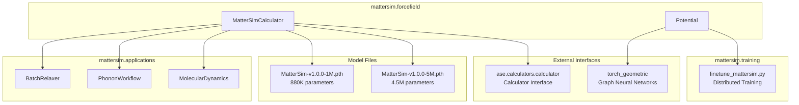
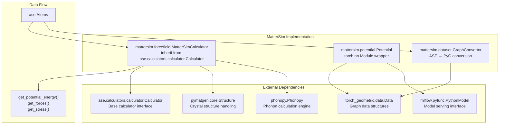
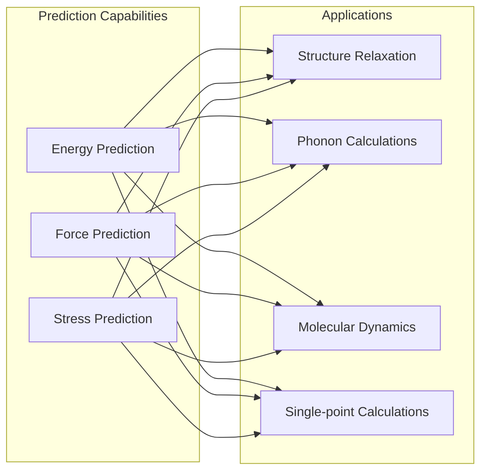
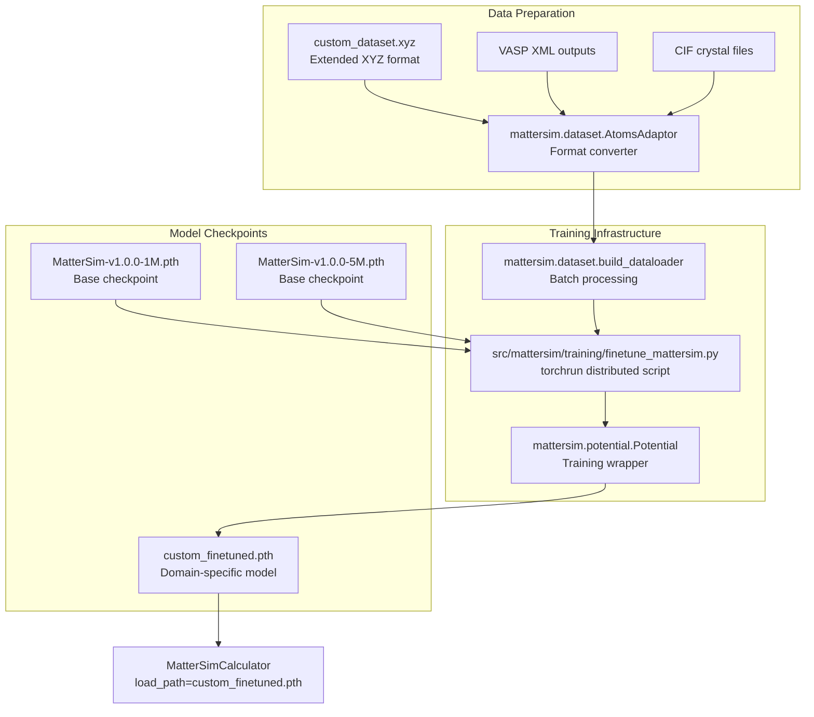

<!-- source: DeepWiki mcp.deepwiki.com · repo microsoft/mattersim · page 1 Overview · fetched 2026-10-26 -->

# Overview

<details>
<summary>Relevant source files</summary>

The following files were used as context for generating this wiki page:

- [MODEL_CARD.md](MODEL_CARD.md)
- [README.md](README.md)

</details>


MatterSim is a deep learning atomistic model designed for simulating materials across different elements, temperatures, and pressures. This document provides a high-level introduction to the MatterSim system, its architecture, capabilities, and use cases.

MatterSim enables efficient atomistic simulations at the first-principles level and accurate prediction of material properties across the periodic table, supporting temperature ranges from 0 to 5000K and pressures up to 1000 GPa. It serves as a machine learning force field that can predict ground-state material structures, energetics, and simulate material behavior under realistic conditions.

For detailed installation instructions, see [Installation & Setup](#3). For usage examples, see [Usage](#4). For information about training and fine-tuning, see [Training & Fine-tuning](#5).

Sources: [README.md:17-17](), [MODEL_CARD.md:22-22]()

## System Architecture

### Core MatterSim Components

MatterSim implements a modular deep learning architecture centered around the M3GNet neural network for atomistic simulations. The system bridges machine learning models with established computational chemistry interfaces.



### Key Code Entities

| Component | Location | Purpose |
|-----------|----------|---------|
| `MatterSimCalculator` | `mattersim.forcefield` | ASE calculator interface for single structures |
| `Potential` | `mattersim.potential` | Batch processing and training wrapper |
| `finetune_mattersim.py` | `src/mattersim/training/` | Distributed fine-tuning script |
| `BatchRelaxer` | `mattersim.applications.relaxation` | Structure optimization |
| `PhononWorkflow` | `mattersim.applications.phonon` | Vibrational property calculations |

Sources: [README.md:75-80](), [README.md:96-120]()

### Integration Layer Architecture

MatterSim implements standardized interfaces to computational chemistry and machine learning ecosystems through specific adapter patterns:



Sources: [README.md:96-120]()

## Pre-trained Models

MatterSim currently offers two pre-trained models based on the M3GNet architecture:

| Model | Parameters | Description | Use Case |
|-------|------------|-------------|----------|
| MatterSim-v1.0.0-1M | ~880K | Smaller, faster model | Quick simulations, larger systems |
| MatterSim-v1.0.0-5M | ~4.5M | Larger, more accurate model | Higher accuracy requirements |

These models have been trained on datasets containing millions of atomic configurations across different elements, temperatures, and pressures. The models can predict energies, forces, and stresses for a wide range of materials.

Sources: [README.md:75-80](), [MODEL_CARD.md:38-42]()

## Performance and Capabilities

MatterSim demonstrates strong performance across various test datasets:



Performance metrics on benchmark datasets show that the 5M parameter model generally outperforms the 1M model, with energy prediction errors as low as 0.016 eV/atom on the Alexandria-1k dataset.

Sources: [MODEL_CARD.md:102-121]()

## Basic Usage Pattern

MatterSim follows the ASE `Calculator` interface pattern, allowing seamless integration with existing atomistic simulation workflows:

**Core Calculator Interface:**
```python
from mattersim.forcefield import MatterSimCalculator
from ase.build import bulk

# Initialize calculator with specific model checkpoint
calc = MatterSimCalculator(
    load_path="MatterSim-v1.0.0-5M.pth",  # Model selection
    device="cuda"                          # Hardware target
)

# Attach to ASE Atoms object
atoms = bulk("Si", "diamond", a=5.43)
atoms.calc = calc

# Standard ASE property methods
energy = atoms.get_potential_energy()     # Returns float [eV]
forces = atoms.get_forces()               # Returns ndarray [eV/Å]  
stress = atoms.get_stress(voigt=False)    # Returns 3x3 tensor [eV/ų]
```

**Model Selection:**
- Default: `MatterSim-v1.0.0-1M.pth` (faster inference)
- High accuracy: `MatterSim-v1.0.0-5M.pth` (better predictions)

Sources: [README.md:96-120]()

## Training and Customization Pipeline

MatterSim implements a distributed fine-tuning system using `torch.distributed` for domain-specific model adaptation:

### Fine-tuning Workflow



### Distributed Training Command

```bash
# Multi-GPU fine-tuning
torchrun --nproc_per_node=4 \
    src/mattersim/training/finetune_mattersim.py \
    --load_model_path mattersim-v1.0.0-1m \
    --train_data_path custom_dataset.xyz \
    --batch_size 32 \
    --learning_rate 1e-4
```

Sources: [README.md:122-131]()

## Limitations

MatterSim has several limitations to be aware of:

1. **Application Scope**: Designed specifically for bulk materials; applications involving surfaces, interfaces, or long-range interactions may require fine-tuning.
2. **Accuracy Trade-offs**: While fast, accuracy is inferior to more computationally expensive methods.
3. **Theoretical Basis**: Trained on PBE Density Functional Theory, which has known limitations for highly-correlated systems.
4. **Material Types**: Lower accuracy for organic polymeric systems.

For quantitative results in specialized applications, fine-tuning on domain-specific data is recommended.

Sources: [README.md:156-157](), [MODEL_CARD.md:164-173]()

## Citation and References

When using MatterSim, please cite the following paper:

```
@article{yang2024mattersim,
      title={MatterSim: A Deep Learning Atomistic Model Across Elements, Temperatures and Pressures},
      author={Han Yang and Chenxi Hu and Yichi Zhou and Xixian Liu and Yu Shi and Jielan Li and Guanzhi Li and Zekun Chen and Shuizhou Chen and Claudio Zeni and Matthew Horton and Robert Pinsler and Andrew Fowler and Daniel Zügner and Tian Xie and Jake Smith and Lixin Sun and Qian Wang and Lingyu Kong and Chang Liu and Hongxia Hao and Ziheng Lu},
      year={2024},
      eprint={2405.04967},
      archivePrefix={arXiv},
      primaryClass={cond-mat.mtrl-sci},
      url={https://arxiv.org/abs/2405.04967},
      journal={arXiv preprint arXiv:2405.04967}
}
```

When reporting results, please specify the exact model version used (e.g., MatterSim-v1.0.0-1M) to ensure reproducibility.

Sources: [README.md:138-149](), [README.md:152-153]()

---

