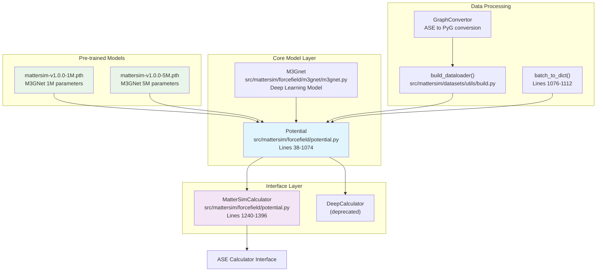
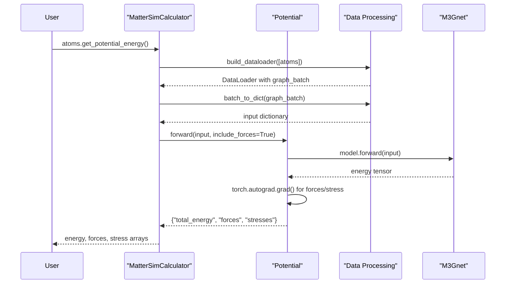

<!-- source: DeepWiki mcp.deepwiki.com · repo microsoft/mattersim · page 2 Core Components · fetched 2026-10-26 -->

# Core Components

<details>
<summary>Relevant source files</summary>

The following files were used as context for generating this wiki page:

- [src/mattersim/forcefield/__init__.py](src/mattersim/forcefield/__init__.py)
- [src/mattersim/forcefield/potential.py](src/mattersim/forcefield/potential.py)

</details>


This document provides an overview of the fundamental building blocks that comprise the MatterSim deep learning atomistic model. The core components include the `Potential` class for model operations, calculator interfaces for ASE integration, pre-trained models, and data processing utilities that enable materials simulation workflows.

For detailed usage examples and practical guides, see [Usage](#4). For information about training and customizing these components, see [Training & Fine-tuning](#5).

## Architecture Overview

The MatterSim core components form a layered architecture that separates model operations, interface layers, and data processing:



Sources: [src/mattersim/forcefield/potential.py:1-1396](), [src/mattersim/forcefield/__init__.py:1-4]()

## Component Overview

### Potential Class

The `Potential` class is the central wrapper that encapsulates force field models and provides comprehensive functionality for training, inference, and model management. It serves as the primary interface for all model operations including forward passes, gradient computation, and checkpoint handling.

Key capabilities:
- **Model Operations**: Forward inference with automatic differentiation for forces and stresses [src/mattersim/forcefield/potential.py:725-825]()
- **Training Support**: Complete training loop with validation, early stopping, and distributed training [src/mattersim/forcefield/potential.py:186-356]()
- **Checkpoint Management**: Loading pre-trained models and saving custom checkpoints [src/mattersim/forcefield/potential.py:848-956]()
- **Fine-tuning**: Layer freezing and custom head support for transfer learning [src/mattersim/forcefield/potential.py:158-184]()

For comprehensive documentation, see [Potential Class](#2.1).

### MatterSimCalculator

The `MatterSimCalculator` class provides seamless integration with the Atomic Simulation Environment (ASE) framework, enabling MatterSim to be used as a standard ASE calculator for single structure calculations.

Key features:
- **ASE Compatibility**: Implements standard ASE calculator interface with `energy`, `forces`, and `stress` properties [src/mattersim/forcefield/potential.py:1245]()
- **Automatic Setup**: Default initialization with pre-trained models [src/mattersim/forcefield/potential.py:1264-1267]()
- **Flexible Configuration**: Customizable stress computation and device selection [src/mattersim/forcefield/potential.py:1251-1252]()

For usage examples and detailed configuration, see [MatterSimCalculator](#2.2).

### Pre-trained Models

MatterSim provides two pre-trained M3GNet model variants that are automatically downloaded and cached locally:

| Model | Parameters | File | Description |
|-------|------------|------|-------------|
| 1M | ~1 million | `mattersim-v1.0.0-1M.pth` | Compact model for faster inference |
| 5M | ~5 million | `mattersim-v1.0.0-5M.pth` | Larger model with higher accuracy |

Both models are trained on extensive materials datasets and support energy, force, and stress predictions. For detailed model specifications and performance characteristics, see [Pre-trained Models](#2.3).

### Data Processing Pipeline

The data processing components handle conversion between different atomic structure representations and prepare data for model consumption:

- **`build_dataloader()`**: Converts ASE `Atoms` objects to PyTorch Geometric `DataLoader` instances [src/mattersim/datasets/utils/build.py]()
- **`batch_to_dict()`**: Transforms PyG batch objects into input dictionaries for model forward passes [src/mattersim/forcefield/potential.py:1076-1112]()
- **Graph Construction**: Automatic neighbor finding, periodic boundary handling, and three-body interaction computation

For implementation details and custom data preparation, see [Data Processing Pipeline](#2.4).

## Component Interactions

The following diagram illustrates how the core components interact during a typical prediction workflow:



Sources: [src/mattersim/forcefield/potential.py:1313-1395](), [src/mattersim/forcefield/potential.py:725-825]()

## Usage Patterns

The core components support several common usage patterns:

**Single Structure Calculation**:
```python
from mattersim import MatterSimCalculator
calc = MatterSimCalculator()
atoms.calc = calc
energy = atoms.get_potential_energy()
```

**Batch Processing**:
```python
from mattersim import Potential
potential = Potential.from_checkpoint()
energies, forces, stresses = potential.predict_properties(dataloader)
```

**Custom Model Loading**:
```python
potential = Potential.from_checkpoint("path/to/custom/model.pth")
calc = MatterSimCalculator.from_potential(potential)
```

Sources: [src/mattersim/forcefield/potential.py:1273-1276](), [src/mattersim/forcefield/potential.py:474-518](), [src/mattersim/forcefield/potential.py:1278-1280]()

---

