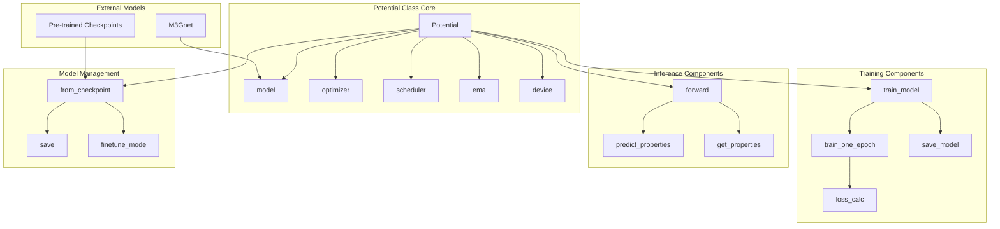
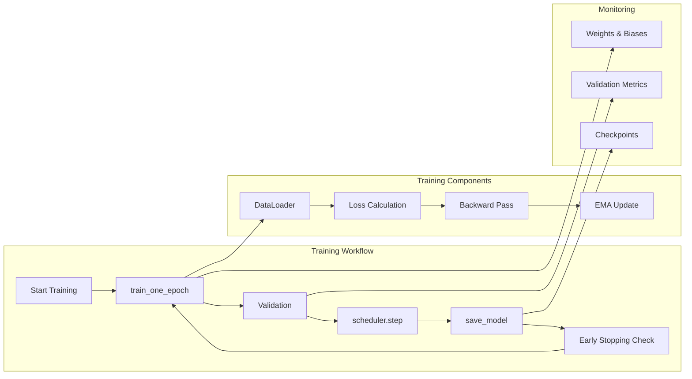
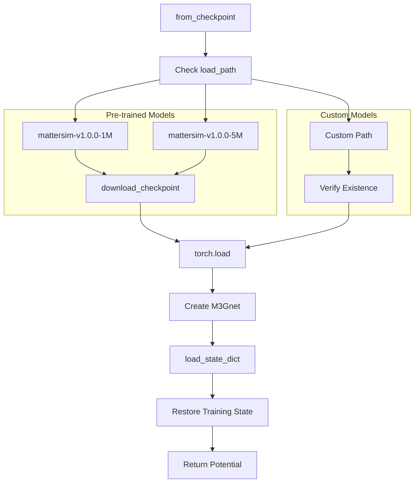
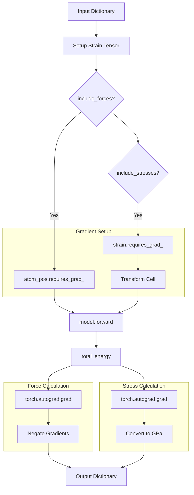
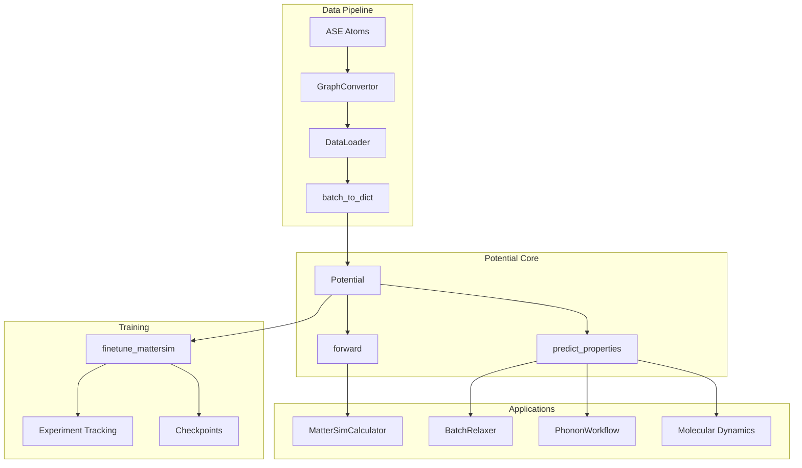

<!-- source: DeepWiki mcp.deepwiki.com · repo microsoft/mattersim · page 2.1 Potential Class · fetched 2026-10-26 -->

# Potential Class

<details>
<summary>Relevant source files</summary>

The following files were used as context for generating this wiki page:

- [src/mattersim/forcefield/__init__.py](src/mattersim/forcefield/__init__.py)
- [src/mattersim/forcefield/potential.py](src/mattersim/forcefield/potential.py)

</details>


The `Potential` class serves as the primary wrapper and interface for deep learning force field models in MatterSim. This class handles training, inference, fine-tuning, and model management for atomistic property predictions including energies, forces, and stresses. It provides both low-level batch processing capabilities for training workflows and high-level inference methods for applications.

For single-structure calculations using ASE interfaces, see [MatterSimCalculator](#2.2). For information about pre-trained model variants and loading, see [Pre-trained Models](#2.3).

## Architecture Overview

The `Potential` class extends `torch.nn.Module` and acts as a comprehensive wrapper around the underlying neural network models (primarily M3GNet). It integrates training infrastructure, optimization components, and inference capabilities into a unified interface.

**Potential Class Architecture**


Sources: [src/mattersim/forcefield/potential.py:38-111]()

## Core Components

### Initialization Parameters

The `Potential` class accepts several key initialization parameters that configure the training and inference behavior:

| Parameter | Type | Default | Description |
|-----------|------|---------|-------------|
| `model` | `nn.Module` | Required | The underlying neural network model |
| `optimizer` | `torch.optim.Optimizer` | `Adam` | Optimizer for training |
| `scheduler` | `str` or `torch.optim.lr_scheduler` | `"StepLR"` | Learning rate scheduler |
| `ema` | `ExponentialMovingAverage` | Auto-created | Exponential moving average for stability |
| `device` | `str` | Auto-detected | Computation device (cuda/cpu) |
| `allow_tf32` | `bool` | `False` | Enable TensorFloat-32 for performance |

Sources: [src/mattersim/forcefield/potential.py:43-111]()

### Training Infrastructure

The class includes comprehensive training infrastructure with support for distributed training, early stopping, and model checkpointing:



Sources: [src/mattersim/forcefield/potential.py:186-357]()

## Key Functionality

### Model Loading and Checkpointing

The `from_checkpoint` class method provides a unified interface for loading both pre-trained and custom models:

**Model Loading Workflow**


Sources: [src/mattersim/forcefield/potential.py:848-956]()

### Forward Pass and Property Prediction

The `forward` method handles the core computation logic for predicting energies, forces, and stresses:



Sources: [src/mattersim/forcefield/potential.py:725-825]()

### Fine-tuning Support

The class provides specialized fine-tuning capabilities with layer freezing and custom head support:

| Fine-tuning Parameter | Description |
|----------------------|-------------|
| `finetune_layers` | Number of layers to fine-tune (-1 for all layers) |
| `finetune_head` | Custom head for fine-tuning tasks |
| `reset_head_for_finetune` | Whether to reset the original head |
| `finetune_task_mean/std` | Task-specific normalization parameters |

The `freeze_reset_model` method selectively freezes model parameters based on the specified fine-tuning configuration.

Sources: [src/mattersim/forcefield/potential.py:158-184]()

## Integration with MatterSim Ecosystem

The `Potential` class integrates with several other MatterSim components:

**Potential Integration Map**


Sources: [src/mattersim/forcefield/potential.py:1076-1112](), [src/mattersim/forcefield/__init__.py:1-5]()

## Utility Functions

### Batch Processing Helper

The `batch_to_dict` function converts PyTorch Geometric batch objects into input dictionaries compatible with the model forward pass:

```python
def batch_to_dict(graph_batch, model_type="m3gnet", device="cuda")
```

This function extracts key tensors including `atom_pos`, `cell`, `pbc_offsets`, `atom_attr`, `edge_index`, and `three_body_indices` from the graph batch and assembles them into the expected input format.

Sources: [src/mattersim/forcefield/potential.py:1076-1112]()

### Calculator Classes

The file also includes `MatterSimCalculator` and the deprecated `DeepCalculator` classes that wrap the `Potential` class to provide ASE-compatible interfaces for single-structure calculations.

Sources: [src/mattersim/forcefield/potential.py:1240-1396]()

---

