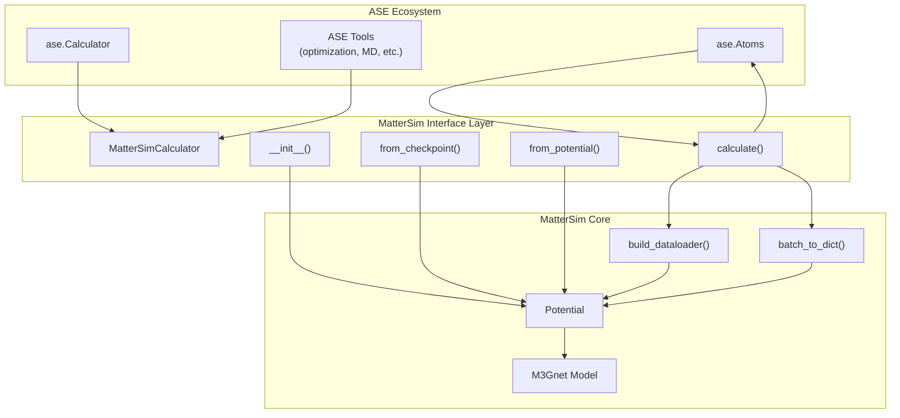
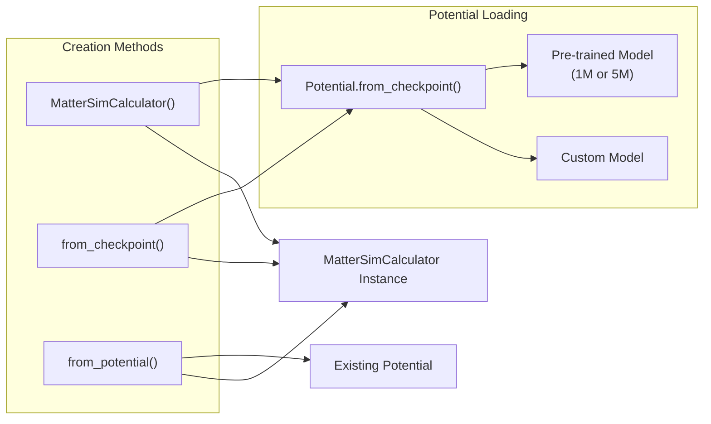
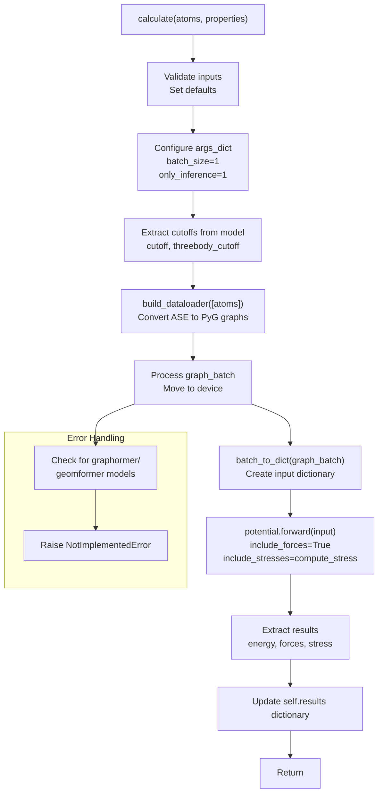
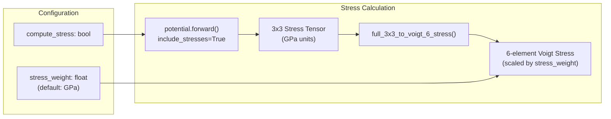

<!-- source: DeepWiki mcp.deepwiki.com · repo microsoft/mattersim · page 2.2 MatterSimCalculator · fetched 2026-10-26 -->

# MatterSimCalculator

<details>
<summary>Relevant source files</summary>

The following files were used as context for generating this wiki page:

- [docs/user_guide/getting_started.rst](docs/user_guide/getting_started.rst)
- [src/mattersim/forcefield/__init__.py](src/mattersim/forcefield/__init__.py)
- [src/mattersim/forcefield/potential.py](src/mattersim/forcefield/potential.py)

</details>


The `MatterSimCalculator` class provides an ASE (Atomic Simulation Environment) compatible interface for performing single-structure calculations using MatterSim's deep learning models. It serves as the primary entry point for users who want to integrate MatterSim with ASE-based workflows and tools.

For batch processing of multiple structures, see [Batch Processing](#4.2). For information about the underlying computational engine, see [Potential Class](#2.1). For practical usage examples, see [Basic Usage with ASE](#4.1).

## Architecture Overview

The `MatterSimCalculator` acts as an adapter between ASE's calculator interface and MatterSim's `Potential` class, enabling seamless integration with the broader ASE ecosystem.



**Sources:** [src/mattersim/forcefield/potential.py:1240-1396](), [docs/user_guide/getting_started.rst:4-33]()

## Class Structure and Properties

The `MatterSimCalculator` implements the standard ASE calculator interface with support for energy, force, and stress calculations.

| Property | Type | Description |
|----------|------|-------------|
| `implemented_properties` | `list` | `["energy", "free_energy", "forces", "stress"]` |
| `potential` | `Potential` | The underlying MatterSim potential object |
| `compute_stress` | `bool` | Whether to calculate stress tensors |
| `stress_weight` | `float` | Stress scaling factor (default: `GPa`) |
| `device` | `str` | Compute device (`"cuda"` or `"cpu"`) |
| `args_dict` | `dict` | Additional arguments for data processing |

**Sources:** [src/mattersim/forcefield/potential.py:1245-1272]()

## Initialization and Factory Methods



The calculator can be initialized in three ways:

1. **Direct constructor**: Creates a default potential if none provided
2. **`from_checkpoint()`**: Loads a specific model checkpoint
3. **`from_potential()`**: Uses an existing `Potential` instance

**Sources:** [src/mattersim/forcefield/potential.py:1247-1281]()

## Calculation Workflow

The `calculate()` method implements the core ASE calculator interface, converting ASE `Atoms` objects to MatterSim's internal representation and computing the requested properties.



**Sources:** [src/mattersim/forcefield/potential.py:1313-1396]()

## Data Flow and Type Conversions

The calculator performs several key data transformations during computation:

| Step | Input Type | Output Type | Function |
|------|------------|-------------|----------|
| 1 | `ase.Atoms` | `list[ase.Atoms]` | Wrap in list |
| 2 | `list[ase.Atoms]` | `DataLoader` | `build_dataloader()` |
| 3 | `DataLoader` | `graph_batch` | PyTorch Geometric batch |
| 4 | `graph_batch` | `dict` | `batch_to_dict()` |
| 5 | `dict` | `dict` | `potential.forward()` |
| 6 | `dict` | ASE results | Extract and convert units |

**Sources:** [src/mattersim/forcefield/potential.py:1344-1396](), [src/mattersim/forcefield/potential.py:1076-1112]()

## Stress Tensor Handling

The calculator includes sophisticated stress tensor processing with unit conversions:



The default `stress_weight` is set to `GPa` (from ASE units), which converts from the internal GPa units to ASE's stress units (eV/ų).

**Sources:** [src/mattersim/forcefield/potential.py:1389-1395](), [src/mattersim/forcefield/potential.py:1252]()

## Integration with ASE Ecosystem

The `MatterSimCalculator` seamlessly integrates with ASE tools through the standard calculator interface:

```python
# Standard ASE usage pattern
atoms.calc = MatterSimCalculator(device="cuda")
energy = atoms.get_potential_energy()
forces = atoms.get_forces()
stress = atoms.get_stress()
```

This enables direct use with ASE optimization algorithms, molecular dynamics drivers, and analysis tools without modification.

**Sources:** [docs/user_guide/getting_started.rst:21-27]()

## Performance Considerations

The `MatterSimCalculator` is optimized for single-structure calculations but has some inherent limitations:

- **Batch size**: Fixed at 1 for ASE compatibility
- **GPU utilization**: Suboptimal for large-scale calculations
- **Memory overhead**: Creates dataloader for each calculation

For high-throughput scenarios, consider using the `Potential` class directly with `predict_properties()` method, as described in [Batch Processing](#4.2).

**Sources:** [docs/user_guide/getting_started.rst:30-33]()

---

