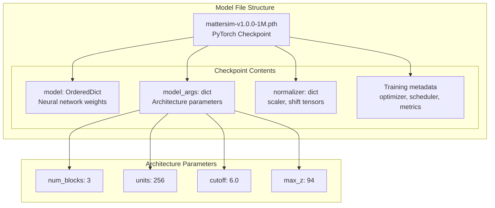
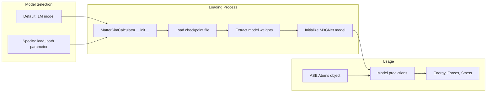
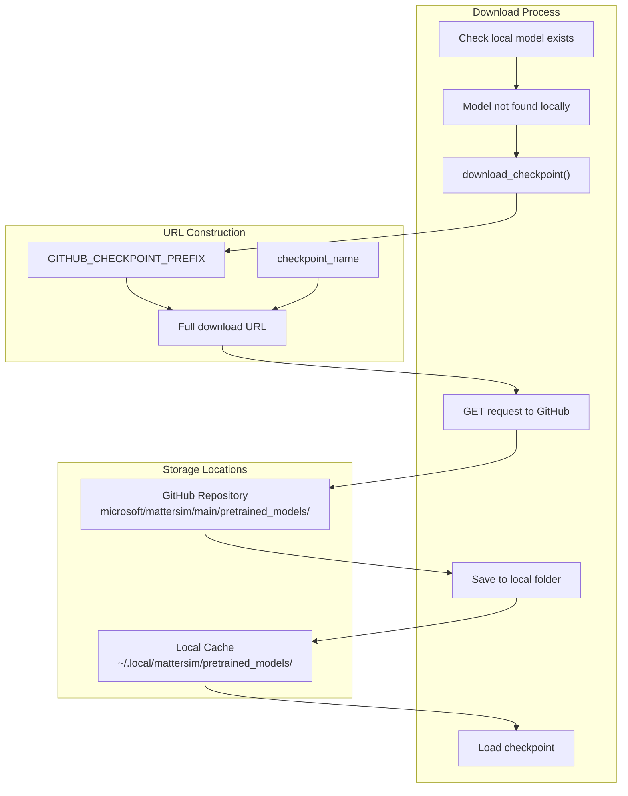

<!-- source: DeepWiki mcp.deepwiki.com · repo microsoft/mattersim · page 2.3 Pre-trained Models · fetched 2026-10-26 -->

# Pre-trained Models

<details>
<summary>Relevant source files</summary>

The following files were used as context for generating this wiki page:

- [MANIFEST.in](MANIFEST.in)
- [README.md](README.md)
- [pretrained_models/mattersim-v1.0.0-1M.pth](pretrained_models/mattersim-v1.0.0-1M.pth)
- [pretrained_models/mattersim-v1.0.0-5M.pth](pretrained_models/mattersim-v1.0.0-5M.pth)
- [src/mattersim/utils/download_utils.py](src/mattersim/utils/download_utils.py)

</details>


This document describes the available pre-trained models in MatterSim, their specifications, storage mechanisms, and how to load and use them for materials simulation tasks. For information about training custom models, see [Fine-tuning Process](#5.2). For details about the calculator interface that uses these models, see [MatterSimCalculator](#2.2).

## Available Models

MatterSim provides two pre-trained **MatterSim-v1** models based on the **M3GNet** architecture:

| Model Name | Description | Use Case |
|------------|-------------|----------|
| `MatterSim-v1.0.0-1M` | Mini version with 1M parameters | Faster inference, lower memory usage |
| `MatterSim-v1.0.0-5M` | Larger version with 5M parameters | Higher accuracy, more comprehensive predictions |

Both models are trained using data generated through workflows described in the MatterSim manuscript and support energy, force, and stress calculations for bulk materials across various elements, temperatures, and pressures.

Sources: [README.md:74-87]()

## Model Architecture and Format

### M3GNet Architecture
The pre-trained models implement the M3GNet (Materials 3-body Graph Network) architecture, which uses graph neural networks to represent atomic structures and predict material properties through multi-body interactions.

### Model Storage Format
Models are stored as PyTorch checkpoint files (`.pth` format) containing:
- Model state dictionary with neural network weights
- Model architecture parameters (`num_blocks`, `units`, `max_l`, `max_n`, `cutoff`, `max_z`, `threebody_cutoff`)
- Normalization parameters (`scaler`, `shift`)
- Training metadata and optimizer state



Sources: [pretrained_models/mattersim-v1.0.0-1M.pth:1-50]()

## Model Loading and Usage

### Default Model Loading
By default, `MatterSimCalculator` loads the 1M parameter model:

```python
from mattersim.forcefield import MatterSimCalculator

# Loads MatterSim-v1.0.0-1M.pth by default
calc = MatterSimCalculator(device="cuda")
```

### Loading Specific Models
To use the 5M parameter model, specify the `load_path` parameter:

```python
# Load the larger 5M model
calc = MatterSimCalculator(
    load_path="MatterSim-v1.0.0-5M.pth", 
    device="cuda"
)
```

### Model Integration Flow



Sources: [README.md:114-119]()

## Download and Storage System

### Automatic Download
Models are automatically downloaded when first accessed if not found locally. The download system uses GitHub as the source repository.

### Download Utilities
The `download_utils` module provides functions for retrieving model checkpoints:

```python
def download_checkpoint(
    checkpoint_name: str, 
    save_folder: str = "~/.local/mattersim/pretrained_models/"
)
```

### Storage Location
- **Default local path**: `~/.local/mattersim/pretrained_models/`
- **Repository source**: `https://raw.githubusercontent.com/microsoft/mattersim/main/pretrained_models/`
- **Supported formats**: `.pth` PyTorch checkpoint files

### Download Workflow



Sources: [src/mattersim/utils/download_utils.py:29-48]()

## Model Specifications

### Performance Characteristics

| Aspect | MatterSim-v1.0.0-1M | MatterSim-v1.0.0-5M |
|--------|----------------------|----------------------|
| Parameters | ~1M | ~5M |
| Inference Speed | Faster | Slower |
| Memory Usage | Lower | Higher |
| Accuracy | Good | Better |
| Recommended Use | Quick calculations, prototyping | Production, high-accuracy needs |

### Training Data Coverage
Both models are trained on data covering:
- Multiple chemical elements across the periodic table
- Various temperature and pressure conditions
- Bulk material structures
- Energy, force, and stress properties

### Limitations
- **Scope**: Designed specifically for bulk materials
- **Surfaces and interfaces**: Results may be qualitatively accurate but not suitable for quantitative analysis
- **Long-range interactions**: Properties influenced by long-range interactions should be used with caution
- **Fine-tuning recommended**: For specialized applications beyond bulk materials

Sources: [README.md:154-157]()

---

