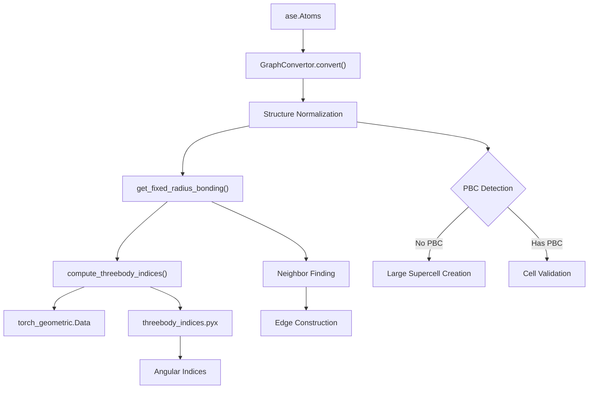
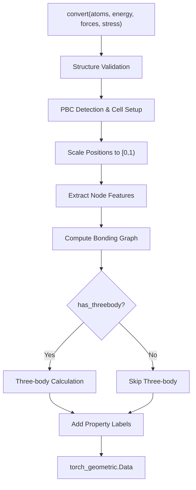
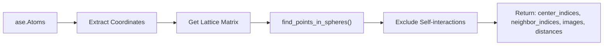
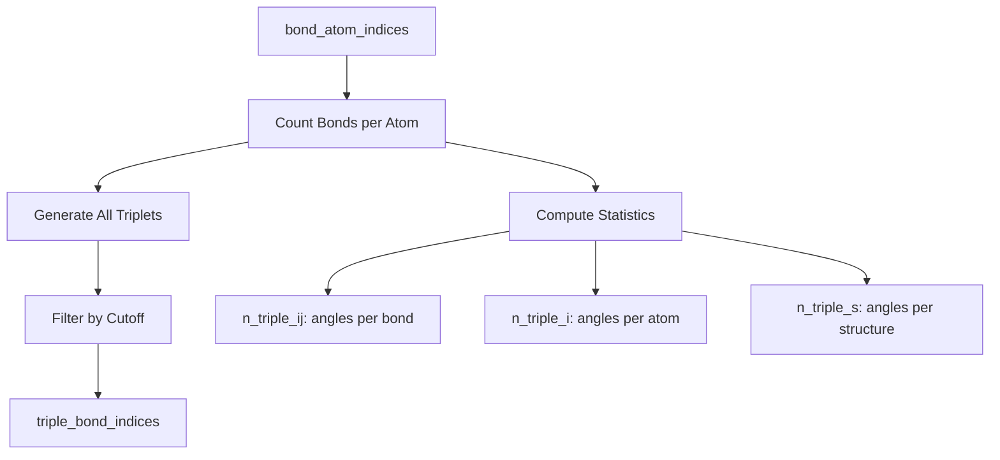
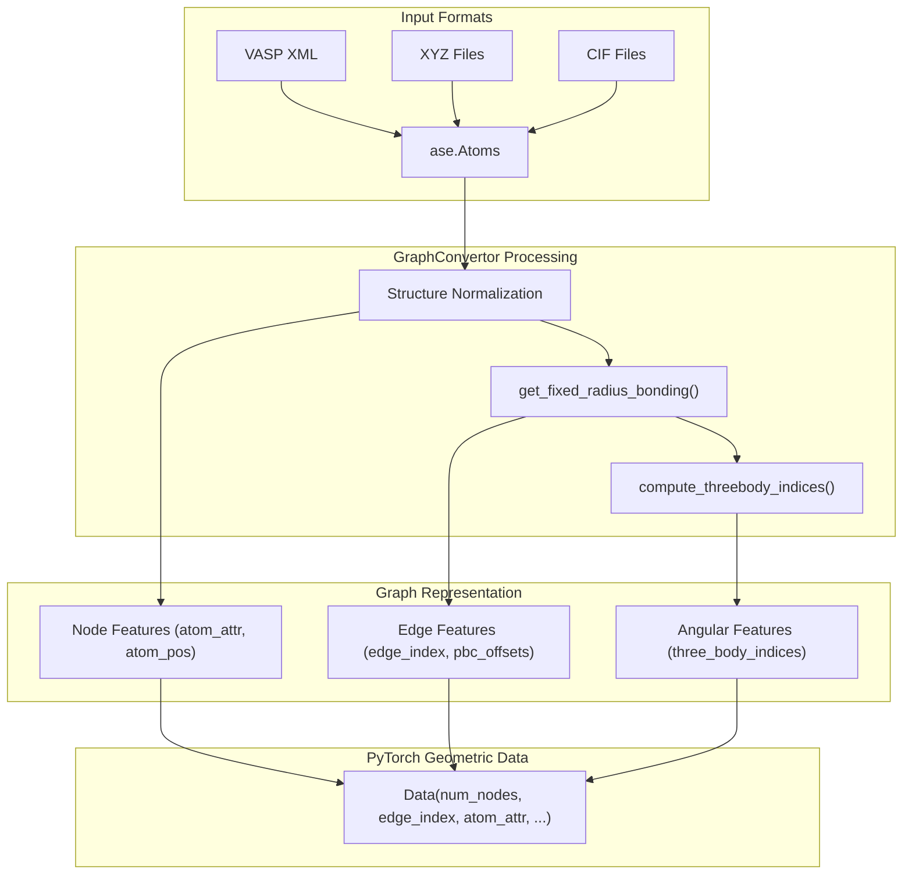
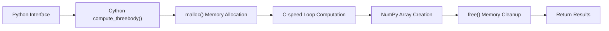

<!-- source: DeepWiki mcp.deepwiki.com · repo microsoft/mattersim · page 2.4 Data Processing Pipeline · fetched 2026-10-26 -->

# Data Processing Pipeline

Relevant source files

The following files were used as context for generating this wiki page:

- [.gitignore](.gitignore)
- [setup.py](setup.py)
- [src/mattersim/datasets/utils/convertor.py](src/mattersim/datasets/utils/convertor.py)
- [src/mattersim/datasets/utils/regressor.py](src/mattersim/datasets/utils/regressor.py)
- [src/mattersim/datasets/utils/setup.py](src/mattersim/datasets/utils/setup.py)
- [src/mattersim/datasets/utils/threebody_indices.pyx](src/mattersim/datasets/utils/threebody_indices.pyx)

This document describes MatterSim's data processing pipeline that converts atomic structures into graph representations suitable for deep learning models. The pipeline transforms ASE `Atoms` objects into PyTorch Geometric `Data` objects containing node features, edge connectivity, and three-body angular information required by the M3GNet architecture.

For information about loading and using pre-trained models with processed data, see [Pre-trained Models](#2.3). For details about the training workflow that consumes this processed data, see [Fine-tuning Process](#5.2).

## Pipeline Overview

The data processing pipeline consists of three main stages: structure normalization, graph construction, and feature extraction. The pipeline handles both periodic and non-periodic systems, automatically detecting boundary conditions and applying appropriate neighbor-finding algorithms.

Sources: [src/mattersim/datasets/utils/convertor.py:154-291]()

## Core Components

### GraphConvertor Class

The `GraphConvertor` class serves as the main interface for structure-to-graph conversion. It supports configurable cutoff radii for two-body and three-body interactions and handles M3GNet-specific graph construction.

| Parameter | Default | Description |
|-----------|---------|-------------|
| `model_type` | "m3gnet" | Target model architecture |
| `twobody_cutoff` | 5.0 | Cutoff radius for edge detection (Å) |
| `threebody_cutoff` | 4.0 | Cutoff radius for angular interactions (Å) |
| `has_threebody` | True | Enable three-body angle computation |

The `convert()` method processes input structures through several stages:

Sources: [src/mattersim/datasets/utils/convertor.py:154-184](), [src/mattersim/datasets/utils/convertor.py:227-283]()

### Neighbor Finding Algorithm

The `get_fixed_radius_bonding()` function implements efficient neighbor detection using periodic boundary conditions. It leverages pymatgen's optimized spatial algorithms for scalable neighbor finding in crystalline systems.

The function handles both periodic and non-periodic systems by detecting PBC flags and applying appropriate spatial algorithms. For non-periodic systems, a large supercell is automatically created to accommodate the cutoff radius.

Sources: [src/mattersim/datasets/utils/convertor.py:101-151](), [src/mattersim/datasets/utils/convertor.py:117-138]()

### Three-body Index Computation

Three-body angular interactions are computed using an optimized Cython implementation in `threebody_indices.pyx`. The algorithm identifies all angular triplets (i-j-k) where atom j is the central atom and both i-k bonds are within the three-body cutoff.

The Cython implementation provides significant performance improvements for large systems by avoiding Python loops and utilizing efficient memory management.

Sources: [src/mattersim/datasets/utils/convertor.py:46-98](), [src/mattersim/datasets/utils/threebody_indices.pyx:16-91]()

## Data Flow Architecture

The complete data processing pipeline transforms atomic structures through multiple representation layers:

Sources: [src/mattersim/datasets/utils/convertor.py:17-39](), [src/mattersim/datasets/utils/convertor.py:227-283]()

## Supported Properties

The pipeline generates comprehensive graph representations containing both structural and property information:

| Property | Type | Description |
|----------|------|-------------|
| `num_nodes` | int | Number of atoms in structure |
| `num_edges` | int | Number of bonds within cutoff |
| `atom_attr` | Tensor[N,1] | Atomic numbers |
| `atom_pos` | Tensor[N,3] | Atomic coordinates |
| `edge_index` | Tensor[2,E] | Bond connectivity matrix |
| `pbc_offsets` | Tensor[E,3] | Periodic image vectors |
| `three_body_indices` | Tensor[T,2] | Angular triplet indices |
| `energy` | float | Total energy (if provided) |
| `forces` | Tensor[N,3] | Atomic forces (if provided) |
| `stress` | Tensor[3,3] | Stress tensor (if provided) |

Sources: [src/mattersim/datasets/utils/convertor.py:17-39](), [src/mattersim/datasets/utils/convertor.py:277-283]()

## Performance Optimizations

### Cython Implementation

Critical computational bottlenecks are implemented in Cython for optimal performance. The `threebody_indices.pyx` module provides C-speed computation of angular indices with manual memory management:

The Cython implementation eliminates Python overhead for nested loops and array operations, providing substantial speedups for large molecular systems.

Sources: [src/mattersim/datasets/utils/threebody_indices.pyx:16-91](), [setup.py:5-12]()

### Build Integration

The Cython extensions are automatically compiled during package installation through setuptools integration. The build system handles platform-specific compilation flags and NumPy API compatibility.

Sources: [setup.py:1-16](), [src/mattersim/datasets/utils/setup.py:1-16]()

---

