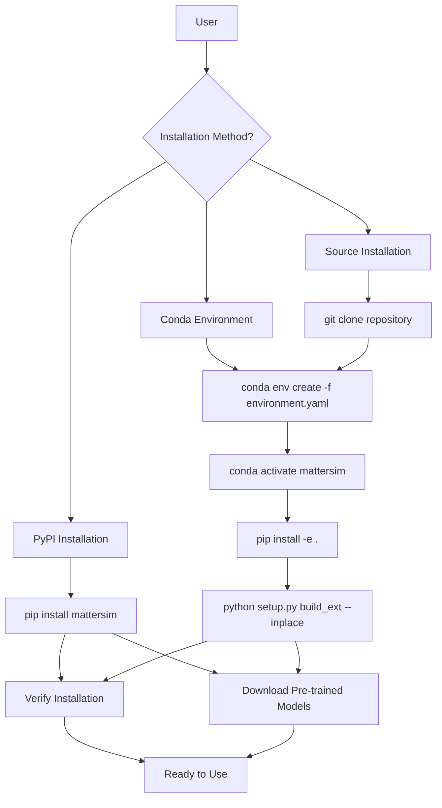
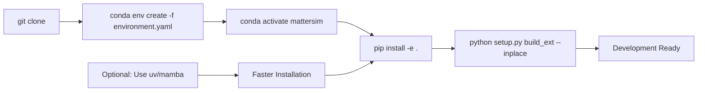

<!-- source: DeepWiki mcp.deepwiki.com · repo microsoft/mattersim · page 3 Installation & Setup · fetched 2026-10-26 -->

# Installation & Setup

<details>
<summary>Relevant source files</summary>

The following files were used as context for generating this wiki page:

- [docs/_static/mattersim.png](docs/_static/mattersim.png)
- [docs/conf.py](docs/conf.py)
- [docs/user_guide/installation.rst](docs/user_guide/installation.rst)
- [environment.yaml](environment.yaml)
- [pyproject.toml](pyproject.toml)

</details>


This document provides comprehensive installation instructions for MatterSim, covering all supported installation methods from simple PyPI installation to development setup from source. It includes system requirements, dependency management, and environment configuration needed to run MatterSim for materials simulation tasks.

For information about using MatterSim after installation, see [Basic Usage with ASE](#4.1). For training and fine-tuning setup, see [Training & Fine-tuning](#5).

## Prerequisites

MatterSim requires Python 3.10 or higher and has specific hardware and software dependencies for optimal performance.

### System Requirements

| Component | Requirement |
|-----------|-------------|
| Python Version | >=3.10 |
| Operating System | Linux (recommended), macOS, Windows |
| Memory | 8GB+ RAM (16GB+ for training) |
| GPU | CUDA-compatible GPU (optional, for acceleration) |
| Disk Space | 2GB+ free space |

### Core Dependencies

MatterSim depends on several key scientific computing libraries as defined in [pyproject.toml:28-55]():

- **PyTorch ecosystem**: `torch>=2.2.0`, `torch_geometric>=2.5.3`, `torchvision>=0.17.0`
- **Materials science**: `ase>=3.23.0`, `pymatgen`, `phonopy` 
- **Machine learning**: `e3nn>=0.5.0`, `scikit-learn`, `torch-ema>=0.3`
- **Cloud integration**: `azure-identity`, `azure-storage-blob`

**Installation Methods Overview**



*Sources: [pyproject.toml:1-100](), [environment.yaml:1-13](), [docs/user_guide/installation.rst:1-51]()*

## PyPI Installation

The simplest installation method for end users who want to use MatterSim for simulations without modifying the source code.

### Standard Installation

```bash
pip install mattersim
```

### Latest Development Version

To install the latest version directly from the GitHub repository:

```bash
pip install git+https://github.com/microsoft/mattersim.git
```

This method automatically handles dependency resolution and installs all required packages defined in [pyproject.toml:28-55]().

*Sources: [docs/user_guide/installation.rst:5-18](), [pyproject.toml:28-55]()*

## Conda Environment Installation

Recommended for users who prefer conda package management or need reproducible environments. This method provides better control over the Python environment and dependencies.

### Using Conda

```bash
conda env create -f environment.yaml
conda activate mattersim
pip install mattersim
```

### Using Mamba (Faster Alternative)

For significantly faster installation, use mamba or micromamba:

```bash
mamba env create -f environment.yaml
mamba activate mattersim  
pip install mattersim
```

The [environment.yaml:1-13]() file specifies:
- Python 3.10 as the base version
- Essential build tools: `cython>=0.29.32`, `setuptools>=45`, `wheel`
- `uv` package manager for faster pip operations

*Sources: [environment.yaml:1-13](), [docs/user_guide/installation.rst:36-45]()*

## Source Installation

Required for developers who want to modify MatterSim code, contribute to the project, or access the latest unreleased features.

**Development Installation Workflow**



*Sources: [docs/user_guide/installation.rst:20-46]()*

### Step-by-Step Development Setup

1. **Clone the repository**:
   ```bash
   git clone https://github.com/microsoft/mattersim.git
   cd mattersim
   ```

2. **Create conda environment**:
   ```bash
   conda env create -f environment.yaml
   conda activate mattersim
   ```

3. **Install in editable mode**:
   ```bash
   pip install -e .
   ```

4. **Build Cython extensions**:
   ```bash
   python setup.py build_ext --inplace
   ```

### Accelerated Development Setup

For faster installation using mamba and uv:

```bash
mamba env create -f environment.yaml
mamba activate mattersim
uv pip install -e .
python setup.py build_ext --inplace
```

The build process compiles Cython extensions as specified in the build system configuration [pyproject.toml:1-9]().

*Sources: [docs/user_guide/installation.rst:20-46](), [pyproject.toml:1-9]()*

## Dependency Management

MatterSim uses a sophisticated dependency management system to handle version compatibility across different Python versions and optional features.

**Dependency Structure**

```mermaid
graph TB
    CORE["Core Dependencies"] --> TORCH["PyTorch Stack"]
    CORE --> MATERIALS["Materials Science"]
    CORE --> ML["Machine Learning"]
    CORE --> CLOUD["Cloud Integration"]
    
    TORCH --> torch["torch>=2.2.0"]
    TORCH --> torch_geo["torch_geometric>=2.5.3"] 
    TORCH --> torchvision["torchvision>=0.17.0"]
    TORCH --> torchaudio["torchaudio>=2.2.0"]
    
    MATERIALS --> ase["ase>=3.23.0"]
    MATERIALS --> pymatgen["pymatgen"]
    MATERIALS --> phonopy["phonopy"]
    MATERIALS --> atomate2["atomate2"]
    
    ML --> e3nn["e3nn>=0.5.0"]
    ML --> sklearn["scikit-learn"]
    ML --> torch_ema["torch-ema>=0.3"]
    ML --> wandb["wandb"]
    
    CLOUD --> azure_id["azure-identity"]  
    CLOUD --> azure_blob["azure-storage-blob"]
    
    OPTIONAL["Optional Dependencies"] --> DEV["dev"]
    OPTIONAL --> DOCS["docs"]
    
    DEV --> pytest["pytest"]
    DEV --> precommit["pre-commit"]
    
    DOCS --> sphinx["sphinx"]
    DOCS --> nbsphinx["nbsphinx"]
```



*Sources: [pyproject.toml:28-55](), [pyproject.toml:57-76]()*

### Version-Specific Dependencies

The dependency specification in [pyproject.toml:28-55]() includes Python version-specific requirements:

- **NumPy**: `>=2.0.0` for Python >=3.10, `<2.0.0` for Python <3.10
- **Emmet-core**: `>=0.84` for Python >=3.10, `<0.84` for Python <3.10

### Optional Dependencies

Install development tools:
```bash
pip install mattersim[dev]
```

Install documentation tools:
```bash
pip install mattersim[docs]  
```

*Sources: [pyproject.toml:57-76]()*

## Model Checkpoints

MatterSim requires pre-trained model checkpoints for operation. These are automatically downloaded when first using the models.

### Available Models

The pre-trained models are located in the repository at `src/mattersim/pretrained_models/` and include:

- **MatterSim-v1.0.0-1M**: Smaller, faster model variant
- **MatterSim-v1.0.0-5M**: Larger, more accurate model variant

Models are downloaded automatically on first use, but you can also manually download them from the [GitHub repository](https://github.com/microsoft/mattersim/tree/main/src/mattersim/pretrained_models).

*Sources: [docs/user_guide/installation.rst:47-51]()*

## Installation Verification

After installation, verify that MatterSim is working correctly:

### Basic Import Test

```python
import mattersim
from mattersim import MatterSimCalculator

# Check version
print(mattersim.__version__)
```

### Calculator Functionality Test

```python
from ase import Atoms
from mattersim import MatterSimCalculator

# Create a simple structure
atoms = Atoms('H2', positions=[[0, 0, 0], [0, 0, 0.74]])

# Initialize calculator
calc = MatterSimCalculator()
atoms.calc = calc

# Test energy calculation
energy = atoms.get_potential_energy()
print(f"Energy: {energy} eV")
```

### Command Line Interface Test

```bash
# Test CLI availability
mattersim --help

# Test single-point calculation
mattersim singlepoint --help
```

## Troubleshooting

### Common Installation Issues

| Issue | Solution |
|-------|----------|
| `ImportError: No module named 'torch'` | Ensure PyTorch is installed: `pip install torch>=2.2.0` |
| `ModuleNotFoundError: No module named '_C'` | Run Cython build: `python setup.py build_ext --inplace` |
| CUDA compatibility issues | Install CUDA-compatible PyTorch version |
| Permission errors during pip install | Use `--user` flag or virtual environment |
| Slow conda installation | Use `mamba` instead of `conda` |

### GPU Setup

For GPU acceleration, ensure CUDA-compatible PyTorch is installed:

```bash
# For CUDA 11.8
pip install torch torchvision torchaudio --index-url https://download.pytorch.org/whl/cu118

# For CUDA 12.1  
pip install torch torchvision torchaudio --index-url https://download.pytorch.org/whl/cu121
```

### Memory Requirements

If encountering memory issues:
- Use the 1M parameter model instead of 5M for lower memory usage
- Reduce batch sizes in batch processing operations
- Close other applications to free system memory

*Sources: [pyproject.toml:28-55](), [docs/user_guide/installation.rst:35-38]()*

---

