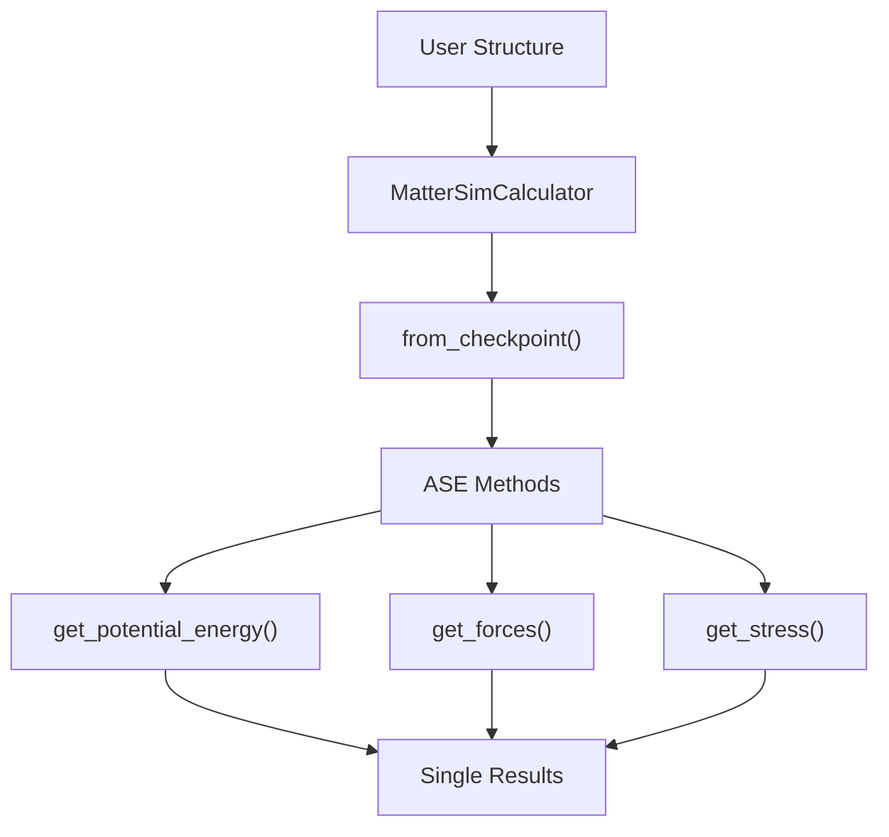
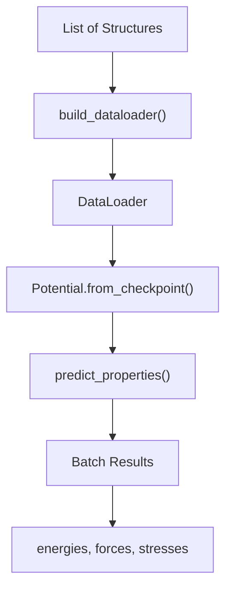
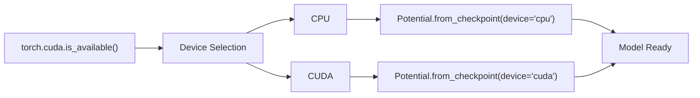

<!-- source: DeepWiki mcp.deepwiki.com · repo microsoft/mattersim · page 4 Usage · fetched 2026-10-26 -->

# Usage

<details>
<summary>Relevant source files</summary>

The following files were used as context for generating this wiki page:

- [docs/user_guide/getting_started.rst](docs/user_guide/getting_started.rst)

</details>


This page provides an overview of the different interfaces and workflows for using MatterSim to perform materials simulations. It covers the primary usage patterns and helps users select the appropriate interface for their specific needs.

For detailed guides on specific interfaces, see [Basic Usage with ASE](#4.1), [Batch Processing](#4.2), and [Command Line Interface](#4.3). For information about model training and fine-tuning, see [Training & Fine-tuning](#5). For specific simulation applications, see [Applications](#6).

## Interface Options

MatterSim provides three primary interfaces for different use cases:

| Interface | Best For | Key Classes | Performance |
|-----------|----------|-------------|-------------|
| ASE Calculator | Single structures, ASE ecosystem integration | `MatterSimCalculator` | Lower GPU utilization |
| Batch Processing | Multiple structures, high-throughput | `Potential` | Optimized GPU utilization |
| Command Line | Scripts, simple workflows | CLI commands | Varies by command |

## Usage Flow Architecture

### Single Structure Workflow


### Batch Processing Workflow  


Sources: [docs/user_guide/getting_started.rst:1-80]()

## Interface Selection Guide

### Use MatterSimCalculator When:
- Working with single structures
- Integrating with existing ASE workflows
- Performing structure optimization or molecular dynamics through ASE
- Learning or prototyping with small systems

### Use Potential Class When:
- Processing multiple structures simultaneously
- Maximizing GPU utilization for high-throughput calculations
- Working with large datasets
- Performance is critical

### Use Command Line Interface When:
- Running standard simulation tasks (relax, phonon, MD)
- Scripting workflows
- Quick calculations without Python programming
- Batch job submission on clusters

Sources: [docs/user_guide/getting_started.rst:30-35]()

## Core Usage Patterns

### ASE Interface Pattern
The `MatterSimCalculator` implements the standard ASE calculator interface:

```python
from mattersim.forcefield import MatterSimCalculator
si.calc = MatterSimCalculator(device=device)
energy = si.get_potential_energy()
forces = si.get_forces()
stress = si.get_stress()
```

### Batch Processing Pattern  
The `Potential` class enables efficient batch predictions:

```python
from mattersim.forcefield.potential import Potential
potential = Potential.from_checkpoint(device=device)
predictions = potential.predict_properties(dataloader, 
                                         include_forces=True, 
                                         include_stresses=True)
```

### Data Preparation Pattern
Converting structures to MatterSim format:

```python
from mattersim.datasets.utils.build import build_dataloader
dataloader = build_dataloader(structures, only_inference=True)
```

Sources: [docs/user_guide/getting_started.rst:10-28](), [docs/user_guide/getting_started.rst:43-75]()

## Model Loading and Device Management



Both interfaces support automatic model loading from pre-trained checkpoints using the `from_checkpoint()` method. Device selection (CPU/GPU) is handled through the `device` parameter.

Sources: [docs/user_guide/getting_started.rst:18-22](), [docs/user_guide/getting_started.rst:60-62]()

## Output Format Considerations

### Stress Tensor Units
MatterSim outputs stress tensors in different units depending on the interface:
- `Potential.predict_properties()`: Returns stress in **GPa**
- `MatterSimCalculator.get_stress()`: Returns stress in **eV/ų**

To convert from GPa to eV/ų, multiply by the `GPa` conversion factor from `ase.units`.

### Result Structure
- **Single structure**: Direct property values (float, array)  
- **Batch processing**: Lists or arrays of properties for all structures
- **CLI interface**: Files written to specified output paths

Sources: [docs/user_guide/getting_started.rst:76-80](), [docs/user_guide/getting_started.rst:23-27](), [docs/user_guide/getting_started.rst:71-74]()

---

