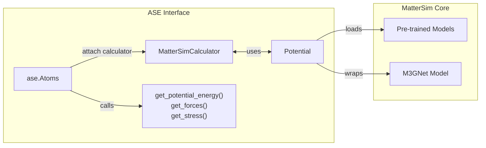
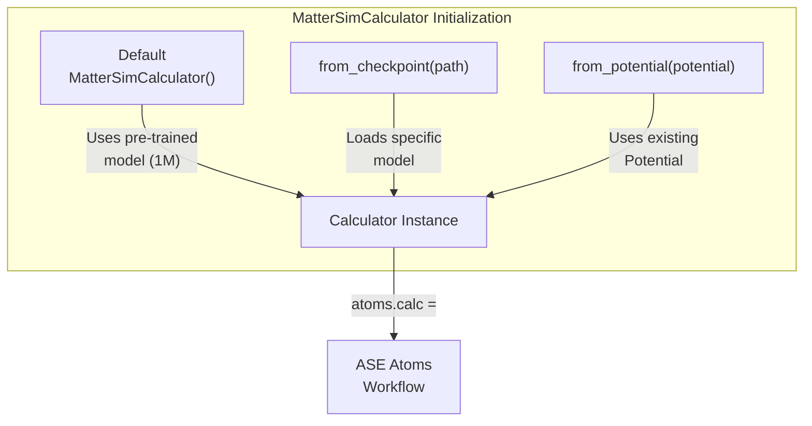
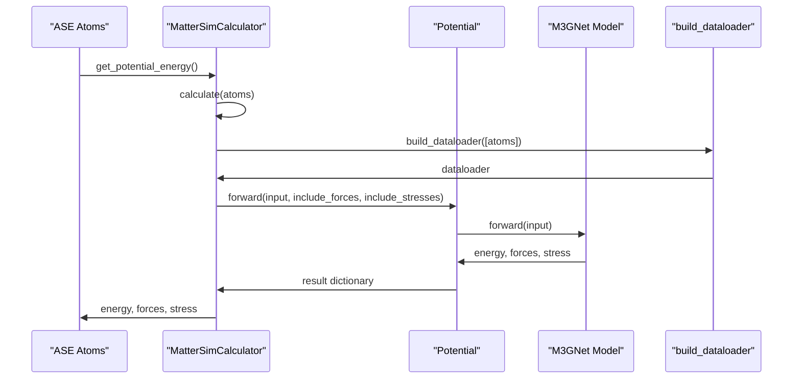
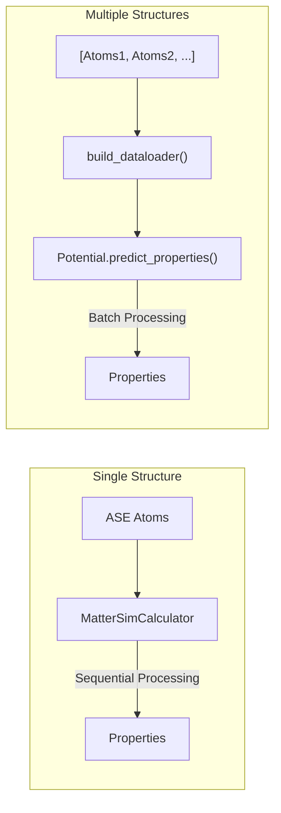

<!-- source: DeepWiki mcp.deepwiki.com · repo microsoft/mattersim · page 4.1 Basic Usage with ASE · fetched 2026-10-26 -->

# Basic Usage with ASE

<details>
<summary>Relevant source files</summary>

The following files were used as context for generating this wiki page:

- [docs/user_guide/getting_started.rst](docs/user_guide/getting_started.rst)

</details>


This document explains how to use MatterSim with the Atomic Simulation Environment (ASE) for calculating materials properties such as energy, forces, and stress. For batch processing of multiple structures, see [Batch Processing](#4.2).

## Overview

The Atomic Simulation Environment (ASE) is a widely used Python library for setting up, manipulating, and analyzing atomistic simulations. MatterSim integrates with ASE through the `MatterSimCalculator` class, which implements ASE's calculator interface. This integration allows you to leverage MatterSim's deep learning potential while using ASE's familiar workflow.



Sources: [src/mattersim/forcefield/potential.py:1240-1395]()

## Setting Up the Calculator

### Basic Configuration

To use MatterSim with ASE, you need to:
1. Create an ASE `Atoms` object
2. Initialize a `MatterSimCalculator`
3. Attach the calculator to the atoms object
4. Call ASE methods to calculate properties

Here's how to set up and use the calculator:

```python
from ase.build import bulk
from mattersim.forcefield import MatterSimCalculator

# Create an ASE Atoms object
si = bulk("Si", "diamond", a=5.43)

# Initialize and attach calculator
si.calc = MatterSimCalculator(device="cuda")

# Calculate properties
energy = si.get_potential_energy()
forces = si.get_forces()
stress = si.get_stress()
```

Sources: [docs/user_guide/getting_started.rst:4-33]()

### Calculator Initialization Options

The `MatterSimCalculator` can be initialized in several ways:

1. **Default initialization** - Uses the default pre-trained model:
   ```python
   calc = MatterSimCalculator(device="cuda")
   ```

2. **From a checkpoint** - Loads a specific model:
   ```python
   calc = MatterSimCalculator.from_checkpoint("mattersim-v1.0.0-5M", device="cuda")
   ```

3. **From an existing potential** - Uses a previously created `Potential` object:
   ```python
   potential = Potential.from_checkpoint(device="cuda")
   calc = MatterSimCalculator.from_potential(potential)
   ```



Sources: [src/mattersim/forcefield/potential.py:1247-1280]()

## Calculating Properties

Once the calculator is attached to your atoms object, you can calculate various properties:

### Energy Calculations

```python
# Total energy (eV)
energy = atoms.get_potential_energy()

# Energy per atom (eV/atom)
energy_per_atom = atoms.get_potential_energy() / len(atoms)
```

### Force Calculations

```python
# All atomic forces (eV/Å)
forces = atoms.get_forces()

# Force on a specific atom
force_atom_0 = atoms.get_forces()[0]
```

### Stress Calculations

```python
# Stress tensor (eV/ų)
stress_tensor = atoms.get_stress(voigt=False)

# Stress in GPa
from ase.units import GPa
stress_gpa = atoms.get_stress(voigt=False) / GPa
```

Sources: [docs/user_guide/getting_started.rst:13-27]()

## Under the Hood

When you call methods like `get_potential_energy()` on an ASE atoms object with an attached `MatterSimCalculator`, the following process occurs:



The `calculate` method in `MatterSimCalculator` is responsible for:
1. Converting the ASE `Atoms` object to a format suitable for MatterSim using `build_dataloader`
2. Calling the `forward` method of the `Potential` class to calculate properties
3. Storing the results in the `self.results` dictionary, which ASE methods like `get_potential_energy()` access

Sources: [src/mattersim/forcefield/potential.py:1313-1395]()

## Available Pre-trained Models

MatterSim comes with pre-trained models that can be used with the ASE calculator:

| Model Name | Description | Parameters | Usage |
|------------|-------------|------------|-------|
| mattersim-v1.0.0-1M | Default model | ~1 million | `MatterSimCalculator()` |
| mattersim-v1.0.0-5M | Larger model | ~5 million | `MatterSimCalculator.from_checkpoint("mattersim-v1.0.0-5M")` |

When not explicitly specified, the calculator uses the 1M parameter model by default.

Sources: [src/mattersim/forcefield/potential.py:848-892]()

## Complete Example

Here's a complete example showing how to use MatterSim with ASE to calculate properties of a silicon crystal:

```python
import torch
from ase.build import bulk
from ase.units import GPa
from mattersim.forcefield import MatterSimCalculator

# Set device (GPU if available)
device = "cuda" if torch.cuda.is_available() else "cpu"
print(f"Running MatterSim on {device}")

# Create silicon bulk structure
si = bulk("Si", "diamond", a=5.43)

# Initialize and attach calculator
si.calc = MatterSimCalculator(device=device)

# Calculate and print properties
print(f"Energy (eV)                 = {si.get_potential_energy()}")
print(f"Energy per atom (eV/atom)   = {si.get_potential_energy()/len(si)}")
print(f"Forces of first atom (eV/Å) = {si.get_forces()[0]}")
print(f"Stress[0][0] (eV/ų)        = {si.get_stress(voigt=False)[0][0]}")
print(f"Stress[0][0] (GPa)          = {si.get_stress(voigt=False)[0][0] / GPa}")
```

Sources: [docs/user_guide/getting_started.rst:10-27]()

## Performance Considerations

The `MatterSimCalculator` is designed to calculate properties for a single structure at a time. While convenient for standard ASE workflows, this approach doesn't fully utilize GPU capabilities for multiple structures.

For calculations involving multiple structures where batch processing would be more efficient, consider using the `Potential` class directly with its `predict_properties` method, as described in [Batch Processing](#4.2).



Sources: [docs/user_guide/getting_started.rst:30-35]()

## Common Issues and Tips

1. **Device Selection**: Always specify the device explicitly when creating a calculator to ensure optimal performance.
   ```python
   calc = MatterSimCalculator(device="cuda" if torch.cuda.is_available() else "cpu")
   ```

2. **Stress Units**: By default, ASE reports stress in eV/ų, while MatterSim's `predict_properties` method returns stress in GPa. Use the `GPa` constant from `ase.units` for conversion when needed.

3. **Periodic Boundary Conditions**: MatterSim works with both periodic and non-periodic structures. When using ASE, make sure to set appropriate boundary conditions in your `Atoms` object.

Sources: [src/mattersim/forcefield/potential.py:1247-1255](), [docs/user_guide/getting_started.rst:76-79]()

---

