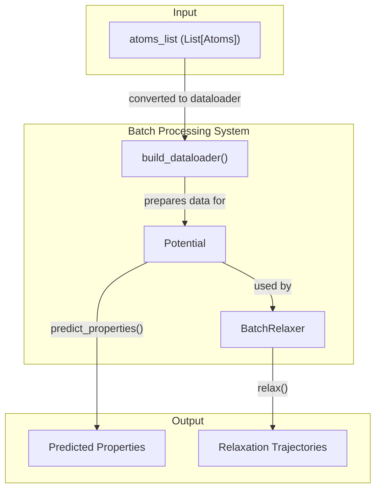
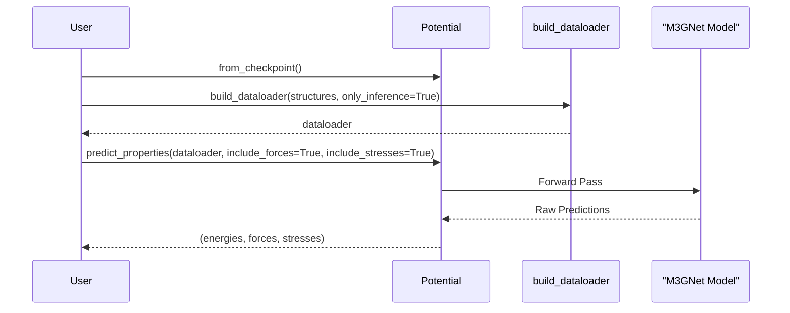
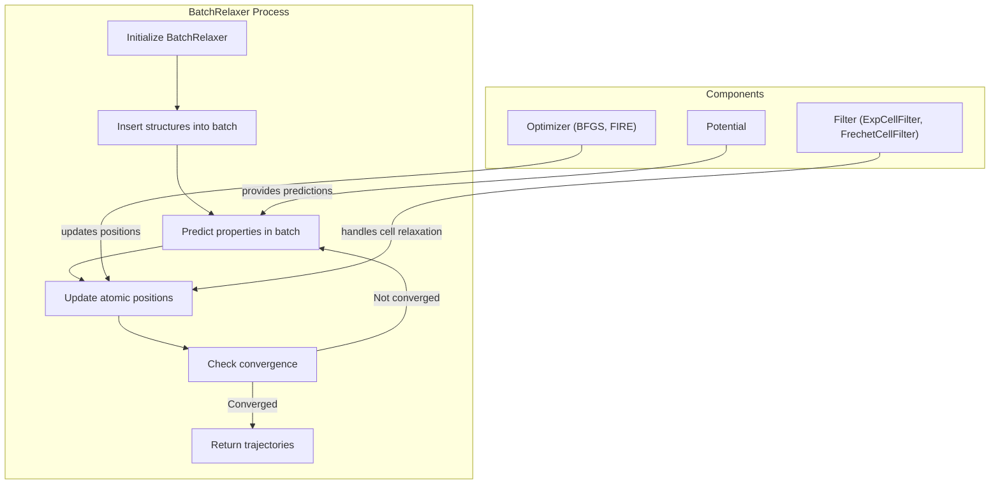
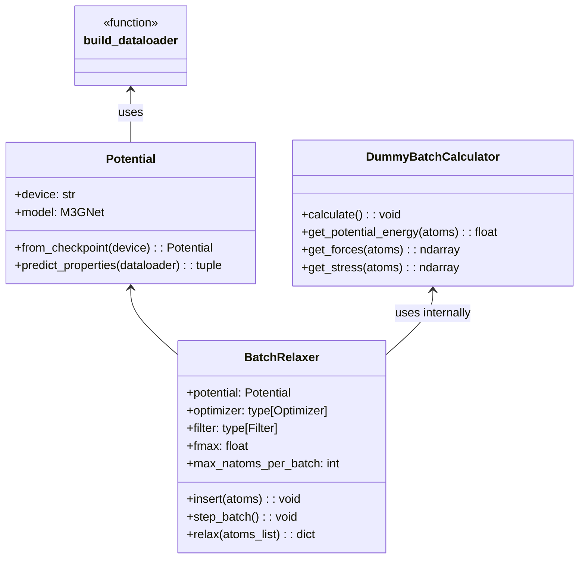

<!-- source: DeepWiki mcp.deepwiki.com · repo microsoft/mattersim · page 4.2 Batch Processing · fetched 2026-10-26 -->

# Batch Processing

<details>
<summary>Relevant source files</summary>

The following files were used as context for generating this wiki page:

- [docs/user_guide/getting_started.rst](docs/user_guide/getting_started.rst)
- [src/mattersim/applications/batch_relax.py](src/mattersim/applications/batch_relax.py)
- [src/mattersim/datasets/utils/build.py](src/mattersim/datasets/utils/build.py)

</details>


## Introduction

Batch processing in MatterSim enables efficient computation of material properties for multiple atomic structures simultaneously. This approach offers significant performance benefits compared to processing structures one at a time, especially when utilizing GPU acceleration. While the `MatterSimCalculator` (described in [MatterSimCalculator](#2.2)) processes single structures through the ASE interface, batch processing provides a more direct and efficient pathway for handling collections of structures.

This page covers the core components of batch processing, how to perform batch predictions of materials properties, and how to leverage batch operations for structure relaxation.

Sources: [docs/user_guide/getting_started.rst:30-33]()

## Core Components

The batch processing system in MatterSim consists of several key components:



**Diagram: Batch Processing Core Components**

- **`Potential` class**: The core component that manages the machine learning model and provides methods for batch prediction of material properties.
- **`build_dataloader` function**: Converts atomic structures to a format suitable for efficient batch processing.
- **`BatchRelaxer` class**: Facilitates batch structural relaxation, efficiently processing multiple structures in parallel.

Sources: [src/mattersim/forcefield/potential.py](), [src/mattersim/datasets/utils/build.py:13-28](), [src/mattersim/applications/batch_relax.py:35-38]()

## Batch Prediction Workflow

The batch prediction workflow uses the `Potential` class to efficiently predict properties of multiple structures:



**Diagram: Batch Prediction Process Flow**

### Using the Potential Class for Batch Prediction

To use batch prediction:

1. **Load the pre-trained model** using `Potential.from_checkpoint()`
2. **Convert structures to a dataloader** using `build_dataloader()`
3. **Predict properties** using `predict_properties()`

```python
# Example usage pattern (not actual code):
potential = Potential.from_checkpoint(device=device)
dataloader = build_dataloader(structures, only_inference=True)
energies, forces, stresses = potential.predict_properties(
    dataloader, include_forces=True, include_stresses=True
)
```

The `predict_properties` method returns:
- A list of total energies (in eV)
- A list of forces (in eV/Å)
- A list of stress tensors (in GPa)

> **Note**: Stress tensors are returned in GPa by default. To convert to eV/ų, multiply by the conversion factor `GPa` from ASE units.

Sources: [docs/user_guide/getting_started.rst:35-74](), [src/mattersim/datasets/utils/build.py:13-123]()

## Batch Relaxation

The `BatchRelaxer` class enables efficient structure optimization for multiple atomic structures:



**Diagram: Batch Relaxation Workflow**

### Key Features of BatchRelaxer

- **Efficient batch processing**: Processes multiple structures in parallel to utilize GPU resources effectively
- **Supported optimizers**: BFGS and FIRE algorithms
- **Supported filters**: ExpCellFilter and FrechetCellFilter for cell optimization
- **Trajectory tracking**: Records the relaxation trajectory for each structure

### Using BatchRelaxer

```python
# Example usage pattern (not actual code):
potential = Potential.from_checkpoint()
relaxer = BatchRelaxer(
    potential, 
    fmax=0.01,                 # Force convergence criterion
    filter="EXPCELLFILTER",    # For cell relaxation
    optimizer="FIRE"           # Optimization algorithm
)
relaxation_trajectories = relaxer.relax(atoms_list)
```

The `relax()` method returns a dictionary mapping structure indices to their relaxation trajectories. Each trajectory is a list of `Atoms` objects representing the structure at each optimization step.

Sources: [src/mattersim/applications/batch_relax.py:35-171](), [docs/examples/batch_relaxation_example.rst:1-66]()

## Implementation Details



**Diagram: Batch Processing Classes and Relationships**

### Internal BatchRelaxer Workflow

1. The `relax()` method processes structures in batches, respecting the `max_natoms_per_batch` limit.
2. For each structure, a `DummyBatchCalculator` is assigned to store predicted properties.
3. For each batch step:
   - Structures are collected into a dataloader
   - The `Potential` predicts properties for all structures at once
   - Properties are assigned to the respective structures
   - The optimizer applies updates to atomic positions
   - Convergence is checked for each structure
4. Converged structures are removed from the active batch, and new structures are added if available.
5. The process continues until all structures are converged or reach the maximum step limit.

Sources: [src/mattersim/applications/batch_relax.py:18-33](), [src/mattersim/applications/batch_relax.py:141-171]()

## Best Practices and Performance Considerations

### Optimizing Batch Size

- **Memory limitations**: The optimal batch size depends on GPU memory. For complex structures, reduce batch size to avoid out-of-memory errors.
- **Processing efficiency**: Larger batches generally improve GPU utilization, but there are diminishing returns above certain sizes.
- **Structure size**: The `max_natoms_per_batch` parameter in `BatchRelaxer` can be adjusted to control maximum atoms per batch.

### Device Selection

```python
# Setting the device for batch processing
device = "cuda" if torch.cuda.is_available() else "cpu"
potential = Potential.from_checkpoint(device=device)
```

GPU-based batch processing provides significant speedups compared to CPU processing, especially for large batches.

### Monitoring Resource Usage

- Watch GPU memory usage during batch processing
- For very large datasets, consider processing in chunks to avoid memory issues

Sources: [docs/user_guide/getting_started.rst:59-62](), [src/mattersim/applications/batch_relax.py:52-53]()

## Example Use Cases

1. **High-throughput screening**: Process thousands of candidate structures efficiently
2. **Ensemble relaxation**: Relax multiple perturbations of the same structure to find global minima
3. **Parameter sweeps**: Evaluate the same structure across different conditions
4. **Dataset generation**: Create datasets for training custom models

Sources: [docs/examples/batch_relaxation_example.rst:1-66]()

---

