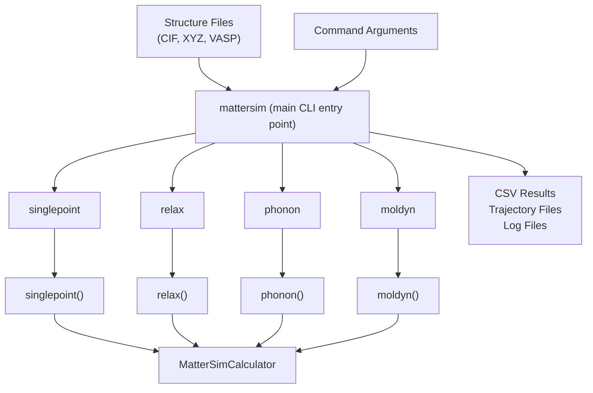
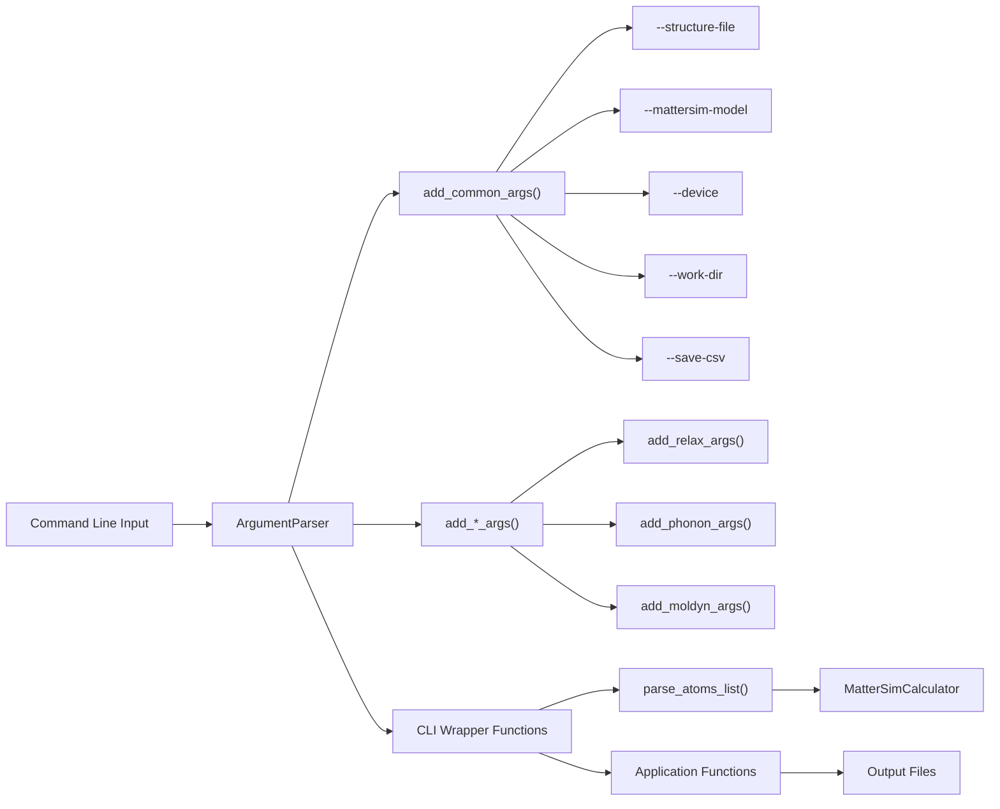
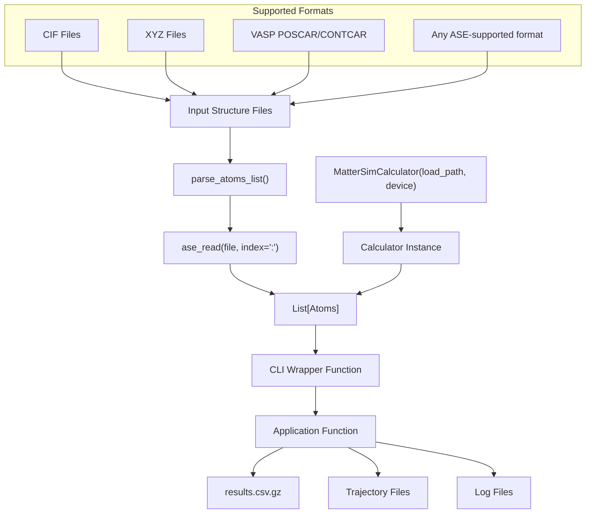

<!-- source: DeepWiki mcp.deepwiki.com · repo microsoft/mattersim · page 4.3 Command Line Interface · fetched 2026-10-26 -->

# Command Line Interface

<details>
<summary>Relevant source files</summary>

The following files were used as context for generating this wiki page:

- [src/mattersim/cli/mattersim_app.py](src/mattersim/cli/mattersim_app.py)
- [tests/data/mp-149_Si2.cif](tests/data/mp-149_Si2.cif)
- [tests/data/mp-2998_BaTiO3.cif](tests/data/mp-2998_BaTiO3.cif)

</details>


The MatterSim Command Line Interface (CLI) provides a unified command-line tool for performing materials simulation tasks including single-point calculations, structure relaxation, phonon analysis, and molecular dynamics simulations. The CLI is implemented as a Python console script that serves as a convenient wrapper around MatterSim's core functionality.

For detailed information about the underlying calculation methods, see [Basic Usage with ASE](#4.1) and [Batch Processing](#4.2). For information about the individual simulation applications, see [Applications](#6).

## CLI Architecture Overview

The CLI follows a subcommand architecture where each major simulation type is implemented as a separate subcommand with its own specific arguments while sharing common configuration options.



Sources: [src/mattersim/cli/mattersim_app.py:296-350](), [src/mattersim/cli/mattersim_app.py:10-14]()

## Installation and Basic Usage

The CLI is automatically installed as a console script named `mattersim` when MatterSim is installed via pip or conda. The basic syntax is:

```bash
mattersim <subcommand> [arguments]
```

To see available subcommands:
```bash
mattersim --help
```

To see help for a specific subcommand:
```bash
mattersim <subcommand> --help
```

## Available Commands

### singlepoint

Performs single-point energy, force, and stress calculations on one or more atomic structures.

```bash
mattersim singlepoint --structure-file structure.cif
```

### relax

Performs structural optimization to find the minimum energy configuration.

```bash
mattersim relax --structure-file structure.cif --fmax 0.01 --steps 500
```

### phonon

Calculates phonon dispersion and vibrational properties using finite differences.

```bash
mattersim phonon --structure-file structure.cif --find-prim --enable-relax
```

### moldyn

Runs molecular dynamics simulations at specified temperature and ensemble.

```bash
mattersim moldyn --structure-file structure.cif --temperature 300 --steps 1000
```

Sources: [src/mattersim/cli/mattersim_app.py:304-336]()

## Argument Processing Flow

The CLI processes arguments through a systematic workflow that separates common configuration from command-specific parameters:



Sources: [src/mattersim/cli/mattersim_app.py:105-140](), [src/mattersim/cli/mattersim_app.py:142-277](), [src/mattersim/cli/mattersim_app.py:279-293]()

## Common Arguments

All subcommands share these fundamental configuration options:

| Argument | Type | Default | Description |
|----------|------|---------|-------------|
| `--structure-file` | str+ | Required | Path to structure file(s) (CIF, XYZ, VASP, etc.) |
| `--mattersim-model` | str | `mattersim-v1.0.0-1m` | Pre-trained model choice (`1m` or `5m`) |
| `--device` | str | `cpu` | Computation device (`cpu` or `cuda`) |
| `--work-dir` | str | Auto-generated | Working directory for calculation files |
| `--save-csv` | str | `results.csv.gz` | Output CSV file for results |

The CLI automatically generates unique working directories using timestamps and UUIDs when not specified, ensuring that concurrent runs don't interfere with each other.

Sources: [src/mattersim/cli/mattersim_app.py:105-140]()

## Command-Specific Arguments

### Relaxation Arguments

Used by both `relax` and `phonon` commands:

| Argument | Type | Default | Description |
|----------|------|---------|-------------|
| `--optimizer` | str | `FIRE` | ASE optimizer algorithm |
| `--filter` | str | `None` | Constraint filter to apply |
| `--constrain-symmetry` | flag | `False` | Maintain crystallographic symmetry |
| `--fix-axis` | bool+ | `False` | Fix specific cell axes |
| `--pressure-in-GPa` | float | `None` | External pressure for NPT relaxation |
| `--fmax` | float | `0.01` | Force convergence criterion (eV/Å) |
| `--steps` | int | `500` | Maximum optimization steps |

### Phonon-Specific Arguments

Additional options for phonon calculations:

| Argument | Type | Default | Description |
|----------|------|---------|-------------|
| `--find-prim` | flag | `False` | Use primitive cell for calculations |
| `--amplitude` | float | `0.01` | Finite difference displacement (Å) |
| `--supercell-matrix` | int[3] | Auto | Supercell dimensions |
| `--qpoints-mesh` | int[3] | Auto | k-point mesh for Brillouin zone integration |
| `--max-atoms` | int | `None` | Maximum atoms in supercell |
| `--enable-relax` | flag | `False` | Pre-relax structure before phonon calculation |

### Molecular Dynamics Arguments

Parameters for MD simulations:

| Argument | Type | Default | Description |
|----------|------|---------|-------------|
| `--temperature` | float | `300` | Target temperature (K) |
| `--timestep` | float | `1` | Integration timestep (fs) |
| `--steps` | int | `1000` | Total simulation steps |
| `--ensemble` | str | `nvt_nose_hoover` | Statistical ensemble |
| `--logfile` | str | `md.log` | Simulation log file |
| `--loginterval` | int | `10` | Logging frequency |
| `--trajectory` | str | `md.traj` | Trajectory output file |
| `--taut` | float | `None` | Nose-Hoover thermostat coupling (fs) |

Sources: [src/mattersim/cli/mattersim_app.py:142-277]()

## Structure File Processing

The CLI handles multiple input formats and can process multiple structures in a single command:



The `parse_atoms_list()` function automatically handles:
- Single or multiple structure files
- Any format supported by ASE's `read()` function
- Assignment of the MatterSim calculator to all structures
- Loading of the specified pre-trained model

Sources: [src/mattersim/cli/mattersim_app.py:279-293]()

## Output and File Management

Each CLI run creates a structured working directory containing all outputs:

```
work-dir/
├── results.csv.gz          # Tabular results (energies, forces, etc.)
├── relaxed_structures/     # Optimized structures (relax command)
├── phonon_results/         # Phonon dispersion data (phonon command)
├── md.traj                 # MD trajectory (moldyn command)
├── md.log                  # MD simulation log (moldyn command)
└── calculation_logs/       # Detailed calculation logs
```

The CLI automatically handles:
- Unique working directory generation to prevent conflicts
- Compressed CSV output for efficient storage
- Structured organization of output files by calculation type
- Preservation of input parameters in metadata

Sources: [src/mattersim/cli/mattersim_app.py:126-139]()

## Example Usage Patterns

### Single Structure Calculation
```bash
mattersim singlepoint --structure-file mp-149_Si2.cif --mattersim-model mattersim-v1.0.0-5m
```

### Batch Structure Relaxation
```bash
mattersim relax --structure-file *.cif --fmax 0.005 --steps 1000 --work-dir batch_relax
```

### Phonon Analysis with Pre-relaxation
```bash
mattersim phonon --structure-file BaTiO3.cif --find-prim --enable-relax --amplitude 0.02
```

### GPU-Accelerated Molecular Dynamics
```bash
mattersim moldyn --structure-file structure.cif --device cuda --temperature 500 --steps 10000
```

Sources: [src/mattersim/cli/mattersim_app.py:17-102](), [tests/data/mp-2998_BaTiO3.cif:1-36](), [tests/data/mp-149_Si2.cif:1-28]()

---

