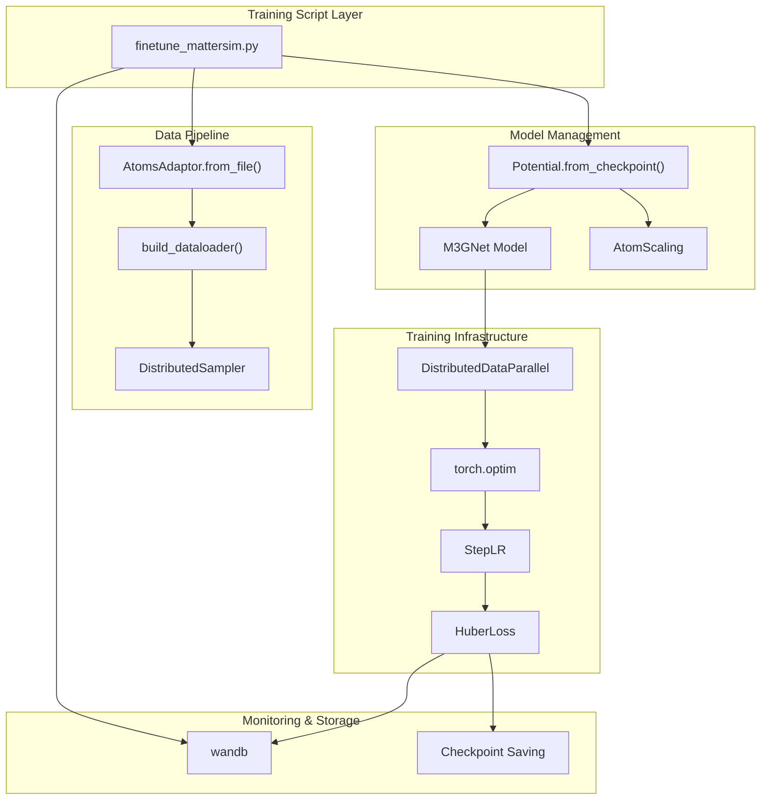
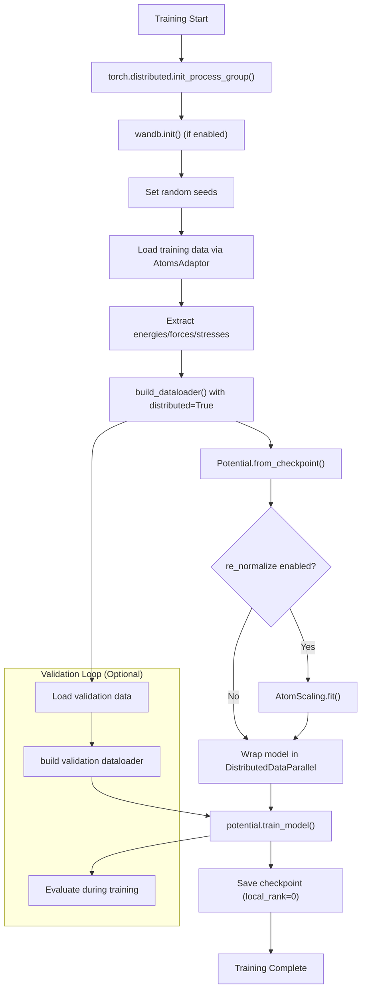
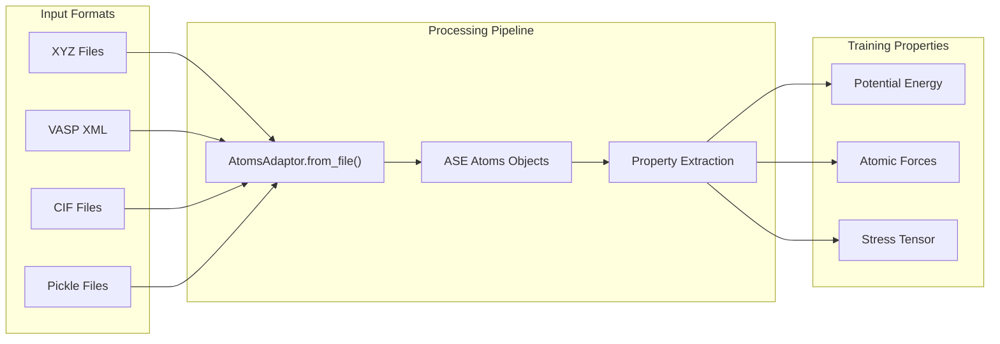

<!-- source: DeepWiki mcp.deepwiki.com · repo microsoft/mattersim · page 5 Training & Fine-tuning · fetched 2026-10-26 -->

# Training & Fine-tuning

Relevant source files

The following files were used as context for generating this wiki page:

- [docs/index.rst](docs/index.rst)
- [docs/user_guide/finetune.rst](docs/user_guide/finetune.rst)
- [src/mattersim/training/finetune_mattersim.py](src/mattersim/training/finetune_mattersim.py)
- [src/mattersim/utils/vasprun_to_xyz.py](src/mattersim/utils/vasprun_to_xyz.py)
- [tests/data/high_level_water.xyz](tests/data/high_level_water.xyz)

This document covers the comprehensive training and fine-tuning capabilities of MatterSim, including the workflow for adapting pre-trained models to custom datasets, distributed training setup, and integration with experiment tracking tools. The content focuses on the core training infrastructure and orchestration components.

For detailed data preparation workflows, see [Data Preparation](#5.1). For step-by-step fine-tuning procedures, see [Fine-tuning Process](#5.2). For model evaluation and validation, see [Model Evaluation](#5.3).

## Overview

MatterSim provides a complete training infrastructure built around distributed PyTorch training with support for multi-GPU setups, experiment tracking via Weights & Biases, and flexible data processing pipelines. The system is designed to fine-tune pre-trained M3GNet-based models on custom materials datasets.

The training system supports:
- Fine-tuning of pre-trained MatterSim models (`mattersim-v1.0.0-1m`, `mattersim-v1.0.0-5m`)
- Distributed training across multiple GPUs using `torch.distributed`
- Energy, force, and stress prediction with customizable loss ratios
- Automatic energy/force normalization via `AtomScaling`
- Integration with external experiment tracking and cloud storage

Sources: [src/mattersim/training/finetune_mattersim.py:1-254](), [docs/user_guide/finetune.rst:1-99]()

## Training Architecture

The MatterSim training system is built around several key components that work together to provide a complete model training pipeline:

Sources: [src/mattersim/training/finetune_mattersim.py:23-147]()

## Core Training Components

### Potential Class Integration
The training system leverages the `Potential` class as the primary interface for model management and training orchestration. The `Potential.from_checkpoint()` method loads pre-trained models, while `Potential.train_model()` handles the actual training loop with distributed support.

### Data Processing Pipeline
Training data flows through several processing stages:
1. `AtomsAdaptor.from_file()` loads atomic structures from various formats (XYZ, VASP XML, CIF, PKL)
2. Energy, force, and stress extraction from ASE `Atoms` objects
3. `build_dataloader()` creates PyTorch dataloaders with distributed sampling
4. Graph conversion for M3GNet architecture consumption

### Distributed Training Setup
The system supports multi-GPU distributed training using PyTorch's `DistributedDataParallel`:
- Backend selection: NCCL for CUDA, Gloo for CPU
- Automatic local rank detection via `LOCAL_RANK` environment variable
- Distributed barrier synchronization for coordinated initialization

Sources: [src/mattersim/training/finetune_mattersim.py:24-48](), [src/mattersim/training/finetune_mattersim.py:132-142]()

## Training Workflow

The training process follows a structured workflow from initialization to model saving:

Sources: [src/mattersim/training/finetune_mattersim.py:48-147]()

## Configuration Parameters

The fine-tuning system accepts comprehensive configuration through command-line arguments organized into several categories:

| Category | Parameters | Purpose |
|----------|------------|---------|
| **Path Configuration** | `train_data_path`, `valid_data_path`, `load_model_path`, `save_path` | Data and model file locations |
| **Model Architecture** | `cutoff`, `threebody_cutoff` | Graph construction parameters |
| **Training Hyperparameters** | `epochs`, `batch_size`, `lr`, `step_size` | Core training settings |
| **Loss Configuration** | `include_forces`, `include_stresses`, `force_loss_ratio`, `stress_loss_ratio` | Multi-target loss weighting |
| **Normalization** | `re_normalize`, `scale_key`, `shift_key`, `trainable_scale`, `trainable_shift` | Energy/force scaling |
| **Experiment Tracking** | `wandb`, `wandb_project`, `wandb_api_key` | External monitoring integration |

Sources: [src/mattersim/training/finetune_mattersim.py:149-252](), [docs/user_guide/finetune.rst:13-78]()

## Data Format Support

The training system supports multiple input data formats through the `AtomsAdaptor` interface:

The system includes utilities for data format conversion, particularly `vasprun_to_xyz.py` for converting VASP calculation outputs to XYZ format suitable for training.

Sources: [src/mattersim/training/finetune_mattersim.py:57-72](), [src/mattersim/utils/vasprun_to_xyz.py:11-54]()

## Experiment Tracking Integration

MatterSim integrates with Weights & Biases for comprehensive experiment tracking:

- Automatic configuration logging via `wandb.init(config=args)`
- Model checkpoint upload using `wandb.save()`
- Distributed-aware logging (only rank 0 performs logging operations)
- Support for custom project names and API key configuration

The integration ensures reproducible experiments while maintaining compatibility with distributed training setups.

Sources: [src/mattersim/training/finetune_mattersim.py:29-46](), [src/mattersim/training/finetune_mattersim.py:144-146]()

## Energy and Force Normalization

The `AtomScaling` component provides automatic normalization of energies and forces based on training dataset statistics:

- **Energy Scaling**: Per-species energy mean calculation via linear regression
- **Force Scaling**: RMS force calculation per atomic species
- **Configurable Keys**: `per_species_forces_rms`, `per_species_energy_mean_linear_reg`
- **Trainable Parameters**: Optional learnable scaling and shifting parameters

This normalization improves training stability and convergence, especially when fine-tuning on datasets with different energy/force scales than the original training data.

Sources: [src/mattersim/training/finetune_mattersim.py:86-94](), [src/mattersim/training/finetune_mattersim.py:129-131]()

---

