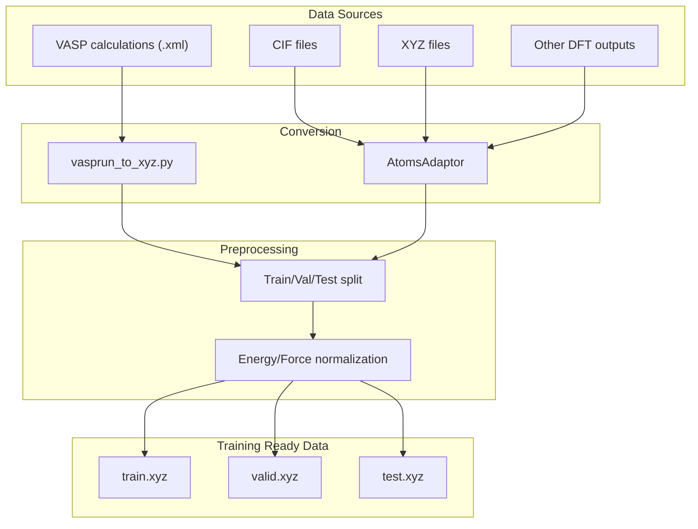
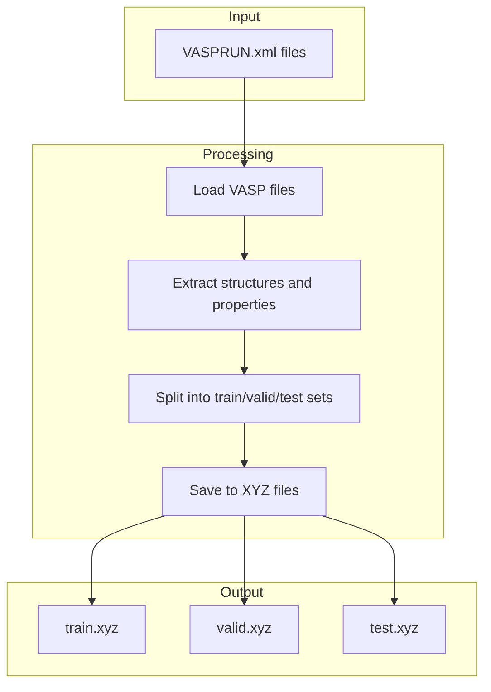
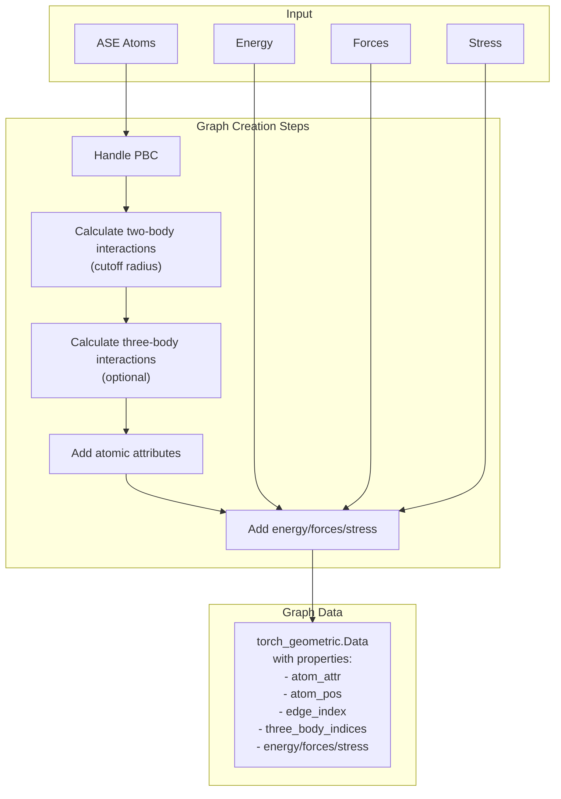
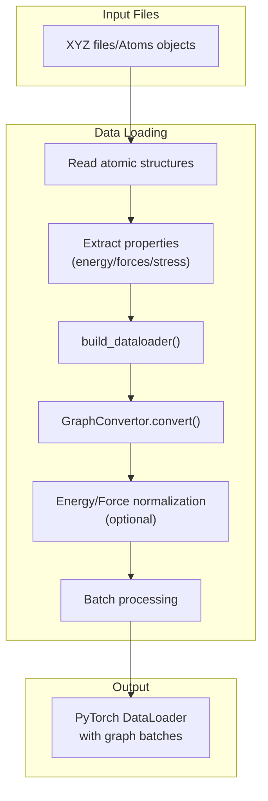

<!-- source: DeepWiki mcp.deepwiki.com · repo microsoft/mattersim · page 5.1 Data Preparation · fetched 2026-10-26 -->

# Data Preparation

<details>
<summary>Relevant source files</summary>

The following files were used as context for generating this wiki page:

- [data/benchmarks/alexandria-random-1k.xyz](data/benchmarks/alexandria-random-1k.xyz)
- [data/benchmarks/mpf-TP.xyz](data/benchmarks/mpf-TP.xyz)
- [data/benchmarks/mpf-alkali-TP.xyz](data/benchmarks/mpf-alkali-TP.xyz)
- [src/mattersim/training/finetune_mattersim.py](src/mattersim/training/finetune_mattersim.py)
- [src/mattersim/utils/vasprun_to_xyz.py](src/mattersim/utils/vasprun_to_xyz.py)

</details>


This page outlines the process of preparing atomic structure data for training and fine-tuning MatterSim models. Proper data preparation is essential for effective model training and accurate predictions of material properties. For information about the actual fine-tuning process, see [Fine-tuning Process](#5.2).

## Data Formats and Requirements

MatterSim supports several common atomic structure formats for training data:

| Format | Description | Support |
|--------|-------------|---------|
| XYZ/Extended XYZ | Simple text file format with atomic coordinates and optional properties | Recommended for training |
| VASP XML | XML output from VASP calculations containing energy, forces, and stress | Convertible via built-in tools |
| CIF | Crystallographic Information File | Supported via ASE |
| Pickle (.pkl) | Serialized Python objects containing ASE Atoms | For efficient data storage |

The training data must include atomic structures and, depending on the training objectives, one or more of the following properties:

- Energy (required)
- Forces (optional, but recommended)
- Stress tensors (optional)

Sources: [src/mattersim/training/finetune_mattersim.py:57-71](), [src/mattersim/training/finetune_mattersim.py:96-110]()

## Data Preparation Workflow

The process of preparing data for training MatterSim models involves several steps, from data collection to final preprocessing.

### Overall Data Preparation Workflow



Sources: [src/mattersim/utils/vasprun_to_xyz.py:11-53](), [src/mattersim/training/finetune_mattersim.py:57-71]()

## Converting VASP Data

MatterSim provides a utility script to convert VASP XML output files to the XYZ format required for training. This tool handles the extraction of energies, forces, and stresses from VASP calculations and formats them for MatterSim training.

### VASP Conversion Workflow



You can convert VASP data using the `vasprun_to_xyz.py` script:

```
python -m mattersim.utils.vasprun_to_xyz --data_path /path/to/vasp/files --save_path ./xyz_files
```

The script recursively searches for all `.xml` files in the specified directory, converts them to ASE Atoms objects, and splits them into training, validation, and test sets according to specified ratios (default: 80% training, 10% validation, 10% testing).

Sources: [src/mattersim/utils/vasprun_to_xyz.py:11-78]()

## Graph Representation

MatterSim uses a graph-based neural network (M3GNet) to represent atomic structures. During training, atomic structures are converted to graph representations using the `GraphConvertor` class.

### Graph Conversion Process



The graph representation includes:

1. **Nodes**: Atoms with their atomic numbers as attributes
2. **Edges**: Connections between atoms within a cutoff radius (two-body interactions)
3. **Three-body terms**: Angular interactions between triplets of atoms (optional)
4. **Properties**: Energy, forces, and stress as training targets

The conversion is handled automatically during data loading but can be configured through parameters to the `GraphConvertor` class.

Sources: [src/mattersim/datasets/utils/convertor.py:154-290]()

## Data Loading

The data loading process prepares atomic structures for training by converting them to graph representations and organizing them into batches. This is handled by the `build_dataloader` function.

### Data Loading Pipeline



The data loading process includes:
1. Reading atomic structures from files (typically XYZ format)
2. Extracting energy, forces, and stress values
3. Converting structures to graph representations
4. (Optional) Normalizing energies and forces 
5. Batching for efficient training

Sources: [src/mattersim/training/finetune_mattersim.py:73-82](), [src/mattersim/training/finetune_mattersim.py:111-121]()

## Graph Conversion Details

The `GraphConvertor` class is responsible for transforming atomic structures into graph representations that can be processed by the neural network model.

### Property Mapping

| Atomic Structure Property | Graph Property | Description |
|---------------------------|---------------|-------------|
| Atomic numbers | `atom_attr` | Element identity as a numerical feature |
| Atomic positions | `atom_pos` | 3D coordinates of each atom |
| Two-body interactions | `edge_index` | Pairs of atoms within cutoff radius |
| Three-body interactions | `three_body_indices` | Triplets of atoms forming angles |
| Energy | `energy` | Total energy of the structure |
| Forces | `forces` | Forces on each atom |
| Stress | `stress` | Stress tensor of the structure |

Key parameters for graph conversion include:
- `twobody_cutoff`: Radius for two-body interactions (default: 5.0 Å)
- `threebody_cutoff`: Radius for three-body interactions (default: 4.0 Å)
- `has_threebody`: Whether to include three-body terms (default: True)

Sources: [src/mattersim/datasets/utils/convertor.py:17-39](), [src/mattersim/datasets/utils/convertor.py:161-172]()

## Normalization and Scaling

MatterSim supports normalization of energies and forces during training to improve numerical stability and model convergence.

### Normalization Options

| Scaling Method | Description | Parameter |
|----------------|-------------|-----------|
| `per_species_energy_mean_linear_reg` | Energy normalization per atomic species using linear regression | `--shift_key` |
| `per_species_forces_rms` | Force scaling based on RMS of forces per species | `--scale_key` |
| Custom values | Manually specified scaling values | `--init_scale`, `--init_shift` |

To enable re-normalization based on your training data, use the `--re_normalize` flag when running the fine-tuning script. This is particularly useful when your dataset has significantly different energy or force scales compared to the pre-training data.

Sources: [src/mattersim/training/finetune_mattersim.py:86-93](), [src/mattersim/training/finetune_mattersim.py:222-246]()

## Best Practices

### Dataset Composition
- Include diverse atomic structures that cover the space of configurations you expect to predict
- For accurate forces, include structures with atoms in various non-equilibrium positions
- For stress prediction, include structures with various cell parameters/deformations

### Dataset Size
- Minimum: 50-100 structures for fine-tuning on similar materials
- Recommended: 500+ structures for general-purpose model adaptation
- Large-scale: 5000+ structures for training from scratch or highly accurate models

### Data Splitting
- Training set: 70-80% of data
- Validation set: 10-15% of data
- Test set: 10-15% of data

### Energy and Force Scales
- For consistent training, energies should be in eV
- Forces should be in eV/Å
- Stresses should be in GPa (automatically converted from ASE's default units)

Sources: [src/mattersim/training/finetune_mattersim.py:71](), [src/mattersim/training/finetune_mattersim.py:110]()

---

