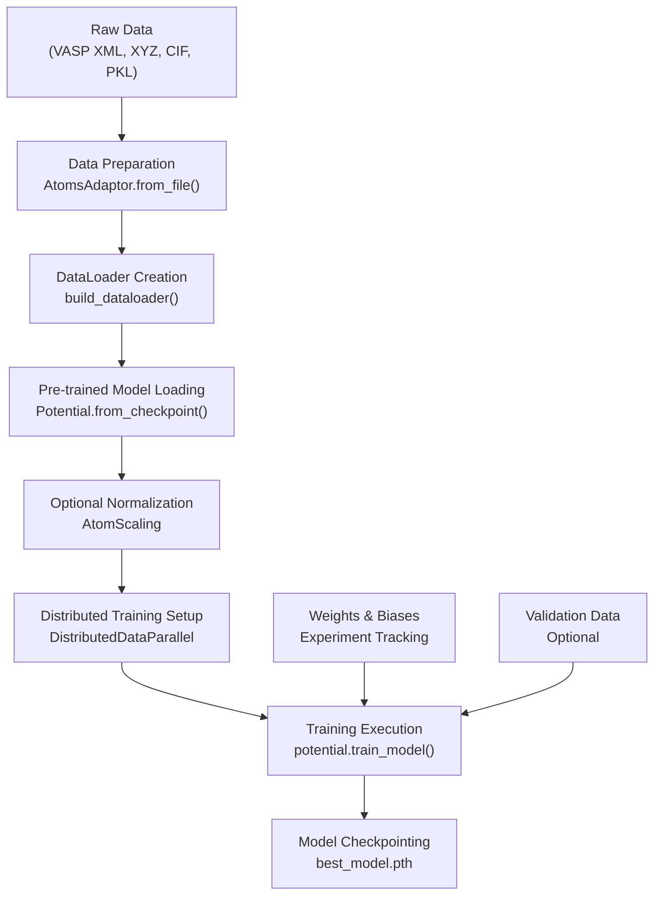
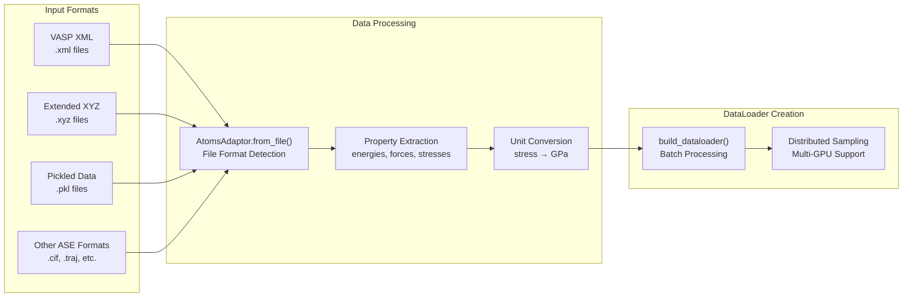
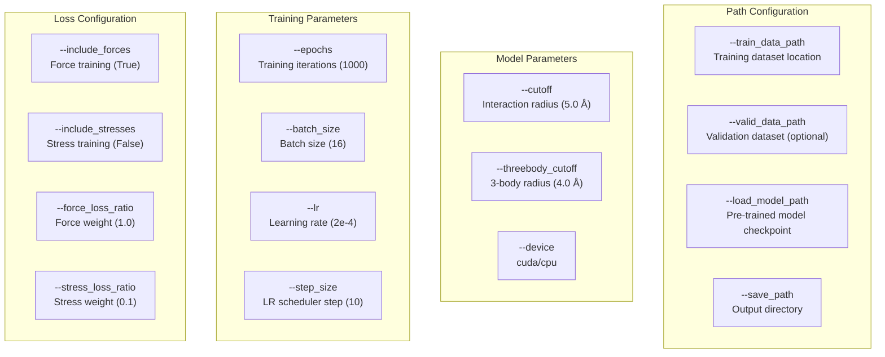
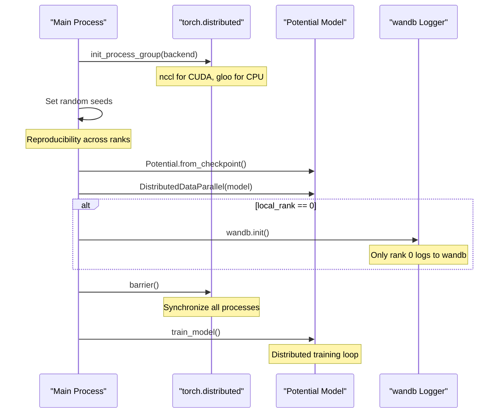
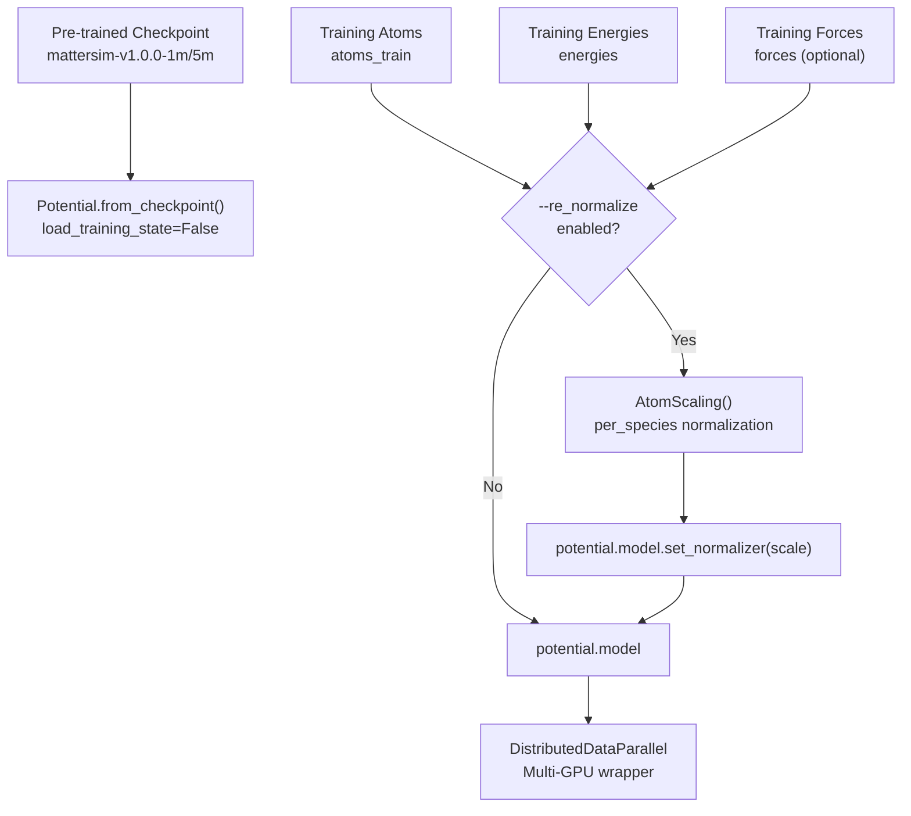
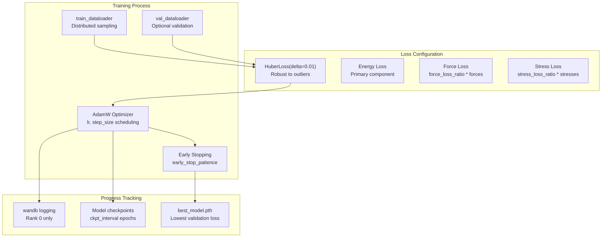

<!-- source: DeepWiki mcp.deepwiki.com · repo microsoft/mattersim · page 5.2 Fine-tuning Process · fetched 2026-10-26 -->

# Fine-tuning Process

<details>
<summary>Relevant source files</summary>

The following files were used as context for generating this wiki page:

- [docs/index.rst](docs/index.rst)
- [docs/user_guide/finetune.rst](docs/user_guide/finetune.rst)
- [src/mattersim/training/finetune_mattersim.py](src/mattersim/training/finetune_mattersim.py)
- [src/mattersim/utils/vasprun_to_xyz.py](src/mattersim/utils/vasprun_to_xyz.py)
- [tests/data/high_level_water.xyz](tests/data/high_level_water.xyz)

</details>


## Purpose and Scope

This document covers the process of fine-tuning pre-trained MatterSim models on custom datasets using the distributed training framework. It details the workflow from data preparation through model training, including parameter configuration, distributed training setup, and model checkpointing.

For information about data preparation from various file formats, see [Data Preparation](#5.1). For model evaluation techniques and benchmarking, see [Model Evaluation](#5.3).

## Fine-tuning Workflow Overview

The fine-tuning process in MatterSim follows a structured workflow that transforms raw atomistic data into a custom-trained model through distributed training.

### High-Level Process Flow



Sources: [src/mattersim/training/finetune_mattersim.py:23-146]()

## Data Preparation and Loading

The fine-tuning process begins with loading and processing atomistic data from various file formats. The system supports both structured data files and pickled atom objects.

### Data Processing Pipeline



The data loading process extracts three key properties from atomic structures:

| Property | Extraction Method | Units | Required |
|----------|------------------|--------|----------|
| Energy | `atoms.get_potential_energy()` | eV | Yes |
| Forces | `atoms.get_forces()` | eV/Å | Optional (`--include_forces`) |
| Stress | `atoms.get_stress(voigt=False) / GPa` | GPa | Optional (`--include_stresses`) |

Sources: [src/mattersim/training/finetune_mattersim.py:57-82](), [src/mattersim/utils/atoms_utils.py]()

## Training Configuration Parameters

The fine-tuning script accepts comprehensive configuration through command-line arguments, organized into functional categories.

### Core Training Parameters



### Advanced Configuration Options

The fine-tuning script provides additional options for normalization, monitoring, and checkpointing:

| Parameter Category | Key Parameters | Purpose |
|-------------------|----------------|---------|
| **Normalization** | `--re_normalize`, `--scale_key`, `--shift_key` | Adapt energy/force scaling to new dataset |
| **Monitoring** | `--wandb`, `--wandb_project`, `--wandb_api_key` | Experiment tracking and logging |
| **Checkpointing** | `--save_checkpoint`, `--ckpt_interval` | Model saving and recovery |
| **Regularization** | `--early_stop_patience`, `--seed` | Training stability and reproducibility |

Sources: [src/mattersim/training/finetune_mattersim.py:149-253](), [docs/user_guide/finetune.rst:13-78]()

## Distributed Training Architecture

MatterSim implements distributed training using PyTorch's `DistributedDataParallel` to support multi-GPU training across nodes.

### Distributed Training Setup



The distributed training setup follows these key steps:

1. **Process Group Initialization**: [src/mattersim/training/finetune_mattersim.py:24-27]()
2. **Random Seed Synchronization**: [src/mattersim/training/finetune_mattersim.py:49-55]()
3. **Model Wrapping**: [src/mattersim/training/finetune_mattersim.py:132-134]()
4. **Rank-based Logging**: [src/mattersim/training/finetune_mattersim.py:29-46]()

Sources: [src/mattersim/training/finetune_mattersim.py:20-47](), [src/mattersim/training/finetune_mattersim.py:132-135]()

## Model Loading and Normalization

The fine-tuning process begins with loading a pre-trained MatterSim model and optionally applying dataset-specific normalization.

### Model Initialization Flow



### Normalization Strategies

When `--re_normalize` is enabled, the system uses `AtomScaling` to adapt the pre-trained model to the new dataset's energy and force distributions:

| Scaling Parameter | Default Value | Purpose |
|------------------|---------------|---------|
| `scale_key` | `"per_species_forces_rms"` | Force magnitude normalization |
| `shift_key` | `"per_species_energy_mean_linear_reg"` | Energy reference adjustment |
| `trainable_scale` | `False` | Whether scaling factors are learnable |
| `trainable_shift` | `False` | Whether shift parameters are learnable |

Sources: [src/mattersim/training/finetune_mattersim.py:86-94](), [src/mattersim/training/finetune_mattersim.py:123-134](), [src/mattersim/forcefield/m3gnet/scaling.py]()

## Training Execution and Loss Function

The training process uses the `Potential.train_model()` method with a configurable loss function and validation monitoring.

### Training Components



The training execution combines multiple loss components:
- **Energy Loss**: Primary prediction target
- **Force Loss**: Weighted by `force_loss_ratio` (default: 1.0)
- **Stress Loss**: Weighted by `stress_loss_ratio` (default: 0.1)

Sources: [src/mattersim/training/finetune_mattersim.py:136-145](), [src/mattersim/forcefield/potential.py]()

## Command-Line Usage Examples

### Basic Fine-tuning Command

```bash
torchrun --nproc_per_node=1 src/mattersim/training/finetune_mattersim.py \
    --load_model_path mattersim-v1.0.0-1m \
    --train_data_path xyz_files/train.xyz \
    --valid_data_path xyz_files/valid.xyz \
    --batch_size 16 \
    --lr 2e-4 \
    --epochs 200 \
    --save_path ./finetune_result \
    --save_checkpoint \
    --include_forces \
    --include_stresses
```

### Multi-GPU Distributed Training

```bash
torchrun --nproc_per_node=4 src/mattersim/training/finetune_mattersim.py \
    --load_model_path mattersim-v1.0.0-5m \
    --train_data_path datasets/train.pkl \
    --batch_size 32 \
    --re_normalize \
    --wandb \
    --wandb_project mattersim_finetuning
```

### Data Format Conversion

For VASP XML data, use the conversion utility first:

```bash
python src/mattersim/utils/vasprun_to_xyz.py \
    --data_path /path/to/vasp/calculations \
    --save_path ./xyz_files \
    --train_ratio 0.8 \
    --validation_ratio 0.1
```

Sources: [docs/user_guide/finetune.rst:81-98](), [src/mattersim/utils/vasprun_to_xyz.py:56-78]()

## Model Output and Checkpointing

The fine-tuning process generates several output files for model deployment and analysis:

| Output File | Location | Purpose |
|------------|----------|---------|
| `best_model.pth` | `{save_path}/` | Best performing model checkpoint |
| `checkpoint_{epoch}.pth` | `{save_path}/` | Periodic training checkpoints |
| `wandb` artifacts | W&B project | Training metrics and model artifacts |

The checkpointing system saves models at regular intervals and preserves the best-performing model based on validation loss. When using Weights & Biases integration, model artifacts are automatically uploaded for experiment tracking.

Sources: [src/mattersim/training/finetune_mattersim.py:144-146](), [src/mattersim/training/finetune_mattersim.py:172-182]()

---

