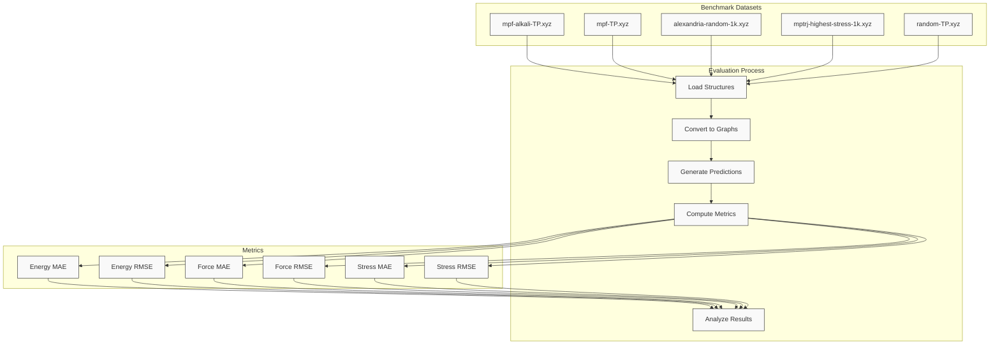
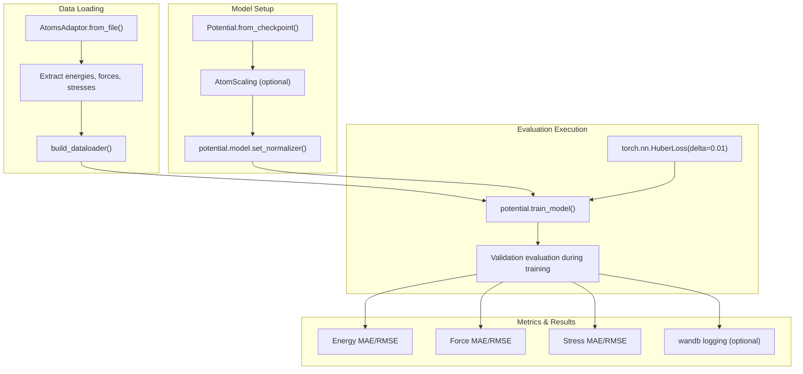
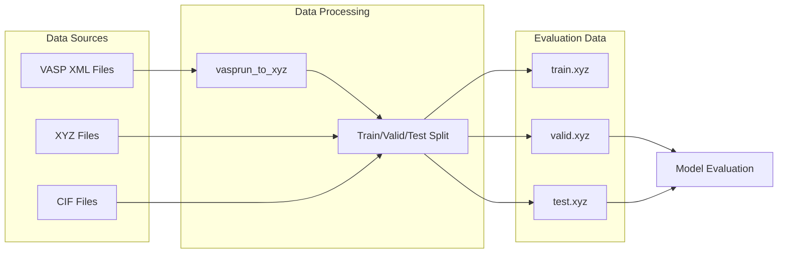

<!-- source: DeepWiki mcp.deepwiki.com · repo microsoft/mattersim · page 5.3 Model Evaluation · fetched 2026-10-26 -->

# Model Evaluation

<details>
<summary>Relevant source files</summary>

The following files were used as context for generating this wiki page:

- [data/benchmarks/mptrj-highest-stress-1k.xyz](data/benchmarks/mptrj-highest-stress-1k.xyz)
- [data/benchmarks/mptrj-random-1k.xyz](data/benchmarks/mptrj-random-1k.xyz)
- [data/benchmarks/random-TP.xyz](data/benchmarks/random-TP.xyz)
- [src/mattersim/training/finetune_mattersim.py](src/mattersim/training/finetune_mattersim.py)
- [src/mattersim/utils/vasprun_to_xyz.py](src/mattersim/utils/vasprun_to_xyz.py)

</details>


This document describes methods and practices for evaluating MatterSim model performance. It covers benchmark datasets included with MatterSim, evaluation workflows, metrics, and how to interpret results when assessing model quality. For information about training new models, see [Fine-tuning Process](#5.2), and for preparing custom evaluation datasets, see [Data Preparation](#5.1).

## Benchmark Datasets

MatterSim includes several benchmark datasets for evaluating model performance across different material types, compositions, and physical conditions. These datasets can be found in the `data/benchmarks/` directory.

### Available Benchmark Datasets

| Dataset | Description | Size | Properties |
|---------|-------------|------|------------|
| mpf-alkali-TP.xyz | Materials Project Foundation alkali dataset | ~20 structures | Energy, forces, stress |
| mpf-TP.xyz | Materials Project Foundation general dataset | ~20 structures | Energy, forces, stress |
| alexandria-random-1k.xyz | Alexandria dataset with random structures | 1000 structures | Energy, forces, stress |
| mptrj-highest-stress-1k.xyz | Materials Project trajectory dataset with high-stress configurations | 1000 structures | Energy, forces, stress |
| random-TP.xyz | Random temperature and pressure dataset | ~20 structures | Energy, forces, stress |

These benchmark datasets are stored in extended XYZ format with lattice information, atomic positions, forces, energy, and stress values. Each dataset covers different material compositions and structural configurations to test model robustness across various scenarios.

Sources: [data/benchmarks/mpf-alkali-TP.xyz](), [data/benchmarks/mpf-TP.xyz](), [data/benchmarks/alexandria-random-1k.xyz](), [data/benchmarks/mptrj-highest-stress-1k.xyz](), [data/benchmarks/random-TP.xyz]()

## Evaluation Workflow

### Model Evaluation Workflow



Sources: [src/mattersim/training/finetune_mattersim.py:95-121]()

### Evaluation During Training

The `finetune_mattersim.py` script implements automatic validation evaluation when `--valid_data_path` is provided. The validation process mirrors the training data preparation pipeline:

**Validation Data Processing**:
1. **Load validation structures**: Uses `AtomsAdaptor.from_file()` to read validation dataset (lines 96-100)
2. **Extract reference properties**: Processes energies, forces, and stresses from validation structures (lines 101-110) 
3. **Create validation dataloader**: Calls `build_dataloader()` with validation data, using distributed sampling if enabled (lines 111-119)
4. **Pass to training**: Validation dataloader is provided to `potential.train_model()` alongside training data (lines 136-142)

**Training-Time Evaluation**:
- Validation evaluation occurs automatically during `potential.train_model()` execution
- Uses `torch.nn.HuberLoss(delta=0.01)` for consistent loss computation across training and validation
- Early stopping monitors validation metrics based on `--early_stop_patience` parameter
- Optional wandb integration logs validation metrics for tracking (lines 144-145)

```bash
python -m mattersim.training.finetune_mattersim \
    --train_data_path ./train.xyz \
    --valid_data_path ./valid.xyz \
    --load_model_path mattersim-v1.0.0-1m \
    --early_stop_patience 10 \
    --include_forces --include_stresses
```

The validation process ensures identical data preprocessing and normalization (`AtomScaling`) as training data for fair evaluation.

Sources: [src/mattersim/training/finetune_mattersim.py:95-121](), [src/mattersim/training/finetune_mattersim.py:136-142](), [src/mattersim/training/finetune_mattersim.py:144-145]()

### Post-Training Evaluation

To evaluate a trained model on a benchmark dataset, the process follows the same data loading and preprocessing steps as training, but focuses on generating predictions rather than updating model parameters:

1. **Load test dataset**: Use `AtomsAdaptor.from_file()` to load structures from benchmark files
2. **Extract properties**: Process atomic structures to extract energies, forces, and stresses for reference values
3. **Create dataloader**: Use `build_dataloader()` to prepare batches for efficient evaluation
4. **Load trained model**: Load the model checkpoint using `Potential.from_checkpoint()`
5. **Generate predictions**: Use the model's forward pass through the same training pipeline
6. **Compute evaluation metrics**: Calculate MAE, RMSE, and other metrics by comparing predictions to reference values

The evaluation process reuses the same data processing pipeline as training, ensuring consistency between training and evaluation data formats.

```python
# Example evaluation workflow
atoms_test = AtomsAdaptor.from_file(filename="test_data.xyz")
test_dataloader = build_dataloader(atoms_test, energies, forces, stresses, shuffle=False)
potential = Potential.from_checkpoint(load_path="trained_model.pth")
# Use same forward pass as training for predictions
```

Sources: [src/mattersim/training/finetune_mattersim.py:96-100](), [src/mattersim/training/finetune_mattersim.py:111-119](), [src/mattersim/training/finetune_mattersim.py:123-127]()

## Evaluation Implementation Details

### Model Evaluation Code Architecture



Sources: [src/mattersim/training/finetune_mattersim.py:13-17](), [src/mattersim/training/finetune_mattersim.py:73-82](), [src/mattersim/training/finetune_mattersim.py:123-142]()

## Evaluation Metrics

MatterSim evaluates model performance using several key metrics:

### Energy Metrics
- **Mean Absolute Error (MAE)**: Average absolute difference between predicted and reference energies
- **Root Mean Square Error (RMSE)**: Square root of the average squared differences

### Force Metrics
- **Force MAE**: Average absolute difference in force components
- **Force RMSE**: Root mean square error of force components

### Stress Metrics
- **Stress MAE**: Average absolute difference in stress components
- **Stress RMSE**: Root mean square error of stress components

During training, these metrics are calculated on the validation set if provided. The primary loss used for optimization is typically a Huber loss function, which combines properties of L1 (MAE) and L2 (MSE) losses:

```python
potential.train_model(
    dataloader,
    val_dataloader,
    loss=torch.nn.HuberLoss(delta=0.01),
    is_distributed=True,
    **args_dict,
)
```

The Huber loss with a small delta parameter (0.01) helps provide stable gradients while being less sensitive to outliers.

Sources: [src/mattersim/training/finetune_mattersim.py:136-142]()

## Preparing Evaluation Data

### Data Preparation Workflow



When using VASP XML files for evaluation, they can be converted to the required XYZ format using the `vasprun_to_xyz.py` utility. This tool splits the dataset into training, validation, and test sets based on specified ratios.

```
python -m mattersim.utils.vasprun_to_xyz \
    --data_path /path/to/vasp/files \
    --train_ratio 0.8 \
    --validation_ratio 0.1 \
    --save_path ./xyz_files
```

By default, this creates an 80/10/10 split for training, validation, and test data.

Sources: [src/mattersim/utils/vasprun_to_xyz.py:11-53]()

## Best Practices for Model Evaluation

1. **Use diverse benchmark datasets**: Evaluate on both included benchmarks and domain-specific data relevant to your research
2. **Report multiple metrics**: Include MAE and RMSE for energy, forces, and stresses
3. **Compare against baseline models**: Always compare performance against the pre-trained models
4. **Consider application requirements**: Different applications have different accuracy requirements for energy, forces, and stresses
5. **Validate across length scales**: Test performance on systems of different sizes to ensure transferability

### Common Evaluation Pitfalls

- **Overfitting to validation data**: If early stopping is based on validation metrics, the model might still overfit if validation data is too similar to training data
- **Unit mismatches**: Ensure consistent units between predictions and reference values
- **Imbalanced test sets**: Ensure benchmark datasets represent the material space of interest
- **Missing evaluation of forces/stresses**: Some applications require accurate forces or stresses, not just energies

## Tracking and Visualizing Evaluation Results

MatterSim includes optional Weights & Biases (wandb) integration for tracking model training and evaluation metrics. To enable this feature, provide the following parameters to the fine-tuning script:

```
python -m mattersim.training.finetune_mattersim \
    --train_data_path ./train.xyz \
    --valid_data_path ./valid.xyz \
    --load_model_path mattersim-v1.0.0-1m \
    --wandb \
    --wandb_project your_project_name
```

This will log training and validation metrics, allowing you to visualize model performance over time and compare different models.

Sources: [src/mattersim/training/finetune_mattersim.py:29-42](), [src/mattersim/training/finetune_mattersim.py:144-145]()

## Conclusion

Model evaluation is a critical step in the MatterSim workflow, providing insights into model performance and helping identify areas for improvement. By using the benchmark datasets and evaluation workflows described in this document, you can assess model accuracy across different materials and conditions, enabling more confident application of MatterSim models to real-world problems.

For more specific workflows like structure relaxation or molecular dynamics, additional evaluation metrics may be relevant. See the [Applications](#6) section for guidance on application-specific evaluation.

---

