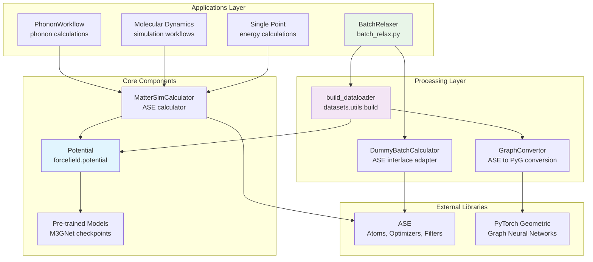
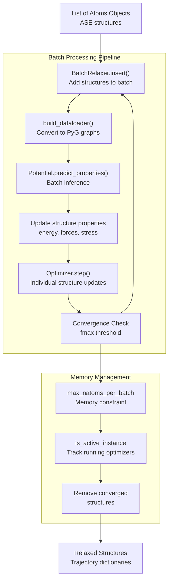
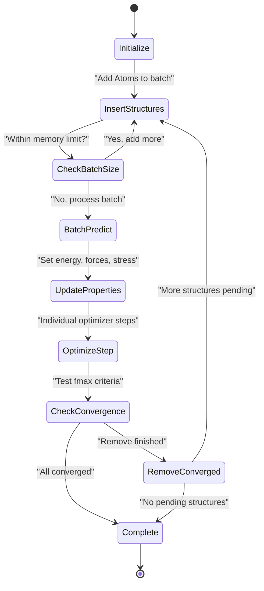
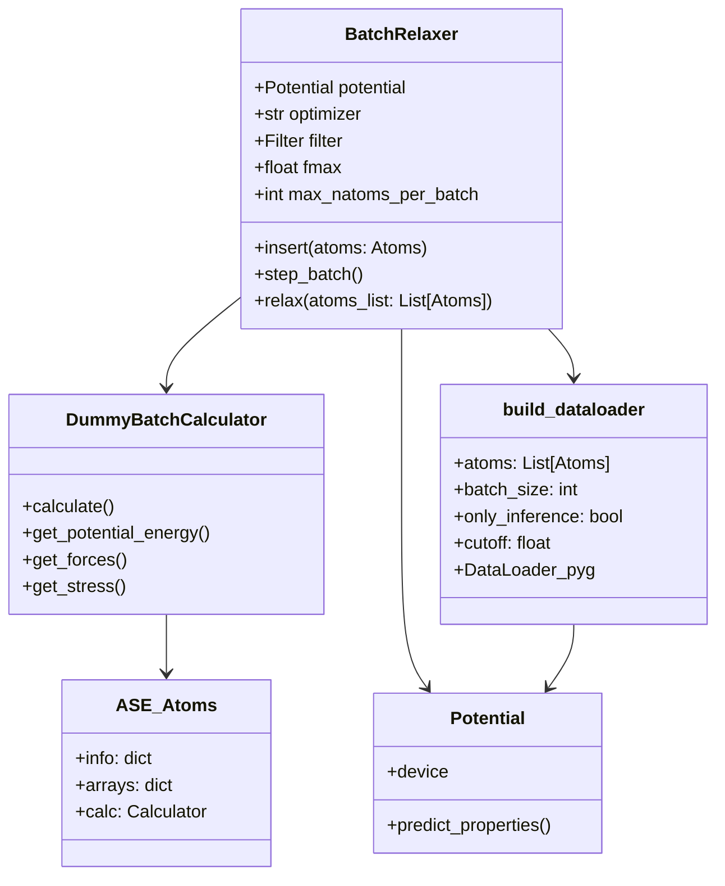

<!-- source: DeepWiki mcp.deepwiki.com · repo microsoft/mattersim · page 6 Applications · fetched 2026-10-26 -->

# Applications

<details>
<summary>Relevant source files</summary>

The following files were used as context for generating this wiki page:

- [src/mattersim/applications/batch_relax.py](src/mattersim/applications/batch_relax.py)
- [src/mattersim/datasets/utils/build.py](src/mattersim/datasets/utils/build.py)

</details>


This document covers the simulation applications built on top of the MatterSim framework. These applications provide high-level interfaces for common materials simulation tasks including structure relaxation, phonon calculations, molecular dynamics, and single-point energy calculations.

The applications layer sits above the core MatterSim components and provides both single-structure and batch processing capabilities. For information about the underlying calculator interfaces, see [Core Components](#2). For training and fine-tuning workflows, see [Training & Fine-tuning](#5).

## Application Architecture

The MatterSim applications are built on a layered architecture that enables efficient batch processing and seamless integration with existing computational workflows:



Sources: [src/mattersim/applications/batch_relax.py:1-174](), [src/mattersim/datasets/utils/build.py:13-46]()

## Batch Processing Framework

The applications leverage a sophisticated batch processing framework that optimizes computational efficiency for large-scale simulations:



Sources: [src/mattersim/applications/batch_relax.py:91-142](), [src/mattersim/datasets/utils/build.py:13-123]()

## Structure Relaxation

Structure relaxation applications implement both individual and batch optimization workflows using ASE-compatible optimizers and filters.

### BatchRelaxer Implementation

The `BatchRelaxer` class provides efficient batch structural optimization with the following key components:

| Component | Purpose | Supported Options |
|-----------|---------|-------------------|
| Optimizers | Geometric optimization algorithms | `BFGS`, `FIRE` |
| Filters | Cell constraint handling | `ExpCellFilter`, `FrechetCellFilter`, `None` |
| Convergence | Force-based stopping criteria | `fmax` threshold in eV/Å |
| Memory Management | Batch size control | `max_natoms_per_batch` |

The relaxation workflow processes structures in dynamic batches, automatically managing memory constraints and convergence tracking:



Sources: [src/mattersim/applications/batch_relax.py:35-80](), [src/mattersim/applications/batch_relax.py:143-173]()

### DummyBatchCalculator Interface

The `DummyBatchCalculator` provides ASE compatibility by implementing the calculator interface while delegating actual computation to the batch processing pipeline:

- `get_potential_energy()`: Returns `atoms.info["total_energy"]` [src/mattersim/applications/batch_relax.py:25-26]()
- `get_forces()`: Returns `atoms.arrays["forces"]` [src/mattersim/applications/batch_relax.py:28-29]()  
- `get_stress()`: Returns `atoms.info["stress"]` converted to GPa [src/mattersim/applications/batch_relax.py:31-32]()

Sources: [src/mattersim/applications/batch_relax.py:18-33]()

## Data Processing Pipeline

The applications rely on a robust data processing pipeline that converts ASE structures to graph representations suitable for the M3GNet architecture:

### build_dataloader Function

The `build_dataloader` function serves as the primary interface between applications and the neural network inference:

```python
# Key parameters for application usage
build_dataloader(
    atoms: list[Atoms],           # Input structures
    batch_size: int = 64,         # Batch processing size  
    only_inference: bool = False, # Skip training labels
    cutoff: float = 5.0,         # Graph connectivity radius
    threebody_cutoff: float = 4.0 # Three-body interaction radius
)
```

The function handles:
- **Graph Conversion**: ASE Atoms → PyTorch Geometric Data via `GraphConvertor` [src/mattersim/datasets/utils/build.py:48]()
- **Batch Assembly**: Dynamic batching with memory considerations [src/mattersim/datasets/utils/build.py:117-123]()
- **Device Management**: GPU/CPU tensor placement and memory pinning [src/mattersim/datasets/utils/build.py:24-25]()

Sources: [src/mattersim/datasets/utils/build.py:13-46](), [src/mattersim/datasets/utils/build.py:71-123]()

## Application Integration Patterns

Applications follow consistent integration patterns that enable seamless interoperability with existing computational workflows:



This architecture ensures that applications can leverage the full computational power of the MatterSim models while maintaining compatibility with existing ASE-based workflows and providing efficient batch processing capabilities for high-throughput simulations.

Sources: [src/mattersim/applications/batch_relax.py:35-142](), [src/mattersim/datasets/utils/build.py:13-123]()

---

