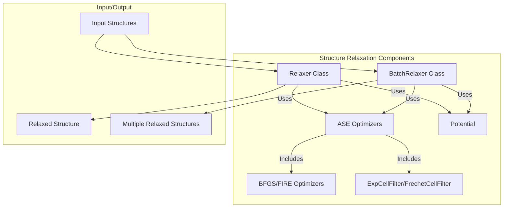
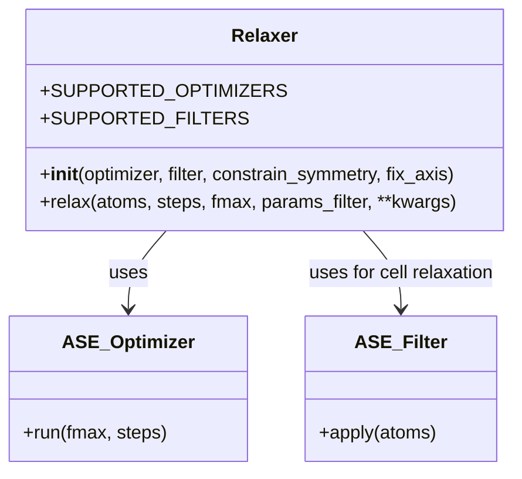
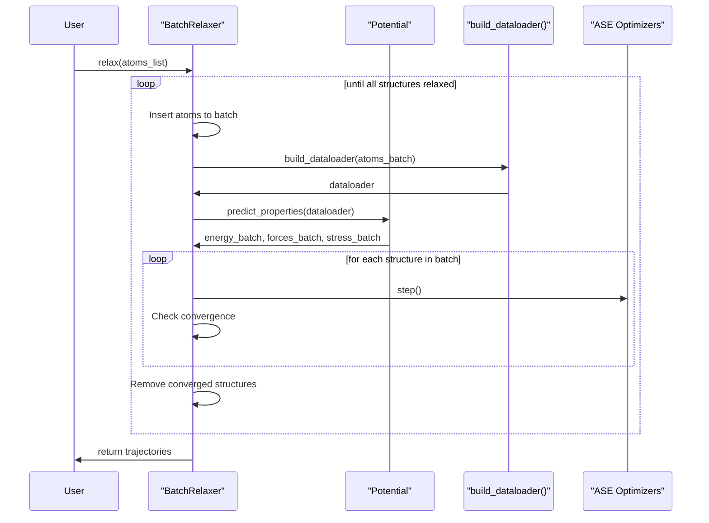

<!-- source: DeepWiki mcp.deepwiki.com · repo microsoft/mattersim · page 6.1 Structure Relaxation · fetched 2026-10-26 -->

# Structure Relaxation

<details>
<summary>Relevant source files</summary>

The following files were used as context for generating this wiki page:

- [docs/examples/batch_relaxation_example.rst](docs/examples/batch_relaxation_example.rst)
- [docs/examples/examples.rst](docs/examples/examples.rst)
- [src/mattersim/applications/batch_relax.py](src/mattersim/applications/batch_relax.py)
- [src/mattersim/applications/relax.py](src/mattersim/applications/relax.py)
- [src/mattersim/datasets/utils/build.py](src/mattersim/datasets/utils/build.py)
- [tests/applications/test_batch_relax.py](tests/applications/test_batch_relax.py)

</details>


## Purpose and Scope

This document covers how to use MatterSim for structural relaxation and optimization of atomic structures. Structure relaxation is the process of finding the minimum energy configuration of atoms in a material. MatterSim provides two implementations for structure relaxation: single-structure relaxation via the `Relaxer` class and efficient batch relaxation via the `BatchRelaxer` class. For information about running molecular dynamics simulations, see [Molecular Dynamics](#6.3).

## Overview

Structure relaxation in MatterSim leverages the Atomic Simulation Environment (ASE) optimization algorithms combined with MatterSim's machine learning potentials. The system supports both atomic position relaxation and unit cell optimization.



Sources: [src/mattersim/applications/relax.py:14-169](), [src/mattersim/applications/batch_relax.py:35-171]()

## Single Structure Relaxation

The `Relaxer` class handles optimization of individual structures with optional cell relaxation capabilities.

### Class Overview



Sources: [src/mattersim/applications/relax.py:14-109]()

### Using the Relaxer

To use the `Relaxer` class, you need:
1. An ASE `Atoms` object with a calculator attached (usually a `MatterSimCalculator`)
2. Optimizer selection (BFGS or FIRE)
3. Optional cell filter for unit cell optimization

The main parameters for the `Relaxer` constructor are:

| Parameter | Description | Default |
|-----------|-------------|---------|
| `optimizer` | Optimizer to use ("BFGS" or "FIRE") | "FIRE" |
| `filter` | Cell filter for relaxation ("EXPCELLFILTER" or "FRECHETCELLFILTER") | None |
| `constrain_symmetry` | Whether to constrain symmetry during relaxation | True |
| `fix_axis` | Which cell axes to fix (Boolean or list of 6 Booleans) | False |

For the `relax` method:

| Parameter | Description | Default |
|-----------|-------------|---------|
| `atoms` | ASE Atoms object to relax | Required |
| `steps` | Maximum number of optimization steps | 500 |
| `fmax` | Force convergence criterion (eV/Å) | 0.01 |
| `params_filter` | Parameters for the cell filter | {} |

Sources: [src/mattersim/applications/relax.py:23-102]()

## Batch Structure Relaxation

The `BatchRelaxer` class provides an efficient way to relax multiple structures at once, which is significantly faster than relaxing them one by one.

### Class Overview

```mermaid
classDiagram
    class BatchRelaxer {
        +SUPPORTED_OPTIMIZERS
        +SUPPORTED_FILTERS
        +__init__(potential, optimizer, filter, fmax, max_natoms_per_batch, max_n_steps)
        +insert(atoms)
        +step_batch()
        +relax(atoms_list)
    }
    
    class DummyBatchCalculator {
        +calculate(atoms, properties, system_changes)
        +get_potential_energy(atoms)
        +get_forces(atoms)
        +get_stress(atoms)
    }
    
    class Potential {
        +predict_properties(dataloader, include_forces, include_stresses)
    }
    
    BatchRelaxer --> DummyBatchCalculator: creates
    BatchRelaxer --> Potential: uses
    BatchRelaxer ..> "build_dataloader()": uses
```

Sources: [src/mattersim/applications/batch_relax.py:18-171]()

### How Batch Relaxation Works

The batch relaxation process uses an efficient batching strategy:

1. Structures are added to a batch until a size limit is reached
2. The `Potential` predicts energies, forces, and stresses for all structures in one batch
3. Each structure takes one optimization step based on those predictions
4. Converged structures are removed from the batch
5. New structures are added to the batch
6. The process repeats until all structures are relaxed



Sources: [src/mattersim/applications/batch_relax.py:90-168]()

### Key Parameters for BatchRelaxer

| Parameter | Description | Default |
|-----------|-------------|---------|
| `potential` | The `Potential` instance to use for calculations | Required |
| `optimizer` | Optimizer to use ("BFGS" or "FIRE") | "FIRE" |
| `filter` | Cell filter for relaxation | None |
| `fmax` | Force convergence criterion (eV/Å) | 0.05 |
| `max_natoms_per_batch` | Maximum number of atoms in a batch | 512 |
| `max_n_steps` | Maximum number of optimization steps per structure | 1,000,000 |

Sources: [src/mattersim/applications/batch_relax.py:45-79]()

## Usage Examples

### Example: Batch Structure Relaxation

```python
# Import required modules
from ase.build import bulk
from mattersim.applications.batch_relax import BatchRelaxer
from mattersim.forcefield.potential import Potential

# Initialize the default MatterSim Potential
potential = Potential.from_checkpoint()

# Create a batch relaxer with cell optimization
relaxer = BatchRelaxer(
    potential,
    optimizer="FIRE",
    filter="EXPCELLFILTER",
    fmax=0.01
)

# Create a list of structures to relax
atoms_list = [bulk("C"), bulk("Si"), bulk("Mg")]

# Perturb the structures to create non-equilibrium configurations
for atoms in atoms_list:
    atoms.rattle(stdev=0.1)

# Perform batch relaxation
relaxation_trajectories = relaxer.relax(atoms_list)

# Extract relaxed structures
relaxed_structures = [traj[-1] for traj in relaxation_trajectories.values()]
```

Sources: [docs/examples/batch_relaxation_example.rst:1-66]()

## Implementation Details

### Relaxation Process

MatterSim's structure relaxation implementations utilize ASE's optimization algorithms but provide enhancements for efficiency when working with machine learning potentials.

```mermaid
flowchart TD
    subgraph "Single Structure Relaxation"
        direction LR
        A1["ASE Atoms"] --> |"Add calculator"| C1["MatterSimCalculator"]
        C1 --> R1["Relaxer"]
        R1 --> |"Optional"| F1["Cell Filter"]
        R1 --> |"Uses"| O1["ASE Optimizer"]
        O1 --> E1["Relaxed Structure"]
    end
    
    subgraph "Batch Structure Relaxation"
        direction LR
        A2["ASE Atoms List"] --> BR["BatchRelaxer"]
        BR --> B["Structure Batch"]
        B --> |"Create dataloader"| DL["PyTorch Dataloader"]
        DL --> POT["Potential.predict_properties()"]
        POT --> |"Return"| PRED["Energies, Forces, Stresses"]
        PRED --> |"Feed to"| DC["DummyBatchCalculator"]
        DC --> |"Used by"| OPT["Optimizer.step()"]
        OPT --> |"Check"| CONV["Convergence"]
        CONV --> |"If not converged"| B
        CONV --> |"If converged"| OUT["Output Trajectories"]
    end
```



Sources: [src/mattersim/applications/batch_relax.py:90-140](), [src/mattersim/applications/relax.py:52-109]()

### BatchRelaxer Internal Workflow

The `BatchRelaxer` class manages multiple optimization processes simultaneously and efficiently computes energies and forces in batches:

1. The `insert` method adds a new structure to the batch with a `DummyBatchCalculator`
2. The `step_batch` method:
   - Collects all active structures
   - Creates a dataloader with `build_dataloader`
   - Runs a single prediction for all structures using the `Potential`
   - Updates each structure with its predicted properties
   - Calls `step()` on each optimizer instance
   - Checks for convergence and removes converged structures
3. The `relax` method orchestrates the overall process

Sources: [src/mattersim/applications/batch_relax.py:81-171]()

## Performance Considerations

When relaxing many structures, `BatchRelaxer` is significantly more efficient than running individual relaxations because:

1. It processes multiple structures in parallel within a single batch
2. It leverages GPU acceleration effectively through batched predictions
3. It dynamically manages the batch to maintain optimal GPU utilization

The key parameter affecting performance is `max_natoms_per_batch`, which should be adjusted based on available GPU memory. For larger structures, reducing this value may be necessary. For simple structures, increasing it can improve throughput.

Sources: [src/mattersim/applications/batch_relax.py:35-38](), [src/mattersim/applications/batch_relax.py:73-74]()

---

