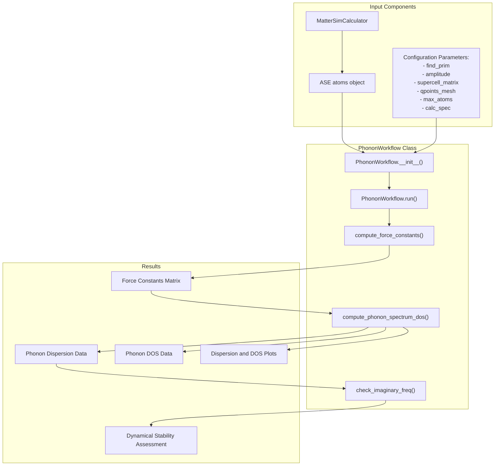
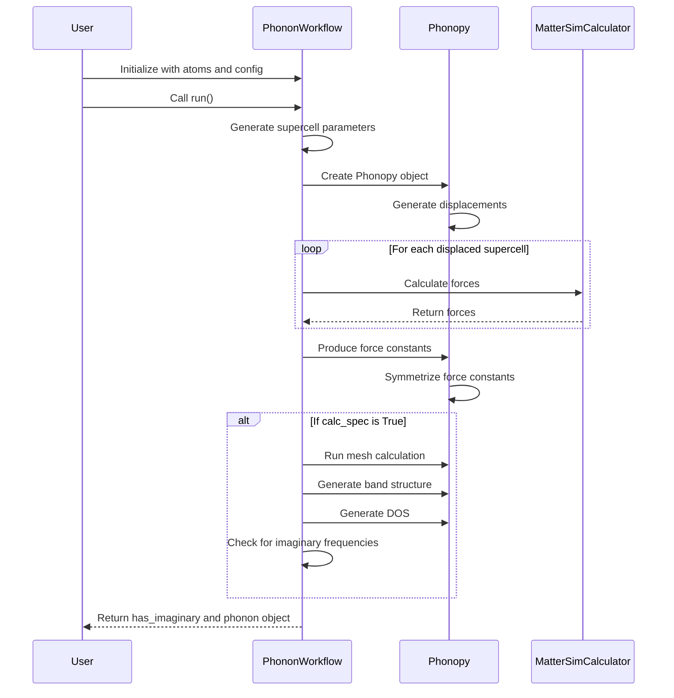
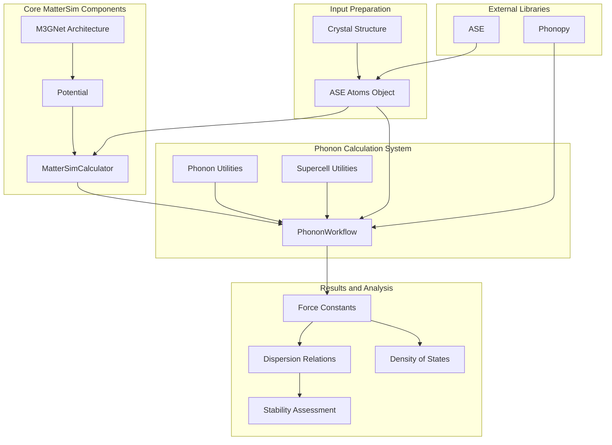

<!-- source: DeepWiki mcp.deepwiki.com · repo microsoft/mattersim · page 6.2 Phonon Calculations · fetched 2026-10-26 -->

# Phonon Calculations

<details>
<summary>Relevant source files</summary>

The following files were used as context for generating this wiki page:

- [docs/_static/phonon_dispersion.png](docs/_static/phonon_dispersion.png)
- [docs/examples/phonon_example.rst](docs/examples/phonon_example.rst)
- [notebooks/Si2_LA_between_Gamma_and_X.gif](notebooks/Si2_LA_between_Gamma_and_X.gif)
- [notebooks/Si2_highest_freq_at_X.gif](notebooks/Si2_highest_freq_at_X.gif)
- [notebooks/foundry-mattersim-phonon.ipynb](notebooks/foundry-mattersim-phonon.ipynb)
- [src/mattersim/applications/phonon.py](src/mattersim/applications/phonon.py)

</details>


This document covers the phonon calculation functionality in MatterSim, which enables the prediction of dynamical properties of materials. Phonon calculations help assess the dynamical stability of materials and provide insights into thermal, mechanical, and other physical properties.

## Purpose and Scope

The phonon calculation system in MatterSim implements the "frozen phonon" method to compute:
- Phonon dispersion relations
- Phonon density of states (DOS)
- Dynamical stability assessment via identification of imaginary frequencies

This functionality is specifically implemented through the `PhononWorkflow` class, which interfaces with the MatterSim calculator and uses the Phonopy library for post-processing and visualization.

## Theoretical Background

Phonons are quantized vibrational modes in crystalline materials. They represent the collective oscillation of atoms around their equilibrium positions. In a quantum mechanical description, phonons are quasi-particles associated with lattice vibrations.

Computing phonons involves calculating the dynamical matrices (D) of materials:

```
D_{I\alpha,J\beta} = \frac{1}{M_I M_J} \frac{\partial^2 E}{\partial R_{I\alpha} \partial R_{J\beta}}
```

where:
- I and J are atom indices
- α and β are Cartesian coordinate indices
- R represents atom coordinates
- M denotes atom masses
- E is the system's potential energy

Phonon calculations provide vital information about a material's:
- Dynamical stability (absence of imaginary frequencies)
- Thermal properties
- Heat capacity
- Thermal conductivity
- Sound velocity
- Elastic properties

Sources: [notebooks/foundry-mattersim-phonon.ipynb:45-56](), [docs/examples/phonon_example.rst:1-11]()

## PhononWorkflow Architecture

The phonon calculation system is built around the `PhononWorkflow` class which coordinates the entire calculation process.



Sources: [src/mattersim/applications/phonon.py:19-95]()

## Key Components and Parameters

The `PhononWorkflow` class is initialized with the following key parameters:

| Parameter | Type | Description | Default |
|-----------|------|-------------|---------|
| `atoms` | `Atoms` | ASE atoms object with structure and calculator | Required |
| `find_prim` | `bool` | Whether to find primitive cell | `False` |
| `work_dir` | `str` | Directory to store results | Date-formula-phonon |
| `amplitude` | `float` | Displacement magnitude (Å) | `0.01` |
| `supercell_matrix` | `np.ndarray` | Matrix for supercell construction | `None` |
| `qpoints_mesh` | `np.ndarray` | Mesh for BZ integration | `None` |
| `max_atoms` | `int` | Maximum atoms in supercell | `None` |
| `calc_spec` | `bool` | Whether to calculate spectrum | `True` |

The workflow requires an ASE atoms object with an attached calculator (typically `MatterSimCalculator`).

Sources: [src/mattersim/applications/phonon.py:25-57]()

## Workflow Execution Process

The phonon calculation process follows these steps:



Sources: [src/mattersim/applications/phonon.py:188-236]()

## Implementation Details

### 1. Force Constants Calculation

The force constants calculation is implemented in the `compute_force_constants` method:

1. A Phonopy object is created based on the input structure
2. Atomic displacements are generated 
3. The MatterSim calculator computes forces for each displacement
4. Force constants are produced and symmetrized

```python
# Pseudocode representing the force constants calculation
phonon = Phonopy(structure, supercell_matrix)
phonon.generate_displacements(distance=amplitude)
displacements = phonon.supercells_with_displacements

for disp in displacements:
    calculate_forces(disp)
    
phonon.produce_force_constants()
phonon.symmetrize_force_constants()
```

Sources: [src/mattersim/applications/phonon.py:96-131]()

### 2. Phonon Spectrum and DOS Calculation

Once force constants are available, the spectrum and DOS are calculated:

1. Brillouin zone mesh is created
2. Band structure is computed along high-symmetry paths
3. Density of states is calculated
4. Results are visualized and saved

Sources: [src/mattersim/applications/phonon.py:134-166]()

### 3. Imaginary Frequency Check

The `check_imaginary_freq` method determines whether the material is dynamically stable:

1. Frequencies from the band structure are extracted
2. If any frequency is below -0.299 (a threshold for numerical noise), the material has imaginary frequencies
3. Imaginary frequencies indicate dynamical instability

Sources: [src/mattersim/applications/phonon.py:168-186]()

## Integration with MatterSim

The phonon calculation system integrates with the broader MatterSim architecture:



The system works with the core MatterSim components:
- Uses `MatterSimCalculator` to calculate forces
- Employs `Potential` class for energy predictions
- Leverages the M3GNet architecture for accurate force predictions

It also interfaces with external libraries:
- ASE for structure manipulation
- Phonopy for phonon calculations and visualization

Sources: [docs/examples/phonon_example.rst:15-33]()

## Usage Example

Here's a typical usage example of the `PhononWorkflow`:

```python
# Import necessary modules
from ase.build import bulk
from mattersim.forcefield.potential import MatterSimCalculator
from mattersim.applications.phonon import PhononWorkflow
import numpy as np

# Create structure and attach calculator
si = bulk("Si")
si.calc = MatterSimCalculator()

# Set up the phonon workflow
ph = PhononWorkflow(
    atoms=si,
    find_prim=False,
    work_dir="phonon_results",
    amplitude=0.01,
    supercell_matrix=np.diag([4, 4, 4])
)

# Run the workflow
has_imag, phonons = ph.run()

# Check stability
if not has_imag:
    print("The material is dynamically stable.")
else:
    print("The material has imaginary frequencies and is dynamically unstable.")
```

This will:
1. Create a silicon structure using ASE
2. Attach the MatterSim calculator
3. Configure the PhononWorkflow with a 4×4×4 supercell
4. Run the workflow
5. Check if the material is dynamically stable

The results will be saved in the specified directory, including:
- Phonon dispersion plots
- Phonon DOS plots
- Force constants data

Sources: [docs/examples/phonon_example.rst:24-57]()

## Example Output

A successful phonon calculation produces:

1. **Phonon dispersion plot**: Shows phonon band structure along high-symmetry paths in the Brillouin zone
2. **Phonon DOS plot**: Shows the density of vibrational states
3. **Stability assessment**: Indicates whether the material is dynamically stable
4. **Force constants data**: Contains the complete set of interatomic force constants

The phonon dispersion plot typically looks like this for silicon:


Sources: [docs/examples/phonon_example.rst:58-68]()

## Advanced Configuration

### Supercell Configuration

The supercell size greatly affects calculation accuracy and computational cost. There are three ways to specify it:

1. **Directly** via `supercell_matrix`:
   - 3×3 matrix for general transformations
   - 3-element array for diagonal transformations (e.g., `[4, 4, 4]`)

2. **Via q-point mesh** using `qpoints_mesh`:
   - Specifies the density of q-points in the Brillouin zone
   - Higher density means better accuracy

3. **Via atom limit** using `max_atoms`:
   - System automatically determines supercell size based on maximum atom count
   - Useful for balancing accuracy and computational cost

The supercell parameters are generated by `get_supercell_parameters()` from the `supercell_utils` module.

Sources: [src/mattersim/applications/phonon.py:75-91](), [src/mattersim/applications/phonon.py:202-203]()

### Primitive Cell Finding

Setting `find_prim=True` makes the workflow first find the primitive cell of the structure:

```python
if find_prim:
    self.atoms = get_primitive_cell(atoms)
    self.atoms.calc = atoms.calc
else:
    self.atoms = atoms
```

This can significantly reduce computational cost for structures with large conventional cells.

Sources: [src/mattersim/applications/phonon.py:61-65]()

## Performance Considerations

Phonon calculations can be computationally intensive. Key factors affecting performance:

1. **Structure size**: More atoms means longer calculation time
2. **Supercell size**: Larger supercells increase accuracy but require more calculations
3. **Displacement amplitude**: Smaller displacements may require higher numerical precision
4. **Symmetry**: The system uses symmetry to reduce the number of required force calculations

To optimize performance:
- Use primitive cells when possible
- Start with smaller supercells and increase as needed
- Set reasonable `max_atoms` limits

Sources: [src/mattersim/applications/phonon.py:122-125]()

## Common Issues and Troubleshooting

### Imaginary Frequencies

Imaginary frequencies (shown as negative values) can indicate:
- Genuine dynamical instability
- Insufficient supercell size
- Numerical issues

If unexpected imaginary frequencies appear:
- Try a larger supercell
- Check structure optimization
- Verify force calculation accuracy

### Calculation Errors

The workflow has error handling with specific messages for each stage:
- Supercell parameter generation
- Force constant calculation
- Phonon spectrum calculation

Check the error messages for clues about the issue.

Sources: [src/mattersim/applications/phonon.py:205-224]()

## Conclusion

The phonon calculation system in MatterSim provides a powerful tool for analyzing material stability and vibrational properties. By using the `PhononWorkflow` class, users can:

1. Calculate phonon dispersion relations
2. Determine phonon density of states
3. Assess dynamical stability
4. Predict thermal and mechanical properties

This functionality integrates seamlessly with the rest of the MatterSim ecosystem, leveraging its accurate force predictions to provide reliable phonon calculations.

---

