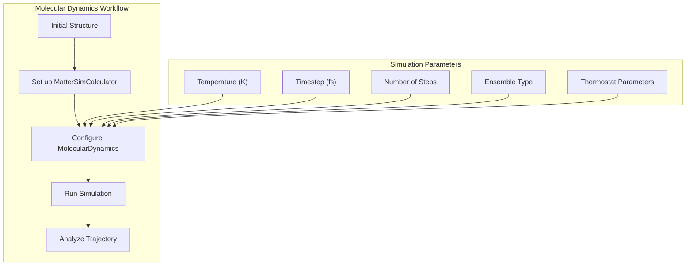
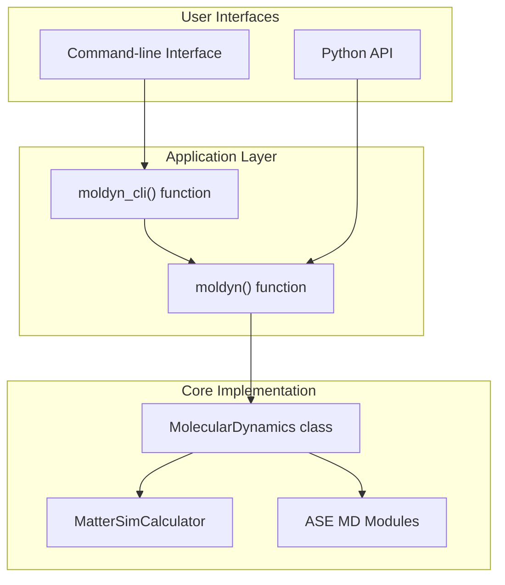
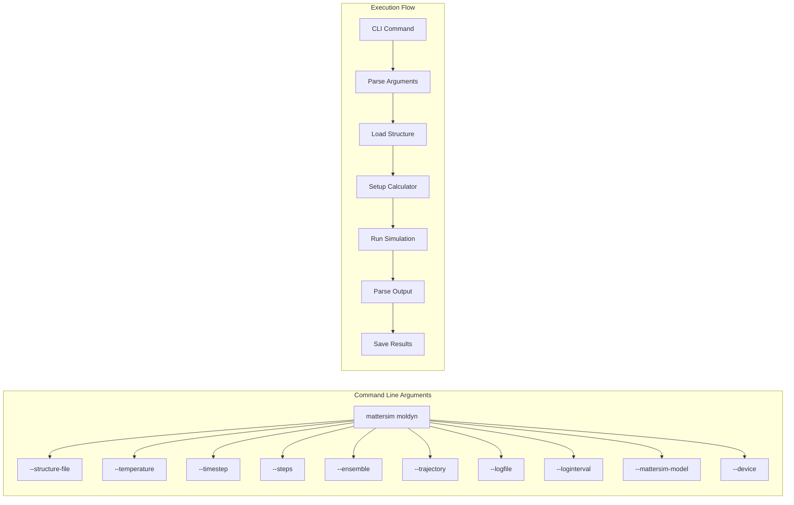

<!-- source: DeepWiki mcp.deepwiki.com · repo microsoft/mattersim · page 6.3 Molecular Dynamics · fetched 2026-10-26 -->

# Molecular Dynamics

<details>
<summary>Relevant source files</summary>

The following files were used as context for generating this wiki page:

- [src/mattersim/cli/mattersim_app.py](src/mattersim/cli/mattersim_app.py)
- [tests/data/mp-149_Si2.cif](tests/data/mp-149_Si2.cif)
- [tests/data/mp-2998_BaTiO3.cif](tests/data/mp-2998_BaTiO3.cif)

</details>


## Purpose and Scope

This document provides technical documentation for running molecular dynamics (MD) simulations using MatterSim. It covers how to use the molecular dynamics capability through both the Python API and command-line interface. Molecular dynamics simulations allow for studying the time evolution of atomic systems, including thermal properties and dynamic behavior of materials.

For information about other applications like structure relaxation, see [Structure Relaxation](#6.1), and for phonon calculations, see [Phonon Calculations](#6.2).

## Overview of Molecular Dynamics in MatterSim

MatterSim provides an implementation of molecular dynamics that uses the MatterSim potential for efficient and accurate force calculations. The implementation supports NVT ensemble simulations with different thermostat options.



Sources: [src/mattersim/cli/applications/moldyn.py:16-93]()

## Architecture and Components

The molecular dynamics functionality in MatterSim is implemented through several interconnected components:



Sources: [src/mattersim/cli/mattersim_app.py:81-102](), [src/mattersim/cli/applications/moldyn.py:16-93]()

## Using MolecularDynamics

### Python API

The primary class for running molecular dynamics simulations is `MolecularDynamics`. This class is instantiated with an `Atoms` object that has a `MatterSimCalculator` assigned to it.

Key parameters for configuring a molecular dynamics simulation:

| Parameter | Type | Default | Description |
|-----------|------|---------|-------------|
| `temperature` | float | 300 | Simulation temperature in Kelvin |
| `timestep` | float | 1 | Time between steps in femtoseconds |
| `steps` | int | 1000 | Total number of simulation steps |
| `ensemble` | str | "nvt_nose_hoover" | Simulation ensemble type |
| `loginterval` | int | 10 | Interval between log entries |
| `logfile` | str | "md.log" | File to write simulation data |
| `trajectory` | str | "md.traj" | File to save atomic trajectories |
| `taut` | float | None | Time constant for Nose-Hoover thermostat |

Sources: [src/mattersim/cli/applications/moldyn.py:83-93]()

### Supported Ensembles

MatterSim molecular dynamics currently supports NVT (canonical) ensemble with two thermostat options:

1. **Nose-Hoover thermostat** (`nvt_nose_hoover`): Provides proper canonical sampling with adjustable time constant
2. **Berendsen thermostat** (`nvt_berendsen`): Simple and efficient temperature control, but doesn't strictly sample the canonical ensemble

Sources: [src/mattersim/cli/mattersim_app.py:247-251]()

### Cell Handling

The molecular dynamics implementation has special handling for simulation cells:

- Checks for non-zero values in the lower triangle of the cell matrix
- Automatically rotates and permutes the cell to upper triangular form if needed
- Sets exact zeros in the lower triangle to avoid numerical issues

This ensures stable simulations even with complex cell geometries.

Sources: [src/mattersim/cli/applications/moldyn.py:41-72]()

## Command-Line Interface

MatterSim provides a convenient command-line interface for running molecular dynamics simulations without writing Python code.



Sources: [src/mattersim/cli/mattersim_app.py:227-277](), [src/mattersim/cli/mattersim_app.py:330-336]()

### Command-line Arguments

The following arguments are available for the `moldyn` subcommand:

| Argument | Description | Default |
|----------|-------------|---------|
| `--structure-file` | Path to the atoms structure file(s) | Required |
| `--temperature` | Temperature in Kelvin | 300 |
| `--timestep` | Timestep in femtoseconds | 1 |
| `--steps` | Number of steps | 1000 |
| `--ensemble` | Simulation ensemble | "nvt_nose_hoover" |
| `--logfile` | Logfile to write output | "md.log" |
| `--loginterval` | Log interval | 10 |
| `--trajectory` | Path to trajectory file | "md.traj" |
| `--taut` | Taut for Nose-Hoover thermostat | None |
| `--mattersim-model` | Model to use | "mattersim-v1.0.0-1m" |
| `--device` | Device for computation | "cpu" |
| `--work-dir` | Working directory | Auto-generated |
| `--save-csv` | Save results to CSV | "results.csv.gz" |

Sources: [src/mattersim/cli/mattersim_app.py:227-277](), [src/mattersim/cli/mattersim_app.py:106-139]()

## Implementation Details

### Simulation Execution Process

The molecular dynamics implementation follows these steps:

1. Validate input (currently only one structure is supported)
2. Prepare cell geometry by ensuring upper triangular form
3. Create necessary directories and prepare output files
4. Instantiate the `MolecularDynamics` class with the provided parameters
5. Run the simulation for the specified number of steps
6. Parse the logfile and trajectory into a pandas DataFrame
7. Save results to a compressed CSV file

Sources: [src/mattersim/cli/applications/moldyn.py:16-121]()

### Output Processing

After a simulation completes, MatterSim:

1. Reads the logfile into a pandas DataFrame
2. Parses the trajectory file into a list of structures
3. Adds the structures to the DataFrame as JSON strings
4. Saves the DataFrame as a compressed CSV file

This makes it easy to analyze the simulation results using standard data analysis tools.

Sources: [src/mattersim/cli/applications/moldyn.py:96-119]()

## Limitations and Considerations

- The current implementation only supports running one structure at a time
- Cell handling includes special processing for non-standard cell orientations
- Only the NVT ensemble with Nose-Hoover or Berendsen thermostats is supported
- There's automatic validation to ensure the cell is in upper triangular form

Sources: [src/mattersim/cli/applications/moldyn.py:31-32](), [src/mattersim/cli/applications/moldyn.py:41-72]()

## Example Usage

### Command-Line Example

```bash
mattersim moldyn --structure-file structure.xyz --temperature 300 --timestep 0.5 --steps 2000 --ensemble nvt_nose_hoover --loginterval 20 --work-dir md_results
```

### Python API Example

```python
from ase.io import read
from mattersim.forcefield import MatterSimCalculator
from mattersim.applications.moldyn import MolecularDynamics

# Load structure and set up calculator
atoms = read('structure.xyz')
atoms.calc = MatterSimCalculator(load_path="mattersim-v1.0.0-1m")

# Configure and run MD simulation
md = MolecularDynamics(
    atoms,
    temperature=300,
    timestep=0.5,
    ensemble="nvt_nose_hoover",
    logfile="md.log",
    trajectory="md.traj",
    loginterval=20
)
md.run(2000)
```

Sources: [src/mattersim/cli/applications/moldyn.py:83-93]()

---

