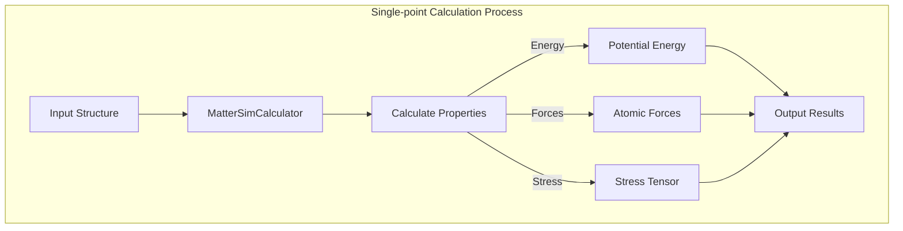
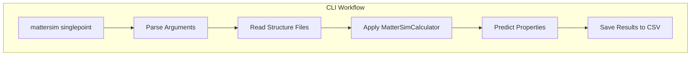
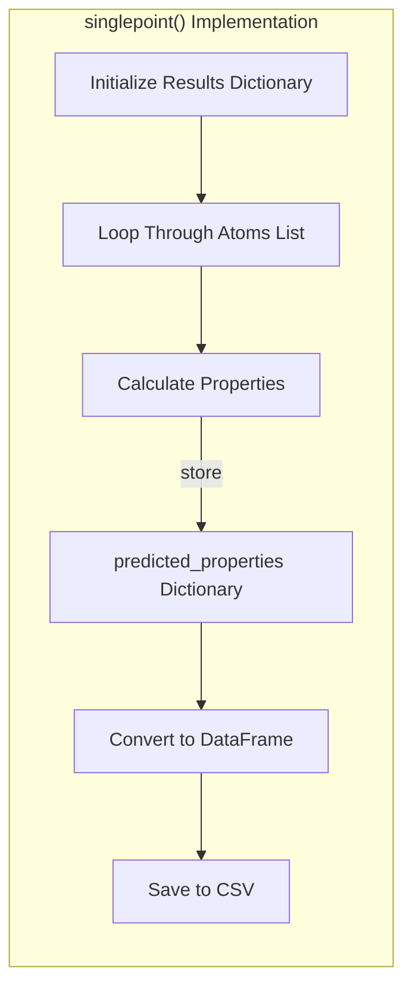
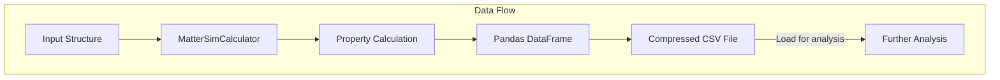

<!-- source: DeepWiki mcp.deepwiki.com · repo microsoft/mattersim · page 6.4 Single-point Calculations · fetched 2026-10-26 -->

# Single-point Calculations

<details>
<summary>Relevant source files</summary>

The following files were used as context for generating this wiki page:

- [src/mattersim/cli/mattersim_app.py](src/mattersim/cli/mattersim_app.py)
- [tests/data/mp-149_Si2.cif](tests/data/mp-149_Si2.cif)
- [tests/data/mp-2998_BaTiO3.cif](tests/data/mp-2998_BaTiO3.cif)

</details>


## Purpose and Overview

Single-point calculations represent one of the fundamental operations in atomistic modeling, allowing users to calculate energy, forces, and stress for a given atomic structure without modifying its geometry. This document explains how to perform single-point calculations using MatterSim, detailing both command-line and programmatic approaches.

For more complex operations that involve structural changes, refer to [Structure Relaxation](#6.1) or [Molecular Dynamics](#6.3).



Sources: [src/mattersim/cli/applications/singlepoint.py:14-46]()

## Command-Line Interface

MatterSim provides a convenient command-line interface for performing single-point calculations on atomic structures.

### Basic Usage

```
mattersim singlepoint --structure-file your_structure.xyz --mattersim-model mattersim-v1.0.0-1m
```

### Command-Line Options

The singlepoint command accepts several arguments:

| Argument | Description | Default Value |
|----------|-------------|---------------|
| `--structure-file` | Path to structure file(s) (supports multiple files) | Required |
| `--mattersim-model` | MatterSim model to use: "mattersim-v1.0.0-1m" or "mattersim-v1.0.0-5m" | mattersim-v1.0.0-1m |
| `--device` | Computation device: "cpu" or "cuda" | cpu |
| `--work-dir` | Working directory for calculation outputs | Timestamp-UUID |
| `--save-csv` | Filename for saving results | results.csv.gz |



Sources: [src/mattersim/cli/mattersim_app.py:17-36](), [src/mattersim/cli/mattersim_app.py:305-309]()

## Programmatic Usage

You can also perform single-point calculations programmatically using the MatterSim API.

### Direct Method with ASE

```python
from ase.io import read
from mattersim.forcefield import MatterSimCalculator

# Load structure
atoms = read("your_structure.xyz")

# Create and attach calculator
calc = MatterSimCalculator()
atoms.calc = calc

# Calculate properties
energy = atoms.get_potential_energy()
forces = atoms.get_forces()
stress = atoms.get_stress()
```

### Using the Singlepoint Function

For batch processing of multiple structures:

```python
from ase.io import read
from mattersim.cli.applications.singlepoint import singlepoint

# Load structures
atoms_list = read("your_structures.xyz", index=":")

# Calculate properties for all structures
results = singlepoint(atoms_list, work_dir="output_directory")
```

Sources: [src/mattersim/cli/applications/singlepoint.py:14-46]()

## Implementation Details

The single-point calculation functionality is implemented in the `singlepoint` function in the MatterSim codebase.



For each atomic structure, the following properties are calculated:

1. Structure (converted to a pymatgen Structure object)
2. Total energy
3. Energy per atom
4. Atomic forces
5. Stress tensor (in both native units and GPa)

The implementation creates a default dictionary to store these properties, processes each structure in the input list, and saves the results to a compressed CSV file.

Sources: [src/mattersim/cli/applications/singlepoint.py:14-46]()

## Data Processing and Output

The results from single-point calculations are organized in a pandas DataFrame with the following columns:

| Column | Description |
|--------|-------------|
| structure | The atomic structure in pymatgen format |
| energy | Total potential energy of the system |
| energy_per_atom | Energy normalized by number of atoms |
| forces | 3D array of forces on each atom |
| stress | Full 3×3 stress tensor |
| stress_GPa | Stress tensor in GPa units |

All results are saved to a compressed CSV file, which can be further processed or analyzed using standard data analysis tools.



Sources: [src/mattersim/cli/applications/singlepoint.py:24-45]()

## Integration with Other Workflows

Single-point calculations can serve as the foundation for more complex workflows in materials simulation. The properties calculated (energy, forces, stress) can be used for:

1. Material property evaluation
2. Initial assessment before structure relaxation
3. Comparison between different structures
4. Validation of simulation parameters

Single-point calculations are usually the fastest type of calculation you can perform with MatterSim, making them ideal for rapid screening of materials or initial analysis before more computationally intensive workflows.

Sources: [src/mattersim/cli/mattersim_app.py:305-309](), [src/mattersim/cli/applications/singlepoint.py:14-46]()

---

