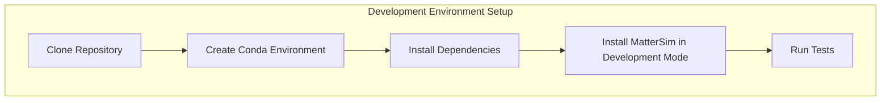
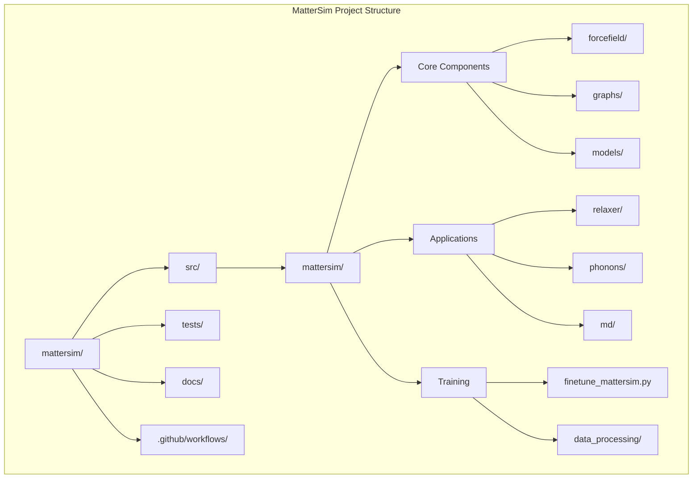
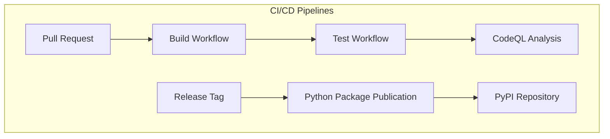
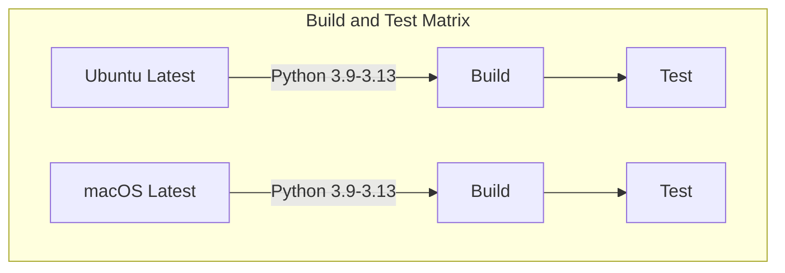
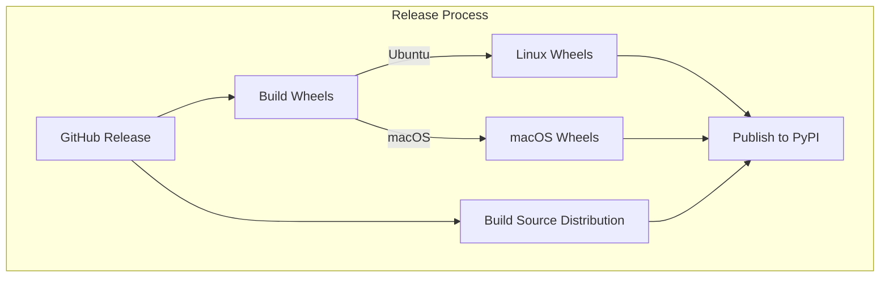
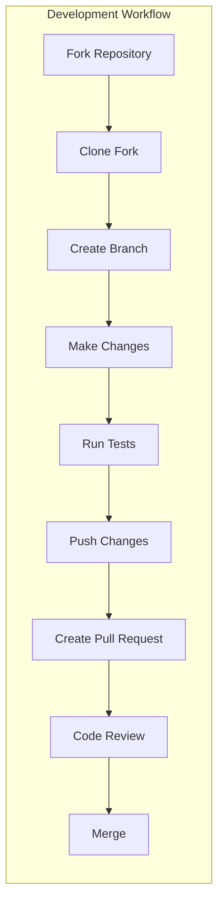
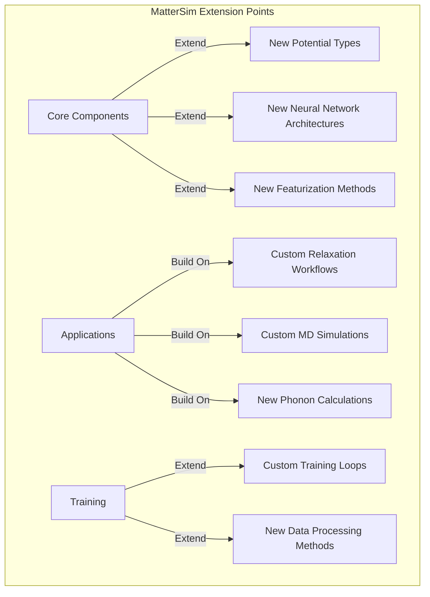

<!-- source: DeepWiki mcp.deepwiki.com · repo microsoft/mattersim · page 7 Development · fetched 2026-10-26 -->

# Development

<details>
<summary>Relevant source files</summary>

The following files were used as context for generating this wiki page:

- [.github/workflows/build.yaml](.github/workflows/build.yaml)
- [.github/workflows/codeql.yaml](.github/workflows/codeql.yaml)
- [.github/workflows/python-publish.yaml](.github/workflows/python-publish.yaml)

</details>


This page provides essential information for developers contributing to MatterSim, including build system architecture, CI/CD pipelines, and deployment processes. It covers the technical infrastructure that supports the development workflow, from local setup to production deployment.

## Development Environment Setup

Setting up a proper development environment is the first step for contributing to MatterSim. The recommended approach is to use a dedicated conda environment.



### Clone the Repository

Start by cloning the MatterSim repository:

```bash
git clone git@github.com:microsoft/mattersim.git
cd mattersim
```

### Create and Configure the Development Environment

MatterSim strongly recommends using mamba or micromamba for dependency management, as conda can be slower when resolving dependencies.

```bash
mamba env create -f environment.yaml
mamba activate mattersim
uv pip install -e .
```

To install development dependencies:

```bash
uv pip install -e ".[dev]"
```

Sources: [README.md:54-73]()

## Project Structure

MatterSim follows a modular architecture with clear separation of concerns. Understanding this structure is important for developers who want to contribute effectively.



### Key Directories

- **src/mattersim/**: Main source code
  - **forcefield/**: Core potential and calculator implementations
  - **graphs/**: Graph conversion utilities for atomic structures
  - **models/**: Neural network model architectures
  - **relaxer/**: Structure relaxation workflows
  - **phonons/**: Phonon calculation utilities
  - **md/**: Molecular dynamics implementations
  - **training/**: Fine-tuning and training pipelines

- **tests/**: Test suite for the project
- **docs/**: Documentation source
- **.github/workflows/**: CI/CD pipeline configurations

## Continuous Integration and Deployment

MatterSim uses GitHub Actions for automated building, testing, and deployment. Understanding these workflows is essential for contributors.



### Build and Test Workflow

The build workflow ensures that MatterSim can be built successfully across different operating systems and Python versions. It uses micromamba to set up the environment and runs the test suite.



The build and test workflows run on both Ubuntu and macOS with Python versions 3.9, 3.10, 3.11, 3.12, and 3.13.

Sources: [.github/workflows/build.yaml:1-99]()

### Release Process

When a new release is created on GitHub, the python-publish workflow automatically builds and publishes the package to PyPI.



The release workflow builds wheels for multiple Python versions and platforms, ensuring broad compatibility.

Sources: [.github/workflows/python-publish.yaml:1-113]()

### Code Quality

MatterSim uses CodeQL for static code analysis to identify vulnerabilities and maintain code quality.

Sources: [.github/workflows/codeql.yaml:1-93]()

## Development Workflow

The recommended workflow for contributing to MatterSim follows standard GitHub practices:



### Testing

Before submitting a pull request, make sure to run the test suite to ensure your changes don't break existing functionality:

```bash
pytest -s tests
```

Sources: [.github/workflows/build.yaml:95-98]()

## Extending MatterSim

Developers can extend MatterSim by adding new features to the core components or by developing new applications on top of them.



### Fine-tuning Pipeline

The fine-tuning pipeline is a key extension point for developers who want to adapt MatterSim to specific use cases or materials. The pipeline can be customized through command-line arguments.

Example usage:

```bash
torchrun --nproc_per_node=1 src/mattersim/training/finetune_mattersim.py --load_model_path mattersim-v1.0.0-1m --train_data_path your_custom_data.xyz
```

Sources: [README.md:123-131]()

## Contact and Support

For research interests, contributions, or issues, developers can reach out to the MatterSim team at ai4s-materials@microsoft.com.

Sources: [README.md:171-172]()

## Version Control and Releases

When reporting results or referencing MatterSim in academic papers or technical reports, always specify the exact model version and checkpoint (e.g., MatterSim-v1.0.0-1M) rather than generically referring to the model as MatterSim.

Sources: [README.md:152-153]()

---

