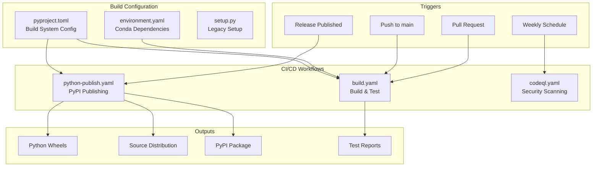
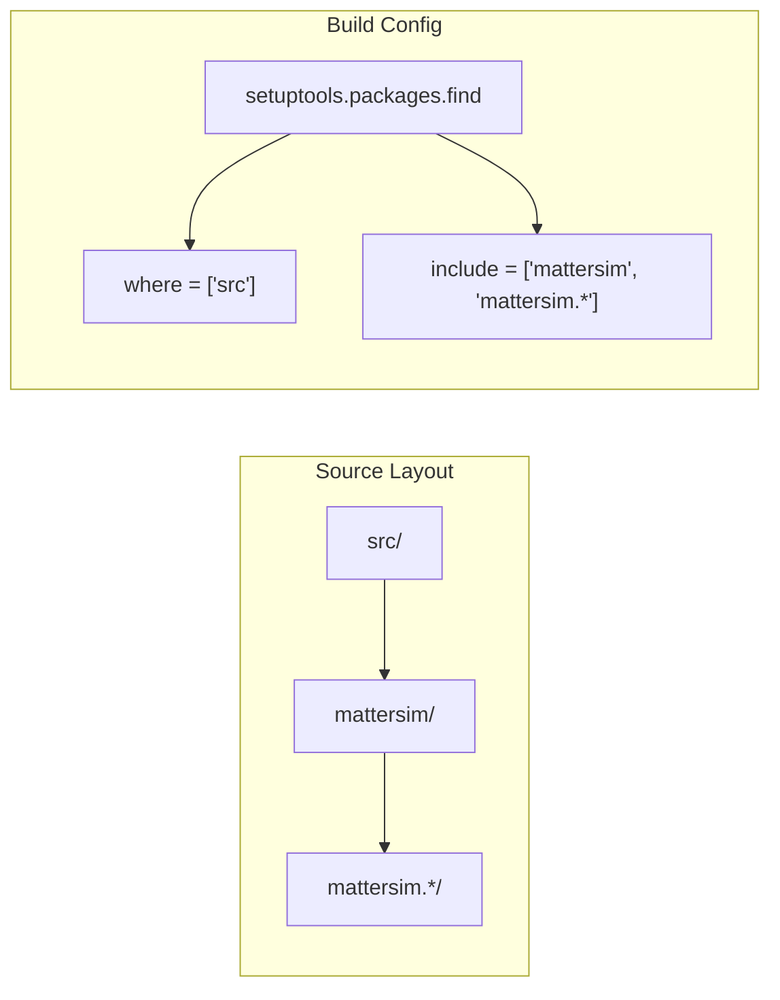
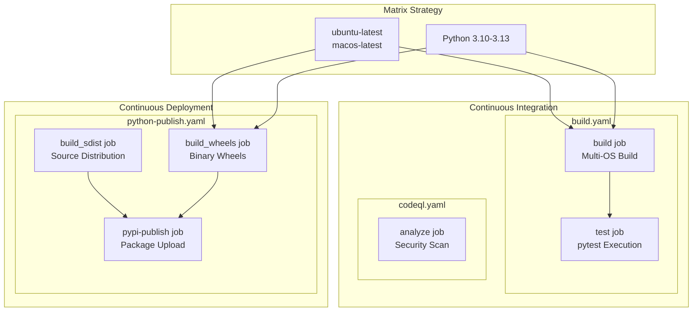
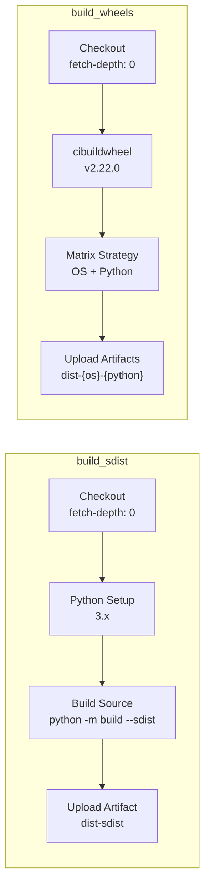

<!-- source: DeepWiki mcp.deepwiki.com · repo microsoft/mattersim · page 7.1 Build System & CI/CD · fetched 2026-10-26 -->

# Build System & CI/CD

<details>
<summary>Relevant source files</summary>

The following files were used as context for generating this wiki page:

- [.github/workflows/build.yaml](.github/workflows/build.yaml)
- [.github/workflows/codeql.yaml](.github/workflows/codeql.yaml)
- [.github/workflows/python-publish.yaml](.github/workflows/python-publish.yaml)
- [pyproject.toml](pyproject.toml)

</details>


This document covers the automated build system, testing framework, and continuous integration/deployment pipeline for MatterSim. It details the GitHub Actions workflows, build configuration, dependency management, and package publishing processes.

For information about documentation building and deployment, see [Documentation System](#8). For MLflow-based model deployment, see [MLflow Integration](#7.2).

## Overview

MatterSim uses a modern Python build system based on `pyproject.toml` with setuptools and setuptools_scm for version management. The CI/CD pipeline consists of three main GitHub Actions workflows that handle building, testing, security scanning, and package publication to PyPI.



Sources: [pyproject.toml:1-100](), [.github/workflows/build.yaml:1-99](), [.github/workflows/python-publish.yaml:1-113](), [.github/workflows/codeql.yaml:1-93]()

## Build System Configuration

The build system is configured through `pyproject.toml` using modern Python packaging standards with setuptools as the build backend and setuptools_scm for automatic versioning.

### Build Backend and Dependencies

The build system requires specific tools for compilation and packaging:

| Component | Purpose | Version Requirement |
|-----------|---------|-------------------|
| Cython | C extension compilation | ≥0.29.32 |
| numpy | Numerical computing headers | ≥2.0.0 |
| setuptools | Build backend | ≥45 |
| setuptools_scm | Version management | Latest |
| wheel | Wheel building | Latest |

### Package Structure

MatterSim uses a src-layout structure with packages located under the `src/` directory:



Sources: [pyproject.toml:82-88]()

### Dependency Management

The project defines dependencies in several categories:

#### Core Dependencies
Essential packages required for MatterSim functionality, including PyTorch ecosystem, ASE, pymatgen, and Azure storage components. Key dependencies include:

- `torch>=2.2.0`, `torch_geometric>=2.5.3` - Deep learning framework
- `ase>=3.23.0` - Atomic simulation environment
- `pymatgen` - Materials analysis library
- `azure-identity`, `azure-storage-blob` - Cloud storage integration

#### Optional Dependencies
- `dev`: Development tools including `pytest`, `pre-commit`, `ipykernel`
- `docs`: Documentation building tools including `sphinx`, `nbsphinx`

Sources: [pyproject.toml:28-76]()

## CI/CD Pipeline Architecture

The CI/CD system consists of three coordinated workflows that handle different aspects of the development lifecycle.



Sources: [.github/workflows/build.yaml:12-60](), [.github/workflows/python-publish.yaml:24-70](), [.github/workflows/codeql.yaml:22-47]()

## Build and Test Workflow

The `build.yaml` workflow provides comprehensive testing across multiple platforms and Python versions.

### Build Strategy Matrix

The workflow tests against all supported combinations:

| Operating System | Python Versions |
|-----------------|----------------|
| ubuntu-latest | 3.10, 3.11, 3.12, 3.13 |
| macos-latest | 3.10, 3.11, 3.12, 3.13 |

### Environment Setup

The build process uses Micromamba for fast environment creation and management:

1. **Environment Configuration**: Dynamic Python version substitution in `environment.yaml`
2. **Micromamba Setup**: Uses `mamba-org/setup-micromamba@v1` action
3. **Dependency Installation**: Uses `uv pip install` for fast package installation
4. **Caching**: Caches both pip cache and micromamba environments

### Test Execution

Tests run using pytest with the following configuration:
- Test discovery in `tests/` directory
- Verbose output with `-s` flag
- Development dependencies installed via `.[dev]` extra

Sources: [.github/workflows/build.yaml:19-99]()

## Package Publishing Workflow

The `python-publish.yaml` workflow handles building and distributing packages to PyPI.

### Build Jobs



### Wheel Building Configuration

The workflow uses `cibuildwheel` with specific configuration from `pyproject.toml`:

| Parameter | Value | Purpose |
|-----------|--------|---------|
| `build` | `cp3{10,11,12,13}-*` | Python 3.10-3.13 |
| `manylinux-x86_64-image` | `manylinux2014` | Linux compatibility |
| `skip` | `pp*,*win*,*macos*` | Skip PyPy and some platforms |

### Publishing Process

The `pypi-publish` job coordinates artifact collection and publication:

1. **Artifact Collection**: Downloads all build artifacts using `pattern: dist-*`
2. **Trusted Publishing**: Uses OIDC token-based authentication
3. **Target Selection**: Supports both PyPI and TestPyPI via workflow dispatch
4. **Environment Protection**: Uses GitHub environments for security

Sources: [.github/workflows/python-publish.yaml:25-113](), [pyproject.toml:93-100]()

## Security and Code Quality

### CodeQL Analysis

The `codeql.yaml` workflow provides automated security scanning:

**Schedule**: Runs on push, pull request, and weekly (`0 0 * * 5`)  
**Language**: Python with `build-mode: none`  
**Analysis**: Uses `github/codeql-action` for static analysis

### Build Security Features

- **Trusted Publishing**: OIDC-based PyPI authentication without API keys
- **Environment Protection**: GitHub environments with deployment rules
- **Dependency Scanning**: Automated vulnerability detection via CodeQL
- **Artifact Verification**: Checksums and signatures for built packages

Sources: [.github/workflows/codeql.yaml:14-93](), [.github/workflows/python-publish.yaml:76-90]()

## Configuration Management

### Version Management

MatterSim uses `setuptools_scm` for automatic version determination:

```toml
[tool.setuptools_scm]
version_scheme = "guess-next-dev"
local_scheme = "dirty-tag"
```

This generates versions based on git tags with development suffixes for unreleased commits.

### Environment Synchronization

The build system maintains consistency between development and CI environments:

- **Base Environment**: `environment.yaml` defines conda dependencies
- **Dynamic Python**: CI workflows modify Python version in environment file
- **Pip Integration**: Uses `uv pip` for fast installation of project and extras
- **Caching Strategy**: Comprehensive caching of environments and pip cache

Sources: [pyproject.toml:89-92](), [.github/workflows/build.yaml:23-51]()

---

