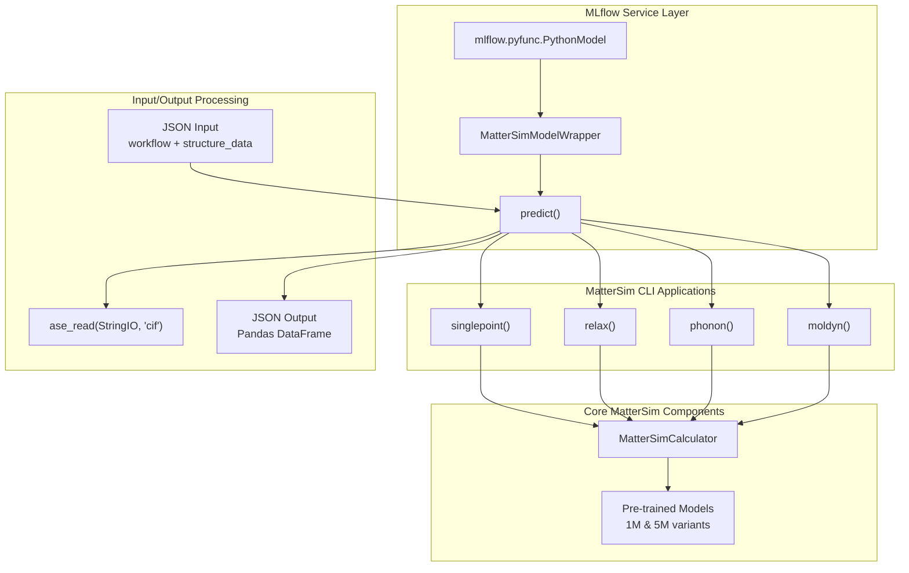
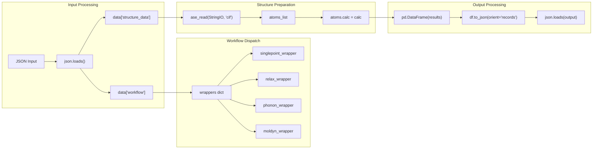
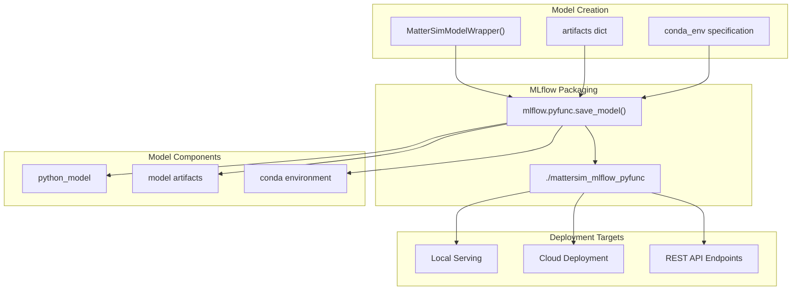

<!-- source: DeepWiki mcp.deepwiki.com · repo microsoft/mattersim · page 7.2 MLflow Integration · fetched 2026-10-26 -->

# MLflow Integration

<details>
<summary>Relevant source files</summary>

The following files were used as context for generating this wiki page:

- [src/mattersim/utils/mlflow_utils.py](src/mattersim/utils/mlflow_utils.py)

</details>


This document covers MatterSim's integration with MLflow for model serving and deployment in production environments. The MLflow integration provides a standardized interface for serving MatterSim models through MLflow's PyFunc model format, enabling scalable deployment of materials simulation workflows.

For information about the underlying CLI applications used by the MLflow wrapper, see [Command Line Interface](#4.3). For details about model training and evaluation workflows, see [Training & Fine-tuning](#5).

## Purpose and Architecture

The MLflow integration wraps MatterSim's core simulation capabilities into a deployable model service that can be consumed through standard MLflow serving endpoints. The integration supports all major MatterSim workflows including single-point calculations, structure relaxation, phonon calculations, and molecular dynamics simulations.

### MLflow Integration Architecture



Sources: [src/mattersim/utils/mlflow_utils.py:23-89]()

### Data Flow and Processing Pipeline



Sources: [src/mattersim/utils/mlflow_utils.py:57-89]()

## MatterSimModelWrapper Implementation

The core MLflow integration is implemented through the `MatterSimModelWrapper` class, which extends `mlflow.pyfunc.PythonModel` to provide a standardized interface for MatterSim workflows.

### Wrapper Methods

The wrapper provides four main simulation methods, each corresponding to a MatterSim CLI application:

| Method | CLI Function | Purpose | Output Processing |
|--------|--------------|---------|-------------------|
| `singlepoint_wrapper` | `singlepoint()` | Energy, force, stress calculations | Direct DataFrame conversion |
| `relax_wrapper` | `relax()` | Structure optimization | Direct DataFrame conversion |
| `phonon_wrapper` | `phonon()` | Phonon dispersion and DOS | Base64 encoding of plot images |
| `moldyn_wrapper` | `moldyn()` | Molecular dynamics simulations | Trajectory and log file handling |

Sources: [src/mattersim/utils/mlflow_utils.py:27-55]()

### Input Format and Processing

The MLflow wrapper expects JSON input with the following structure:

```json
{
  "workflow": "singlepoint|relax_structure|phonon|molecular_dynamics",
  "structure_data": ["cif_string_1", "cif_string_2", ...],
  "work_dir": "temporary_directory_path",
  // additional workflow-specific parameters
}
```

The `predict` method processes this input by:

1. Parsing the JSON data from the model input
2. Selecting the appropriate wrapper function based on `workflow` parameter
3. Converting CIF structure strings to ASE `Atoms` objects using `ase_read(StringIO(structure_data), format="cif")`
4. Initializing `MatterSimCalculator` with the 1M model variant
5. Executing the selected workflow in a temporary directory
6. Converting results to JSON format via Pandas DataFrame

Sources: [src/mattersim/utils/mlflow_utils.py:57-89]()

## Model Artifacts and Dependencies

### Pre-trained Model Artifacts

The MLflow model includes artifacts pointing to MatterSim's pre-trained models:

```python
artifacts = {
    "checkpoint-1M": "pretrained_models/mattersim-v1.0.0-1M.pth",
    "checkpoint-5M": "pretrained_models/mattersim-v1.0.0-5M.pth",
}
```

The wrapper currently uses the 1M model variant by default (`mattersim-v1.0.0-1m`), though both variants are available as artifacts.

Sources: [src/mattersim/utils/mlflow_utils.py:17-20](), [src/mattersim/utils/mlflow_utils.py:77-78]()

### Environment Configuration

The MLflow model defines a complete conda environment specification for deployment:

| Component | Version | Purpose |
|-----------|---------|---------|
| Python | 3.9 | Runtime environment |
| MLflow | 2.19.0 | Model serving framework |
| MatterSim | Latest from git | Core simulation capabilities |
| PyTorch | 2.4.1 | Deep learning backend |
| Phonopy | 2.33.4 | Phonon calculations |
| Pandas | 2.2.3 | Data processing |
| NumPy | 1.26.4 | Numerical computing |

The environment installs MatterSim directly from the GitHub repository using a specific commit hash to ensure reproducibility.

Sources: [src/mattersim/utils/mlflow_utils.py:97-122]()

## Deployment Process

### Model Packaging and Storage



The model is saved using `mlflow.pyfunc.save_model()` with the following components:

- **Python Model**: `MatterSimModelWrapper` instance
- **Artifacts**: Pre-trained model checkpoints
- **Environment**: Complete conda environment specification
- **Path**: `./mattersim_mlflow_pyfunc` directory

Sources: [src/mattersim/utils/mlflow_utils.py:92-122]()

## Usage Patterns and Integration

### Workflow Selection

The wrapper supports four distinct workflow types through the `wrappers` dictionary:

```python
wrappers = {
    "molecular_dynamics": self.moldyn_wrapper,
    "phonon": self.phonon_wrapper,
    "relax_structure": self.relax_wrapper,
    "singlepoint": self.singlepoint_wrapper,
}
```

Invalid workflow specifications return an error response: `dict(error="Invalid workflow selected")`.

Sources: [src/mattersim/utils/mlflow_utils.py:61-71]()

### Special Output Handling

The phonon workflow includes special processing for visualization outputs:

- Plot images (`phonon_band_plot`, `phonon_dos_plot`) are base64-encoded for JSON serialization
- This enables embedding of matplotlib plots directly in API responses
- The encoding process reads generated plot files and converts them to base64 strings

Sources: [src/mattersim/utils/mlflow_utils.py:38-44]()

### Temporary Directory Management

All workflows execute within temporary directories created by `tempfile.TemporaryDirectory()`, ensuring clean execution environments and automatic cleanup of intermediate files.

Sources: [src/mattersim/utils/mlflow_utils.py:82-85]()

The MLflow integration provides a production-ready deployment path for MatterSim models, enabling scalable materials simulation services through standardized MLflow serving infrastructure.

---

