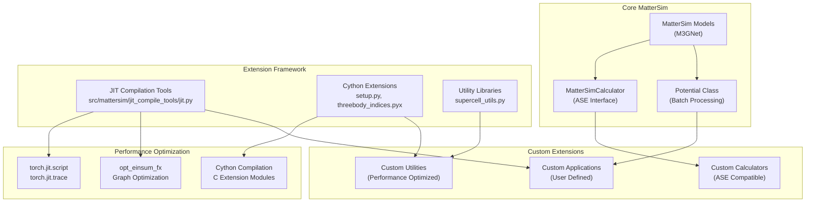
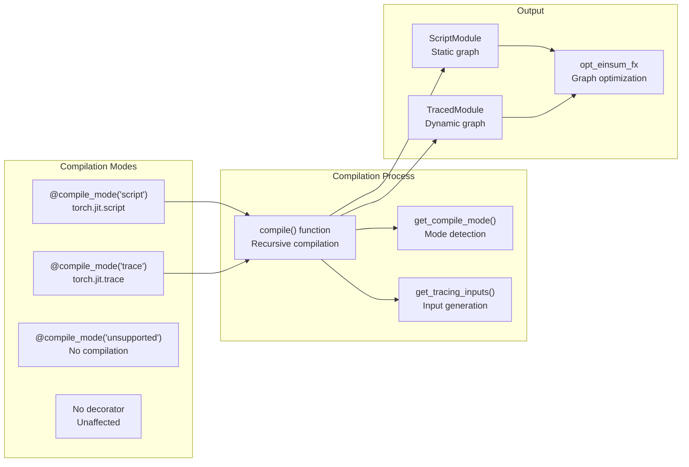
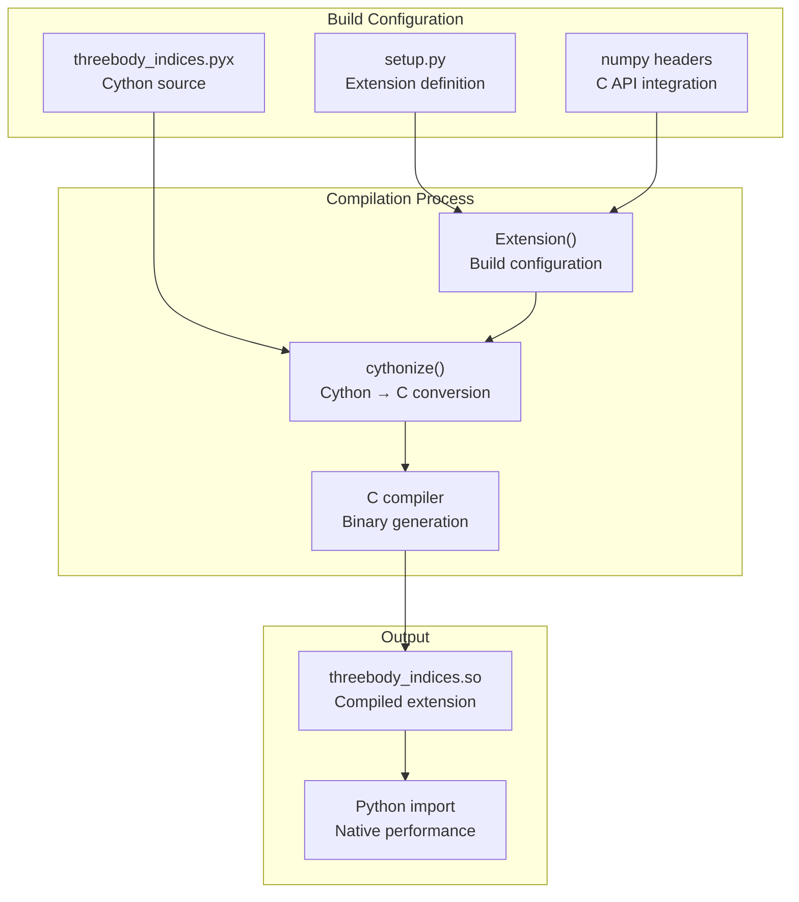
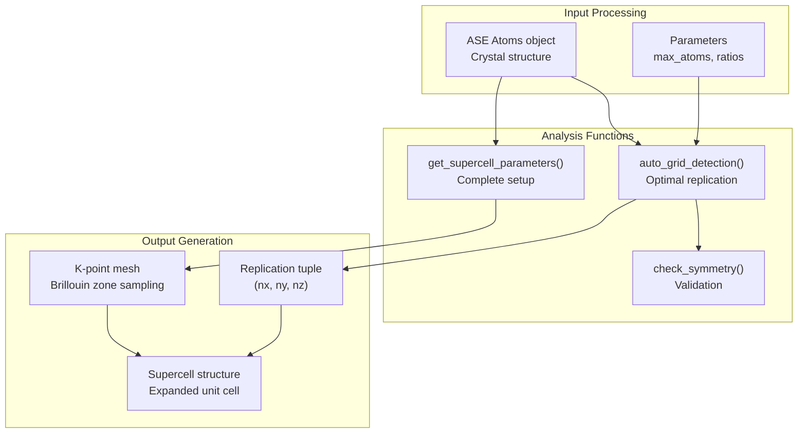
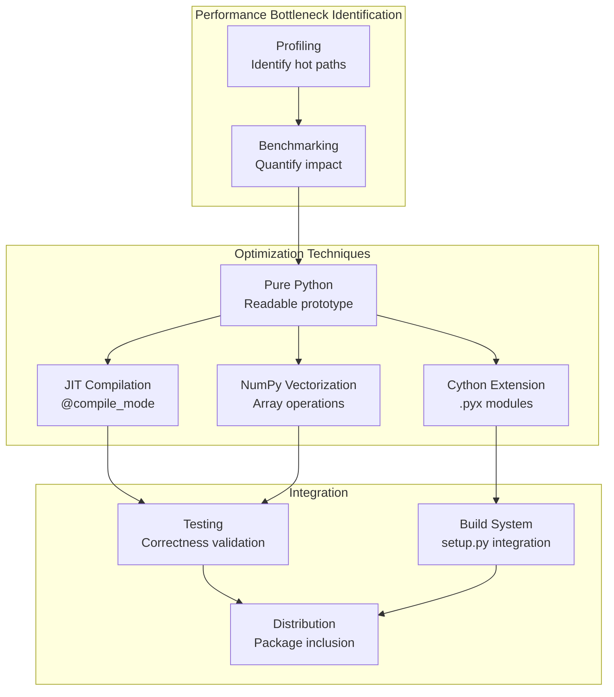

<!-- source: DeepWiki mcp.deepwiki.com · repo microsoft/mattersim · page 7.3 Extending MatterSim · fetched 2026-10-26 -->

# Extending MatterSim

Relevant source files

The following files were used as context for generating this wiki page:

- [.gitignore](.gitignore)
- [setup.py](setup.py)
- [src/mattersim/datasets/utils/threebody_indices.pyx](src/mattersim/datasets/utils/threebody_indices.pyx)
- [src/mattersim/jit_compile_tools/jit.py](src/mattersim/jit_compile_tools/jit.py)
- [src/mattersim/utils/supercell_utils.py](src/mattersim/utils/supercell_utils.py)

This document covers the technical framework and utilities for extending MatterSim functionality, including JIT compilation tools, Cython extensions for performance-critical operations, and patterns for developing custom applications. For information about contributing to the core codebase, see [Contributing Guidelines](#7.4). For MLflow integration and model deployment, see [MLflow Integration](#7.2).

## Extension Architecture Overview

MatterSim provides several extension points and utilities for developers to add custom functionality while maintaining performance and compatibility with the core system.

**Extension Points in MatterSim**

| Component | Extension Type | Use Case | Performance Benefit |
|-----------|----------------|----------|-------------------|
| `Potential` class | Subclassing | Custom force fields | Batch processing optimization |
| `MatterSimCalculator` | ASE Calculator interface | Custom simulation workflows | ASE ecosystem integration |
| JIT compilation | `@compile_mode` decorators | PyTorch module optimization | 2-10x speedup |
| Cython extensions | `.pyx` modules | Computational kernels | 10-100x speedup |
| Utility functions | Python modules | Helper operations | Code reusability |

Sources: [setup.py:1-16](), [src/mattersim/jit_compile_tools/jit.py:1-338](), [src/mattersim/utils/supercell_utils.py:1-202]()

## JIT Compilation System

The JIT compilation framework enables performance optimization of PyTorch modules through decorators and automated compilation utilities.

### Compilation Modes

The system supports three compilation modes through the `@compile_mode` decorator:

**Core JIT Functions**

| Function | Purpose | Key Parameters |
|----------|---------|----------------|
| `compile_mode(mode)` | Decorator to set compilation mode | `'script'`, `'trace'`, `'unsupported'` |
| `compile(mod, ...)` | Recursively compile module | `n_trace_checks`, `script_options`, `trace_options` |
| `get_compile_mode(mod)` | Retrieve module compilation mode | Returns mode string |
| `get_tracing_inputs(mod, n)` | Generate random tracing inputs | `device`, `dtype` for input generation |

### Usage Example

The JIT system automatically detects and compiles modules based on their decorators:

- **Script compilation**: [src/mattersim/jit_compile_tools/jit.py:131-134]() - Uses `torch.jit.script` for static graph optimization
- **Trace compilation**: [src/mattersim/jit_compile_tools/jit.py:135-149]() - Uses `torch.jit.trace_module` with automatic input generation
- **Recursive compilation**: [src/mattersim/jit_compile_tools/jit.py:117-129]() - Compiles all submodules according to their individual decorators

Sources: [src/mattersim/jit_compile_tools/jit.py:20-338]()

## Cython Extensions

MatterSim uses Cython for performance-critical computational kernels that require C-level performance.

### Extension Build System

The build system automatically compiles Cython extensions during package installation:

**Cython Extension Configuration**

The extension is configured in [setup.py:5-12]() with the following key settings:

| Setting | Value | Purpose |
|---------|-------|---------|
| `name` | `"mattersim.datasets.utils.threebody_indices"` | Python module path |
| `sources` | `["src/mattersim/datasets/utils/threebody_indices.pyx"]` | Cython source file |
| `include_dirs` | `[np.get_include()]` | NumPy C API headers |
| `define_macros` | `NPY_NO_DEPRECATED_API` | NumPy compatibility |

### Three-body Indices Computation

The `threebody_indices.pyx` module implements high-performance computation of three-body bond indices:

**Core Function**: `compute_threebody`
- **Input**: [src/mattersim/datasets/utils/threebody_indices.pyx:16-17]() - Bond atom indices and atom counts
- **Output**: [src/mattersim/datasets/utils/threebody_indices.pyx:24-28]() - Triple bond indices and counts
- **Performance**: C-level loops with memory management [src/mattersim/datasets/utils/threebody_indices.pyx:37-91]()

**Memory Management Pattern**:
- Dynamic allocation: [src/mattersim/datasets/utils/threebody_indices.pyx:37-45]() - `malloc` for temporary arrays
- Efficient computation: [src/mattersim/datasets/utils/threebody_indices.pyx:49-73]() - C loops for index calculation  
- Cleanup: [src/mattersim/datasets/utils/threebody_indices.pyx:87-90]() - `free` for all allocated memory

Sources: [setup.py:1-16](), [src/mattersim/datasets/utils/threebody_indices.pyx:1-92]()

## Custom Utilities and Applications

MatterSim provides utility functions and patterns for developing custom applications with optimized performance.

### Supercell Utilities

The `supercell_utils.py` module demonstrates patterns for creating high-level utility functions:

**Key Utility Functions**

| Function | Purpose | Key Logic |
|----------|---------|-----------|
| `auto_grid_detection` | Determine optimal supercell dimensions | Lattice vector analysis [src/mattersim/utils/supercell_utils.py:33-90]() |
| `get_supercell_parameters` | Complete supercell setup | Symmetry-based parameter selection [src/mattersim/utils/supercell_utils.py:130-201]() |

**Algorithm Pattern**: 
1. **Lattice analysis**: [src/mattersim/utils/supercell_utils.py:33-40]() - Compare vector lengths and ratios
2. **Replication calculation**: [src/mattersim/utils/supercell_utils.py:41-90]() - Determine optimal grid based on atom count limits
3. **Symmetry validation**: [src/mattersim/utils/supercell_utils.py:102-120]() - Ensure preserved crystal symmetry
4. **K-point generation**: [src/mattersim/utils/supercell_utils.py:160-201]() - Set appropriate Brillouin zone sampling

Sources: [src/mattersim/utils/supercell_utils.py:1-202]()

## Development Patterns

### Performance Optimization Strategy

**Optimization Decision Matrix**

| Scenario | Recommended Approach | Expected Speedup | Development Effort |
|----------|---------------------|------------------|-------------------|
| PyTorch model inference | JIT compilation (`@compile_mode`) | 2-10x | Low |
| Graph/tensor operations | `opt_einsum_fx` optimization | 2-5x | Low |
| Nested loops with NumPy | Cython extension | 10-100x | High |
| Mathematical kernels | Cython with C libraries | 50-500x | Very High |
| Utility functions | Pure Python + NumPy | Baseline | Low |

### Extension Development Workflow

1. **Prototype in Python**: Develop and test functionality using pure Python with NumPy
2. **Add JIT compilation**: Apply `@compile_mode` decorators for PyTorch modules
3. **Create Cython extensions**: Convert performance-critical loops to Cython
4. **Update build system**: Add extensions to [setup.py:5-12]() configuration
5. **Validate correctness**: Ensure identical results across implementations
6. **Integration testing**: Test within MatterSim ecosystem

**File Organization Pattern**:
- Core extensions: `src/mattersim/{module}/` 
- Utilities: `src/mattersim/utils/`
- JIT tools: `src/mattersim/jit_compile_tools/`
- Build config: `setup.py` root level

Sources: [setup.py:1-16](), [src/mattersim/jit_compile_tools/jit.py:1-338](), [src/mattersim/utils/supercell_utils.py:1-202](), [.gitignore:8-9]()

---

