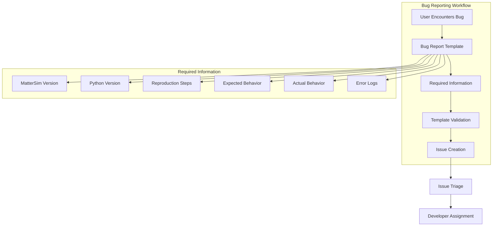
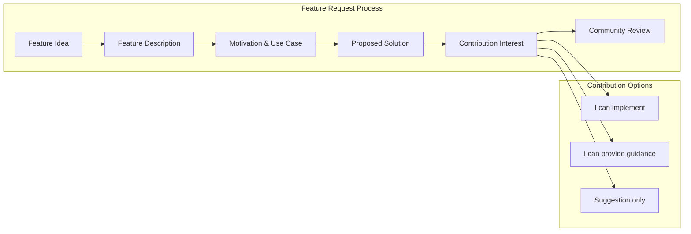
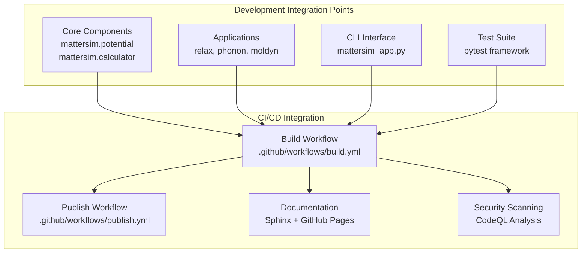
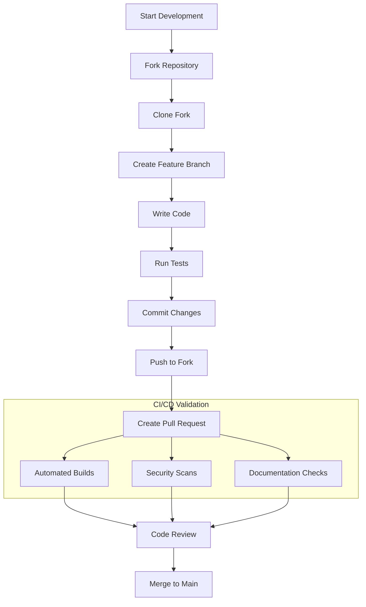
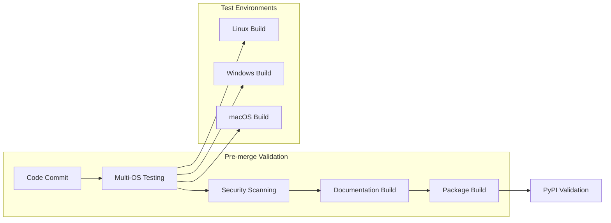
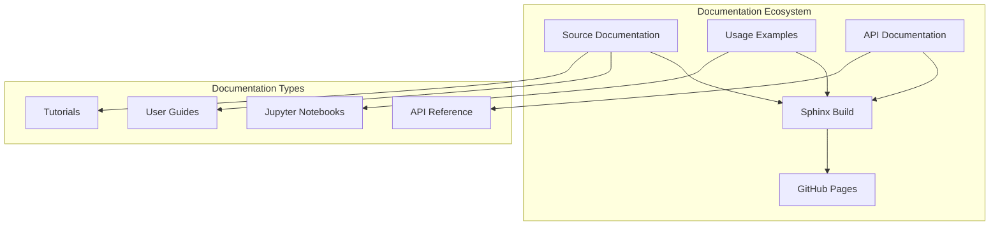
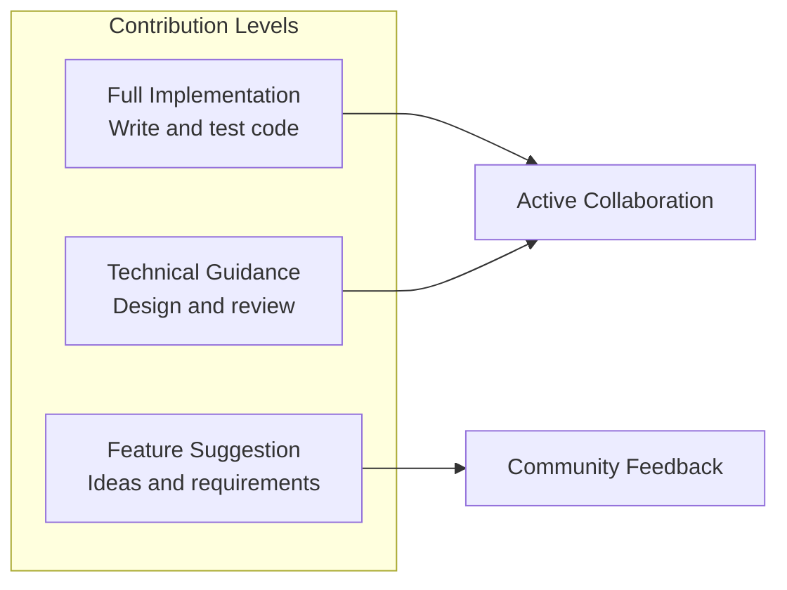

<!-- source: DeepWiki mcp.deepwiki.com · repo microsoft/mattersim · page 7.4 Contributing Guidelines · fetched 2026-10-26 -->

# Contributing Guidelines

<details>
<summary>Relevant source files</summary>

The following files were used as context for generating this wiki page:

- [.git_archival.txt](.git_archival.txt)
- [.gitattributes](.gitattributes)
- [.github/ISSUE_TEMPLATE/01-bug-report.yml](.github/ISSUE_TEMPLATE/01-bug-report.yml)
- [.github/ISSUE_TEMPLATE/02-feature-request.yml](.github/ISSUE_TEMPLATE/02-feature-request.yml)
- [.github/ISSUE_TEMPLATE/config.yml](.github/ISSUE_TEMPLATE/config.yml)
- [docs/_static/mattersim-with-name.png](docs/_static/mattersim-with-name.png)

</details>


This document provides comprehensive information for contributors to the MatterSim project, covering issue reporting, development workflow, code submission process, and integration with the project's CI/CD infrastructure. For information about the build system and deployment processes, see [Build System & CI/CD](#7.1). For details on extending MatterSim functionality, see [Extending MatterSim](#7.3).

## Issue Reporting Process

### Bug Reports

The project uses structured issue templates to ensure consistent bug reporting. Bug reports should be submitted using the GitHub issue template system.



**Sources:** [.github/ISSUE_TEMPLATE/01-bug-report.yml:1-91]()

The bug report template requires the following mandatory information:

| Field | Description | Required |
|-------|-------------|----------|
| Bug Description | Clear description of the issue | Yes |
| MatterSim Version | Specific version being used | Yes |
| Python Version | Python environment version | Yes |
| Reproduction Steps | Detailed steps to recreate the bug | Yes |
| Expected Behavior | What should happen | Yes |
| Actual Behavior | What actually happened | Yes |
| Error Logs | Stack traces and error messages | No |
| Contact Details | Communication method | No |

### Feature Requests

Feature requests follow a structured template to capture requirements and implementation details.



**Sources:** [.github/ISSUE_TEMPLATE/02-feature-request.yml:1-62]()

## Development Environment Setup

### Repository Structure Integration

Contributors should understand how their changes integrate with the overall MatterSim architecture:



**Sources:** Based on architecture diagrams and CI/CD workflow patterns

### Issue Template Configuration

The project uses GitHub's issue template system with blank issues disabled to ensure structured communication:

**Sources:** [.github/ISSUE_TEMPLATE/config.yml:1-1]()

```yaml
blank_issues_enabled: false
```

This configuration forces contributors to use the structured templates, improving issue quality and maintainer efficiency.

## Code Contribution Workflow

### Development Process



### Integration with Build System

Contributors must ensure their changes integrate properly with the existing build and deployment infrastructure. The project uses several key integration points:

| Component | Purpose | Integration Point |
|-----------|---------|-------------------|
| `pyproject.toml` | Dependencies and metadata | Package configuration |
| `setup.py` | Cython extensions | Native code compilation |
| `environment.yaml` | Conda environment | Development setup |

**Sources:** Based on development ecosystem architecture

## Testing and Validation

### Automated Validation Pipeline



**Sources:** Based on CI/CD architecture patterns

### Code Quality Standards

Contributors must adhere to code quality standards enforced by the automated pipeline:

- **Security Scanning**: CodeQL analysis for security vulnerabilities
- **Multi-platform Testing**: Linux, Windows, and macOS compatibility
- **Documentation Integration**: Sphinx documentation build validation
- **Package Integrity**: PyPI package build verification

## Documentation Contributions

### Documentation Architecture



**Sources:** Based on documentation system architecture

Contributors should ensure documentation changes integrate with:
- Sphinx documentation build system
- GitHub Pages automatic deployment
- Jupyter notebook examples
- API documentation generation

## Code of Conduct Compliance

Both bug reports and feature requests require explicit agreement to follow the project's Code of Conduct:

**Sources:** [.github/ISSUE_TEMPLATE/01-bug-report.yml:84-91](), [.github/ISSUE_TEMPLATE/02-feature-request.yml:55-62]()

```yaml
- type: checkboxes
  id: terms
  attributes:
    label: Code of Conduct
    description: By submitting this issue, you agree to follow our Code of Conduct
    options:
      - label: I agree to follow the project's Code of Conduct
        required: true
```

## Community Interaction

### Contribution Interest Levels

The project recognizes different levels of community engagement:



**Sources:** [.github/ISSUE_TEMPLATE/02-feature-request.yml:45-53]()

This tiered approach allows contributors to participate at their comfort level while providing clear expectations for maintainers.

## Repository Metadata

### Git Configuration

The repository uses Git archival for release management:

**Sources:** [.git_archival.txt:1-4](), [.gitattributes:1-2]()

```
node: $Format:%H$
node-date: $Format:%cI$
describe-name: $Format:%(describe:tags=true,match=*[0-9]*)$
```

This configuration enables automatic version tagging and release artifact generation through the CI/CD pipeline.

---

