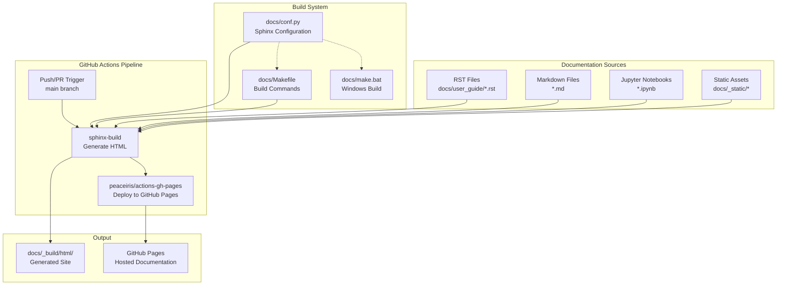
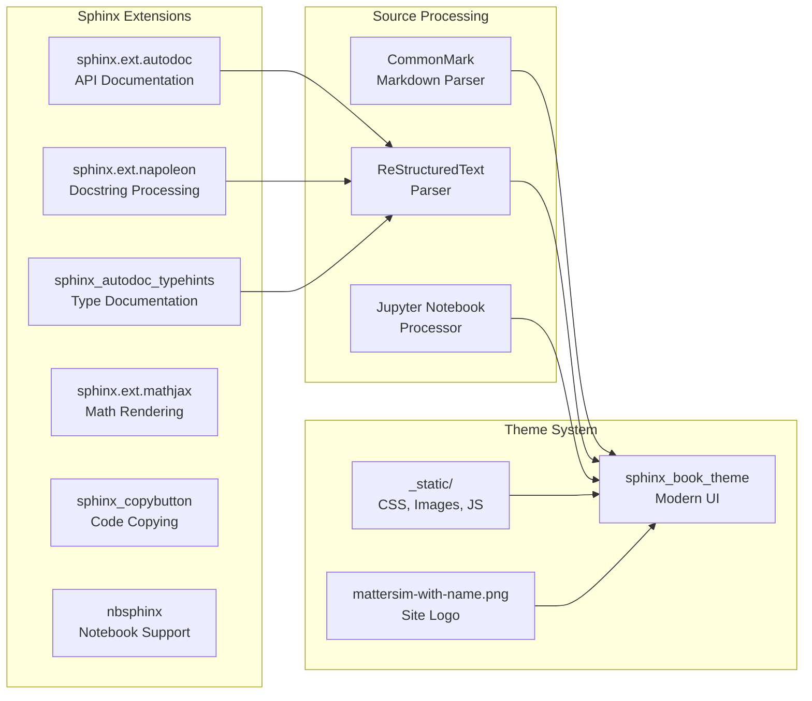
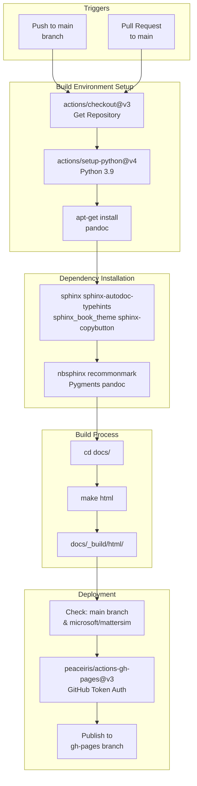
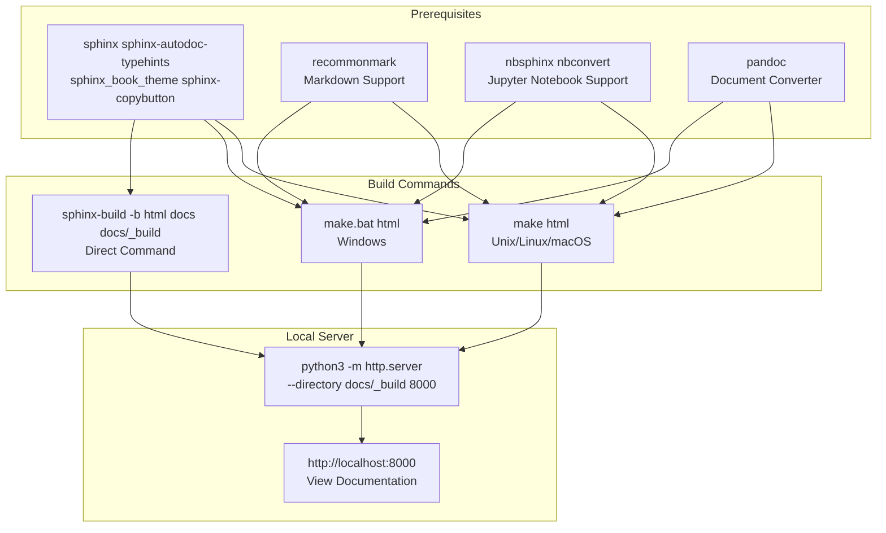
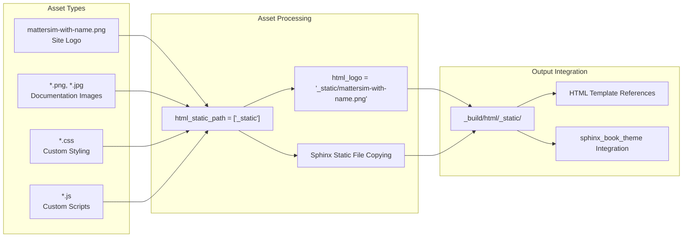
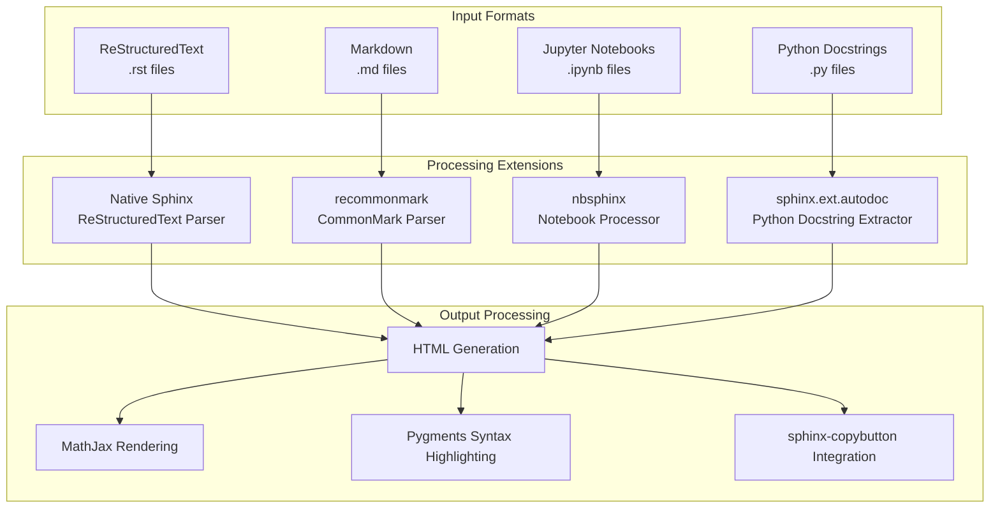

<!-- source: DeepWiki mcp.deepwiki.com · repo microsoft/mattersim · page 8 Documentation System · fetched 2026-10-26 -->

# Documentation System

Relevant source files

The following files were used as context for generating this wiki page:

- [.github/workflows/gh-pages.yaml](.github/workflows/gh-pages.yaml)
- [.nojekyll](.nojekyll)
- [docs/Makefile](docs/Makefile)
- [docs/README.md](docs/README.md)
- [docs/_static/mattersim.png](docs/_static/mattersim.png)
- [docs/conf.py](docs/conf.py)
- [docs/make.bat](docs/make.bat)
- [docs/user_guide/installation.rst](docs/user_guide/installation.rst)

## Purpose and Scope

This documentation system manages the build process, automated deployment, and local development workflows for MatterSim's technical documentation. It uses Sphinx as the documentation generator with GitHub Pages for hosting and GitHub Actions for continuous deployment. For information about contributing to the documentation content itself, see [Contributing Guidelines](#7.4).

## Architecture Overview

The documentation system follows a modern static site generation approach with automated deployment:

Sources: [docs/conf.py](), [docs/Makefile](), [docs/make.bat](), [.github/workflows/gh-pages.yaml]()

## Sphinx Configuration

The documentation system is built on Sphinx with a comprehensive set of extensions and configurations:

### Core Configuration

| Component | Configuration | Purpose |
|-----------|---------------|---------|
| **Extensions** | `sphinx.ext.autodoc` | Auto-generate API documentation |
| | `sphinx.ext.napoleon` | Google/NumPy docstring support |
| | `sphinx_autodoc_typehints` | Type hint documentation |
| | `sphinx.ext.mathjax` | Mathematical notation |
| | `sphinx_copybutton` | Copy code button |
| | `nbsphinx` | Jupyter notebook support |
| **Theme** | `sphinx_book_theme` | Modern book-style theme |
| **Formats** | `.rst`, `.md` | Multiple markup format support |

The main configuration is defined in `docs/conf.py`:

Sources: [docs/conf.py:16-24](), [docs/conf.py:33-38](), [docs/conf.py:46]()

## GitHub Pages Deployment

The automated deployment pipeline uses GitHub Actions to build and publish documentation:

### Deployment Workflow

Sources: [.github/workflows/gh-pages.yaml:3-11](), [.github/workflows/gh-pages.yaml:28-38](), [.github/workflows/gh-pages.yaml:39-42](), [.github/workflows/gh-pages.yaml:44-49]()

### Deployment Configuration

The deployment workflow includes several key features:

| Feature | Configuration | Purpose |
|---------|---------------|---------|
| **Triggers** | `push` to main, `pull_request` to main | Automatic builds on changes |
| **Permissions** | `contents: write` | Allow deployment to gh-pages |
| **Conditional Deploy** | Repository and branch checks | Prevent unauthorized deployments |
| **Token Auth** | `${{ secrets.GITHUB_TOKEN }}` | Secure deployment authorization |

Sources: [.github/workflows/gh-pages.yaml:12-13](), [.github/workflows/gh-pages.yaml:45]()

## Local Development Setup

### Prerequisites and Installation

Developers can build documentation locally using the provided tooling:

Sources: [docs/README.md:4-18](), [docs/README.md:20-30]()

### Build System Structure

The build system provides multiple interfaces for different environments:

| File | Platform | Purpose |
|------|----------|---------|
| `docs/Makefile` | Unix/Linux/macOS | Standard make-based builds |
| `docs/make.bat` | Windows | Batch file for Windows builds |
| `docs/README.md` | All | Developer setup instructions |

The build process uses Sphinx's standard directory structure:
- **Source Directory**: `.` (docs root)
- **Build Directory**: `_build`
- **Output Directory**: `_build/html`

Sources: [docs/Makefile:7-9](), [docs/make.bat:10-11](), [docs/README.md:22-24]()

## Documentation Assets and Structure

### Static Assets Management

The documentation system manages static assets through a dedicated directory structure:

Sources: [docs/conf.py:44](), [docs/conf.py:46](), [docs/_static/mattersim.png]()

### GitHub Pages Configuration

The system includes GitHub Pages-specific configuration:

| File | Purpose |
|------|---------|
| `.nojekyll` | Disables Jekyll processing for GitHub Pages |
| `gh-pages` branch | Deployment target for generated HTML |

The `.nojekyll` file ensures that Sphinx-generated files with underscores (like `_static/`) are properly served by GitHub Pages.

Sources: [.nojekyll]()

## Documentation Source Formats

The system supports multiple documentation source formats through Sphinx extensions:

### Supported Formats

Sources: [docs/conf.py:16-24](), [docs/conf.py:26-29](), [docs/conf.py:48-50]()

### Configuration Details

The format support is configured through the `source_suffix` dictionary and extension list:

- **ReStructuredText**: Native Sphinx support with full feature set
- **Markdown**: CommonMark parsing via `recommonmark` extension
- **Jupyter Notebooks**: Execution control via `nbsphinx_execute = "never"`
- **Python Code**: Automatic API documentation via `sphinx.ext.autodoc`

The system prevents notebook execution during build (`nbsphinx_execute = "never"`) while allowing error tolerance (`nbsphinx_allow_errors = True`) for robust builds.

Sources: [docs/conf.py:26-29](), [docs/conf.py:49-50]()

---

