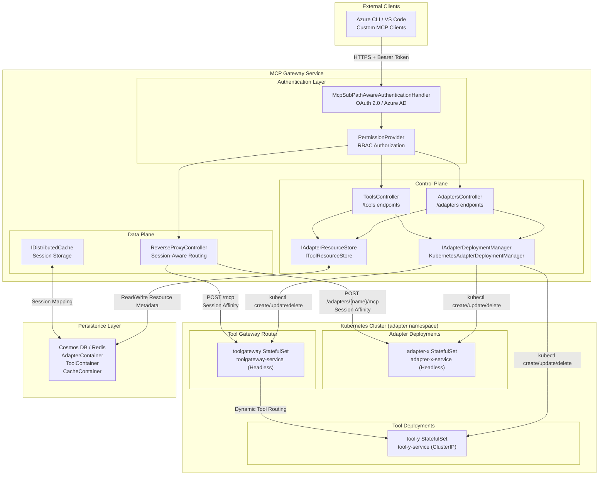

<!-- source: DeepWiki mcp.deepwiki.com · repo microsoft/mcp-gateway · page 1 Overview · fetched 2026-10-26 -->

# Overview

Relevant source files

The following files were used as context for generating this wiki page:

- [README.md](README.md)

## Purpose and Scope

This document provides a high-level introduction to the MCP Gateway system, explaining its purpose, core concepts, architecture, and capabilities. It serves as the starting point for understanding how the system functions as both a reverse proxy and management layer for Model Context Protocol (MCP) servers.

For detailed architectural documentation including control plane and data plane components, see [System Architecture](#2). For authentication and authorization mechanisms, see [Security and Authentication](#7). For deployment procedures, see [Deployment](#3). For complete API documentation, see [API Reference](#5).

**Sources:** [README.md:1-21]()

## What is MCP Gateway

MCP Gateway is a Kubernetes-native reverse proxy and management layer for Model Context Protocol servers. It provides enterprise-ready capabilities for deploying, managing, and routing traffic to MCP servers at scale. The system operates as a gateway service that sits between MCP clients (such as VS Code, Azure CLI, or custom applications) and backend MCP server instances.

The gateway serves two primary functions:

- **Control Plane**: Provides RESTful APIs for managing the lifecycle of MCP servers and tools, including deployment, updates, status monitoring, and log retrieval
- **Data Plane**: Routes MCP protocol traffic to backend server instances with session affinity, ensuring stateful connections are maintained

**Sources:** [README.md:14-21]()

## Key Concepts

### MCP Servers and Adapters

An **MCP Server** is a server implementation of the Model Context Protocol, typically exposed as a streamable HTTP endpoint. In the MCP Gateway system, MCP servers are represented as **adapters** - logical resources that encapsulate server deployment metadata and configuration.

Adapters are managed under the `/adapters` scope and are designed to coexist with other resource types in a unified AI development platform. Each adapter corresponds to a Kubernetes StatefulSet deployment with an associated headless Service for pod-specific routing.

### Tools and Tool Definitions

**Tools** are registered resources that include MCP tool definitions describing their purpose, input schema, and execution endpoint. Unlike adapters which provide direct access to MCP servers, tools are accessed through an intermediary routing layer that dynamically dispatches requests based on tool definitions.

A tool registration includes:
- Tool metadata (name, description)
- Container image information
- MCP tool definition (input schema, annotations)
- Execution endpoint configuration (port, path, HTTP method)

### Tool Gateway Router

The **Tool Gateway Router** is a specialized MCP server that acts as an intelligent routing layer for registered tools. Key characteristics:

- Runs as multiple instances behind the gateway for high availability and session affinity
- Maintains awareness of all registered tool definitions through the tool definition registry
- Dynamically routes `tools/call` requests to appropriate tool servers based on tool names in the request payload
- Accessed via the `POST /mcp` endpoint (without adapter name specification)

### Session-Aware Stateful Routing

The gateway implements session-aware routing to ensure that all requests containing a specific `session_id` are consistently routed to the same backend MCP server instance. This maintains stateful connections and preserves context across multiple requests within a session.

Session routing is implemented through:
- Distributed session store (Cosmos DB in production, Redis in development)
- Session-to-pod mapping maintained by the routing layer
- Headless Kubernetes services for direct pod addressing

**Sources:** [README.md:22-29](), [README.md:166-189]()

## Core Capabilities

### Control Plane Operations

The control plane provides RESTful management APIs for adapter and tool lifecycle operations:

| Operation Category | Endpoints | Purpose |
|-------------------|-----------|---------|
| **Adapter Management** | `POST /adapters`, `GET /adapters`, `GET /adapters/{name}`, `PUT /adapters/{name}`, `DELETE /adapters/{name}` | Create, list, retrieve, update, and delete adapter resources |
| **Adapter Observability** | `GET /adapters/{name}/status`, `GET /adapters/{name}/logs` | Monitor deployment status and access runtime logs |
| **Tool Management** | `POST /tools`, `GET /tools`, `GET /tools/{name}`, `PUT /tools/{name}`, `DELETE /tools/{name}` | Register, list, retrieve, update, and delete tool resources |
| **Tool Observability** | `GET /tools/{name}/status`, `GET /tools/{name}/logs` | Monitor tool deployment status and access runtime logs |

Control plane operations interact with:
- Kubernetes API to create/update/delete StatefulSets and Services
- Metadata store (Cosmos DB or Redis) to persist resource configurations
- Deployment manager to orchestrate Kubernetes resources

**Sources:** [README.md:119-139]()

### Data Plane Operations

The data plane handles runtime traffic routing for MCP protocol requests:

| Routing Type | Endpoint | Target | Purpose |
|-------------|----------|--------|---------|
| **Direct Adapter Access** | `POST /adapters/{name}/mcp` | Specific adapter StatefulSet | Establish streamable HTTP connection to a named MCP server with session affinity |
| **Tool Gateway Routing** | `POST /mcp` | Tool Gateway Router instances | Route to tool gateway router, which dynamically dispatches to registered tools based on tool definitions |

Data plane operations utilize:
- Session store for session affinity mapping
- Reverse proxy controller for request forwarding
- Authentication and authorization middleware for access control

**Sources:** [README.md:141-149]()

## High-Level Architecture

The following diagram illustrates the overall system architecture, showing how external clients interact with the control and data planes, and how the gateway manages Kubernetes workloads:

**Architecture Components:**

1. **External Clients**: MCP protocol clients (Azure CLI, VS Code, custom applications) that communicate with the gateway via HTTPS with bearer token authentication
2. **Authentication Layer**: Handles OAuth 2.0 authentication with Azure AD and RBAC-based authorization
3. **Control Plane**: RESTful API controllers and backend services for managing adapter and tool lifecycles
4. **Data Plane**: Session-aware reverse proxy that routes MCP traffic to backend servers
5. **Kubernetes Cluster**: Hosts adapter StatefulSets, tool gateway router StatefulSets, and tool StatefulSets
6. **Persistence Layer**: Cosmos DB (production) or Redis (development) for metadata storage and session caching

**Sources:** [README.md:30-115]()

## Component Overview

### Gateway Service Components

The following table maps high-level system functions to their implementing code components:

| Component | Code Entity | Location | Purpose |
|-----------|-------------|----------|---------|
| **Adapter Management** | `AdaptersController` | [dotnet/Microsoft.McpGateway.Service/src/Controllers/AdaptersController.cs]() | REST API endpoints for adapter CRUD and observability |
| **Tool Management** | `ToolsController` | [dotnet/Microsoft.McpGateway.Service/src/Controllers/ToolsController.cs]() | REST API endpoints for tool CRUD and observability |
| **Reverse Proxy** | `ReverseProxyController` | [dotnet/Microsoft.McpGateway.Service/src/Controllers/ReverseProxyController.cs]() | Session-aware routing for MCP traffic |
| **Deployment Manager** | `KubernetesAdapterDeploymentManager` | [dotnet/Microsoft.McpGateway.Service/src/Services/KubernetesAdapterDeploymentManager.cs]() | Creates and manages Kubernetes StatefulSets and Services |
| **Metadata Storage (Cosmos)** | `CosmosAdapterResourceStore`, `CosmosToolResourceStore` | [dotnet/Microsoft.McpGateway.Service/src/Services/]() | Persists adapter and tool metadata to Cosmos DB |
| **Metadata Storage (Redis)** | `RedisAdapterResourceStore`, `RedisToolResourceStore` | [dotnet/Microsoft.McpGateway.Service/src/Services/]() | Persists adapter and tool metadata to Redis for development |
| **Authentication** | `McpSubPathAwareAuthenticationHandler` | [dotnet/Microsoft.McpGateway.Service/src/Authentication/]() | OAuth 2.0 authentication with sub-path awareness |
| **Authorization** | `PermissionProvider` | [dotnet/Microsoft.McpGateway.Service/src/Services/PermissionProvider.cs]() | RBAC-based access control for resources |

### Tool Gateway Router Components

| Component | Code Entity | Location | Purpose |
|-----------|-------------|----------|---------|
| **Tool Router** | `ToolGatewayRouter` | [dotnet/Microsoft.McpGateway.Tools/src/]() | Routes MCP tool calls to registered tool servers |
| **Tool Registry** | `StorageToolDefinitionProvider` | [dotnet/Microsoft.McpGateway.Tools/src/Services/]() | Provides tool definitions from storage backend |
| **Tool Executor** | `HttpToolExecutor` | [dotnet/Microsoft.McpGateway.Tools/src/Services/]() | Executes tool calls via HTTP requests to tool servers |

**Sources:** File paths listed in table

## Deployment Environments

The MCP Gateway supports three deployment environments with different characteristics:

### Development Environment

- **Runtime**: Direct execution with `dotnet run` on localhost:8000
- **Authentication**: `DevelopmentAuthenticationHandler` (bypasses authentication)
- **Storage**: Redis for all caching and metadata storage
- **Cache**: `StackExchangeRedisCache` connected to localhost:6379
- **Use Case**: Rapid local development and debugging

### Local Kubernetes

- **Runtime**: Kubernetes cluster (Kind, Minikube, Docker Desktop)
- **Deployment**: `deployment/k8s/local-deployment.yml`
- **Container Registry**: localhost:5000 for local images
- **Storage**: Redis deployment in Kubernetes
- **Use Case**: Integration testing and Kubernetes behavior validation

### Azure Production

- **Runtime**: Azure Kubernetes Service (AKS) with workload identity
- **Infrastructure**: Provisioned via Bicep templates in `deployment/infra/azure-deployment.bicep`
- **Authentication**: Azure AD (Entra ID) with OAuth 2.0
- **Storage**: Cosmos DB for production-grade persistence
- **Networking**: Virtual Network with Application Gateway for ingress
- **Observability**: Application Insights for telemetry
- **Use Case**: Production deployments with enterprise security and scalability

**Sources:** [README.md:190-346](), [README.md:347-591]()

## Authentication and Authorization

The gateway implements a multi-layered security model:

### Authentication

- **Production**: OAuth 2.0 with Azure AD (Entra ID) using bearer tokens
- **Development**: Simplified authentication handler that bypasses token validation
- **MCP Protocol Support**: Implements OAuth 2.0 Protected Resource Metadata specification
- **Token Validation**: JWT token validation against Azure AD

### Authorization

Access control is enforced through the `PermissionProvider` service using role-based rules:

| Operation | Access Rule |
|-----------|-------------|
| **Read Access** | Granted to: resource creator, users with `requiredRoles`, users with `mcp.admin` role |
| **Write Access** | Granted to: resource creator, users with `mcp.admin` role |

Authorization checks are performed at the API level before forwarding requests to backend services or MCP servers.

**Sources:** [README.md:151-158]()

## Related Documentation

For more detailed information on specific aspects of the system:

- **Architecture Deep Dive**: See [System Architecture](#2) for detailed component interactions
- **Control Plane Details**: See [Control Plane](#2.3) for adapter and tool management internals
- **Data Plane Details**: See [Data Plane](#2.2) for routing and session management
- **Tool System**: See [Tool Gateway System](#2.4) for tool registration and dynamic routing
- **Azure Deployment**: See [Azure Infrastructure](#3.1) for Bicep templates and infrastructure setup
- **API Documentation**: See [REST API Endpoints](#5.1) for complete endpoint specifications
- **Security Details**: See [Authentication Flow](#7.1) and [Authorization and RBAC](#7.2)
- **Development Setup**: See [Getting Started](#6.1) for local development instructions

**Sources:** Table of contents structure provided in prompt

---

