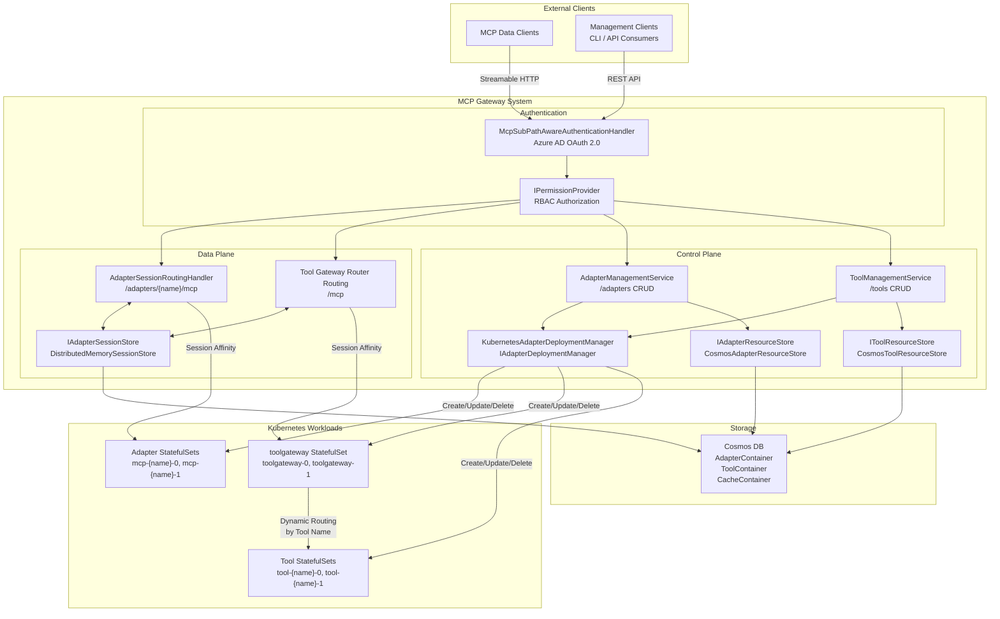
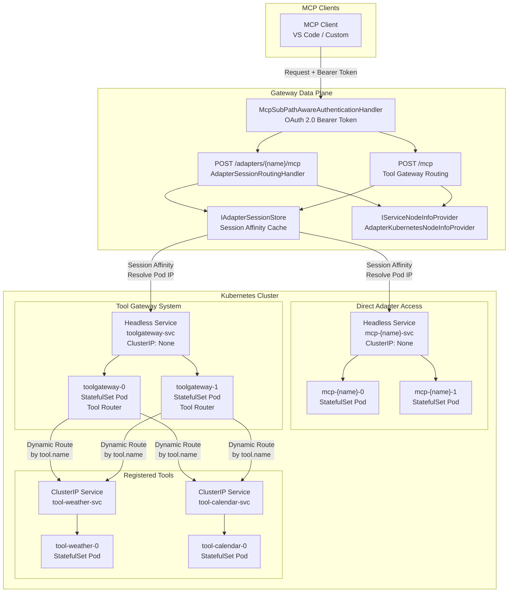
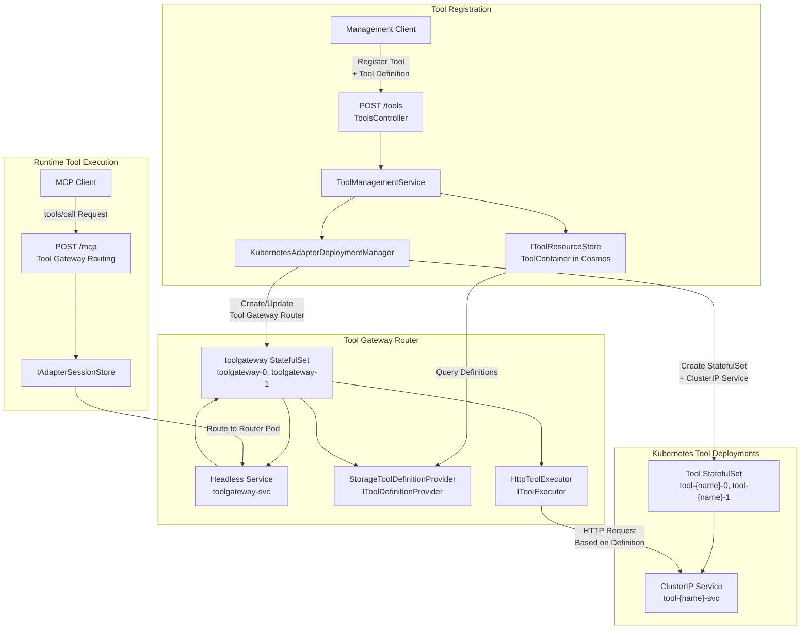
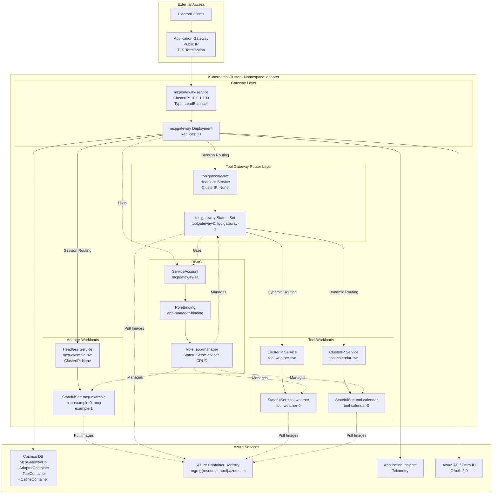
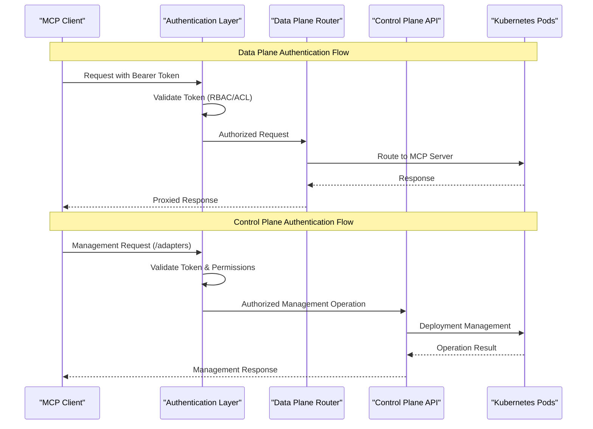

<!-- source: DeepWiki mcp.deepwiki.com · repo microsoft/mcp-gateway · page 2 System Architecture · fetched 2026-10-26 -->

# System Architecture

<details>
<summary>Relevant source files</summary>

The following files were used as context for generating this wiki page:

- [README.md](README.md)
- [dotnet/Microsoft.McpGateway.Service/src/McpSubPathAwareAuthenticationHandler.cs](dotnet/Microsoft.McpGateway.Service/src/McpSubPathAwareAuthenticationHandler.cs)
- [dotnet/Microsoft.McpGateway.Service/src/Program.cs](dotnet/Microsoft.McpGateway.Service/src/Program.cs)

</details>


This document describes the overall system architecture of the MCP Gateway, covering its dual-plane design, core components, and infrastructure integration patterns. The architecture follows a clean separation between runtime data processing and administrative control operations.

For detailed information about individual components, see [Core Components](#3). For API specifications and data contracts, see [API Reference](#4).

## Architectural Overview

The MCP Gateway implements a dual-plane architecture that separates concerns between runtime traffic routing (Data Plane) and administrative operations (Control Plane). The system manages two types of MCP resources: **Adapters** (direct MCP servers) and **Tools** (registered MCP tools with definitions that route through a Tool Gateway Router).

### Dual-Plane Architecture with Adapters and Tools



The architecture maintains strict separation between the Data Plane (runtime routing) and Control Plane (lifecycle management), with shared authentication/authorization infrastructure.

**Sources:** [README.md:22-29](), [dotnet/Microsoft.McpGateway.Service/src/Program.cs:21-137]()

## Data Plane Architecture

The Data Plane handles runtime traffic routing with two distinct routing mechanisms: **Direct Adapter Routing** for accessing specific MCP servers, and **Tool Gateway Routing** for dynamic tool execution through the Tool Gateway Router.

### Data Plane Routing Architecture



### Session-Aware Routing Mechanism

The Data Plane implements session affinity using a three-layer routing strategy:

| Component | Responsibility | Implementation |
|-----------|---------------|----------------|
| `AdapterSessionRoutingHandler` | Extracts `session_id` from MCP requests | [dotnet/Microsoft.McpGateway.Service/src/Routing/]() |
| `IAdapterSessionStore` | Maps `session_id` to specific pod instances | `DistributedMemorySessionStore` backed by Cosmos or Redis |
| `IServiceNodeInfoProvider` | Resolves Kubernetes pod IPs for routing | `AdapterKubernetesNodeInfoProvider` queries K8s API |

When a client sends a request:
1. The gateway extracts the `session_id` from the MCP protocol request
2. Session store returns the assigned pod instance (or creates new assignment)
3. Node info provider resolves the pod's cluster IP
4. Request is forwarded directly to the specific pod, bypassing load balancing

This ensures stateful MCP conversations are routed to the same backend instance throughout their lifecycle.

**Sources:** [README.md:141-149](), [dotnet/Microsoft.McpGateway.Service/src/Program.cs:28-30]()

## Control Plane Architecture

The Control Plane manages the complete lifecycle of both adapters and tools through RESTful APIs. It orchestrates Kubernetes deployments, persists metadata, and provides status/logging capabilities.

### Control Plane Service Layer

```mermaid
graph TB
    subgraph "REST API Controllers"
        AdaptersAPI["AdaptersController<br/>POST/GET/PUT/DELETE /adapters<br/>GET /adapters/{name}/status<br/>GET /adapters/{name}/logs"]
        ToolsAPI["ToolsController<br/>POST/GET/PUT/DELETE /tools<br/>GET /tools/{name}/status<br/>GET /tools/{name}/logs"]
    end
    
    subgraph "Management Services"
        AdapterMgmtSvc["AdapterManagementService<br/>IAdapterManagementService"]
        ToolMgmtSvc["ToolManagementService<br/>IToolManagementService"]
        RichResultProvider["AdapterRichResultProvider<br/>IAdapterRichResultProvider"]
    end
    
    subgraph "Deployment Layer"
        IDeploymentMgr["IAdapterDeploymentManager"]
        K8sDeploymentMgr["KubernetesAdapterDeploymentManager<br/>StatefulSet & Service Creation"]
    end
    
    subgraph "Storage Layer"
        IAdapterStore["IAdapterResourceStore"]
        IToolStore["IToolResourceStore"]
        CosmosAdapterStore["CosmosAdapterResourceStore<br/>AdapterContainer"]
        CosmosToolStore["CosmosToolResourceStore<br/>ToolContainer"]
        RedisAdapterStore["RedisAdapterResourceStore<br/>Dev Environment"]
        RedisToolStore["RedisToolResourceStore<br/>Dev Environment"]
    end
    
    subgraph "Kubernetes Abstraction"
        IKubeWrapper["IKubeClientWrapper"]
        KubeClient["KubeClient<br/>Namespace: adapter"]
        K8sClientFactory["IKubernetesClientFactory<br/>LocalKubernetesClientFactory"]
    end
    
    subgraph "Authorization"
        PermProvider["IPermissionProvider<br/>SimplePermissionProvider<br/>Resource Creator + RBAC"]
    end
    
    subgraph "External Systems"
        K8sCluster["Kubernetes Cluster<br/>StatefulSets<br/>Headless Services<br/>ClusterIP Services"]
        CosmosDB["Cosmos DB<br/>McpGatewayDb"]
        RedisCache["Redis<br/>Dev Cache"]
    end
    
    AdaptersAPI --> PermProvider
    ToolsAPI --> PermProvider
    
    PermProvider --> AdapterMgmtSvc
    PermProvider --> ToolMgmtSvc
    PermProvider --> RichResultProvider
    
    AdapterMgmtSvc --> IDeploymentMgr
    AdapterMgmtSvc --> IAdapterStore
    ToolMgmtSvc --> IDeploymentMgr
    ToolMgmtSvc --> IToolStore
    RichResultProvider --> IDeploymentMgr
    
    IDeploymentMgr <|.. K8sDeploymentMgr
    IAdapterStore <|.. CosmosAdapterStore
    IAdapterStore <|.. RedisAdapterStore
    IToolStore <|.. CosmosToolStore
    IToolStore <|.. RedisToolStore
    
    K8sDeploymentMgr --> IKubeWrapper
    IKubeWrapper <|.. KubeClient
    KubeClient --> K8sClientFactory
    
    K8sDeploymentMgr --> K8sCluster
    CosmosAdapterStore --> CosmosDB
    CosmosToolStore --> CosmosDB
    RedisAdapterStore --> RedisCache
    RedisToolStore --> RedisCache
```

### Control Plane Operations

The Control Plane exposes two parallel API surfaces for managing adapters and tools:

| API Endpoint | Purpose | Service Implementation |
|--------------|---------|------------------------|
| `POST /adapters` | Create new adapter | `AdapterManagementService.CreateAdapterAsync()` |
| `GET /adapters` | List adapters | `AdapterManagementService.GetAdaptersAsync()` |
| `GET /adapters/{name}` | Get adapter metadata | `AdapterManagementService.GetAdapterAsync()` |
| `PUT /adapters/{name}` | Update adapter | `AdapterManagementService.UpdateAdapterAsync()` |
| `DELETE /adapters/{name}` | Delete adapter | `AdapterManagementService.DeleteAdapterAsync()` |
| `GET /adapters/{name}/status` | Get deployment status | `AdapterRichResultProvider` + `KubernetesAdapterDeploymentManager` |
| `GET /adapters/{name}/logs` | Get pod logs | `AdapterRichResultProvider` + `KubernetesAdapterDeploymentManager` |
| `POST /tools` | Register new tool | `ToolManagementService.CreateToolAsync()` |
| `GET /tools` | List tools | `ToolManagementService.GetToolsAsync()` |
| `GET /tools/{name}` | Get tool definition | `ToolManagementService.GetToolAsync()` |
| `PUT /tools/{name}` | Update tool | `ToolManagementService.UpdateToolAsync()` |
| `DELETE /tools/{name}` | Delete tool | `ToolManagementService.DeleteToolAsync()` |
| `GET /tools/{name}/status` | Get tool deployment status | Similar to adapters |
| `GET /tools/{name}/logs` | Get tool pod logs | Similar to adapters |

**Sources:** [README.md:119-139](), [dotnet/Microsoft.McpGateway.Service/src/Program.cs:112-120]()

## Tool Gateway System

The Tool Gateway System enables dynamic tool registration and execution through a specialized routing layer. Tools are registered with MCP tool definitions, and the Tool Gateway Router acts as an intelligent dispatcher.

### Tool Gateway Router Architecture



### Tool Definition Structure

Each registered tool includes metadata that defines its execution characteristics:

| Field | Type | Purpose |
|-------|------|---------|
| `name` | string | Unique tool identifier used in MCP `tools/call` requests |
| `description` | string | Human-readable description of tool capabilities |
| `inputSchema` | JSON Schema | Defines expected input structure for validation |
| `port` | integer | TCP port where tool server listens (default: 8000) |
| `path` | string | HTTP path for tool execution endpoint (optional) |
| `method` | string | HTTP method (GET, POST, etc.) (optional) |

The `StorageToolDefinitionProvider` loads these definitions from `IToolResourceStore` and makes them available to the Tool Gateway Router at runtime.

### Dynamic Routing Process

1. **Client Request**: MCP client sends `tools/call` request to `POST /mcp`
2. **Session Routing**: Gateway routes to a Tool Gateway Router pod using session affinity
3. **Definition Lookup**: Router queries `StorageToolDefinitionProvider` for tool definition by name
4. **Request Construction**: `HttpToolExecutor` constructs HTTP request using:
   - Service name: `http://tool-{name}-svc:{port}{path}`
   - HTTP method from definition
   - Request body from `tools/call` arguments
5. **Execution**: Router forwards request to target tool server
6. **Response**: Tool result returns through router to gateway to client

This architecture decouples tool discovery from tool execution, enabling hot-swapping tools without gateway restarts.

**Sources:** [README.md:165-189](), [README.md:272-340]()

## Infrastructure Integration

The MCP Gateway integrates with Azure and Kubernetes services to provide enterprise capabilities. The architecture supports both development (local Kubernetes + Redis) and production (AKS + Cosmos DB) environments.

### Kubernetes Resource Topology



### Service Types and Routing Strategy

The system uses different Kubernetes service types to optimize routing patterns:

| Service Type | Use Case | Example | Routing Behavior |
|--------------|----------|---------|------------------|
| **LoadBalancer** | External gateway access | `mcpgateway-service` | Azure App Gateway backend pool |
| **Headless (ClusterIP: None)** | Session-affinity StatefulSets | `mcp-example-svc`, `toolgateway-svc` | Direct pod IP addressing for sticky sessions |
| **ClusterIP** | Stateless load-balanced tools | `tool-weather-svc`, `tool-calendar-svc` | Round-robin load balancing within cluster |

The gateway has RBAC permissions via `ServiceAccount` + `Role` + `RoleBinding` to dynamically create/update/delete StatefulSets and Services in the `adapter` namespace, enabling meta-orchestration capabilities.

**Sources:** [README.md:349-425](), [dotnet/Microsoft.McpGateway.Service/src/Program.cs:73-105]()

## Component Interaction Patterns

The system implements several key architectural patterns that ensure scalability, maintainability, and operational excellence.

| Pattern | Implementation | Purpose |
|---------|----------------|---------|
| **Session Affinity** | Distributed routing with session store | Ensures request consistency for stateful MCP conversations |
| **Adapter Pattern** | `IAdapterDeploymentManager`, `IAdapterResourceStore` | Abstracts deployment and storage implementations |
| **Factory Pattern** | `IKubernetesClientFactory` | Manages Kubernetes client lifecycle |
| **Dependency Injection** | Interface-based service registration | Enables testing and configuration flexibility |
| **Stateless Design** | Distributed session store separation | Supports horizontal scaling and fault tolerance |

### Authentication and Authorization Flow



The dual authentication layers enable independent security policies for runtime data access versus administrative operations, supporting different permission models and audit requirements.

**Sources:** [README.md:37-42](), [README.md:79-80]()

---

