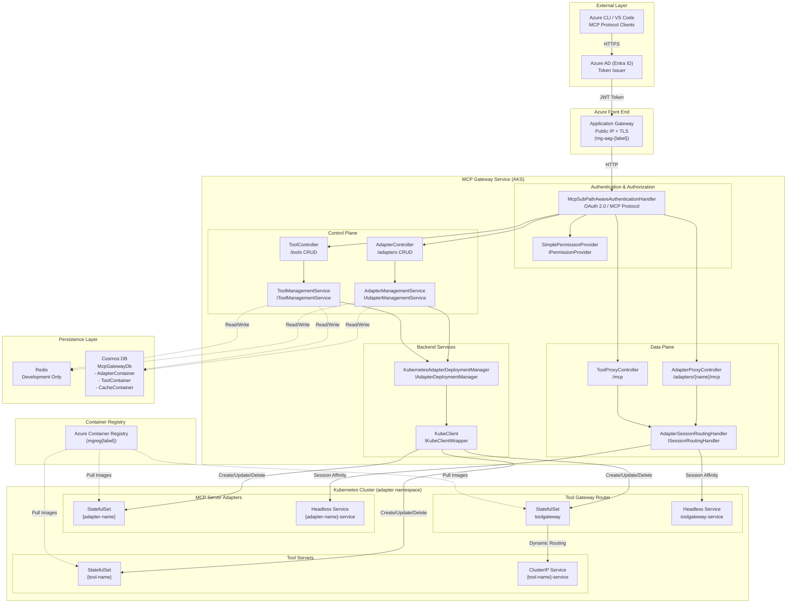
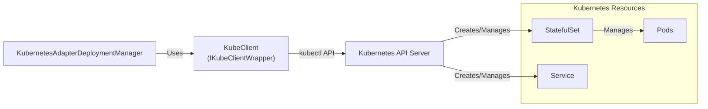
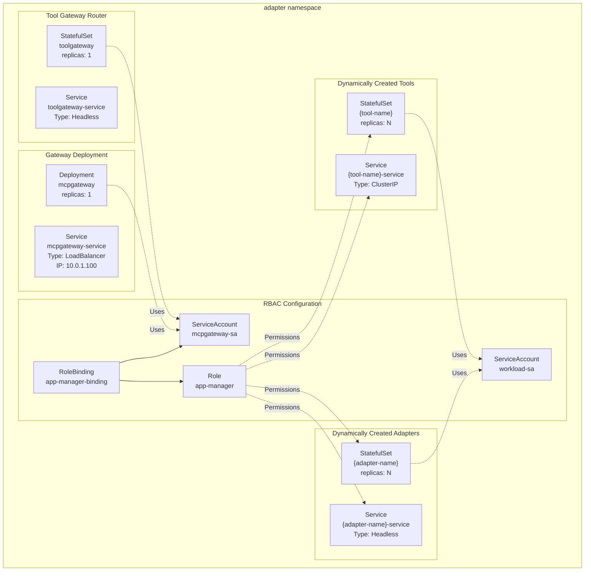
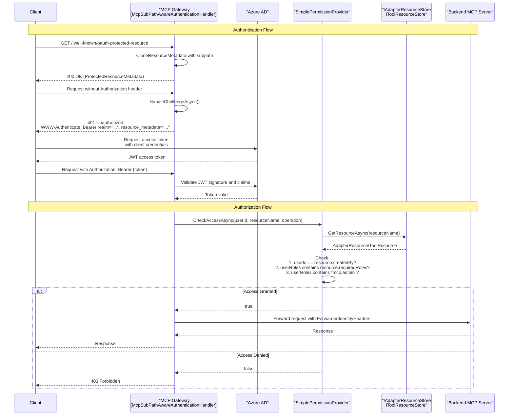
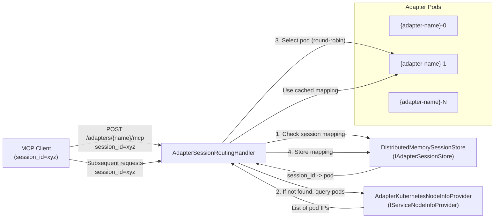
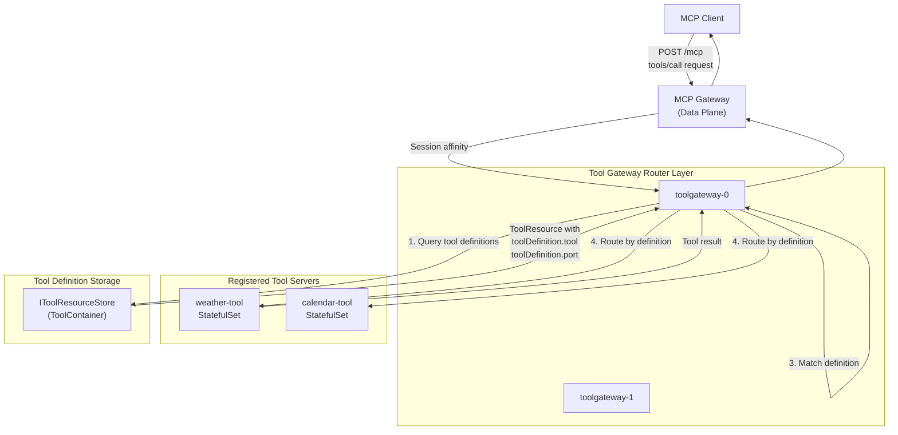

<!-- source: DeepWiki mcp.deepwiki.com · repo microsoft/mcp-gateway · page 2.1 Overall Architecture · fetched 2026-10-26 -->

# Overall Architecture

<details>
<summary>Relevant source files</summary>

The following files were used as context for generating this wiki page:

- [README.md](README.md)
- [deployment/k8s/cloud-deployment-template.yml](deployment/k8s/cloud-deployment-template.yml)
- [dotnet/Microsoft.McpGateway.Service/src/McpSubPathAwareAuthenticationHandler.cs](dotnet/Microsoft.McpGateway.Service/src/McpSubPathAwareAuthenticationHandler.cs)
- [dotnet/Microsoft.McpGateway.Service/src/Program.cs](dotnet/Microsoft.McpGateway.Service/src/Program.cs)

</details>


## Purpose and Scope

This document provides comprehensive architectural documentation for the MCP Gateway system, covering its high-level design, major components, and their interactions. It describes the overall system structure including the control plane for lifecycle management, the data plane for request routing, and the backend services that orchestrate deployments.

For detailed information about specific subsystems:
- Data plane routing mechanisms: see [Data Plane](#2.2)
- Control plane management APIs: see [Control Plane](#2.3)
- Tool gateway routing system: see [Tool Gateway System](#2.4)
- Authentication and authorization details: see [Authentication Flow](#7.1)
- Deployment configurations: see [Azure Infrastructure](#3.1) and [Kubernetes Configuration](#3.2)

---

## System Overview

The MCP Gateway is a Kubernetes-native reverse proxy and management layer for Model Context Protocol (MCP) servers. It provides both control plane capabilities (CRUD operations for adapter and tool resources) and data plane capabilities (session-aware routing of MCP protocol traffic).

### Core Architectural Principles

| Principle | Implementation |
|-----------|----------------|
| **Separation of Concerns** | Control plane (`/adapters`, `/tools` REST APIs) and data plane (`/adapters/{name}/mcp`, `/mcp` routing endpoints) are logically separated |
| **Kubernetes-Native** | Dynamically provisions and manages StatefulSets and Services via Kubernetes API |
| **Session Affinity** | Maintains stateful connections by routing requests with the same `session_id` to the same pod instance |
| **Multi-Tenancy** | Resource-level authorization with creator ownership and role-based access control (RBAC) |
| **Cloud-Ready** | Supports both local development (Redis) and production (Cosmos DB, Azure AD, Application Insights) |

**Sources:** [README.md:1-30](), [README.md:117-165]()

---

## High-Level Architecture Diagram

The following diagram illustrates the complete system architecture, mapping components to their implementation artifacts:



**Sources:** [README.md:30-115](), [dotnet/Microsoft.McpGateway.Service/src/Program.cs:1-137](), [deployment/k8s/cloud-deployment-template.yml:1-176]()

---

## Architectural Layers

### Control Plane

The control plane provides REST APIs for managing the lifecycle of adapter and tool resources. It is implemented through ASP.NET Core controllers and backing services.

**Key Components:**

| Component | Implementation | Responsibility |
|-----------|---------------|----------------|
| **Adapter Management API** | `AdapterController` | Exposes `/adapters` endpoints for CRUD operations |
| **Tool Management API** | `ToolController` | Exposes `/tools` endpoints for CRUD operations |
| **Adapter Service** | `AdapterManagementService` implementing `IAdapterManagementService` | Business logic for adapter lifecycle |
| **Tool Service** | `ToolManagementService` implementing `IToolManagementService` | Business logic for tool lifecycle |
| **Deployment Manager** | `KubernetesAdapterDeploymentManager` implementing `IAdapterDeploymentManager` | Creates/updates/deletes Kubernetes resources |
| **Metadata Store** | `IAdapterResourceStore`, `IToolResourceStore` | Persists resource metadata |

**Control Plane API Endpoints:**

```
POST   /adapters                 - Deploy new MCP server
GET    /adapters                 - List adapters
GET    /adapters/{name}          - Get adapter metadata
PUT    /adapters/{name}          - Update adapter
DELETE /adapters/{name}          - Remove adapter
GET    /adapters/{name}/status   - Check deployment status
GET    /adapters/{name}/logs     - Retrieve logs

POST   /tools                    - Register new tool
GET    /tools                    - List tools
GET    /tools/{name}             - Get tool metadata
PUT    /tools/{name}             - Update tool
DELETE /tools/{name}             - Remove tool
GET    /tools/{name}/status      - Check deployment status
GET    /tools/{name}/logs        - Retrieve logs
```

**Sources:** [README.md:119-139](), [dotnet/Microsoft.McpGateway.Service/src/Program.cs:113-120]()

### Data Plane

The data plane handles runtime request routing, forwarding MCP protocol traffic to deployed adapter and tool instances with session affinity.

**Key Components:**

| Component | Implementation | Responsibility |
|-----------|---------------|----------------|
| **Adapter Proxy** | `AdapterProxyController` | Routes `/adapters/{name}/mcp` to adapter pods |
| **Tool Proxy** | `ToolProxyController` | Routes `/mcp` to tool gateway router pods |
| **Session Routing** | `AdapterSessionRoutingHandler` implementing `ISessionRoutingHandler` | Maintains session-to-pod affinity |
| **Session Store** | `DistributedMemorySessionStore` implementing `IAdapterSessionStore` | Tracks session-to-pod mappings |
| **Node Info Provider** | `AdapterKubernetesNodeInfoProvider` implementing `IServiceNodeInfoProvider` | Discovers available pod endpoints |

**Data Plane Endpoints:**

```
POST /adapters/{name}/mcp    - Direct access to specific adapter instance
POST /mcp                    - Access to tool gateway router
```

**Sources:** [README.md:141-149](), [dotnet/Microsoft.McpGateway.Service/src/Program.cs:28-30]()

### Backend Services

Backend services orchestrate Kubernetes resources and manage storage operations.

**Kubernetes Integration:**



The `KubernetesAdapterDeploymentManager` uses `IKubeClientWrapper` to:
- Create StatefulSets with replicas, resource limits, and environment variables
- Create headless Services (ClusterIP: None) for adapter instances
- Create ClusterIP Services for tool instances
- Query pod status and retrieve logs

**Sources:** [dotnet/Microsoft.McpGateway.Service/src/Program.cs:107-117]()

### Storage Layer

The system uses different storage implementations based on environment:

| Environment | Adapter Store | Tool Store | Cache |
|-------------|--------------|------------|-------|
| **Development** | `RedisAdapterResourceStore` | `RedisToolResourceStore` | `StackExchangeRedisCache` |
| **Production** | `CosmosAdapterResourceStore` | `CosmosToolResourceStore` | `CosmosCache` |

**Development Configuration:**
[dotnet/Microsoft.McpGateway.Service/src/Program.cs:32-49]()

**Production Configuration:**
[dotnet/Microsoft.McpGateway.Service/src/Program.cs:52-105]()

**Sources:** [dotnet/Microsoft.McpGateway.Service/src/Program.cs:32-105]()

---

## Kubernetes Resource Topology

The gateway deploys resources into the `adapter` namespace with a specific topology designed for scalability and isolation.



**RBAC Permissions:**

The `app-manager` Role grants the gateway service account permissions to:
- `["get", "list", "create", "update", "delete", "patch", "watch"]` on `statefulsets`
- `["get", "list", "create", "update", "delete", "watch"]` on `services` and `pods`
- `["get", "watch"]` on `pods/log`

This allows the gateway to act as a meta-orchestrator, dynamically provisioning workloads on behalf of users.

**Service Types:**

| Resource Type | Service Type | Purpose |
|---------------|--------------|---------|
| Gateway | LoadBalancer | External access via fixed IP (10.0.1.100) |
| Tool Gateway Router | Headless (ClusterIP: None) | Direct pod addressing for session affinity |
| Adapters | Headless (ClusterIP: None) | Direct pod addressing for session affinity |
| Tools | ClusterIP | Load-balanced access (stateless) |

**Sources:** [deployment/k8s/cloud-deployment-template.yml:1-176]()

---

## Authentication and Authorization Flow

The system implements a multi-layered security model combining OAuth 2.0, MCP protocol authentication, and RBAC.



**Authentication Handler:**

The `McpSubPathAwareAuthenticationHandler` extends standard JWT Bearer authentication with MCP protocol-specific features:
- Serves OAuth 2.0 Protected Resource Metadata at `/.well-known/oauth-protected-resource` and sub-paths
- Adds `resource_metadata` parameter to WWW-Authenticate challenge headers
- Supports dynamic resource metadata based on request path

[dotnet/Microsoft.McpGateway.Service/src/McpSubPathAwareAuthenticationHandler.cs:1-182]()

**Authorization Rules:**

| Operation | Access Granted To |
|-----------|------------------|
| **Read** | Resource creator, users with `requiredRoles`, users with `mcp.admin` role |
| **Write** | Resource creator, users with `mcp.admin` role |

**Sources:** [dotnet/Microsoft.McpGateway.Service/src/Program.cs:52-72](), [dotnet/Microsoft.McpGateway.Service/src/McpSubPathAwareAuthenticationHandler.cs:1-182](), [README.md:151-158]()

---

## Session Routing Architecture

The data plane implements session-aware routing to maintain stateful connections between clients and MCP server instances.



**Session Store Implementations:**

- **Development:** `DistributedMemorySessionStore` with in-memory cache
- **Production:** `DistributedMemorySessionStore` with distributed cache (Cosmos DB or Redis)

The session store persists mappings of `(session_id, adapter_name) -> pod_endpoint`, ensuring that all requests with the same session ID are routed to the same pod instance, maintaining MCP protocol state.

**Sources:** [dotnet/Microsoft.McpGateway.Service/src/Program.cs:28-30]()

---

## Tool Gateway Router System

The tool gateway router is a specialized MCP server that dynamically routes tool execution requests to registered tool servers.



**Tool Definition Structure:**

Tools are registered with a `toolDefinition` object containing:
```json
{
  "tool": {
    "name": "weather",
    "description": "Gets weather info",
    "inputSchema": { /* JSON Schema */ }
  },
  "port": 8000,
  "path": "/execute"  // optional
}
```

The router uses this metadata to construct the target URL: `http://{tool-name}-service:{port}{path}`

**Sources:** [README.md:166-189](), [deployment/k8s/cloud-deployment-template.yml:125-176]()

---

## Environment Configurations

The system supports three deployment environments with different architectural characteristics:

### Development Environment

```
┌─────────────────────────────┐
│ dotnet run                  │
│ localhost:8000              │
├─────────────────────────────┤
│ DevelopmentAuthenticationHandler │
│ (No auth validation)        │
├─────────────────────────────┤
│ Redis (localhost:6379)      │
│ - RedisAdapterResourceStore │
│ - RedisToolResourceStore    │
│ - StackExchangeRedisCache   │
└─────────────────────────────┘
```

**Configuration:** [dotnet/Microsoft.McpGateway.Service/src/Program.cs:32-49]()

### Local Kubernetes Environment

```
┌─────────────────────────────┐
│ kubectl apply -f            │
│ local-deployment.yml        │
├─────────────────────────────┤
│ Local registry              │
│ (localhost:5000)            │
├─────────────────────────────┤
│ Redis pod                   │
│ (redis:7-alpine)            │
└─────────────────────────────┘
```

### Azure Production Environment

```
┌─────────────────────────────┐
│ Application Gateway         │
│ (mg-aag-{label})            │
│ Public IP + TLS             │
├─────────────────────────────┤
│ AKS Cluster                 │
│ (mg-aks-{label})            │
│ - Workload Identity enabled │
├─────────────────────────────┤
│ Azure AD Authentication     │
│ (McpSubPathAwareAuthenticationHandler) │
├─────────────────────────────┤
│ Cosmos DB                   │
│ (mg-storage-{label})        │
│ - CosmosAdapterResourceStore│
│ - CosmosToolResourceStore   │
│ - CosmosCache               │
├─────────────────────────────┤
│ Azure Container Registry    │
│ (mgreg{label})              │
├─────────────────────────────┤
│ Application Insights        │
│ (mg-ai-{label})             │
└─────────────────────────────┘
```

**Configuration:** [dotnet/Microsoft.McpGateway.Service/src/Program.cs:52-105](), [deployment/k8s/cloud-deployment-template.yml:1-176]()

**Sources:** [README.md:190-232](), [README.md:347-573]()

---

## Dependency Injection Configuration

The gateway's service registration in `Program.cs` demonstrates the architectural composition:

**Core Services:**
```
IKubernetesClientFactory → LocalKubernetesClientFactory
IAdapterSessionStore → DistributedMemorySessionStore
IServiceNodeInfoProvider → AdapterKubernetesNodeInfoProvider
ISessionRoutingHandler → AdapterSessionRoutingHandler
```

**Backend Services:**
```
IKubeClientWrapper → KubeClient
IPermissionProvider → SimplePermissionProvider
IAdapterDeploymentManager → KubernetesAdapterDeploymentManager
IAdapterManagementService → AdapterManagementService
IToolManagementService → ToolManagementService
IAdapterRichResultProvider → AdapterRichResultProvider
```

**Environment-Specific Services:**
```
Development:
  IAdapterResourceStore → RedisAdapterResourceStore
  IToolResourceStore → RedisToolResourceStore

Production:
  IAdapterResourceStore → CosmosAdapterResourceStore
  IToolResourceStore → CosmosToolResourceStore
```

[dotnet/Microsoft.McpGateway.Service/src/Program.cs:27-121]()

**Sources:** [dotnet/Microsoft.McpGateway.Service/src/Program.cs:21-137]()

---

