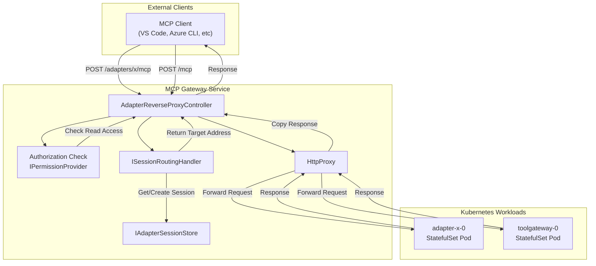
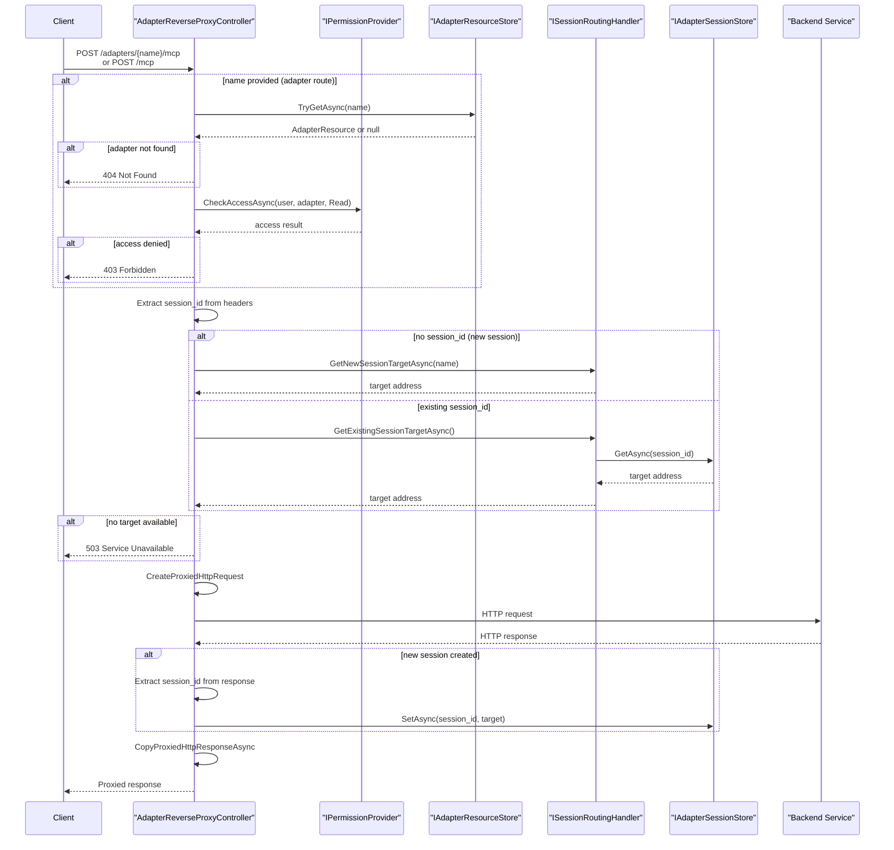
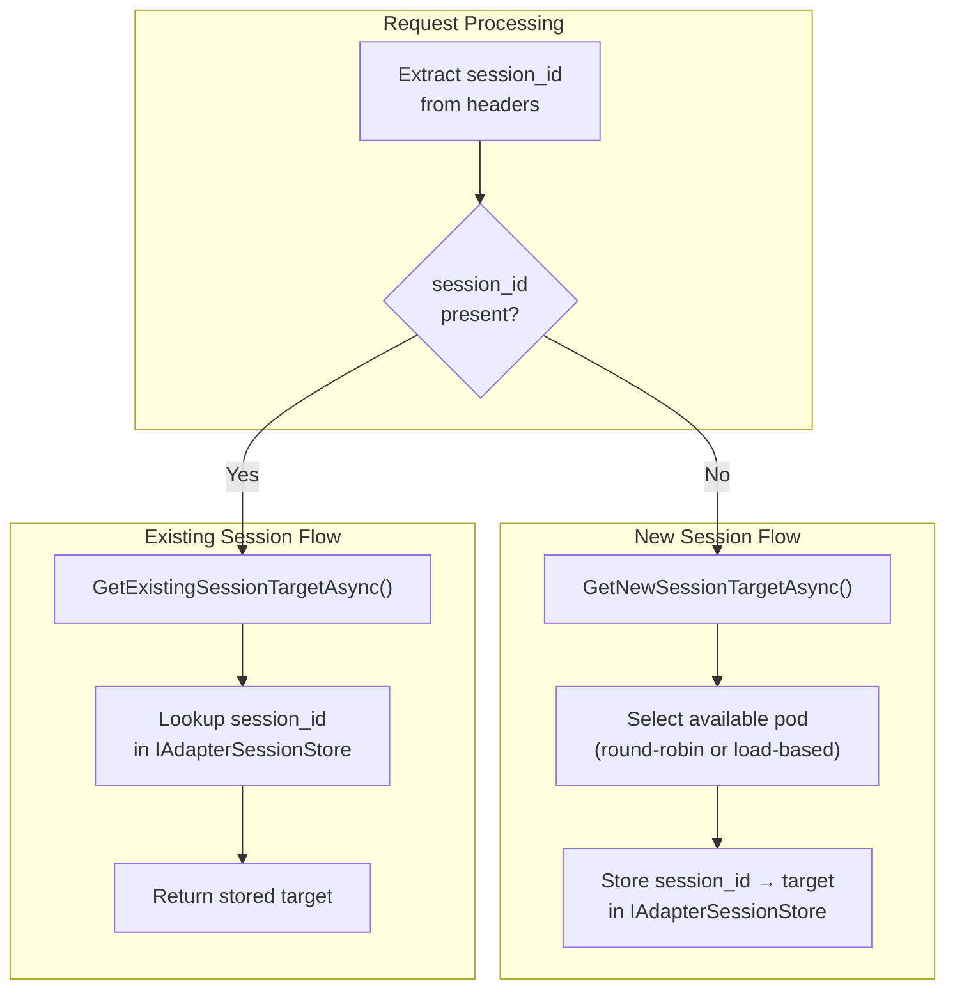
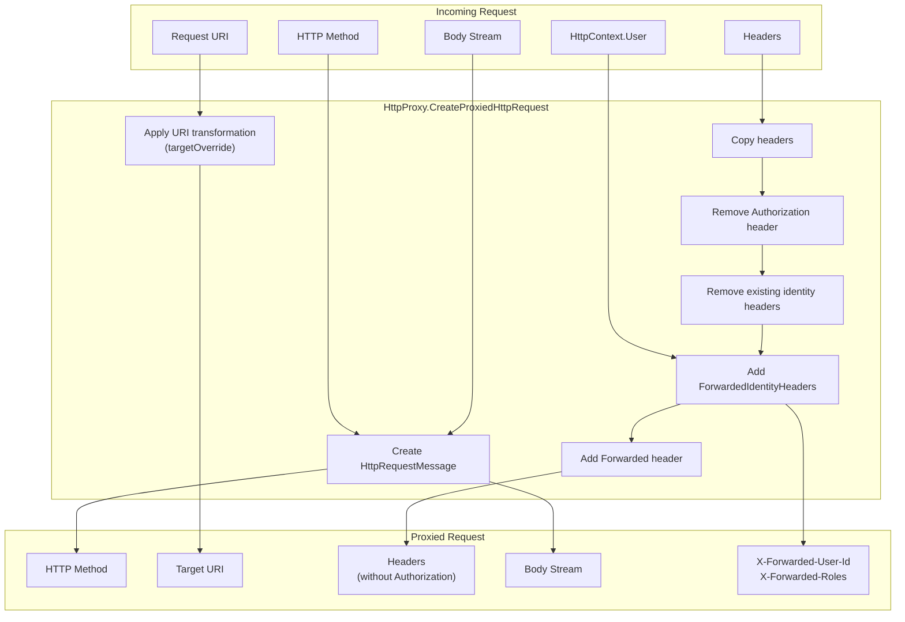
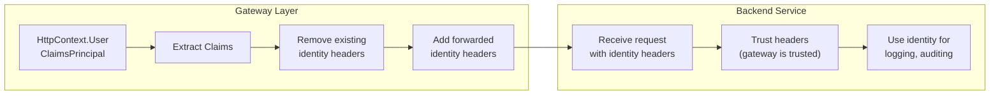
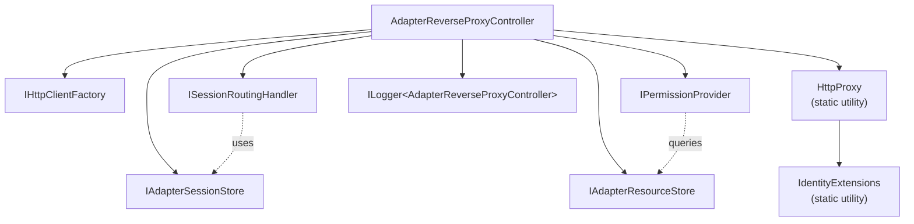

<!-- source: DeepWiki mcp.deepwiki.com · repo microsoft/mcp-gateway · page 2.2 Data Plane · fetched 2026-10-26 -->

# Data Plane

Relevant source files

The following files were used as context for generating this wiki page:

- [README.md](README.md)
- [dotnet/Microsoft.McpGateway.Management/src/Extensions/IdentityExtensions.cs](dotnet/Microsoft.McpGateway.Management/src/Extensions/IdentityExtensions.cs)
- [dotnet/Microsoft.McpGateway.Service/src/Controllers/AdapterReverseProxyController.cs](dotnet/Microsoft.McpGateway.Service/src/Controllers/AdapterReverseProxyController.cs)
- [dotnet/Microsoft.McpGateway.Service/src/Controllers/ManagementController.cs](dotnet/Microsoft.McpGateway.Service/src/Controllers/ManagementController.cs)
- [dotnet/Microsoft.McpGateway.Service/src/HttpProxy.cs](dotnet/Microsoft.McpGateway.Service/src/HttpProxy.cs)

## Purpose and Scope

The Data Plane is responsible for routing runtime MCP (Model Context Protocol) traffic to deployed adapters and tool gateway routers. It handles session-aware request proxying, authentication/authorization enforcement, and identity forwarding to backend services. This page documents the request routing mechanisms, session management, and HTTP proxying infrastructure.

For information about managing adapter and tool lifecycles (CRUD operations), see the Control Plane [2.3](#2.3). For details on the Tool Gateway Router's internal routing logic, see [2.4](#2.4).

## Data Plane Architecture

The data plane operates as a reverse proxy layer that sits between external MCP clients and backend Kubernetes workloads. It provides two primary routing endpoints:

| Endpoint | Purpose | Target |
|----------|---------|--------|
| `POST /adapters/{name}/mcp` | Direct adapter access | Specific adapter StatefulSet instances |
| `POST /mcp` | Tool gateway routing | Tool Gateway Router StatefulSet instances |

**Sources:** [dotnet/Microsoft.McpGateway.Service/src/Controllers/AdapterReverseProxyController.cs:1-115](), [README.md:141-149]()

## Request Routing Flow

### Controller Entry Point

The `AdapterReverseProxyController` class serves as the entry point for all data plane requests. It handles both adapter-specific routes and tool gateway routes through a single method:

**Sources:** [dotnet/Microsoft.McpGateway.Service/src/Controllers/AdapterReverseProxyController.cs:30-66]()

### Route Handling Logic

The controller method `ForwardStreamableHttpRequest` handles both routing patterns by using an optional `name` parameter:

- **Adapter Route** (`POST /adapters/{name}/mcp`): The `name` parameter identifies the target adapter
- **Tool Gateway Route** (`POST /mcp`): The `name` parameter is null/empty, defaults to `"toolgateway"`

**Sources:** [dotnet/Microsoft.McpGateway.Service/src/Controllers/AdapterReverseProxyController.cs:33-44]()

### Authorization Enforcement

For adapter routes, the controller enforces read access before proxying:

1. Retrieves the adapter resource from `IAdapterResourceStore`
2. Checks access using `IPermissionProvider.CheckAccessAsync(user, adapter, Operation.Read)`
3. Returns 404 if adapter not found, 403 if access denied

Tool gateway routes (`POST /mcp`) bypass this check since the route doesn't reference a specific named resource.

**Sources:** [dotnet/Microsoft.McpGateway.Service/src/Controllers/AdapterReverseProxyController.cs:68-91]()

## Session Management

### Session Affinity Strategy

The data plane maintains session affinity to ensure all requests with the same `session_id` route to the same backend pod instance. This is critical for stateful MCP protocol connections.

**Sources:** [dotnet/Microsoft.McpGateway.Service/src/Controllers/AdapterReverseProxyController.cs:40-62]()

### Session Store Interface

The `IAdapterSessionStore` interface abstracts session storage, supporting both Redis (development) and Cosmos DB (production) backends:

- `GetAsync(string sessionId, CancellationToken)`: Retrieves the target address for a session
- `SetAsync(string sessionId, string targetAddress, CancellationToken)`: Stores session-to-target mapping

Session IDs are extracted from MCP protocol headers using `AdapterSessionRoutingHandler.GetSessionId()`.

**Sources:** [dotnet/Microsoft.McpGateway.Service/src/Controllers/AdapterReverseProxyController.cs:24](), [dotnet/Microsoft.McpGateway.Service/src/Controllers/AdapterReverseProxyController.cs:40-62]()

### Session Routing Handler

The `ISessionRoutingHandler` interface provides higher-level routing logic:

- `GetNewSessionTargetAsync(string resourceName, HttpContext, CancellationToken)`: Selects a target pod for new sessions
- `GetExistingSessionTargetAsync(HttpContext, CancellationToken)`: Retrieves the target for existing sessions

This abstraction handles the coordination between session extraction, target selection, and session storage.

**Sources:** [dotnet/Microsoft.McpGateway.Service/src/Controllers/AdapterReverseProxyController.cs:25](), [dotnet/Microsoft.McpGateway.Service/src/Controllers/AdapterReverseProxyController.cs:43-45]()

## HTTP Proxying

### Request Transformation

The `HttpProxy.CreateProxiedHttpRequest()` method transforms incoming ASP.NET Core requests into `HttpRequestMessage` objects for forwarding:

**Sources:** [dotnet/Microsoft.McpGateway.Service/src/HttpProxy.cs:13-56]()

### URI Transformation

When proxying requests, the controller provides a URI transformation function `ReplaceUriAddress()` that:

1. Extracts path segments after `/adapters/{name}/` or `/mcp/`
2. Combines them with the target pod's base address
3. Preserves query strings and fragments
4. Adds trailing slash for `/messages` paths (MCP protocol requirement)

**Sources:** [dotnet/Microsoft.McpGateway.Service/src/Controllers/AdapterReverseProxyController.cs:93-113]()

### Response Copying

The `HttpProxy.CopyProxiedHttpResponseAsync()` method streams the backend response to the client:

1. Copies HTTP status code
2. Copies response headers (both `HttpResponseMessage.Headers` and `Content.Headers`)
3. Removes `Transfer-Encoding` header (handled by ASP.NET Core)
4. Streams response body using `CopyToAsync()`

This approach supports streaming responses without buffering, crucial for MCP's streamable HTTP connections.

**Sources:** [dotnet/Microsoft.McpGateway.Service/src/HttpProxy.cs:58-70]()

## Identity Forwarding

### Forwarded Identity Headers

The data plane forwards authenticated user identity to backend services via custom HTTP headers:

| Header Name | Source | Purpose |
|-------------|--------|---------|
| `X-Forwarded-User-Id` | `ClaimsPrincipal.GetUserId()` | User's unique identifier (oid or NameIdentifier) |
| `X-Forwarded-Roles` | `ClaimsPrincipal.GetUserRoles()` | Comma-separated list of user roles |

**Sources:** [dotnet/Microsoft.McpGateway.Service/src/HttpProxy.cs:32-52]()

### Header Sanitization

To prevent header injection attacks, the proxy:

1. **Strips inbound `Authorization` header**: Prevents backends from seeing the gateway's auth token
2. **Removes any existing forwarded identity headers**: Ensures only gateway-added headers are present
3. **Adds sanitized identity headers**: Based on authenticated `ClaimsPrincipal`

This ensures backend services receive only trusted identity information from the gateway.

**Sources:** [dotnet/Microsoft.McpGateway.Service/src/HttpProxy.cs:24-38]()

### Identity Extraction Logic

The `IdentityExtensions` class provides claims extraction:

- `GetUserId()`: Checks `ClaimTypes.NameIdentifier` then `"oid"` claim
- `GetUserRoles()`: Aggregates claims from `ClaimTypes.Role`, `"roles"`, and `"role"` claim types

**Sources:** [dotnet/Microsoft.McpGateway.Management/src/Extensions/IdentityExtensions.cs:10-32]()

## HTTP Client Configuration

The data plane uses a named `HttpClient` for backend communication:

- **Client Name**: `Constants.HttpClientNames.AdapterProxyClient`
- **Usage**: Created via `IHttpClientFactory.CreateClient()`
- **Configuration**: Set up during service registration to support long-lived streaming connections

**Sources:** [dotnet/Microsoft.McpGateway.Service/src/Controllers/AdapterReverseProxyController.cs:55]()

## Error Handling

The data plane returns specific HTTP status codes for different error conditions:

| Status Code | Condition | Triggered By |
|-------------|-----------|--------------|
| 404 Not Found | Adapter resource not found | `IAdapterResourceStore.TryGetAsync()` returns null |
| 403 Forbidden | User lacks read access to adapter | `IPermissionProvider.CheckAccessAsync()` returns false |
| 503 Service Unavailable | No target pod available | `ISessionRoutingHandler` returns null |

For adapter routes, authorization is checked before proxying. For tool gateway routes, authentication is still enforced (via `[Authorize]` attribute), but per-resource authorization is not applicable since no specific resource is referenced.

**Sources:** [dotnet/Microsoft.McpGateway.Service/src/Controllers/AdapterReverseProxyController.cs:47-51](), [dotnet/Microsoft.McpGateway.Service/src/Controllers/AdapterReverseProxyController.cs:76-88]()

## Data Plane Component Dependencies

**Sources:** [dotnet/Microsoft.McpGateway.Service/src/Controllers/AdapterReverseProxyController.cs:14-28]()

---

