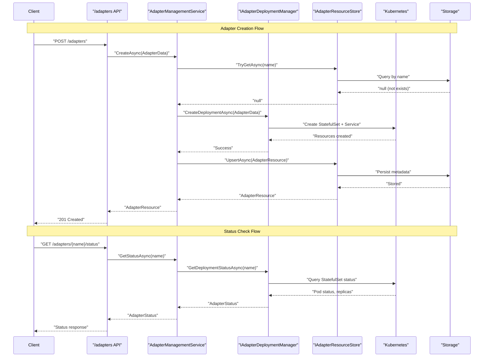
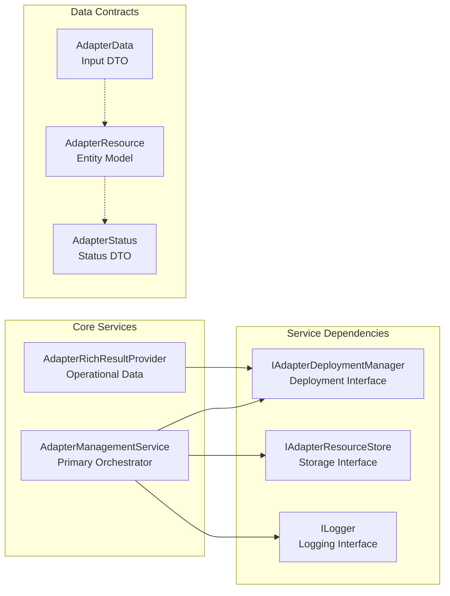

<!-- source: DeepWiki mcp.deepwiki.com · repo microsoft/mcp-gateway · page 2.3 Control Plane · fetched 2026-10-26 -->

# Control Plane

<details>
<summary>Relevant source files</summary>

The following files were used as context for generating this wiki page:

- [README.md](README.md)
- [dotnet/Microsoft.McpGateway.Management/src/Extensions/IdentityExtensions.cs](dotnet/Microsoft.McpGateway.Management/src/Extensions/IdentityExtensions.cs)
- [dotnet/Microsoft.McpGateway.Management/src/Store/CosmosAdapterResourceStore.cs](dotnet/Microsoft.McpGateway.Management/src/Store/CosmosAdapterResourceStore.cs)
- [dotnet/Microsoft.McpGateway.Service/src/Controllers/ManagementController.cs](dotnet/Microsoft.McpGateway.Service/src/Controllers/ManagementController.cs)
- [dotnet/Microsoft.McpGateway.Service/src/HttpProxy.cs](dotnet/Microsoft.McpGateway.Service/src/HttpProxy.cs)
- [dotnet/Microsoft.McpGateway.Service/src/appsettings.json](dotnet/Microsoft.McpGateway.Service/src/appsettings.json)
- [openapi/mcp-gateway.openapi.json](openapi/mcp-gateway.openapi.json)

</details>


The Control Plane is responsible for managing the complete lifecycle of MCP server adapters, including deployment, configuration, monitoring, and removal. It provides RESTful APIs for adapter management operations and orchestrates the underlying Kubernetes resources and metadata storage.

For information about the runtime routing and session management aspects, see [Data Plane](#2.1). For detailed implementation of individual service components, see [Core Components](#3).

## Purpose and Responsibilities

The Control Plane handles all administrative operations for MCP server adapters through a layered service architecture:

- **Adapter Lifecycle Management**: Create, read, update, and delete operations for adapter resources
- **Deployment Orchestration**: Kubernetes StatefulSet and Service management for MCP server containers
- **Metadata Persistence**: Storage and retrieval of adapter configuration and state information
- **Operational Monitoring**: Status checking and log retrieval for deployed adapters

Sources: [README.md:61-69](), [dotnet/Microsoft.McpGateway.Management/test/AdapterManagementServiceTests.cs:16-31]()

## Control Plane Architecture

```mermaid
graph TB
    subgraph "Management API"
        API["/adapters REST API"]
    end
    
    subgraph "Service Layer"
        AMS["AdapterManagementService"]
        RichProvider["AdapterRichResultProvider"]
    end
    
    subgraph "Abstraction Layer"
        IDeploymentMgr["IAdapterDeploymentManager"]
        IResourceStore["IAdapterResourceStore"]
    end
    
    subgraph "Implementation Layer"
        K8sDeployMgr["KubernetesAdapterDeploymentManager"]
        CosmosStore["CosmosAdapterResourceStore"]
        InMemoryStore["InMemoryAdapterResourceStore"]
    end
    
    subgraph "External Systems"
        K8sCluster["Kubernetes Cluster"]
        CosmosDB["Azure Cosmos DB"]
    end
    
    API --> AMS
    API --> RichProvider
    AMS --> IDeploymentMgr
    AMS --> IResourceStore
    RichProvider --> IDeploymentMgr
    
    IDeploymentMgr <|.. K8sDeployMgr
    IResourceStore <|.. CosmosStore
    IResourceStore <|.. InMemoryStore
    
    K8sDeployMgr --> K8sCluster
    CosmosStore --> CosmosDB
```

The Control Plane follows a clean architecture pattern with clear separation between API layer, business logic, and infrastructure concerns. The `AdapterManagementService` serves as the primary orchestrator, coordinating between deployment and storage operations.

Sources: [dotnet/Microsoft.McpGateway.Management/test/AdapterManagementServiceTests.cs:16-31](), [README.md:32-42]()

## Core Operations Flow



This sequence demonstrates the coordination between service layers during typical Control Plane operations. The `AdapterManagementService` orchestrates both deployment and storage operations to maintain consistency.

Sources: [dotnet/Microsoft.McpGateway.Management/test/AdapterManagementServiceTests.cs:34-44](), [dotnet/Microsoft.McpGateway.Management/test/AdapterManagementServiceTests.cs:47-55]()

## API Endpoints and Operations

The Control Plane exposes the following REST API endpoints for adapter management:

| Method | Endpoint | Purpose | Key Service Methods |
|--------|----------|---------|---------------------|
| `POST` | `/adapters` | Deploy new MCP server adapter | `AdapterManagementService.CreateAsync()` |
| `GET` | `/adapters` | List all accessible adapters | `AdapterManagementService.ListAsync()` |
| `GET` | `/adapters/{name}` | Get adapter metadata | `AdapterManagementService.GetAsync()` |
| `GET` | `/adapters/{name}/status` | Check deployment status | `AdapterManagementService.GetStatusAsync()` |
| `GET` | `/adapters/{name}/logs` | Retrieve adapter logs | `AdapterRichResultProvider.GetLogsAsync()` |
| `PUT` | `/adapters/{name}` | Update adapter deployment | `AdapterManagementService.UpdateAsync()` |
| `DELETE` | `/adapters/{name}` | Remove adapter | `AdapterManagementService.DeleteAsync()` |

Each endpoint corresponds to specific CRUD operations implemented in the `AdapterManagementService` class, which coordinates between deployment management and resource storage.

Sources: [README.md:61-69](), [dotnet/Microsoft.McpGateway.Management/test/AdapterManagementServiceTests.cs:34-96]()

## Service Layer Components



The service layer implements the core business logic for adapter management. The `AdapterManagementService` acts as the primary coordinator, handling all CRUD operations and ensuring proper sequencing of deployment and storage operations.

Sources: [dotnet/Microsoft.McpGateway.Management/test/AdapterManagementServiceTests.cs:16-31]()

## Deployment Management

The Control Plane manages Kubernetes deployments through the `IAdapterDeploymentManager` interface, which abstracts deployment operations:

- **Resource Creation**: Creates StatefulSets and headless Services for MCP server pods
- **Status Monitoring**: Queries Kubernetes API for deployment and pod status
- **Resource Updates**: Handles rolling updates and configuration changes
- **Resource Cleanup**: Removes Kubernetes resources during adapter deletion

The primary implementation `KubernetesAdapterDeploymentManager` uses Kubernetes StatefulSets to ensure stable network identities and persistent storage for MCP server instances.

Sources: [dotnet/Microsoft.McpGateway.Management/test/AdapterManagementServiceTests.cs:18](), [dotnet/Microsoft.McpGateway.Management/test/AdapterManagementServiceTests.cs:42]()

## Metadata Management

Adapter metadata is managed through the `IAdapterResourceStore` interface, which provides:

- **Resource Persistence**: Stores `AdapterResource` entities with configuration and metadata
- **Query Operations**: Retrieves adapter information by name or lists all resources
- **Consistency Management**: Ensures metadata consistency with deployment state

Two implementations are available:
- `CosmosAdapterResourceStore` for production Azure Cosmos DB storage
- `InMemoryAdapterResourceStore` for development and testing scenarios

Sources: [dotnet/Microsoft.McpGateway.Management/test/AdapterManagementServiceTests.cs:19](), [dotnet/Microsoft.McpGateway.Management/test/AdapterManagementServiceTests.cs:37]()

## CRUD Operations Implementation

The `AdapterManagementService` implements the complete CRUD lifecycle:

### Create Operation
1. Validates adapter name uniqueness via `TryGetAsync()`
2. Invokes `CreateDeploymentAsync()` to provision Kubernetes resources
3. Calls `UpsertAsync()` to persist adapter metadata
4. Returns created `AdapterResource`

### Read Operations
- `GetAsync()` retrieves individual adapter metadata
- `ListAsync()` returns all accessible adapters
- `GetStatusAsync()` queries deployment status from Kubernetes

### Update Operation
1. Retrieves existing adapter via `TryGetAsync()`
2. Updates deployment through `UpdateDeploymentAsync()`
3. Persists updated metadata via `UpsertAsync()`

### Delete Operation
1. Removes adapter metadata via `DeleteAsync()`
2. Deletes Kubernetes resources through `DeleteDeploymentAsync()`

Sources: [dotnet/Microsoft.McpGateway.Management/test/AdapterManagementServiceTests.cs:34-81]()

---

