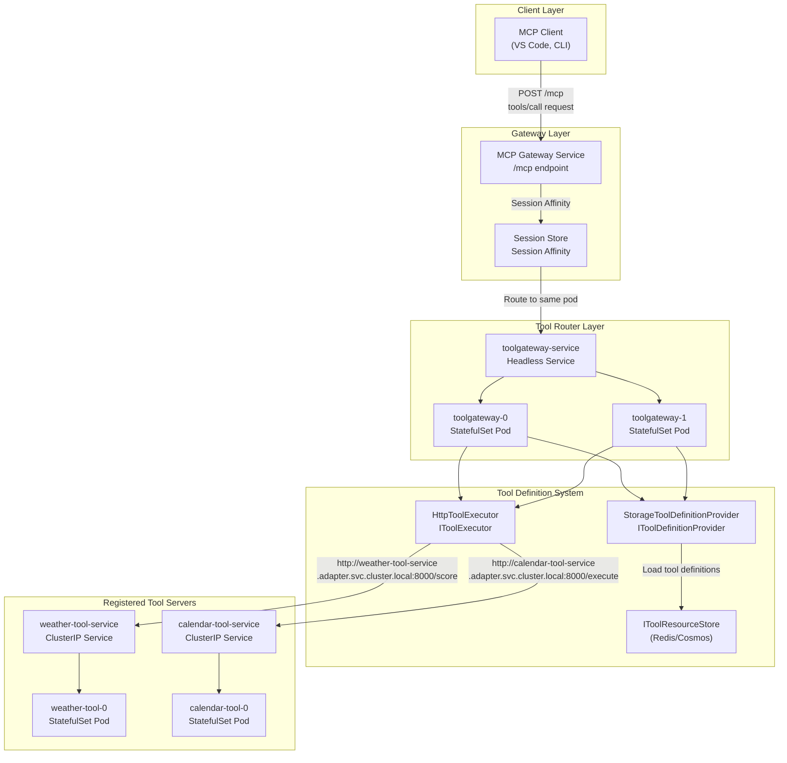
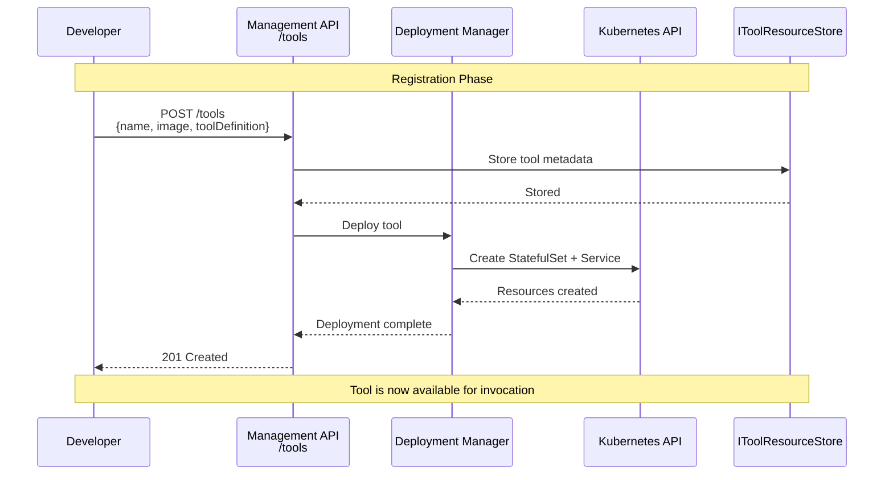
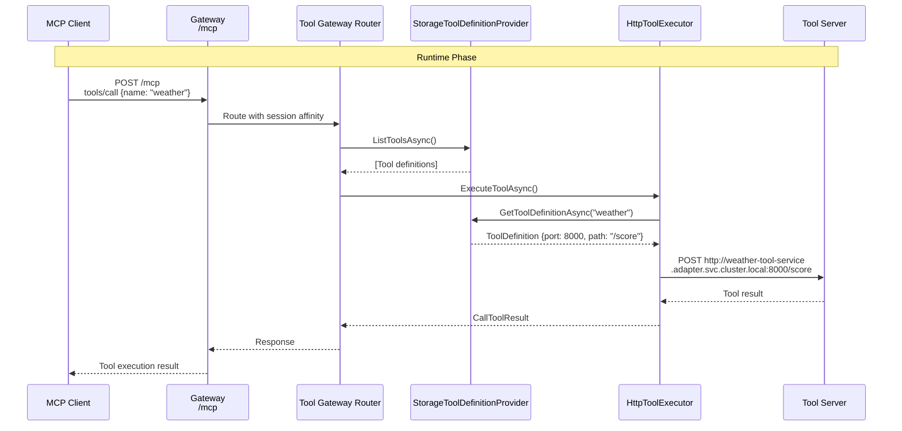
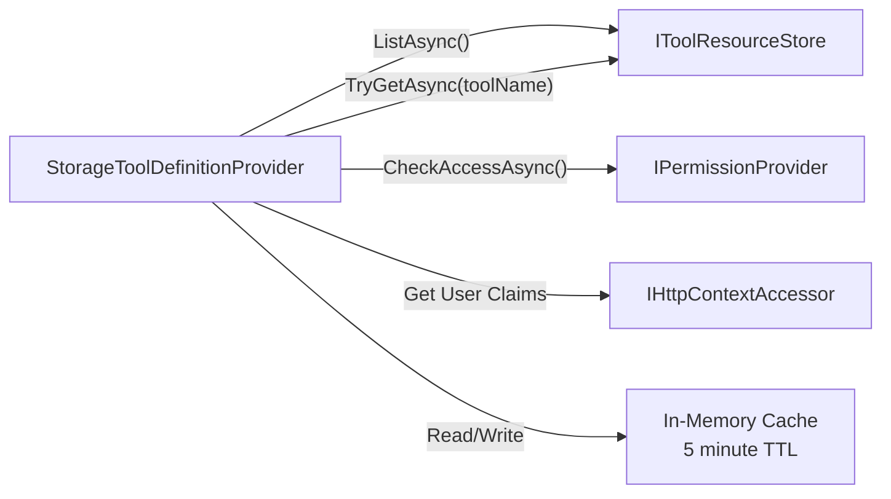
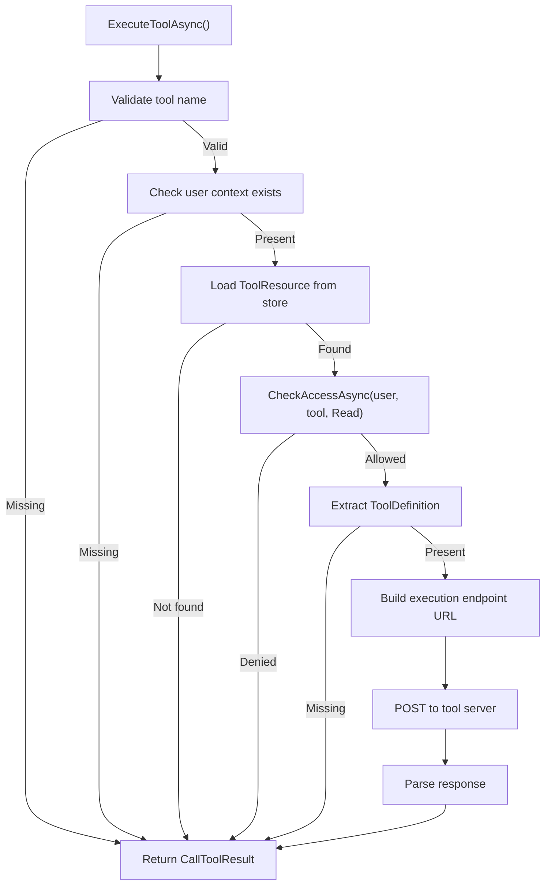
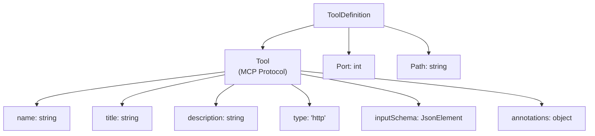
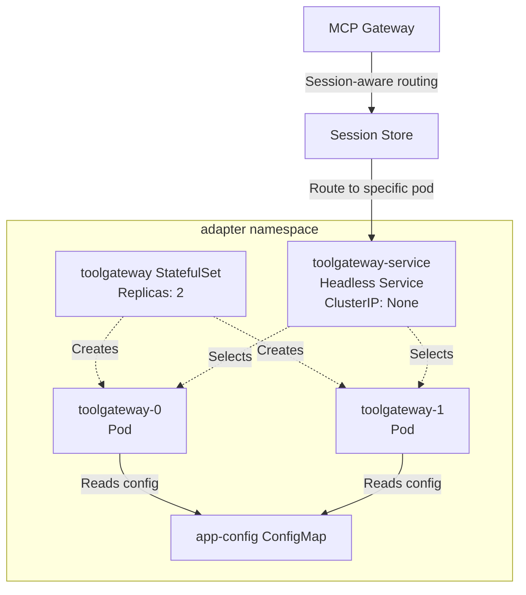
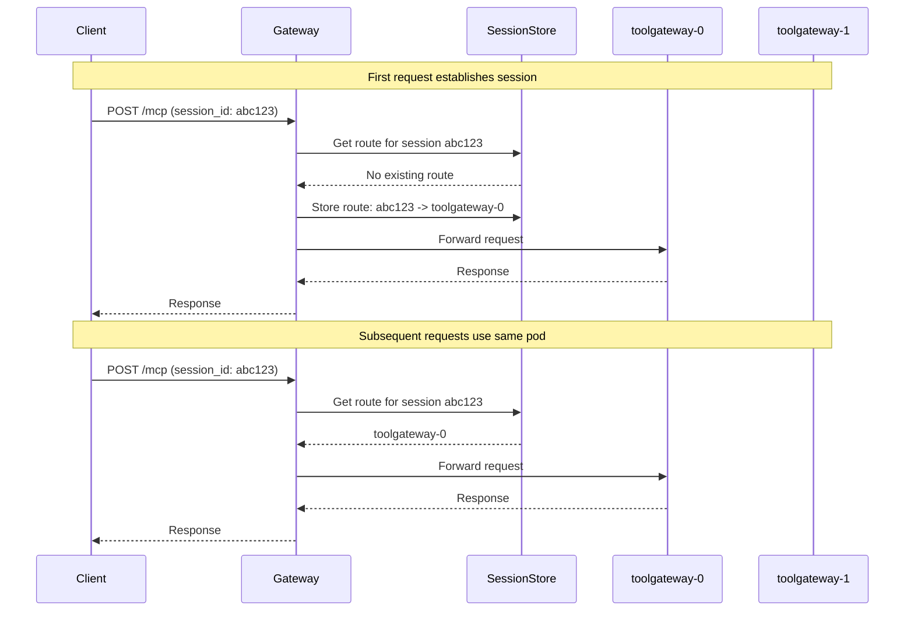
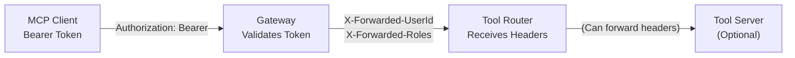

<!-- source: DeepWiki mcp.deepwiki.com · repo microsoft/mcp-gateway · page 2.4 Tool Gateway System · fetched 2026-10-26 -->

# Tool Gateway System

<details>
<summary>Relevant source files</summary>

The following files were used as context for generating this wiki page:

- [README.md](README.md)
- [dotnet/Microsoft.McpGateway.Tools/src/Program.cs](dotnet/Microsoft.McpGateway.Tools/src/Program.cs)
- [dotnet/Microsoft.McpGateway.Tools/src/Services/HttpToolExecutor.cs](dotnet/Microsoft.McpGateway.Tools/src/Services/HttpToolExecutor.cs)
- [dotnet/Microsoft.McpGateway.Tools/src/Services/StorageToolDefinitionProvider.cs](dotnet/Microsoft.McpGateway.Tools/src/Services/StorageToolDefinitionProvider.cs)
- [dotnet/Microsoft.McpGateway.Tools/test/StorageToolDefinitionProviderTests.cs](dotnet/Microsoft.McpGateway.Tools/test/StorageToolDefinitionProviderTests.cs)

</details>


## Purpose and Scope

This document describes the **Tool Gateway System**, which enables dynamic routing and execution of MCP tools through an intelligent router layer. The Tool Gateway Router is a specialized MCP server that routes tool execution requests to the appropriate registered tool servers based on tool definitions stored in the system.

For information about the control plane APIs used to register and manage tools, see [Control Plane](#2.3). For details about the overall data plane routing architecture, see [Data Plane](#2.2). For adapter management, see [Adapter Management Service](#4.2).

---

## Architecture Overview

The Tool Gateway System consists of three primary components: the Tool Gateway Router service, the tool definition provider, and the tool executor. Together, these components enable clients to invoke tools dynamically without needing to know the specific tool server endpoints.



**Sources**: [README.md:22-28](), [README.md:166-189]()

---

## Two-Phase Operation Model

The Tool Gateway System operates in two distinct phases: a registration phase where tools are deployed to Kubernetes, and a runtime phase where tool invocations are dynamically routed.





**Sources**: [README.md:170-189](), [dotnet/Microsoft.McpGateway.Tools/src/Services/HttpToolExecutor.cs:36-154]()

---

## Tool Gateway Router Service

The Tool Gateway Router is an MCP server that implements the Model Context Protocol with specialized `tools/list` and `tools/call` handlers. It runs as a StatefulSet in Kubernetes with multiple replicas for high availability.

### Service Configuration

The router service is configured in [dotnet/Microsoft.McpGateway.Tools/src/Program.cs]():

| Configuration Aspect | Development | Production |
|---------------------|-------------|------------|
| **Storage Backend** | Redis (`localhost:6379`) | Cosmos DB |
| **Store Implementation** | `RedisToolResourceStore` | `CosmosToolResourceStore` |
| **Authentication** | Development bypass | Forwarded identity headers |
| **Port** | 8000 | 8000 |
| **Log Level** | Debug | Information |

The service registers the MCP server with two key handlers:

```
.WithListToolsHandler() -> IToolDefinitionProvider.ListToolsAsync()
.WithCallToolHandler() -> IToolExecutor.ExecuteToolAsync()
```

**Sources**: [dotnet/Microsoft.McpGateway.Tools/src/Program.cs:15-136]()

### Identity Forwarding Middleware

The router receives authenticated user identity from the gateway via custom HTTP headers:

| Header | Purpose |
|--------|---------|
| `X-Forwarded-UserId` | User identifier from Azure AD |
| `X-Forwarded-Roles` | Comma-separated list of user roles |

The middleware reconstructs the `ClaimsPrincipal` from these headers:

[dotnet/Microsoft.McpGateway.Tools/src/Program.cs:93-117]()

This enables the router to perform authorization checks when listing or executing tools.

**Sources**: [dotnet/Microsoft.McpGateway.Tools/src/Program.cs:93-134]()

---

## Tool Definition Provider

The `StorageToolDefinitionProvider` implements `IToolDefinitionProvider` and is responsible for loading tool definitions from the resource store and filtering them based on user permissions.

### Component Diagram



### Key Methods

**GetToolDefinitionsAsync()**

Loads all tool definitions from storage with a 5-minute cache:

[dotnet/Microsoft.McpGateway.Tools/src/Services/StorageToolDefinitionProvider.cs:49-75]()

**GetToolDefinitionAsync(string toolName)**

Retrieves a single tool definition by name, checking permissions:

[dotnet/Microsoft.McpGateway.Tools/src/Services/StorageToolDefinitionProvider.cs:77-107]()

**ListToolsAsync(RequestContext)**

MCP protocol handler that returns tools visible to the authenticated user:

[dotnet/Microsoft.McpGateway.Tools/src/Services/StorageToolDefinitionProvider.cs:109-126]()

### Permission Filtering

Tool definitions are filtered based on the current user's permissions using `IPermissionProvider.CheckAccessAsync()` with `Operation.Read`:

[dotnet/Microsoft.McpGateway.Tools/src/Services/StorageToolDefinitionProvider.cs:128-142]()

This ensures users only see tools they have permission to access.

**Sources**: [dotnet/Microsoft.McpGateway.Tools/src/Services/StorageToolDefinitionProvider.cs:16-144](), [dotnet/Microsoft.McpGateway.Tools/test/StorageToolDefinitionProviderTests.cs:1-622]()

---

## Tool Executor

The `HttpToolExecutor` implements `IToolExecutor` and is responsible for forwarding tool execution requests to the appropriate tool server endpoint.

### Execution Flow



### Endpoint URL Construction

The executor constructs the tool server endpoint using Kubernetes DNS:

```
http://{toolName}-service.adapter.svc.cluster.local:{port}{path}
```

Where:
- `{toolName}` is the registered tool name
- `{port}` is from `ToolDefinition.Port`
- `{path}` is from `ToolDefinition.Path`

Example: For a tool named `weather` with port `8000` and path `/score`:
```
http://weather-service.adapter.svc.cluster.local:8000/score
```

[dotnet/Microsoft.McpGateway.Tools/src/Services/HttpToolExecutor.cs:88-95]()

### Request and Response Handling

The executor:
1. Serializes `CallToolRequestParams.Arguments` to JSON
2. Sends POST request with `Content-Type: application/json`
3. Handles HTTP error responses
4. Returns result as `CallToolResult` with `TextContentBlock`

[dotnet/Microsoft.McpGateway.Tools/src/Services/HttpToolExecutor.cs:98-142]()

### Error Handling

The executor implements comprehensive error handling:

| Error Condition | Behavior |
|----------------|----------|
| Missing tool name | Return error with message |
| Missing user context | Return permission error |
| Tool not found | Return tool not found error |
| Permission denied | Return permission error |
| Missing tool definition | Return unavailable error |
| HTTP request failure | Return connection error |
| Non-success HTTP status | Return server error with status code |
| Unexpected exception | Return error with exception message |

[dotnet/Microsoft.McpGateway.Tools/src/Services/HttpToolExecutor.cs:144-154]()

**Sources**: [dotnet/Microsoft.McpGateway.Tools/src/Services/HttpToolExecutor.cs:14-165]()

---

## Tool Definition Structure

Tool definitions include the MCP tool metadata and execution endpoint information:



### Example Tool Definition

From the README examples, a weather tool definition:

```json
{
  "tool": {
    "name": "weather",
    "title": "Weather Information",
    "description": "Gets the current weather for a specified location.",
    "type": "http",
    "inputSchema": {
      "type": "object",
      "properties": {
        "location": {
          "type": "string",
          "description": "The city and state, e.g. San Francisco, CA"
        }
      },
      "required": ["location"]
    },
    "annotations": {
      "readOnly": true
    }
  },
  "port": 8000,
  "path": "/score"
}
```

**Sources**: [README.md:295-315](), [README.md:517-539]()

---

## Kubernetes Deployment

The Tool Gateway Router is deployed as a StatefulSet with a headless service for session affinity.

### Deployment Resources



### Service Account Permissions

The Tool Gateway Router uses the `mcpgateway-sa` ServiceAccount with the `app-manager` Role, which provides permissions to:
- Read Pods and Services
- Access ConfigMaps and Secrets

The router does NOT create or modify Kubernetes resources; tool deployment is handled by the gateway's Deployment Manager.

**Sources**: [README.md:77-89](), [README.md:178-182]()

---

## Session Affinity

Session affinity ensures that all requests from a specific MCP client session are routed to the same Tool Gateway Router instance, maintaining stateful MCP connections.

### Session Routing Flow



The session store maps session IDs to specific pod instances, enabling stateful protocol handling.

**Sources**: [README.md:28](), [README.md:105-106]()

---

## Integration with Tool Management API

The Tool Gateway System integrates with the control plane's tool management API to respond to tool lifecycle events:

| API Operation | Tool Gateway Impact |
|---------------|---------------------|
| `POST /tools` | New tool becomes available after deployment completes |
| `PUT /tools/{name}` | Tool definition updated, cache refreshed on next list |
| `DELETE /tools/{name}` | Tool removed from available tools |
| `GET /tools/{name}/status` | No direct impact; router queries store |

The `StorageToolDefinitionProvider` uses a 5-minute cache, so changes propagate within that window. Calling `GetToolDefinitionAsync()` explicitly refreshes the cache for a specific tool:

[dotnet/Microsoft.McpGateway.Tools/src/Services/HttpToolExecutor.cs:85-86]()

**Sources**: [README.md:131-139](), [dotnet/Microsoft.McpGateway.Tools/src/Services/StorageToolDefinitionProvider.cs:18]()

---

## Development vs Production Configuration

The Tool Gateway Router supports different configurations for development and production environments:

### Development Environment

[dotnet/Microsoft.McpGateway.Tools/src/Program.cs:26-40]()

- **Storage**: Redis at `localhost:6379`
- **Authentication**: Development identity bypass (user: "dev", role: "mcp.dev")
- **Logging**: Console output with Debug level
- **Image Registry**: `localhost:5000`

### Production Environment

[dotnet/Microsoft.McpGateway.Tools/src/Program.cs:41-64]()

- **Storage**: Cosmos DB with workload identity authentication
- **Authentication**: Forwarded identity headers from gateway
- **Logging**: Standard logging with Information level
- **Image Registry**: Azure Container Registry

**Sources**: [dotnet/Microsoft.McpGateway.Tools/src/Program.cs:26-64](), [dotnet/Microsoft.McpGateway.Tools/src/Program.cs:119-134]()

---

## Security and Authorization

The Tool Gateway Router enforces fine-grained access control for tool operations:

### Authorization Checks

| Operation | Authorization Logic |
|-----------|-------------------|
| `tools/list` | Returns only tools where user has `Read` permission |
| `tools/call` | Requires `Read` permission on the tool being executed |

### Permission Model

Permissions are checked via `IPermissionProvider.CheckAccessAsync()`:
- User is the tool creator, OR
- User has one of the tool's `requiredRoles`, OR  
- User has the `mcp.admin` role

[dotnet/Microsoft.McpGateway.Tools/src/Services/HttpToolExecutor.cs:58-76]()

### Identity Propagation

User identity flows through the system:



For more details on the authentication flow, see [Authentication Flow](#7.1).

**Sources**: [dotnet/Microsoft.McpGateway.Tools/src/Services/HttpToolExecutor.cs:58-76](), [dotnet/Microsoft.McpGateway.Tools/src/Services/StorageToolDefinitionProvider.cs:128-142]()

---

