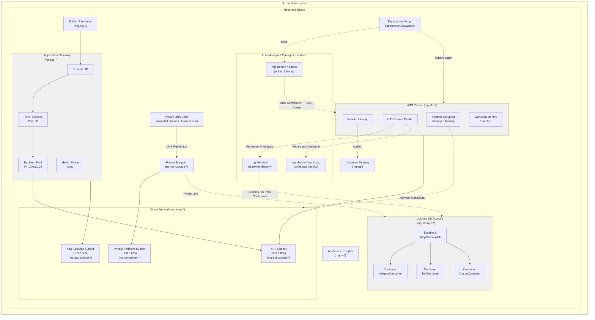
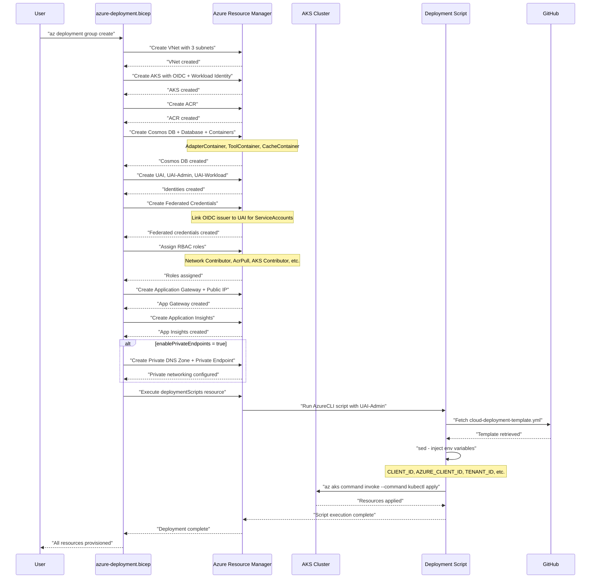
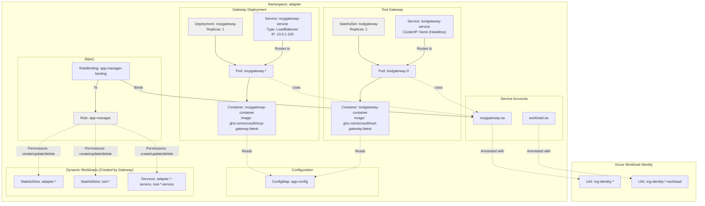

<!-- source: DeepWiki mcp.deepwiki.com · repo microsoft/mcp-gateway · page 3 Deployment · fetched 2026-10-26 -->

# Deployment

<details>
<summary>Relevant source files</summary>

The following files were used as context for generating this wiki page:

- [deployment/infra/azure-deployment.bicep](deployment/infra/azure-deployment.bicep)
- [deployment/k8s/cloud-deployment-template.yml](deployment/k8s/cloud-deployment-template.yml)

</details>


This document provides an overview of the MCP Gateway deployment architecture and processes. It covers the deployment options available, the infrastructure components involved, and how they are orchestrated across different environments.

**Scope**: This page provides a high-level overview of deployment strategies and infrastructure. For detailed deployment procedures, see:
- Azure infrastructure provisioning: [Azure Infrastructure](#3.1)
- Kubernetes resource configuration: [Kubernetes Configuration](#3.2)
- Local development setup: [Local Development Setup](#3.3)

## Deployment Options

The MCP Gateway supports three deployment configurations, each optimized for different use cases:

| Environment | Infrastructure | Storage Backend | Authentication | Use Case |
|-------------|---------------|-----------------|----------------|----------|
| **Azure Production** | AKS + Cosmos DB + App Gateway | Cosmos DB | Azure AD (Entra ID) | Production workloads with full security and scalability |
| **Local Kubernetes** | Kind/Minikube + Redis | Redis | Development bypass | Integration testing and local validation |
| **Direct Local** | .NET runtime | Redis | Development bypass | Rapid development iteration |

Sources: [deployment/infra/azure-deployment.bicep:1-602](), [deployment/k8s/cloud-deployment-template.yml:1-176]()

## Azure Production Deployment Architecture

The Azure production deployment provisions a complete cloud infrastructure using Infrastructure-as-Code (Bicep templates) and deploys Kubernetes workloads to Azure Kubernetes Service (AKS).

### Azure Resource Topology



**Diagram: Azure Infrastructure Resources and Relationships**

This diagram shows the concrete Azure resources created by the Bicep template, using the actual naming conventions from the code. The `*` placeholder represents the `resourceLabel` parameter (defaults to resource group name).

Sources: [deployment/infra/azure-deployment.bicep:16-55](), [deployment/infra/azure-deployment.bicep:60-91](), [deployment/infra/azure-deployment.bicep:104-122](), [deployment/infra/azure-deployment.bicep:125-169](), [deployment/infra/azure-deployment.bicep:199-316](), [deployment/infra/azure-deployment.bicep:320-335](), [deployment/infra/azure-deployment.bicep:384-457]()

### Infrastructure Provisioning Flow

The Azure deployment follows a multi-stage process that provisions infrastructure and then deploys workloads:



**Diagram: Azure Infrastructure Deployment Flow**

Sources: [deployment/infra/azure-deployment.bicep:537-601]()

### Key Bicep Parameters

The Bicep template accepts the following parameters to customize the deployment:

| Parameter | Type | Description | Default |
|-----------|------|-------------|---------|
| `clientId` | string | Entra ID client ID for authentication | *Required* |
| `resourceLabel` | string | Suffix for resource naming and DNS label | Resource group name |
| `location` | string | Azure region for deployment | Resource group location |
| `enablePrivateEndpoints` | bool | Enable private endpoints for ACR and Cosmos DB | `false` |

**Resource Naming Convention**: All resources use the pattern `mg-<type>-${resourceLabel}` where `resourceLabel` is converted to lowercase. Examples:
- AKS: `mg-aks-myproject`
- Cosmos DB: `mg-storage-myproject`
- ACR: `mgregmyproject` (no hyphens, alphanumeric only)

Sources: [deployment/infra/azure-deployment.bicep:1-55]()

## Kubernetes Workload Deployment

After Azure infrastructure is provisioned, the deployment script applies Kubernetes manifests to create the gateway and tool gateway services within the AKS cluster.

### Kubernetes Resource Structure



**Diagram: Kubernetes Resources in cloud-deployment-template.yml**

Sources: [deployment/k8s/cloud-deployment-template.yml:1-176]()

### Kubernetes Resource Definitions

The `cloud-deployment-template.yml` manifest creates the following resources in the `adapter` namespace:

**Core Gateway Resources**:
- **Deployment** `mcpgateway`: Runs the main gateway service with 1 replica
  - Container: `mcpgateway-container` from `ghcr.io/microsoft/mcp-gateway:latest`
  - Resources: 256Mi-512Mi memory, 250m-500m CPU
  - Service account: `mcpgateway-sa`
  - Environment: `ASPNETCORE_ENVIRONMENT=Production`
- **Service** `mcpgateway-service`: LoadBalancer type at `10.0.1.100:8000`
  - Internal load balancer (not exposed externally)
  - Target: `mcpgateway` deployment pods

**Tool Gateway Resources**:
- **StatefulSet** `toolgateway`: Runs the tool routing service with 1 replica
  - Container: `toolgateway-container` from `ghcr.io/microsoft/tool-gateway:latest`
  - Resources: Same as gateway
  - Service account: `mcpgateway-sa`
  - Label: `adapter/type: "mcp"`
- **Service** `toolgateway-service`: Headless service (`ClusterIP: None`)
  - Enables direct pod addressing for session affinity

**Security Resources**:
- **ServiceAccount** `mcpgateway-sa`: Gateway identity with Workload Identity annotation
  - Annotation: `azure.workload.identity/client-id: "${AZURE_CLIENT_ID}"`
- **ServiceAccount** `workload-sa`: Identity for adapter/tool workloads
  - Annotation: `azure.workload.identity/client-id: "${WORKLOAD_CLIENT_ID}"`
- **Role** `app-manager`: Grants permissions to manage dynamic workloads
  - Verbs: `get`, `list`, `create`, `update`, `delete`, `patch`, `watch`
  - Resources: `statefulsets`, `services`, `pods`, `pods/log`
- **RoleBinding** `app-manager-binding`: Binds role to `mcpgateway-sa`

**Configuration**:
- **ConfigMap** `app-config`: Environment variables for gateway and tool gateway
  - Azure AD settings: `TenantId`, `ClientId`, `Audience`
  - Cosmos DB endpoint: `https://mg-storage-${IDENTIFIER}.documents.azure.com:443/`
  - Application Insights connection string
  - Container registry endpoint: `mgreg${IDENTIFIER}.azurecr.io`
  - Public origin: `http://${IDENTIFIER}.${REGION}.cloudapp.azure.com/`

Sources: [deployment/k8s/cloud-deployment-template.yml:6-123](), [deployment/k8s/cloud-deployment-template.yml:125-176]()

### Variable Substitution

The deployment script performs `sed` substitutions on the template before applying it:

| Template Variable | Replaced With | Source |
|-------------------|---------------|--------|
| `${AZURE_CLIENT_ID}` | User-assigned identity client ID | `uai.properties.clientId` |
| `${WORKLOAD_CLIENT_ID}` | Workload identity client ID | `uaiWorkload.properties.clientId` |
| `${TENANT_ID}` | Azure tenant ID | `tenant().tenantId` |
| `${CLIENT_ID}` | Entra ID application client ID | `clientId` parameter |
| `${APPINSIGHTS_CONNECTION_STRING}` | Application Insights connection | `appInsights.properties.ConnectionString` |
| `${IDENTIFIER}` | Resource label | `resourceLabel` parameter |
| `${REGION}` | Azure region | `location` parameter |

Sources: [deployment/infra/azure-deployment.bicep:551-598]()

## Deployment Execution

### Azure Production Deployment

```bash
# Set parameters
CLIENT_ID="your-entra-app-client-id"
RESOURCE_GROUP="my-mcp-gateway"
LOCATION="eastus"

# Create resource group
az group create --name $RESOURCE_GROUP --location $LOCATION

# Deploy infrastructure
az deployment group create \
  --resource-group $RESOURCE_GROUP \
  --template-file deployment/infra/azure-deployment.bicep \
  --parameters clientId=$CLIENT_ID resourceLabel=$RESOURCE_GROUP
```

The Bicep deployment automatically:
1. Provisions all Azure infrastructure resources
2. Configures networking, identities, and RBAC
3. Executes the deployment script to apply Kubernetes manifests
4. Deploys gateway and tool gateway pods to AKS

The gateway is accessible via the Application Gateway public IP at `http://${RESOURCE_GROUP}.${LOCATION}.cloudapp.azure.com/`

Sources: [deployment/infra/azure-deployment.bicep:1-602]()

### Private Endpoint Deployment

For enhanced security, enable private endpoints to isolate Azure resources from the public internet:

```bash
az deployment group create \
  --resource-group $RESOURCE_GROUP \
  --template-file deployment/infra/azure-deployment.bicep \
  --parameters clientId=$CLIENT_ID \
               resourceLabel=$RESOURCE_GROUP \
               enablePrivateEndpoints=true
```

When enabled, this:
- Sets `publicNetworkAccess: 'Disabled'` on Cosmos DB
- Creates a Private Endpoint for Cosmos DB in the `mg-pe-subnet-*` subnet
- Creates a Private DNS Zone `privatelink.documents.azure.com`
- Links the DNS zone to the VNet for private resolution

Sources: [deployment/infra/azure-deployment.bicep:13-14](), [deployment/infra/azure-deployment.bicep:401](), [deployment/infra/azure-deployment.bicep:471-525]()

## Environment-Specific Configurations

The deployment architecture varies by environment:

| Component | Azure Production | Local Kubernetes | Local Dev |
|-----------|------------------|------------------|-----------|
| **Gateway Image** | `ghcr.io/microsoft/mcp-gateway:latest` | `localhost:5000/mcpgateway:latest` | N/A (runs directly) |
| **Tool Gateway Image** | `ghcr.io/microsoft/tool-gateway:latest` | `localhost:5000/toolgateway:latest` | N/A |
| **Namespace** | `adapter` | `adapter` | N/A |
| **Service Type** | LoadBalancer (internal) | LoadBalancer or NodePort | N/A |
| **Storage Backend** | Cosmos DB via Workload Identity | Redis | Redis |
| **Configuration Source** | ConfigMap `app-config` | ConfigMap | `appsettings.Development.json` |
| **Authentication** | Azure AD (Entra ID) | Development bypass | Development bypass |
| **Port** | 8000 | 8000 or 5000 | 8000 (default) |

For detailed setup instructions for each environment, see:
- **Azure Production**: [Azure Infrastructure](#3.1)
- **Local Kubernetes**: [Kubernetes Configuration](#3.2)
- **Local Development**: [Local Development Setup](#3.3)

Sources: [deployment/k8s/cloud-deployment-template.yml:1-176]()

## Post-Deployment Verification

After deployment, verify the gateway is running:

```bash
# Check pod status
kubectl get pods -n adapter

# Check service endpoints
kubectl get services -n adapter

# Test health endpoint
curl http://<gateway-ip>:8000/ping
```

Expected output:
- Pods: `mcpgateway-*` and `toolgateway-0` should be in `Running` state
- Services: `mcpgateway-service` should have an external IP (or `10.0.1.100` for Azure)
- Health check: Should return `200 OK` with `pong` response

Sources: [deployment/infra/azure-deployment.bicep:294-313]()

---

