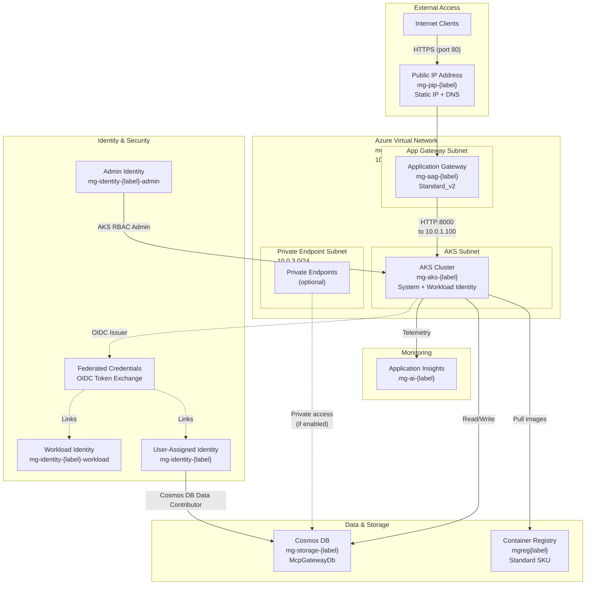
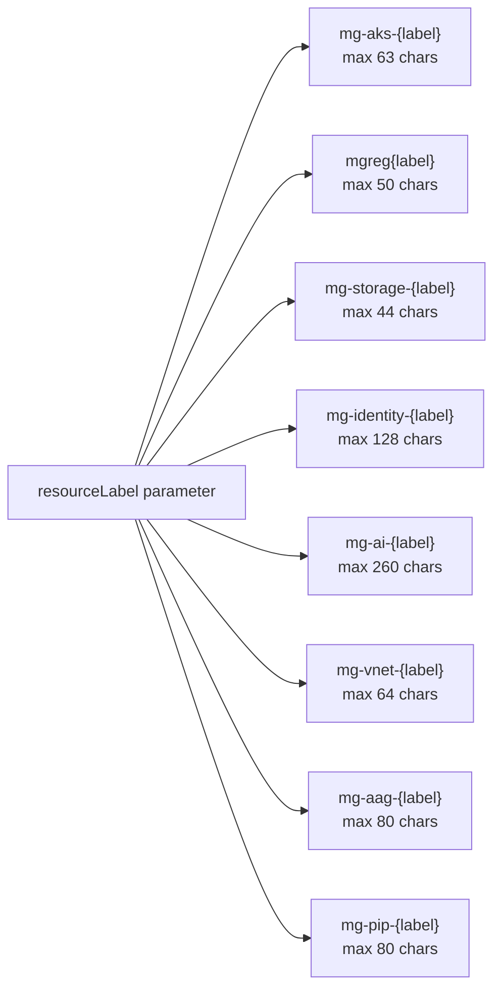
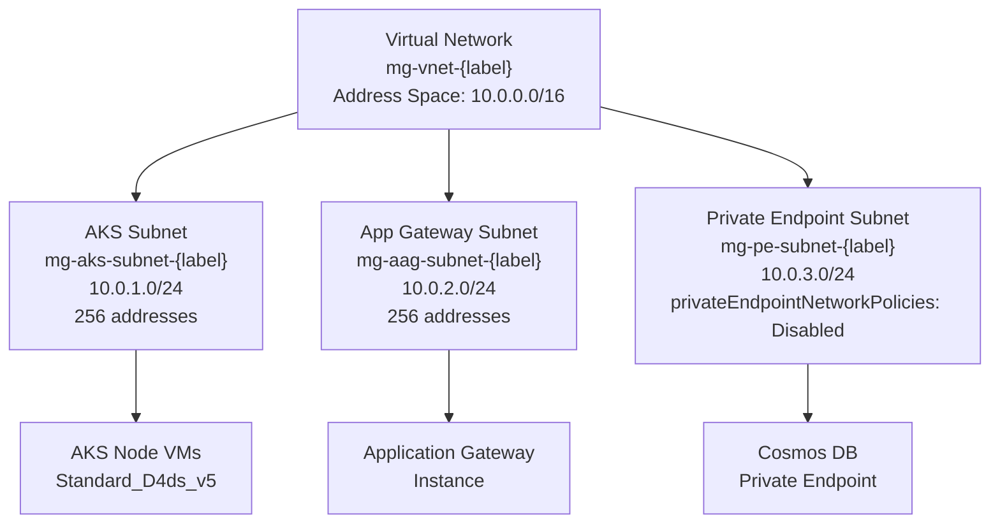
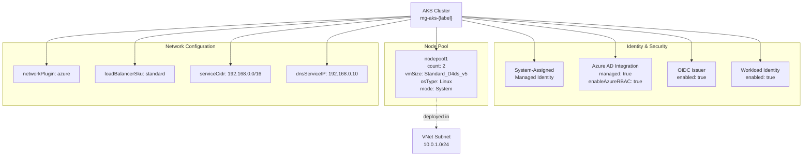
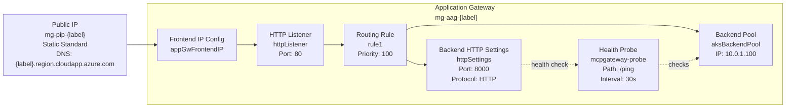
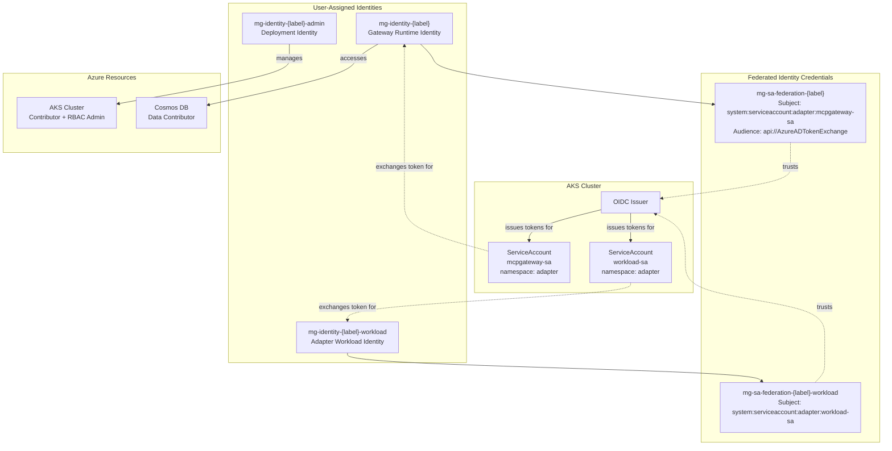
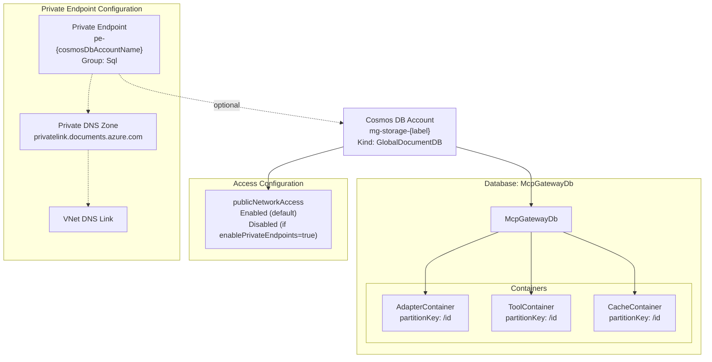
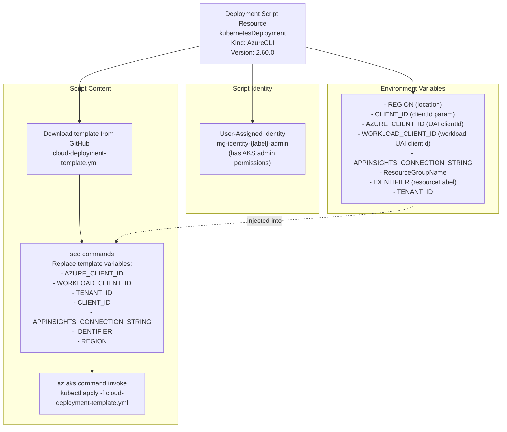

<!-- source: DeepWiki mcp.deepwiki.com · repo microsoft/mcp-gateway · page 3.1 Azure Infrastructure · fetched 2026-10-26 -->

# Azure Infrastructure

<details>
<summary>Relevant source files</summary>

The following files were used as context for generating this wiki page:

- [deployment/infra/azure-deployment.bicep](deployment/infra/azure-deployment.bicep)
- [deployment/infra/azure-deployment.json](deployment/infra/azure-deployment.json)

</details>


## Purpose and Scope

This document describes the Azure infrastructure deployment for the MCP Gateway system, defined using Bicep templates. It covers the Azure resources provisioned for production deployment, including AKS, Cosmos DB, Application Gateway, networking configuration, and managed identity setup.

For Kubernetes-level configuration deployed on top of this infrastructure, see [Kubernetes Configuration](#3.2). For local development environments that do not use Azure infrastructure, see [Local Development Setup](#3.3).

## Infrastructure Overview

The MCP Gateway Azure deployment is defined in a single Bicep template that provisions a complete, production-ready infrastructure. The template creates approximately 20+ Azure resources across networking, compute, storage, and identity services.

**Primary Infrastructure File**: [deployment/infra/azure-deployment.bicep:1-602]()

The deployment follows an infrastructure-as-code approach where all resources are declaratively defined and can be deployed to any Azure subscription. The template supports customization through parameters and includes optional private endpoint configuration for enhanced security.



**Sources**: [deployment/infra/azure-deployment.bicep:1-602]()

## Deployment Parameters

The Bicep template accepts the following parameters for customization:

| Parameter | Type | Default | Description |
|-----------|------|---------|-------------|
| `clientId` | string | (required) | Entra ID client ID for authentication |
| `resourceLabel` | string | Resource group name | Suffix for naming resources and DNS label (3-30 chars, alphanumeric lowercase) |
| `location` | string | Resource group location | Azure region for deployment |
| `enablePrivateEndpoints` | bool | `false` | Enable private endpoints for ACR and Cosmos DB |

**Sources**: [deployment/infra/azure-deployment.bicep:1-14]()

## Resource Naming Convention

All Azure resources use a consistent naming pattern based on the `resourceLabel` parameter. Names are truncated to meet Azure service-specific length limits:



**Sources**: [deployment/infra/azure-deployment.bicep:16-54]()

## Networking Infrastructure

### Virtual Network and Subnets

The deployment creates a single VNet with three subnets, each serving a specific purpose:



**VNet Resource**: [deployment/infra/azure-deployment.bicep:60-91]()

The VNet configuration:
- **Address space**: `10.0.0.0/16` providing 65,536 IP addresses
- **AKS subnet**: `10.0.1.0/24` for Kubernetes nodes
- **App Gateway subnet**: `10.0.2.0/24` for Application Gateway instance
- **Private endpoint subnet**: `10.0.3.0/24` with disabled network policies to support private endpoints

**Sources**: [deployment/infra/azure-deployment.bicep:60-91]()

### Network RBAC

The AKS cluster's system-assigned managed identity is granted Network Contributor role on the VNet to manage load balancers and networking resources:

**Role Assignment**: [deployment/infra/azure-deployment.bicep:93-101]()

**Sources**: [deployment/infra/azure-deployment.bicep:93-101]()

## Azure Kubernetes Service (AKS)

### Cluster Configuration

The AKS cluster is configured with security and identity features required for the MCP Gateway:



**AKS Resource**: [deployment/infra/azure-deployment.bicep:125-169]()

**Key Configuration Details**:

| Setting | Value | Purpose |
|---------|-------|---------|
| Identity Type | SystemAssigned | Automatic identity management |
| Node Count | 2 | High availability |
| VM Size | Standard_D4ds_v5 | 4 vCPU, 16 GB RAM per node |
| Network Plugin | azure | CNI networking with VNet integration |
| RBAC | Enabled | Kubernetes RBAC enabled |
| AAD Integration | Managed with Azure RBAC | Unified identity management |
| OIDC Issuer | Enabled | Required for workload identity |
| Workload Identity | Enabled | Pod-level Azure authentication |
| Private Cluster | Disabled | Public API server access |

**Sources**: [deployment/infra/azure-deployment.bicep:125-169]()

## Container Registry (ACR)

The deployment creates an Azure Container Registry for storing container images:

**ACR Resource**: [deployment/infra/azure-deployment.bicep:104-122]()

**Configuration**:
- **SKU**: Standard
- **Admin user**: Disabled (uses RBAC)
- **Anonymous pull**: Disabled
- **Public network access**: Enabled
- **Network bypass**: AzureServices

The AKS cluster's kubelet identity is granted the `AcrPull` role to pull images:

**ACR Role Assignment**: [deployment/infra/azure-deployment.bicep:173-181]()

**Sources**: [deployment/infra/azure-deployment.bicep:104-122](), [deployment/infra/azure-deployment.bicep:173-181]()

## Application Gateway

### Gateway Configuration

The Application Gateway serves as the public-facing entry point with Layer 7 load balancing:



**Application Gateway Resource**: [deployment/infra/azure-deployment.bicep:199-316]()

**Sources**: [deployment/infra/azure-deployment.bicep:184-196](), [deployment/infra/azure-deployment.bicep:199-316]()

### Routing Configuration

**Backend Address**: The Application Gateway routes traffic to a fixed IP `10.0.1.100` in the AKS subnet. This IP should correspond to the Kubernetes Service exposing the MCP Gateway pods (as defined in the Kubernetes deployment configuration).

**Backend Pool**: [deployment/infra/azure-deployment.bicep:236-246]()

**Backend HTTP Settings**: [deployment/infra/azure-deployment.bicep:248-260]()
- Protocol: HTTP
- Port: 8000
- Request timeout: 20 seconds

**Health Probe Configuration**: [deployment/infra/azure-deployment.bicep:294-313]()
- Protocol: HTTP
- Host: 10.0.1.100
- Path: `/ping`
- Interval: 30 seconds
- Timeout: 30 seconds
- Unhealthy threshold: 3 failures
- Success status codes: 200-399

**Sources**: [deployment/infra/azure-deployment.bicep:236-313]()

## Managed Identities and Workload Identity

### Identity Architecture

The deployment creates three user-assigned managed identities for different purposes:



**Sources**: [deployment/infra/azure-deployment.bicep:320-381]()

### Identity Purposes

**1. Gateway Runtime Identity** (`mg-identity-{label}`)
- **Purpose**: Used by MCP Gateway pods to access Cosmos DB
- **Permissions**: Cosmos DB Data Contributor role
- **Federated with**: `system:serviceaccount:adapter:mcpgateway-sa`

**Identity Resource**: [deployment/infra/azure-deployment.bicep:320-323]()

**Federated Credential**: [deployment/infra/azure-deployment.bicep:358-368]()

**Cosmos DB Role Assignment**: [deployment/infra/azure-deployment.bicep:460-468]()

**2. Admin Identity** (`mg-identity-{label}-admin`)
- **Purpose**: Used by deployment scripts to configure AKS
- **Permissions**: AKS Contributor and AKS RBAC Cluster Admin roles
- **Usage**: Executes the Kubernetes deployment script

**Identity Resource**: [deployment/infra/azure-deployment.bicep:326-329]()

**AKS Contributor Role**: [deployment/infra/azure-deployment.bicep:337-345]()

**AKS RBAC Admin Role**: [deployment/infra/azure-deployment.bicep:347-355]()

**3. Workload Identity** (`mg-identity-{label}-workload`)
- **Purpose**: Used by adapter/tool workload pods
- **Federated with**: `system:serviceaccount:adapter:workload-sa`
- **Usage**: Allows dynamically deployed adapters to authenticate to Azure services

**Identity Resource**: [deployment/infra/azure-deployment.bicep:332-335]()

**Federated Credential**: [deployment/infra/azure-deployment.bicep:371-381]()

**Sources**: [deployment/infra/azure-deployment.bicep:320-381](), [deployment/infra/azure-deployment.bicep:337-355](), [deployment/infra/azure-deployment.bicep:460-468]()

### Workload Identity Federation Flow

The federated identity credentials enable Kubernetes pods to authenticate as Azure managed identities without storing credentials:

1. AKS OIDC issuer signs JWT tokens for ServiceAccounts
2. Pod requests token from AKS OIDC issuer
3. Pod exchanges Kubernetes token for Azure AD token using federated credential
4. Pod uses Azure AD token to access Azure resources

**Federated Credential Configuration**:
- **Audience**: `api://AzureADTokenExchange` (standard for workload identity)
- **Issuer**: AKS OIDC issuer URL (e.g., `https://oidc.prod-aks.azure.com/...`)
- **Subject**: Kubernetes ServiceAccount in format `system:serviceaccount:{namespace}:{serviceAccountName}`

**Sources**: [deployment/infra/azure-deployment.bicep:358-381]()

## Cosmos DB

### Database Account Configuration



**Cosmos DB Account**: [deployment/infra/azure-deployment.bicep:384-403]()

**Configuration Details**:
- **Offer type**: Standard
- **Consistency level**: Session (default)
- **Free tier**: Disabled
- **Public network access**: Controlled by `enablePrivateEndpoints` parameter
- **Location**: Single region (same as resource group)

**Sources**: [deployment/infra/azure-deployment.bicep:384-403]()

### Database and Containers

**Database**: `McpGatewayDb`
[deployment/infra/azure-deployment.bicep:406-414]()

**Containers**:

1. **AdapterContainer**: Stores adapter metadata and configuration
   - Partition key: `/id`
   - [deployment/infra/azure-deployment.bicep:417-429]()

2. **CacheContainer**: Stores session and cache data
   - Partition key: `/id`
   - [deployment/infra/azure-deployment.bicep:431-443]()

3. **ToolContainer**: Stores tool definitions and metadata
   - Partition key: `/id`
   - [deployment/infra/azure-deployment.bicep:445-457]()

**Sources**: [deployment/infra/azure-deployment.bicep:406-457]()

### Private Endpoint Configuration

When `enablePrivateEndpoints` is set to `true`, Cosmos DB is configured with private endpoints for secure VNet-only access:

**Private DNS Zone**: [deployment/infra/azure-deployment.bicep:471-474]()
- Zone name: `privatelink.documents.azure.com`

**VNet DNS Link**: [deployment/infra/azure-deployment.bicep:477-487]()
- Links the private DNS zone to the VNet for DNS resolution

**Private Endpoint**: [deployment/infra/azure-deployment.bicep:490-510]()
- Deployed in the private endpoint subnet (`10.0.3.0/24`)
- Connection group: `Sql` (for Cosmos DB SQL API)

**DNS Zone Group**: [deployment/infra/azure-deployment.bicep:512-525]()
- Associates the private endpoint with the private DNS zone for automatic DNS record management

**Sources**: [deployment/infra/azure-deployment.bicep:471-525]()

## Application Insights

Application Insights is deployed for telemetry and monitoring:

**Resource**: [deployment/infra/azure-deployment.bicep:528-535]()

**Configuration**:
- **Kind**: web
- **Application type**: web

The connection string is passed to the Kubernetes deployment via environment variables for the gateway pods to send telemetry.

**Sources**: [deployment/infra/azure-deployment.bicep:528-535]()

## Automated Kubernetes Deployment

### Deployment Script Resource

The Bicep template includes a deployment script that automatically configures Kubernetes resources after the infrastructure is provisioned:



**Deployment Script Resource**: [deployment/infra/azure-deployment.bicep:537-601]()

**Sources**: [deployment/infra/azure-deployment.bicep:537-601]()

### Script Execution Flow

1. **Identity**: Runs with `mg-identity-{label}-admin` managed identity that has AKS admin permissions

2. **Template Download**: Fetches `cloud-deployment-template.yml` from GitHub repository:
   ```
   https://raw.githubusercontent.com/microsoft/mcp-gateway/refs/heads/main/deployment/k8s/cloud-deployment-template.yml
   ```
   [deployment/infra/azure-deployment.bicep:563-564]()

3. **Variable Substitution**: Uses `sed` to replace template placeholders with actual values:
   [deployment/infra/azure-deployment.bicep:551-559]()

4. **Kubernetes Apply**: Executes `az aks command invoke` to apply the modified template to the AKS cluster:
   ```bash
   az aks command invoke -g $ResourceGroupName -n mg-aks-"$ResourceGroupName" \
     --command "kubectl apply -f cloud-deployment-template.yml" \
     --file cloud-deployment-template.yml
   ```
   [deployment/infra/azure-deployment.bicep:560]()

**Environment Variables Injected**: [deployment/infra/azure-deployment.bicep:565-598]()

| Variable | Source | Purpose |
|----------|--------|---------|
| `REGION` | `location` parameter | Azure region |
| `CLIENT_ID` | `clientId` parameter | Entra ID client ID for auth |
| `AZURE_CLIENT_ID` | Gateway UAI client ID | Workload identity for gateway pods |
| `WORKLOAD_CLIENT_ID` | Workload UAI client ID | Workload identity for adapter pods |
| `APPINSIGHTS_CONNECTION_STRING` | App Insights connection string | Telemetry configuration |
| `ResourceGroupName` | Resource group name | AKS cluster identification |
| `IDENTIFIER` | `resourceLabel` parameter | Resource naming suffix |
| `TENANT_ID` | Azure tenant ID | Authentication configuration |

**Sources**: [deployment/infra/azure-deployment.bicep:537-601]()

### Script Configuration

**Execution Settings**:
- **Timeout**: 30 minutes (`PT30M`)
- **Retention**: 1 day (`P1D`)
- **CLI Version**: 2.60.0

The deployment script resource ensures that Kubernetes configuration is applied atomically with the infrastructure deployment, eliminating manual configuration steps.

**Sources**: [deployment/infra/azure-deployment.bicep:548-550]()

## Complete Resource Dependency Graph

```mermaid
graph TB
    VNet["VirtualNetwork<br/>mg-vnet-{label}"]
    AKS["AKS Cluster<br/>mg-aks-{label}"]
    ACR["Container Registry<br/>mgreg{label}"]
    PublicIP["Public IP<br/>mg-pip-{label}"]
    AppGW["Application Gateway<br/>mg-aag-{label}"]
    UAI["User-Assigned Identity<br/>mg-identity-{label}"]
    UAIAdmin["Admin Identity<br/>mg-identity-{label}-admin"]
    UAIWorkload["Workload Identity<br/>mg-identity-{label}-workload"]
    FedCred["Federated Credential<br/>mcpgateway-sa"]
    FedCredWorkload["Federated Credential<br/>workload-sa"]
    Cosmos["Cosmos DB<br/>mg-storage-{label}"]
    CosmosDB["Database<br/>McpGatewayDb"]
    AdapterContainer["AdapterContainer"]
    ToolContainer["ToolContainer"]
    CacheContainer["CacheContainer"]
    CosmosRole["Cosmos DB Role Assignment"]
    PrivateDNS["Private DNS Zone"]
    DNSLink["VNet DNS Link"]
    PrivateEndpoint["Private Endpoint"]
    DNSGroup["DNS Zone Group"]
    AppInsights["Application Insights<br/>mg-ai-{label}"]
    DeployScript["Deployment Script<br/>kubernetesDeployment"]
    NetworkRole["Network Contributor Role"]
    ACRRole["ACR Pull Role"]
    AKSContribRole["AKS Contributor Role"]
    AKSRBACRole["AKS RBAC Admin Role"]
    
    VNet --> AKS
    VNet --> AppGW
    VNet --> NetworkRole
    VNet --> DNSLink
    VNet --> PrivateEndpoint
    
    AKS --> NetworkRole
    AKS --> ACRRole
    AKS --> FedCred
    AKS --> FedCredWorkload
    AKS --> AKSContribRole
    AKS --> AKSRBACRole
    AKS --> DeployScript
    
    ACR --> ACRRole
    
    PublicIP --> AppGW
    
    UAI --> FedCred
    UAI --> CosmosRole
    UAI --> DeployScript
    
    UAIAdmin --> AKSContribRole
    UAIAdmin --> AKSRBACRole
    UAIAdmin --> DeployScript
    
    UAIWorkload --> FedCredWorkload
    UAIWorkload --> DeployScript
    
    Cosmos --> CosmosDB
    Cosmos --> CosmosRole
    Cosmos --> PrivateEndpoint
    
    CosmosDB --> AdapterContainer
    CosmosDB --> ToolContainer
    CosmosDB --> CacheContainer
    
    PrivateDNS --> DNSLink
    PrivateDNS --> DNSGroup
    
    PrivateEndpoint --> DNSGroup
    
    AppInsights --> DeployScript
```



**Sources**: [deployment/infra/azure-deployment.bicep:1-602]()

## Deployment Command

To deploy the infrastructure, use the Azure CLI with the Bicep template:

```bash
az group create --name <resource-group-name> --location <region>

az deployment group create \
  --resource-group <resource-group-name> \
  --template-file deployment/infra/azure-deployment.bicep \
  --parameters clientId=<entra-id-client-id> \
               resourceLabel=<custom-label> \
               enablePrivateEndpoints=false
```

The `clientId` parameter is required and should be the Entra ID (Azure AD) application client ID configured for MCP Gateway authentication. The deployment typically takes 15-30 minutes to complete, including the automated Kubernetes configuration.

**Sources**: [deployment/infra/azure-deployment.bicep:1-14]()

---

