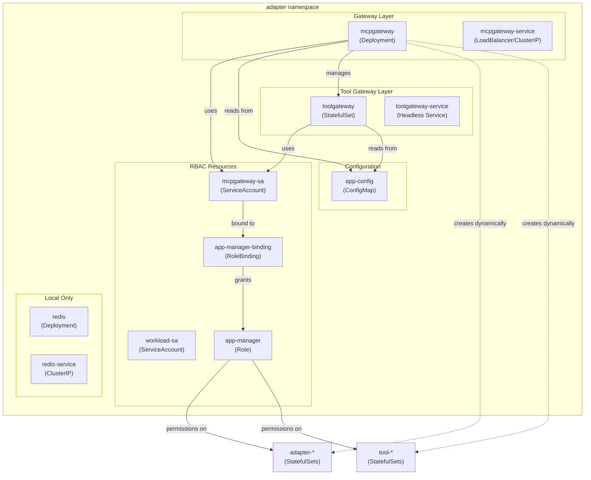
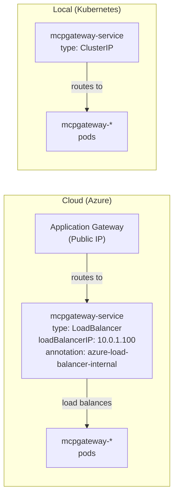
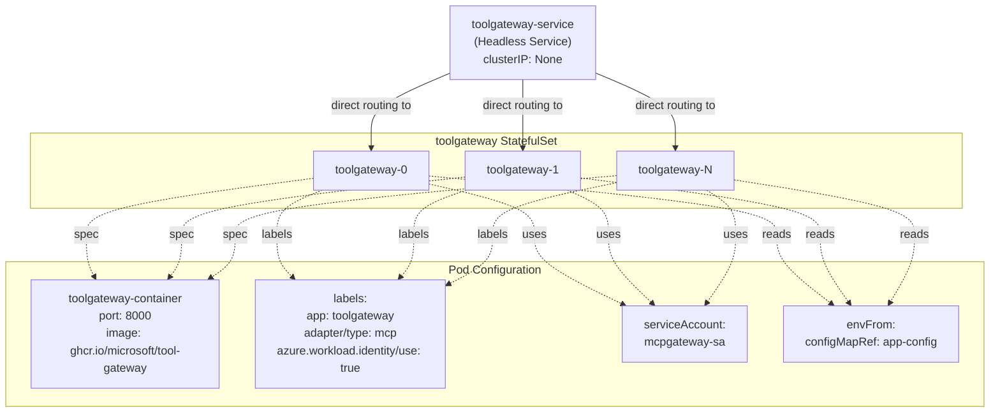
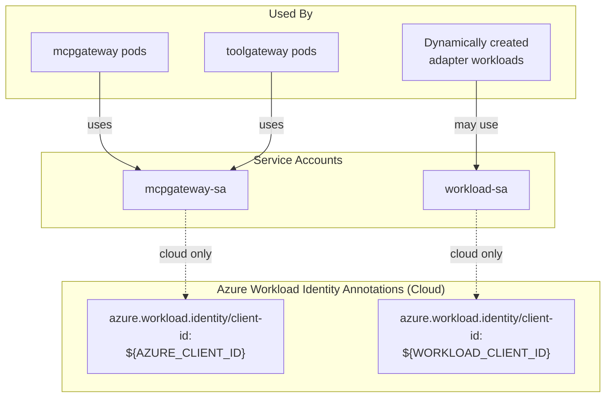
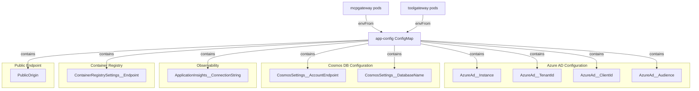
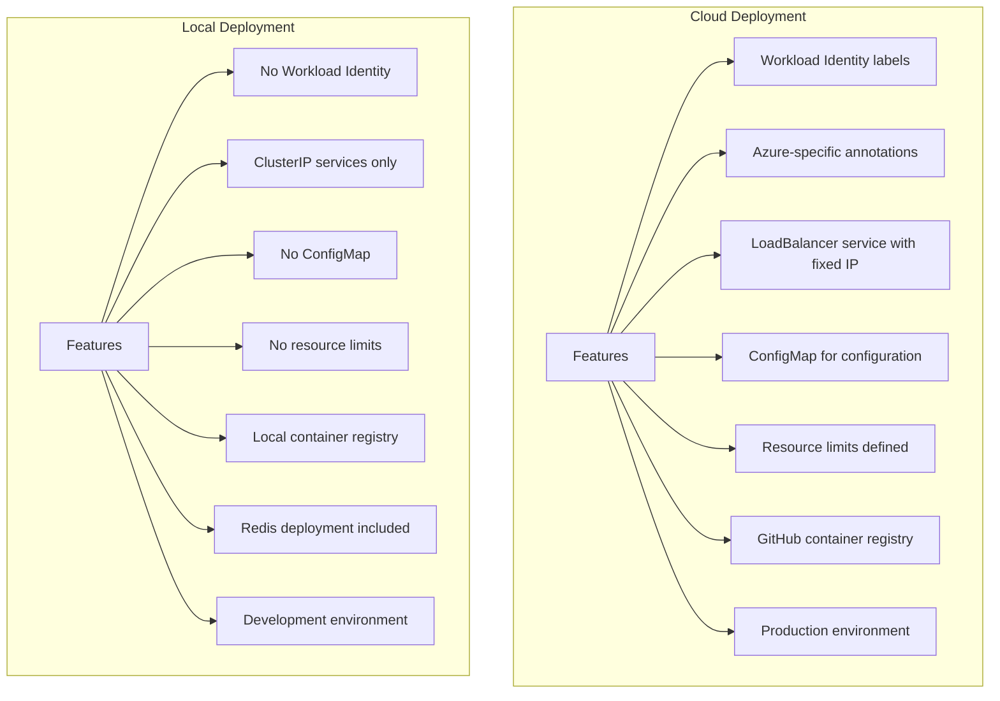

<!-- source: DeepWiki mcp.deepwiki.com · repo microsoft/mcp-gateway · page 3.2 Kubernetes Configuration · fetched 2026-10-26 -->

# Kubernetes Configuration

<details>
<summary>Relevant source files</summary>

The following files were used as context for generating this wiki page:

- [deployment/k8s/cloud-deployment-template.yml](deployment/k8s/cloud-deployment-template.yml)
- [deployment/k8s/local-deployment.yml](deployment/k8s/local-deployment.yml)

</details>


## Purpose and Scope

This document describes the Kubernetes deployment configurations for the MCP Gateway system. It covers both cloud (Azure) and local development Kubernetes deployments, including resource definitions for Deployments, StatefulSets, Services, RBAC policies, and ConfigMaps. For information about the underlying Azure infrastructure provisioning, see [Azure Infrastructure](#3.1). For local development setup outside of Kubernetes, see [Local Development Setup](#3.3).

## Deployment Environments Overview

The MCP Gateway provides two Kubernetes deployment configurations:

| Configuration | File Path | Purpose | Container Registry |
|--------------|-----------|---------|-------------------|
| Cloud/Azure | `deployment/k8s/cloud-deployment-template.yml` | Production deployment on Azure Kubernetes Service (AKS) | GitHub Container Registry (`ghcr.io/microsoft`) |
| Local | `deployment/k8s/local-deployment.yml` | Local development on Kind/Minikube | Local registry (`localhost:5000`) |

Both configurations deploy resources into the `adapter` namespace and include the core gateway services, RBAC policies, and tool gateway infrastructure. The cloud configuration includes Azure-specific features like Workload Identity, Application Insights integration, and ConfigMap-based configuration. The local configuration includes a Redis deployment for development storage.

**Sources:** [deployment/k8s/cloud-deployment-template.yml:1-176](), [deployment/k8s/local-deployment.yml:1-180]()

## Namespace and Resource Organization



**Namespace Structure:** All MCP Gateway resources are deployed in the `adapter` namespace. This namespace contains the gateway deployment, tool gateway, RBAC resources, and serves as the target namespace for dynamically provisioned adapter and tool workloads.

**Sources:** [deployment/k8s/cloud-deployment-template.yml:1-5](), [deployment/k8s/local-deployment.yml:1-5]()

## Gateway Deployment

### mcpgateway Deployment

The main gateway service is deployed as a Kubernetes `Deployment` (not a StatefulSet), allowing for stateless scaling and rolling updates.

```yaml
# Cloud configuration structure
apiVersion: apps/v1
kind: Deployment
metadata:
  name: mcpgateway
  namespace: adapter
spec:
  replicas: 1
  selector:
    matchLabels:
      app: mcpgateway
```

**Deployment Configuration:**

| Property | Cloud Value | Local Value |
|----------|------------|-------------|
| Name | `mcpgateway` | `mcpgateway` |
| Replicas | 1 | 1 |
| Container Image | `ghcr.io/microsoft/mcp-gateway:latest` | `localhost:5000/microsoft-mcpgateway-service:latest` |
| Container Port | 8000 | 8000 |
| ASPNETCORE_ENVIRONMENT | Production | Development |
| Service Account | `mcpgateway-sa` | `mcpgateway-sa` |

**Resource Limits (Cloud Only):**
- Memory: Request 256Mi, Limit 512Mi
- CPU: Request 250m, Limit 500m

**Azure Workload Identity Labels (Cloud Only):**
The cloud deployment includes the label `azure.workload.identity/use: "true"` on pod templates, enabling Azure Workload Identity integration for secure access to Azure resources without storing credentials.

**Sources:** [deployment/k8s/cloud-deployment-template.yml:6-41](), [deployment/k8s/local-deployment.yml:6-30]()

### mcpgateway-service Service



**Cloud Service Configuration:**
- Type: `LoadBalancer` (internal Azure Load Balancer)
- Fixed IP: `10.0.1.100` (coordinates with Application Gateway backend pool)
- Annotation: `service.beta.kubernetes.io/azure-load-balancer-internal: "true"` (creates internal load balancer)
- Port: TCP 8000 → 8000

**Local Service Configuration:**
- Type: `ClusterIP` (cluster-internal only)
- Port: TCP 8000 → 8000
- No fixed IP assignment

The cloud configuration uses an internal load balancer with a fixed IP address that the Azure Application Gateway routes traffic to, while the local configuration uses a simple ClusterIP service for cluster-internal access.

**Sources:** [deployment/k8s/cloud-deployment-template.yml:42-58](), [deployment/k8s/local-deployment.yml:31-43]()

## Tool Gateway StatefulSet

### toolgateway StatefulSet

The tool gateway router is deployed as a `StatefulSet` to enable session affinity routing to specific pod instances.



**StatefulSet Configuration:**

| Property | Cloud Value | Local Value |
|----------|------------|-------------|
| Name | `toolgateway` | `toolgateway` |
| Service Name | `toolgateway-service` | `toolgateway-service` |
| Replicas | 1 | 1 |
| Container Image | `ghcr.io/microsoft/tool-gateway:latest` | `localhost:5000/microsoft-mcpgateway-tools:latest` |
| Container Port | 8000 | 8000 |
| ASPNETCORE_ENVIRONMENT | Production | Development |

**Pod Labels:**
- `app: toolgateway` - selector label
- `adapter/type: "mcp"` - identifies this as an MCP protocol adapter
- `azure.workload.identity/use: "true"` - enables Azure Workload Identity (cloud only)

**Sources:** [deployment/k8s/cloud-deployment-template.yml:125-162](), [deployment/k8s/local-deployment.yml:86-112]()

### toolgateway-service Headless Service

The tool gateway service is configured as a **headless service** (`clusterIP: None`) to enable direct pod-level routing required for session affinity.

```yaml
apiVersion: v1
kind: Service
metadata:
  name: toolgateway-service
  namespace: adapter
spec:
  clusterIP: "None"  # Headless service
  selector:
    app: toolgateway
  ports:
    - protocol: TCP
      port: 8000
      targetPort: 8000
```

**Headless Service Behavior:**
- DNS returns individual pod IPs instead of a cluster IP
- Enables direct addressing like `toolgateway-0.toolgateway-service.adapter.svc.cluster.local`
- Required for session routing logic in the gateway's reverse proxy controller

**Sources:** [deployment/k8s/cloud-deployment-template.yml:163-176](), [deployment/k8s/local-deployment.yml:113-126]()

## RBAC Configuration

### Service Accounts



**mcpgateway-sa:** Primary service account used by the gateway and tool gateway pods. In cloud deployments, annotated with `azure.workload.identity/client-id` to enable federated authentication to Azure services (Cosmos DB, Application Insights, etc.).

**workload-sa:** Service account intended for dynamically provisioned adapter and tool workloads. Can be configured with separate Azure permissions for workload isolation.

**Sources:** [deployment/k8s/cloud-deployment-template.yml:59-74](), [deployment/k8s/local-deployment.yml:44-55]()

### app-manager Role

The `app-manager` Role grants the gateway permission to dynamically create and manage adapter and tool workloads within the `adapter` namespace.

**Permissions Table:**

| API Group | Resources | Verbs |
|-----------|-----------|-------|
| `apps` | `statefulsets` | `get`, `list`, `create`, `update`, `delete`, `patch`, `watch` |
| `""` (core) | `services`, `pods` | `get`, `list`, `create`, `update`, `delete`, `watch` |
| `""` (core) | `pods/log` | `get`, `watch` |

**Permission Analysis:**
- **StatefulSet Management:** Full CRUD operations for creating adapter and tool deployments
- **Service Management:** Create ClusterIP and headless services for routing to workloads
- **Pod Operations:** Query pod status for health checks and status endpoints
- **Log Access:** Retrieve pod logs for the `/adapters/{name}/logs` and `/tools/{name}/logs` API endpoints

**Note on `patch` verb:** The cloud configuration includes `patch` for StatefulSets ([deployment/k8s/cloud-deployment-template.yml:83]()), while the local configuration does not ([deployment/k8s/local-deployment.yml:64]()). This allows in-place updates to StatefulSet specifications in production.

**Sources:** [deployment/k8s/cloud-deployment-template.yml:75-90](), [deployment/k8s/local-deployment.yml:56-71]()

### app-manager-binding RoleBinding

```yaml
apiVersion: rbac.authorization.k8s.io/v1
kind: RoleBinding
metadata:
  name: app-manager-binding
  namespace: adapter
subjects:
  - kind: ServiceAccount
    name: mcpgateway-sa
    namespace: adapter
roleRef:
  kind: Role
  name: app-manager
  apiGroup: rbac.authorization.k8s.io
```

Binds the `app-manager` Role to the `mcpgateway-sa` ServiceAccount, granting the gateway deployment the permissions to orchestrate adapter and tool workloads.

**Sources:** [deployment/k8s/cloud-deployment-template.yml:91-104](), [deployment/k8s/local-deployment.yml:72-85]()

## ConfigMap Configuration (Cloud)

### app-config ConfigMap

The cloud deployment uses a ConfigMap to inject environment-specific configuration into pods. Values are parameterized with template variables (e.g., `${IDENTIFIER}`, `${TENANT_ID}`) that are substituted during deployment by the Bicep deployment script.



**Configuration Keys:**

| Key | Description | Example Value |
|-----|-------------|---------------|
| `AzureAd__Instance` | Azure AD login endpoint | `https://login.microsoftonline.com/` |
| `AzureAd__TenantId` | Azure AD tenant ID | `${TENANT_ID}` (substituted) |
| `AzureAd__ClientId` | Application registration client ID | `${CLIENT_ID}` (substituted) |
| `AzureAd__Audience` | Expected JWT audience | Same as `ClientId` |
| `CosmosSettings__AccountEndpoint` | Cosmos DB account URL | `https://mg-storage-${IDENTIFIER}.documents.azure.com:443/` |
| `CosmosSettings__DatabaseName` | Cosmos DB database name | `McpGatewayDb` |
| `ApplicationInsights__ConnectionString` | Application Insights connection string | `${APPINSIGHTS_CONNECTION_STRING}` (substituted) |
| `ContainerRegistrySettings__Endpoint` | Azure Container Registry endpoint | `mgreg${IDENTIFIER}.azurecr.io` |
| `PublicOrigin` | Public-facing gateway URL | `http://${IDENTIFIER}.${REGION}.cloudapp.azure.com/` |

**Configuration Injection:** Pods reference the ConfigMap using `envFrom` with `configMapRef`, which exposes all ConfigMap keys as environment variables in the container.

**Sources:** [deployment/k8s/cloud-deployment-template.yml:105-124]()

## Local Environment: Redis Deployment

The local deployment includes a Redis instance for development storage and caching, replacing Cosmos DB used in production.

### redis Deployment and Service

```yaml
# Redis Deployment
apiVersion: apps/v1
kind: Deployment
metadata:
  name: redis
  namespace: adapter
spec:
  replicas: 1
  selector:
    matchLabels:
      app: redis
  template:
    spec:
      containers:
        - name: redis
          image: redis:7-alpine
          ports:
            - containerPort: 6379
```

**Redis Configuration:**

| Property | Value |
|----------|-------|
| Image | `redis:7-alpine` |
| Port | 6379 |
| Memory Request | 128Mi |
| Memory Limit | 512Mi |
| CPU Request | 100m |
| CPU Limit | 500m |

**Health Probes:**
- **Liveness Probe:** TCP socket check on port 6379, initial delay 30s, period 10s
- **Readiness Probe:** `redis-cli ping` command, initial delay 5s, period 5s

**Redis Service:**
- Name: `redis-service`
- Type: `ClusterIP`
- Port: TCP 6379 → 6379
- Selector: `app: redis`

The gateway and tool gateway connect to Redis at `redis-service.adapter.svc.cluster.local:6379` when `ASPNETCORE_ENVIRONMENT` is set to `Development`.

**Sources:** [deployment/k8s/local-deployment.yml:127-180]()

## Deployment Configuration Comparison

### Key Differences Between Cloud and Local



| Aspect | Cloud Configuration | Local Configuration |
|--------|-------------------|-------------------|
| **Authentication** | Azure AD via Workload Identity | Development authentication handler (bypass) |
| **Storage** | Cosmos DB (via ConfigMap) | Redis (`redis-service`) |
| **Service Type** | `LoadBalancer` with fixed IP | `ClusterIP` |
| **Container Registry** | `ghcr.io/microsoft` | `localhost:5000` |
| **Configuration** | ConfigMap with Azure-specific values | Environment variables only |
| **Resource Limits** | Defined (256Mi-512Mi memory, 250m-500m CPU) | Not defined |
| **Monitoring** | Application Insights (via ConfigMap) | Not configured |
| **Environment Variable** | `ASPNETCORE_ENVIRONMENT=Production` | `ASPNETCORE_ENVIRONMENT=Development` |
| **Additional Components** | None (external dependencies) | Redis deployment |

**Sources:** [deployment/k8s/cloud-deployment-template.yml:1-176](), [deployment/k8s/local-deployment.yml:1-180]()

## Template Variable Substitution (Cloud)

The cloud deployment template uses placeholder variables that are substituted during deployment:

| Variable | Usage | Example |
|----------|-------|---------|
| `${AZURE_CLIENT_ID}` | Gateway service account client ID | Workload identity federation |
| `${WORKLOAD_CLIENT_ID}` | Workload service account client ID | Adapter/tool workload identity |
| `${TENANT_ID}` | Azure AD tenant | Authentication configuration |
| `${CLIENT_ID}` | Application client ID | Authentication configuration |
| `${APPINSIGHTS_CONNECTION_STRING}` | Application Insights | Telemetry configuration |
| `${IDENTIFIER}` | Deployment-unique identifier | Resource naming |
| `${REGION}` | Azure region | Public endpoint URL |

These variables are replaced by the deployment script (typically invoked from the Bicep deployment) using environment variable substitution before applying the manifest to the cluster.

**Sources:** [deployment/k8s/cloud-deployment-template.yml:65-123]()

## Resource Naming Conventions

The following naming conventions are used across both deployments:

| Resource Type | Naming Pattern | Example |
|--------------|----------------|---------|
| Namespace | Fixed name | `adapter` |
| Gateway Deployment | Fixed name | `mcpgateway` |
| Gateway Service | Fixed name | `mcpgateway-service` |
| Tool Gateway StatefulSet | Fixed name | `toolgateway` |
| Tool Gateway Service | Fixed name | `toolgateway-service` |
| Gateway Service Account | Fixed name | `mcpgateway-sa` |
| Workload Service Account | Fixed name | `workload-sa` |
| RBAC Role | Fixed name | `app-manager` |
| RBAC RoleBinding | Fixed name | `app-manager-binding` |
| ConfigMap | Fixed name | `app-config` |
| Adapter StatefulSets | User-provided | `{adapter-name}` (created dynamically) |
| Adapter Services | User-provided with suffix | `{adapter-name}-service` (created dynamically) |
| Tool StatefulSets | User-provided | `{tool-name}` (created dynamically) |
| Tool Services | User-provided with suffix | `{tool-name}-service` (created dynamically) |

**Sources:** [deployment/k8s/cloud-deployment-template.yml:1-176](), [deployment/k8s/local-deployment.yml:1-180]()

---

