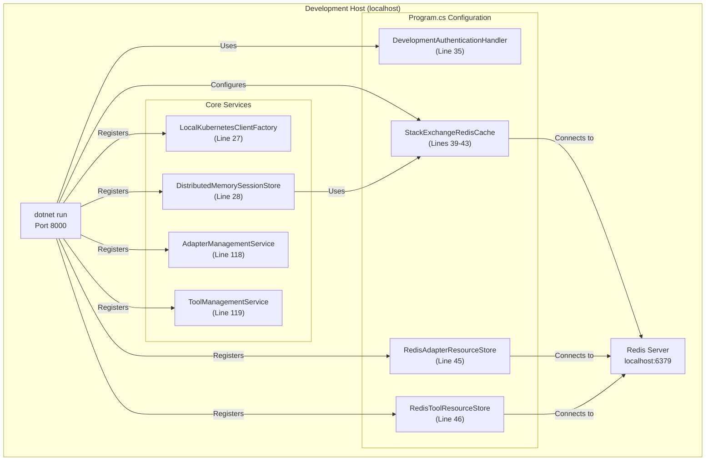
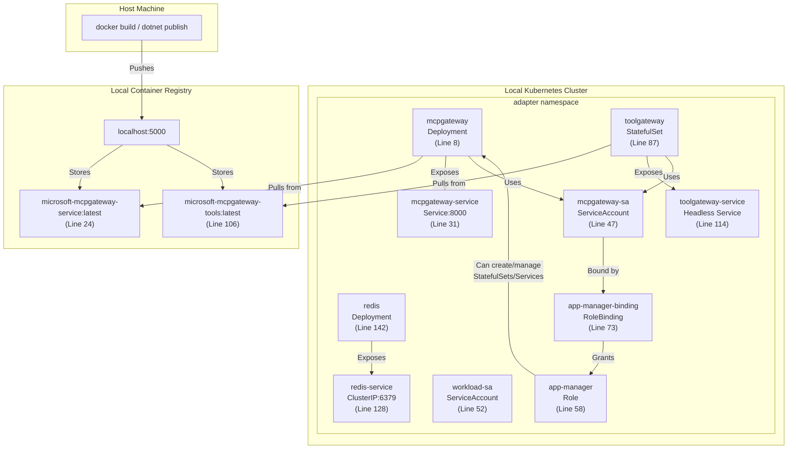
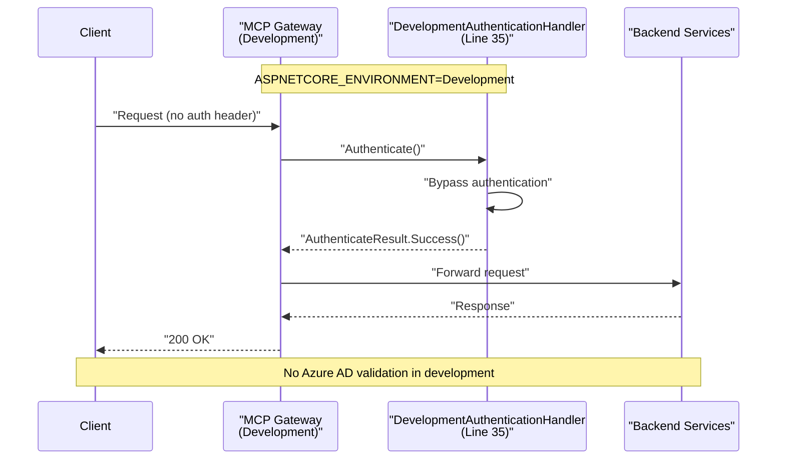
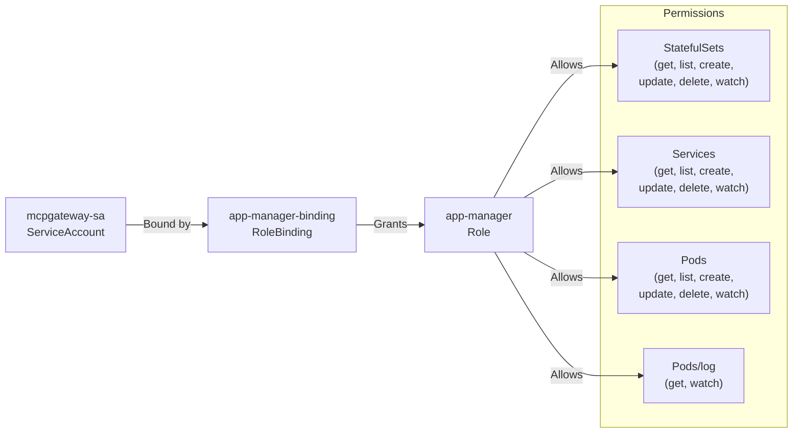

<!-- source: DeepWiki mcp.deepwiki.com · repo microsoft/mcp-gateway · page 3.3 Local Development Setup · fetched 2026-10-26 -->

# Local Development Setup

<details>
<summary>Relevant source files</summary>

The following files were used as context for generating this wiki page:

- [deployment/k8s/local-deployment.yml](deployment/k8s/local-deployment.yml)
- [dotnet/Microsoft.McpGateway.Service/src/McpSubPathAwareAuthenticationHandler.cs](dotnet/Microsoft.McpGateway.Service/src/McpSubPathAwareAuthenticationHandler.cs)
- [dotnet/Microsoft.McpGateway.Service/src/Program.cs](dotnet/Microsoft.McpGateway.Service/src/Program.cs)
- [dotnet/Microsoft.McpGateway.Tools/src/Properties/PublishProfiles/github.pubxml](dotnet/Microsoft.McpGateway.Tools/src/Properties/PublishProfiles/github.pubxml)
- [dotnet/Microsoft.McpGateway.Tools/src/Properties/PublishProfiles/localhost_5000.pubxml](dotnet/Microsoft.McpGateway.Tools/src/Properties/PublishProfiles/localhost_5000.pubxml)
- [dotnet/Microsoft.McpGateway.Tools/src/Properties/launchSettings.json](dotnet/Microsoft.McpGateway.Tools/src/Properties/launchSettings.json)

</details>


This page provides guidance for setting up a local development environment for the MCP Gateway service. It covers both direct execution via `dotnet run` and local Kubernetes deployment options.

For production Azure deployment, see [Azure Infrastructure](#3.1). For Kubernetes configuration details and cloud deployment, see [Kubernetes Configuration](#3.2). For general configuration options, see [Configuration](#6.4).

## Development Environment Options

The MCP Gateway supports two local development approaches:

1. **Direct Execution**: Run the service directly with `dotnet run`, using Redis for storage and simplified authentication
2. **Local Kubernetes**: Deploy to a local Kubernetes cluster (Kind/Minikube) to simulate the production environment

Both approaches use development-specific configurations that differ from production:

| Aspect | Development | Production |
|--------|------------|------------|
| Authentication | `DevelopmentAuthenticationHandler` (bypass) | Azure AD + JWT Bearer |
| Storage | Redis (`RedisAdapterResourceStore`, `RedisToolResourceStore`) | Cosmos DB (`CosmosAdapterResourceStore`, `CosmosToolResourceStore`) |
| Cache | `StackExchangeRedisCache` | Cosmos DB Cache (`AddCosmosCache`) |
| Port | 8000 | 8000 |
| Environment Variable | `ASPNETCORE_ENVIRONMENT=Development` | Not set (defaults to Production) |

Sources: [dotnet/Microsoft.McpGateway.Service/src/Program.cs:32-105]()

## Prerequisites

### For Direct Execution
- .NET 8.0 SDK or later
- Redis server (localhost:6379 or custom connection string)
- Docker (optional, for running Redis in a container)

### For Local Kubernetes
- Docker Desktop with Kubernetes enabled, or
- Kind (Kubernetes in Docker), or
- Minikube
- kubectl CLI tool
- Local container registry (e.g., `localhost:5000`)

Sources: [dotnet/Microsoft.McpGateway.Service/src/Program.cs:38](), [deployment/k8s/local-deployment.yml:24]()

## Direct Execution Setup

### Architecture



Sources: [dotnet/Microsoft.McpGateway.Service/src/Program.cs:21-137]()

### Step 1: Start Redis

**Option A: Docker Container**
```bash
docker run -d -p 6379:6379 --name redis-dev redis:7-alpine
```

**Option B: Native Redis Installation**
```bash
# On macOS with Homebrew
brew install redis
brew services start redis

# On Ubuntu/Debian
sudo apt-get install redis-server
sudo systemctl start redis-server

# On Windows
# Download from https://github.com/microsoftarchive/redis/releases
```

**Verify Redis is running:**
```bash
redis-cli ping
# Expected output: PONG
```

Sources: [deployment/k8s/local-deployment.yml:157-179]()

### Step 2: Configure Redis Connection

The default connection string is `localhost:6379`. To override, set the configuration in `appsettings.Development.json` or via environment variable:

**appsettings.Development.json:**
```json
{
  "Redis": {
    "ConnectionString": "localhost:6379"
  }
}
```

**Environment Variable:**
```bash
export Redis__ConnectionString="your-redis-connection-string"
```

Sources: [dotnet/Microsoft.McpGateway.Service/src/Program.cs:38]()

### Step 3: Run the Gateway Service

Navigate to the service directory and run:

```bash
cd dotnet/Microsoft.McpGateway.Service/src
dotnet run
```

The service will start on port 8000 with `ASPNETCORE_ENVIRONMENT=Development`. You should see output similar to:

```
info: Microsoft.Hosting.Lifetime[14]
      Now listening on: http://[::]:8000
info: Microsoft.Hosting.Lifetime[0]
      Application started. Press Ctrl+C to shut down.
```

Sources: [dotnet/Microsoft.McpGateway.Service/src/Program.cs:126-137]()

### Step 4: Verify the Service

Test the service is running:

```bash
# Health check (adapter list endpoint)
curl -X GET http://localhost:8000/adapters

# Expected: 200 OK with JSON array (may be empty)
```

Sources: [dotnet/Microsoft.McpGateway.Service/src/Program.cs:123-136]()

## Local Kubernetes Setup

### Architecture



Sources: [deployment/k8s/local-deployment.yml:1-180]()

### Step 1: Set Up Local Container Registry

Start a local container registry on port 5000:

```bash
docker run -d -p 5000:5000 --restart=always --name registry registry:2
```

**For Kind clusters**, add registry configuration:

```bash
# Create a Kind cluster with registry
cat <<EOF | kind create cluster --config=-
kind: Cluster
apiVersion: kind.x-k8s.io/v1alpha4
containerdConfigPatches:
- |-
  [plugins."io.containerd.grpc.v1.cri".registry.mirrors."localhost:5000"]
    endpoint = ["http://registry:5000"]
EOF

# Connect the registry to the Kind network
docker network connect "kind" registry || true
```

Sources: [deployment/k8s/local-deployment.yml:24](), [dotnet/Microsoft.McpGateway.Tools/src/Properties/PublishProfiles/localhost_5000.pubxml:7]()

### Step 2: Build and Publish Container Images

**Gateway Service:**
```bash
cd dotnet/Microsoft.McpGateway.Service/src

# Build and publish to local registry
dotnet publish /p:PublishProfile=localhost_5000

# Or build with Docker
docker build -t localhost:5000/microsoft-mcpgateway-service:latest .
docker push localhost:5000/microsoft-mcpgateway-service:latest
```

**Tool Gateway:**
```bash
cd dotnet/Microsoft.McpGateway.Tools/src

# Build and publish to local registry
dotnet publish /p:PublishProfile=localhost_5000

# Or build with Docker
docker build -t localhost:5000/microsoft-mcpgateway-tools:latest .
docker push localhost:5000/microsoft-mcpgateway-tools:latest
```

Sources: [dotnet/Microsoft.McpGateway.Tools/src/Properties/PublishProfiles/localhost_5000.pubxml:1-16]()

### Step 3: Deploy to Kubernetes

Apply the local deployment manifest:

```bash
kubectl apply -f deployment/k8s/local-deployment.yml
```

This creates:
- **Namespace**: `adapter`
- **Deployments**: `mcpgateway` (1 replica), `redis` (1 replica)
- **StatefulSet**: `toolgateway` (1 replica)
- **Services**: `mcpgateway-service`, `toolgateway-service`, `redis-service`
- **ServiceAccounts**: `mcpgateway-sa`, `workload-sa`
- **RBAC**: `app-manager` Role and `app-manager-binding` RoleBinding

Sources: [deployment/k8s/local-deployment.yml:1-180]()

### Step 4: Verify Deployment

Check pod status:

```bash
kubectl get pods -n adapter

# Expected output:
# NAME                          READY   STATUS    RESTARTS   AGE
# mcpgateway-xxxxx-xxxxx        1/1     Running   0          30s
# toolgateway-0                 1/1     Running   0          30s
# redis-xxxxx-xxxxx             1/1     Running   0          30s
```

Check service endpoints:

```bash
kubectl get services -n adapter

# Expected output:
# NAME                   TYPE        CLUSTER-IP     PORT(S)
# mcpgateway-service     ClusterIP   10.x.x.x       8000/TCP
# toolgateway-service    ClusterIP   None           8000/TCP
# redis-service          ClusterIP   10.x.x.x       6379/TCP
```

Sources: [deployment/k8s/local-deployment.yml:31-42, 114-125, 128-139]()

### Step 5: Access the Service

**Option A: Port Forwarding**
```bash
kubectl port-forward -n adapter service/mcpgateway-service 8000:8000

# Access at http://localhost:8000
curl http://localhost:8000/adapters
```

**Option B: NodePort Service (if using Minikube/Kind)**
```bash
# Edit the service to use NodePort
kubectl patch service mcpgateway-service -n adapter -p '{"spec":{"type":"NodePort"}}'

# Get the NodePort
kubectl get service mcpgateway-service -n adapter

# Access via NodePort (or use minikube service)
minikube service mcpgateway-service -n adapter
```

Sources: [deployment/k8s/local-deployment.yml:31-42]()

## Configuration Reference

### Environment-Specific Service Registration

The following table shows how services are registered differently based on the environment:

| Service Type | Development Implementation | Production Implementation |
|--------------|---------------------------|---------------------------|
| Authentication | `DevelopmentAuthenticationHandler` | `McpSubPathAwareAuthenticationHandler` + `AddMicrosoftIdentityWebApi` |
| Adapter Store | `RedisAdapterResourceStore` | `CosmosAdapterResourceStore` |
| Tool Store | `RedisToolResourceStore` | `CosmosToolResourceStore` |
| Cache | `StackExchangeRedisCache` (Redis) | `AddCosmosCache` (Cosmos DB) |
| Logging | Console with Debug level | Application Insights |

**Environment Detection Logic:**
```csharp
// Line 32: Check if running in Development environment
if (builder.Environment.IsDevelopment())
{
    // Development-specific registrations (lines 34-49)
}
else
{
    // Production-specific registrations (lines 52-105)
}
```

Sources: [dotnet/Microsoft.McpGateway.Service/src/Program.cs:32-105]()

### Development Authentication Flow



Sources: [dotnet/Microsoft.McpGateway.Service/src/Program.cs:34-36]()

### Redis Configuration in Development

The development environment uses three Redis-backed components:

**1. StackExchangeRedisCache (Session Cache)**
```csharp
// Lines 39-43: Distributed cache configuration
builder.Services.AddStackExchangeRedisCache(options =>
{
    options.Configuration = "localhost:6379"; // Default from config
    options.InstanceName = "mcpgateway:";      // Key prefix
});
```

**2. RedisAdapterResourceStore**
```csharp
// Line 45: Adapter metadata storage
builder.Services.AddSingleton<IAdapterResourceStore, RedisAdapterResourceStore>();
```

**3. RedisToolResourceStore**
```csharp
// Line 46: Tool definition storage
builder.Services.AddSingleton<IToolResourceStore, RedisToolResourceStore>();
```

Sources: [dotnet/Microsoft.McpGateway.Service/src/Program.cs:38-46]()

### Kubernetes Environment Variables

The local deployment sets critical environment variables in pod specifications:

**Gateway Service Environment:**
```yaml
# Lines 27-29
env:
  - name: ASPNETCORE_ENVIRONMENT
    value: "Development"
```

**Tool Gateway Environment:**
```yaml
# Lines 109-111
env:
  - name: ASPNETCORE_ENVIRONMENT
    value: "Development"
```

These environment variables trigger the development configuration branch in `Program.cs`.

Sources: [deployment/k8s/local-deployment.yml:27-29, 109-111]()

## RBAC Permissions for Local Development

The `mcpgateway-sa` ServiceAccount requires specific permissions to manage adapter and tool workloads:



**Role Definition:**
```yaml
# Lines 58-70
rules:
  - apiGroups: ["apps"]
    resources: ["statefulsets"]
    verbs: ["get", "list", "create", "update", "delete", "watch"]
  - apiGroups: [""]
    resources: ["services", "pods"]
    verbs: ["get", "list", "create", "update", "delete", "watch"]
  - apiGroups: [""]
    resources: ["pods/log"]
    verbs: ["get", "watch"]
```

Sources: [deployment/k8s/local-deployment.yml:56-84]()

## Tool Gateway Development

The Tool Gateway service has its own launch configuration for local development:

**Launch Settings:**
```json
// Microsoft.McpGateway.Tools/src/Properties/launchSettings.json
{
  "profiles": {
    "http": {
      "commandName": "Project",
      "applicationUrl": "http://localhost:5280",
      "environmentVariables": {
        "ASPNETCORE_ENVIRONMENT": "Development"
      }
    }
  }
}
```

**Running Locally:**
```bash
cd dotnet/Microsoft.McpGateway.Tools/src
dotnet run

# Tool Gateway runs on port 5280
curl http://localhost:5280
```

Sources: [dotnet/Microsoft.McpGateway.Tools/src/Properties/launchSettings.json:1-14]()

## Container Publishing Profiles

The solution includes publish profiles for different container registries:

**Local Registry (localhost:5000):**
```xml
<!-- Lines 3-16: localhost_5000.pubxml -->
<PropertyGroup>
  <WebPublishMethod>Container</WebPublishMethod>
  <ContainerPublishMethod>NetSdk</ContainerPublishMethod>
  <RegistryUrl>localhost:5000</RegistryUrl>
  <PublishImageTag>latest</PublishImageTag>
  <RuntimeIdentifier>linux-x64</RuntimeIdentifier>
</PropertyGroup>
```

**GitHub Container Registry:**
```xml
<!-- Lines 3-16: github.pubxml -->
<PropertyGroup>
  <ContainerRegistry>ghcr.io</ContainerRegistry>
  <PublishImageTag>latest</PublishImageTag>
  <RuntimeIdentifier>linux-x64</RuntimeIdentifier>
</PropertyGroup>
```

Sources: [dotnet/Microsoft.McpGateway.Tools/src/Properties/PublishProfiles/localhost_5000.pubxml:1-16](), [dotnet/Microsoft.McpGateway.Tools/src/Properties/PublishProfiles/github.pubxml:1-16]()

## Troubleshooting

### Redis Connection Issues

**Symptom:** Service fails to start with Redis connection errors

**Solutions:**
1. Verify Redis is running: `redis-cli ping`
2. Check connection string in configuration
3. Ensure Redis port 6379 is not blocked by firewall
4. If using Docker Redis, verify container is running: `docker ps | grep redis`

### Image Pull Errors in Kubernetes

**Symptom:** Pods stuck in `ImagePullBackOff` or `ErrImagePull`

**Solutions:**
1. Verify local registry is accessible: `curl http://localhost:5000/v2/_catalog`
2. Check image exists: `curl http://localhost:5000/v2/microsoft-mcpgateway-service/tags/list`
3. For Kind, ensure registry is connected to Kind network
4. Rebuild and push images if necessary

### RBAC Permission Denied

**Symptom:** Gateway cannot create StatefulSets/Services

**Solutions:**
1. Verify ServiceAccount is correctly assigned: `kubectl get pods -n adapter -o yaml | grep serviceAccountName`
2. Check RoleBinding: `kubectl get rolebinding -n adapter app-manager-binding -o yaml`
3. Verify Role permissions: `kubectl get role -n adapter app-manager -o yaml`
4. Reapply RBAC resources: `kubectl apply -f deployment/k8s/local-deployment.yml`

### Authentication Handler Issues

**Symptom:** Unexpected authentication behavior in development

**Solutions:**
1. Verify `ASPNETCORE_ENVIRONMENT=Development` is set
2. Check logs for authentication handler registration
3. Ensure no conflicting Azure AD configuration in `appsettings.Development.json`

Sources: [dotnet/Microsoft.McpGateway.Service/src/Program.cs:32-36](), [deployment/k8s/local-deployment.yml:56-84]()

---

