<!-- source: DeepWiki mcp.deepwiki.com · repo microsoft/mcp-gateway · page 4 Core Components · fetched 2026-10-26 -->

# Core Components

Relevant source files

The following files were used as context for generating this wiki page:

- [dotnet/Directory.Packages.props](dotnet/Directory.Packages.props)
- [dotnet/Microsoft.McpGateway.Management/src/Deployment/IAdapterDeploymentManager.cs](dotnet/Microsoft.McpGateway.Management/src/Deployment/IAdapterDeploymentManager.cs)
- [dotnet/Microsoft.McpGateway.Management/src/Store/IAdapterResourceStore.cs](dotnet/Microsoft.McpGateway.Management/src/Store/IAdapterResourceStore.cs)
- [dotnet/Microsoft.McpGateway.Management/src/Store/InMemoryAdapterResourceStore.cs](dotnet/Microsoft.McpGateway.Management/src/Store/InMemoryAdapterResourceStore.cs)
- [dotnet/Microsoft.McpGateway.Management/test/KubernetesAdapterDeploymentManagerTests.cs](dotnet/Microsoft.McpGateway.Management/test/KubernetesAdapterDeploymentManagerTests.cs)
- [dotnet/Microsoft.McpGateway.Service/src/McpSubPathAwareAuthenticationHandler.cs](dotnet/Microsoft.McpGateway.Service/src/McpSubPathAwareAuthenticationHandler.cs)
- [dotnet/Microsoft.McpGateway.Service/src/Program.cs](dotnet/Microsoft.McpGateway.Service/src/Program.cs)

This document provides an overview of the internal components and services that implement the MCP Gateway system. The gateway is composed of multiple layers: a service layer for business logic, a routing and session management layer for request handling, a deployment management layer for Kubernetes orchestration, and a storage layer for persistence.

For detailed implementation specifics, see the child pages: [Gateway Service](#4.1), [Adapter Management Service](#4.2), [Tool Management Service](#4.3), [Kubernetes Deployment Manager](#4.4), [Storage Layer](#4.5), [Session Management and Routing](#4.6), and [Kubernetes Integration](#4.7).

## System Startup and Dependency Injection

The MCP Gateway application initializes in `Program.cs`, which configures all core components through ASP.NET Core's dependency injection container. The startup process differs based on the environment (Development vs Production).

### Component Registration Overview

The following components are registered during application startup:

| Component Category | Interface | Implementation | Lifecycle |
|-------------------|-----------|----------------|-----------|
| Kubernetes Client | `IKubernetesClientFactory` | `LocalKubernetesClientFactory` | Singleton |
| Session Store | `IAdapterSessionStore` | `DistributedMemorySessionStore` | Singleton |
| Node Info Provider | `IServiceNodeInfoProvider` | `AdapterKubernetesNodeInfoProvider` | Singleton |
| Session Routing | `ISessionRoutingHandler` | `AdapterSessionRoutingHandler` | Singleton |
| Kubernetes Wrapper | `IKubeClientWrapper` | `KubeClient` | Singleton |
| Permission Provider | `IPermissionProvider` | `SimplePermissionProvider` | Singleton |
| Deployment Manager | `IAdapterDeploymentManager` | `KubernetesAdapterDeploymentManager` | Singleton |
| Adapter Management | `IAdapterManagementService` | `AdapterManagementService` | Singleton |
| Tool Management | `IToolManagementService` | `ToolManagementService` | Singleton |
| Rich Result Provider | `IAdapterRichResultProvider` | `AdapterRichResultProvider` | Singleton |

**Sources:** [dotnet/Microsoft.McpGateway.Service/src/Program.cs:27-120]()

### Environment-Specific Configuration

The system uses different implementations for development and production environments:

**Development Environment** (`IsDevelopment()`):
- Authentication: `DevelopmentAuthenticationHandler` (bypasses Azure AD)
- Storage: `RedisAdapterResourceStore` / `RedisToolResourceStore` with local Redis
- Cache: `StackExchangeRedisCache` using localhost:6379
- Logging: Console logging with Debug level

**Production Environment**:
- Authentication: `McpSubPathAwareAuthenticationHandler` with Azure AD and JWT Bearer
- Storage: `CosmosAdapterResourceStore` / `CosmosToolResourceStore` with Azure Cosmos DB
- Cache: `CosmosCache` using Cosmos DB CacheContainer
- Authentication: Azure AD with workload identity using `DefaultAzureCredential`

**Sources:** [dotnet/Microsoft.McpGateway.Service/src/Program.cs:32-105]()

## Component Architecture Overview

The MCP Gateway follows a layered architecture with clear separation between service logic, routing, deployment orchestration, and storage. The system is designed with dependency inversion, using interfaces for all major components to enable testability and environment-specific implementations.

### Title: Core Component Architecture and Dependencies

```mermaid
graph TB
    subgraph "ASP.NET Core Host"
        Program["Program.cs<br/>Startup & DI Configuration"]
        Middleware["Middleware Pipeline<br/>Authentication/Authorization"]
        Controllers["Controllers<br/>API Endpoints"]
    end
    
    subgraph "Service Layer"
        IAdapterMgmt["IAdapterManagementService"]
        AdapterMgmt["AdapterManagementService"]
        IToolMgmt["IToolManagementService"]
        ToolMgmt["ToolManagementService"]
        IRichResult["IAdapterRichResultProvider"]
        RichResult["AdapterRichResultProvider"]
    end
    
    subgraph "Routing & Session Layer"
        ISessionRouting["ISessionRoutingHandler"]
        SessionRouting["AdapterSessionRoutingHandler"]
        ISessionStore["IAdapterSessionStore"]
        SessionStore["DistributedMemorySessionStore"]
        INodeInfo["IServiceNodeInfoProvider"]
        NodeInfo["AdapterKubernetesNodeInfoProvider"]
    end
    
    subgraph "Deployment Layer"
        IDeployMgr["IAdapterDeploymentManager"]
        DeployMgr["KubernetesAdapterDeploymentManager"]
    end
    
    subgraph "Kubernetes Layer"
        IKubeWrapper["IKubeClientWrapper"]
        KubeClient["KubeClient"]
        IKubeFactory["IKubernetesClientFactory"]
        KubeFactory["LocalKubernetesClientFactory"]
    end
    
    subgraph "Storage Layer"
        IAdapterStore["IAdapterResourceStore"]
        IToolStore["IToolResourceStore"]
        CosmosAdapter["CosmosAdapterResourceStore"]
        CosmosTool["CosmosToolResourceStore"]
        RedisAdapter["RedisAdapterResourceStore"]
        RedisTool["RedisToolResourceStore"]
        InMemAdapter["InMemoryAdapterResourceStore"]
    end
    
    subgraph "Authentication Layer"
        IAuthHandler["Authentication Handlers"]
        DevAuth["DevelopmentAuthenticationHandler"]
        McpAuth["McpSubPathAwareAuthenticationHandler"]
        IPermProvider["IPermissionProvider"]
        PermProvider["SimplePermissionProvider"]
    end
    
    subgraph "External Infrastructure"
        K8sAPI["Kubernetes API"]
        CosmosDB["Azure Cosmos DB"]
        Redis["Redis Cache"]
        AzureAD["Azure AD"]
    end
    
    Program --> Middleware
    Program --> Controllers
    Program --> IAdapterMgmt
    Program --> IToolMgmt
    Program --> ISessionRouting
    Program --> IDeployMgr
    Program --> IAdapterStore
    Program --> IToolStore
    Program --> IAuthHandler
    
    IAdapterMgmt -.implements.- AdapterMgmt
    IToolMgmt -.implements.- ToolMgmt
    IRichResult -.implements.- RichResult
    ISessionRouting -.implements.- SessionRouting
    ISessionStore -.implements.- SessionStore
    INodeInfo -.implements.- NodeInfo
    IDeployMgr -.implements.- DeployMgr
    IKubeWrapper -.implements.- KubeClient
    IKubeFactory -.implements.- KubeFactory
    IAdapterStore -.implements.- CosmosAdapter
    IAdapterStore -.implements.- RedisAdapter
    IAdapterStore -.implements.- InMemAdapter
    IToolStore -.implements.- CosmosTool
    IToolStore -.implements.- RedisTool
    IAuthHandler -.implements.- DevAuth
    IAuthHandler -.implements.- McpAuth
    IPermProvider -.implements.- PermProvider
    
    AdapterMgmt --> IDeployMgr
    AdapterMgmt --> IAdapterStore
    ToolMgmt --> IDeployMgr
    ToolMgmt --> IToolStore
    RichResult --> IDeployMgr
    
    SessionRouting --> ISessionStore
    SessionRouting --> INodeInfo
    NodeInfo --> IKubeWrapper
    
    DeployMgr --> IKubeWrapper
    KubeClient --> IKubeFactory
    KubeClient --> K8sAPI
    
    CosmosAdapter --> CosmosDB
    CosmosTool --> CosmosDB
    RedisAdapter --> Redis
    RedisTool --> Redis
    
    McpAuth --> AzureAD
    PermProvider --> IAdapterStore
    PermProvider --> IToolStore
```

**Sources:** [dotnet/Microsoft.McpGateway.Service/src/Program.cs:21-137]()

## Core Component Categories

The MCP Gateway components are organized into several functional categories:

### Service Layer

The service layer contains the primary business logic for managing adapters and tools:

**IAdapterManagementService / AdapterManagementService**
- Orchestrates adapter lifecycle operations (create, read, update, delete, list)
- Validates adapter names and enforces access control
- Coordinates between deployment manager and storage layer
- Detailed documentation: [Adapter Management Service](#4.2)

**IToolManagementService / ToolManagementService**
- Manages tool registration and lifecycle
- Handles tool definitions and metadata
- Integrates with deployment manager for tool server provisioning
- Detailed documentation: [Tool Management Service](#4.3)

**IAdapterRichResultProvider / AdapterRichResultProvider**
- Enriches adapter metadata with runtime information
- Retrieves deployment status and logs
- Provides health and availability metrics

**Sources:** [dotnet/Microsoft.McpGateway.Service/src/Program.cs:118-120]()

### Routing and Session Management

The routing layer handles request forwarding and session affinity:

**ISessionRoutingHandler / AdapterSessionRoutingHandler**
- Routes MCP requests to specific adapter instances
- Maintains session affinity for stateful connections
- Integrates with session store and node info provider

**IAdapterSessionStore / DistributedMemorySessionStore**
- Stores session-to-pod mappings
- Backed by distributed cache (Redis or Cosmos DB)
- Ensures consistent routing across gateway replicas

**IServiceNodeInfoProvider / AdapterKubernetesNodeInfoProvider**
- Provides information about available Kubernetes pods
- Queries Kubernetes API for pod addresses
- Used by routing handler to select target pods

**Detailed documentation:** [Session Management and Routing](#4.6)

**Sources:** [dotnet/Microsoft.McpGateway.Service/src/Program.cs:28-30]()

### Deployment Management

The deployment layer orchestrates Kubernetes resources:

**IAdapterDeploymentManager / KubernetesAdapterDeploymentManager**
- Creates, updates, and deletes StatefulSets and Services
- Configures container images, replicas, and environment variables
- Retrieves deployment status and logs
- Supports both MCP adapters (headless services) and tools (ClusterIP services)

**Detailed documentation:** [Kubernetes Deployment Manager](#4.4)

**Sources:** [dotnet/Microsoft.McpGateway.Service/src/Program.cs:113-117](), [dotnet/Microsoft.McpGateway.Management/src/Deployment/IAdapterDeploymentManager.cs:8-52]()

### Storage Layer

The storage layer persists adapter and tool metadata:

**IAdapterResourceStore**
- Interface for adapter metadata persistence
- Implementations: `CosmosAdapterResourceStore`, `RedisAdapterResourceStore`, `InMemoryAdapterResourceStore`
- Operations: `TryGetAsync()`, `UpsertAsync()`, `DeleteAsync()`, `ListAsync()`

**IToolResourceStore**
- Interface for tool metadata persistence
- Implementations: `CosmosToolResourceStore`, `RedisToolResourceStore`
- Same operations as adapter store

**Detailed documentation:** [Storage Layer](#4.5)

**Sources:** [dotnet/Microsoft.McpGateway.Service/src/Program.cs:45-46](), [dotnet/Microsoft.McpGateway.Service/src/Program.cs:86-96](), [dotnet/Microsoft.McpGateway.Management/src/Store/IAdapterResourceStore.cs:8-42]()

### Kubernetes Integration

The Kubernetes layer provides abstraction over the Kubernetes API:

**IKubeClientWrapper / KubeClient**
- Wraps Kubernetes client operations
- Methods for StatefulSets, Services, and Pod management
- Used by deployment manager and node info provider

**IKubernetesClientFactory / LocalKubernetesClientFactory**
- Factory for creating Kubernetes client instances
- Handles cluster configuration and authentication

**Detailed documentation:** [Kubernetes Integration](#4.7)

**Sources:** [dotnet/Microsoft.McpGateway.Service/src/Program.cs:27](), [dotnet/Microsoft.McpGateway.Service/src/Program.cs:107-111]()

### Authentication and Authorization

The authentication layer secures API access:

**McpSubPathAwareAuthenticationHandler**
- Implements MCP protocol authentication with OAuth 2.0
- Serves OAuth Protected Resource Metadata at `/.well-known/oauth-protected-resource`
- Integrates with Azure AD for JWT token validation
- Handles authentication challenges with WWW-Authenticate headers

**DevelopmentAuthenticationHandler**
- Development-only authentication bypass
- Used for local testing without Azure AD

**IPermissionProvider / SimplePermissionProvider**
- Enforces role-based access control (RBAC)
- Checks user permissions for read/write operations
- Validates resource ownership

**Detailed documentation:** [Authentication Flow](#7.1) and [Authorization and RBAC](#7.2)

**Sources:** [dotnet/Microsoft.McpGateway.Service/src/Program.cs:34-71](), [dotnet/Microsoft.McpGateway.Service/src/Program.cs:112](), [dotnet/Microsoft.McpGateway.Service/src/McpSubPathAwareAuthenticationHandler.cs:15-181]()

## Key Interfaces and Contracts

### Service Layer Interfaces

| Interface | Key Methods | Purpose |
|-----------|-------------|---------|
| `IAdapterManagementService` | `CreateAsync`, `UpdateAsync`, `DeleteAsync`, `GetAsync`, `ListAsync` | Adapter lifecycle management |
| `IToolManagementService` | `CreateAsync`, `UpdateAsync`, `DeleteAsync`, `GetAsync`, `ListAsync` | Tool lifecycle management |
| `IAdapterRichResultProvider` | Methods to enrich adapter data with status and logs | Runtime information enrichment |

### Infrastructure Interfaces

| Interface | Key Methods | Purpose |
|-----------|-------------|---------|
| `IAdapterDeploymentManager` | `CreateDeploymentAsync`, `UpdateDeploymentAsync`, `DeleteDeploymentAsync`, `GetDeploymentStatusAsync`, `GetDeploymentLogsAsync` | Kubernetes resource orchestration |
| `IAdapterResourceStore` | `TryGetAsync`, `UpsertAsync`, `DeleteAsync`, `ListAsync` | Adapter metadata persistence |
| `IToolResourceStore` | `TryGetAsync`, `UpsertAsync`, `DeleteAsync`, `ListAsync` | Tool metadata persistence |
| `IKubeClientWrapper` | `UpsertStatefulSetAsync`, `UpsertServiceAsync`, `DeleteStatefulSetAsync`, `ReadStatefulSetAsync`, `GetContainerLogStream` | Kubernetes API operations |
| `IKubernetesClientFactory` | Factory methods for creating Kubernetes clients | Kubernetes client instantiation |

### Routing and Session Interfaces

| Interface | Key Methods | Purpose |
|-----------|-------------|---------|
| `ISessionRoutingHandler` | Methods for routing requests with session affinity | Request routing logic |
| `IAdapterSessionStore` | Methods for storing and retrieving session mappings | Session state persistence |
| `IServiceNodeInfoProvider` | Methods for querying available pods | Pod discovery |

### Authentication and Authorization Interfaces

| Interface | Key Methods | Purpose |
|-----------|-------------|---------|
| `IPermissionProvider` | `CheckAccessAsync`, permission validation methods | Access control enforcement |

**Sources:** [dotnet/Microsoft.McpGateway.Management/src/Deployment/IAdapterDeploymentManager.cs:8-52](), [dotnet/Microsoft.McpGateway.Management/src/Store/IAdapterResourceStore.cs:8-42]()

## Package Dependencies

The MCP Gateway uses centralized package management via `Directory.Packages.props`. Key dependencies include:

| Package | Version | Purpose |
|---------|---------|---------|
| `KubernetesClient` | 18.0.5 | Kubernetes API client library |
| `Microsoft.Azure.Cosmos` | 3.51.0 | Azure Cosmos DB SDK |
| `Microsoft.Extensions.Caching.Cosmos` | 1.7.0 | Cosmos DB distributed cache |
| `Microsoft.Extensions.Caching.StackExchangeRedis` | 9.0.10 | Redis distributed cache |
| `Microsoft.Identity.Web` | 3.9.1 | Azure AD authentication |
| `Microsoft.ApplicationInsights.AspNetCore` | 2.23.0 | Application telemetry |
| `ModelContextProtocol` | 0.4.0-preview.3 | MCP protocol implementation |
| `ModelContextProtocol.AspNetCore` | 0.4.0-preview.3 | MCP ASP.NET Core integration |

**Sources:** [dotnet/Directory.Packages.props:1-21]()

## Key Interfaces and Contracts

### Core Service Interfaces

| Interface | Purpose | Implementation |
|-----------|---------|----------------|
| `IAdapterManagementService` | Primary service contract | `AdapterManagementService` |
| `IAdapterDeploymentManager` | Deployment operations | `KubernetesAdapterDeploymentManager` |
| `IAdapterResourceStore` | Storage operations | `CosmosAdapterResourceStore`, `InMemoryAdapterResourceStore` |

### Data Contracts

| Contract | Purpose | Usage |
|----------|---------|-------|
| `AdapterData` | Input DTO for adapter operations | Request payload |
| `AdapterResource` | Complete adapter entity | Storage and response |
| `AdapterStatus` | Runtime status information | Status queries |
| `EnvironmentVariable` | Environment configuration | Deployment configuration |

**Sources:** [dotnet/Microsoft.McpGateway.Management/test/AdapterManagementServiceTests.cs:36](), [dotnet/Microsoft.McpGateway.Management/src/Service/AdapterManagementService.cs:36]()

## Access Control and Validation

The `AdapterManagementService` implements access control through `ClaimsPrincipal` validation:

- **Name Validation**: Adapter names must match pattern `^[a-z0-9-]+$`
- **Write Access**: Only the creator can modify or delete adapters
- **Read Access**: Currently allows all authenticated users to read adapters
- **Existence Checks**: Prevents duplicate creation and validates existence for updates

**Sources:** [dotnet/Microsoft.McpGateway.Management/src/Service/AdapterManagementService.cs:26-27](), [dotnet/Microsoft.McpGateway.Management/src/Service/AdapterManagementService.cs:117-133](), [dotnet/Microsoft.McpGateway.Management/src/Service/AdapterManagementService.cs:136-139]()

---

