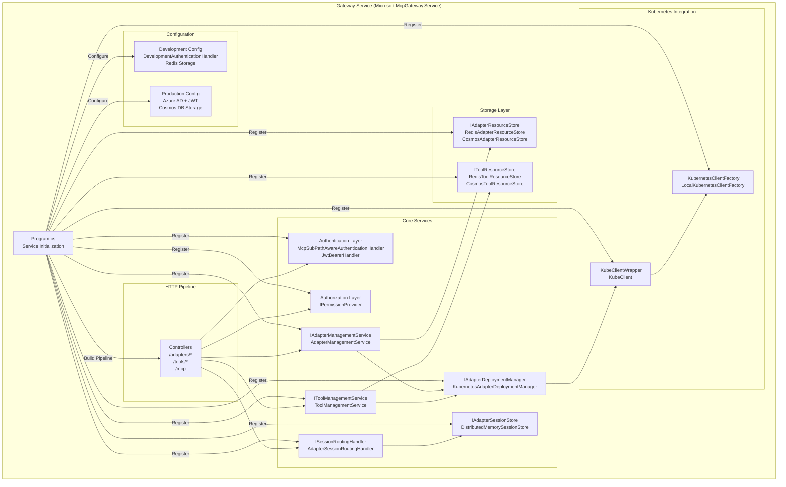
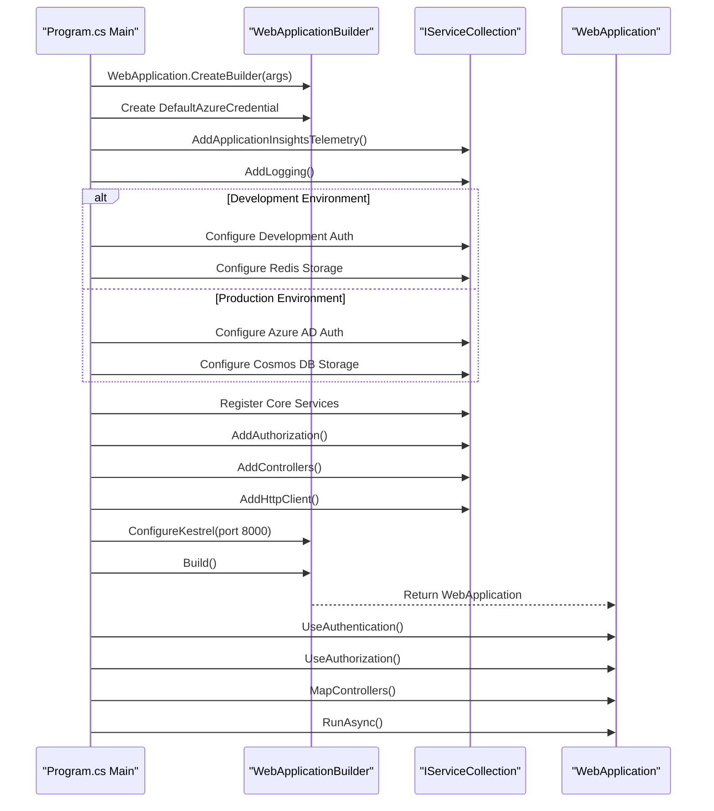
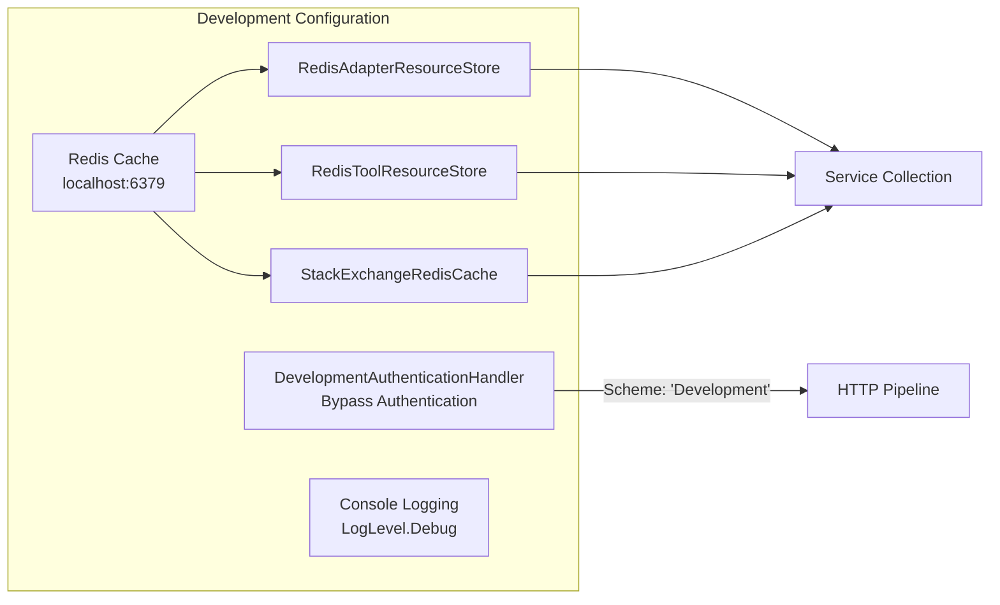
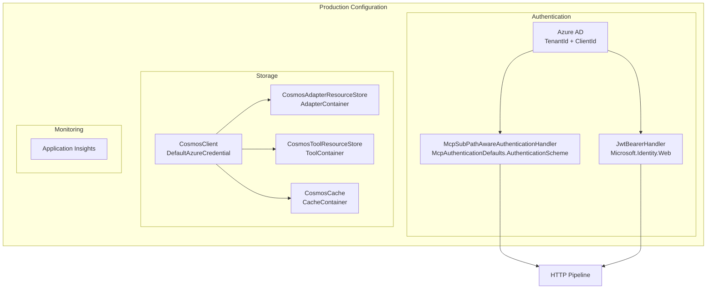
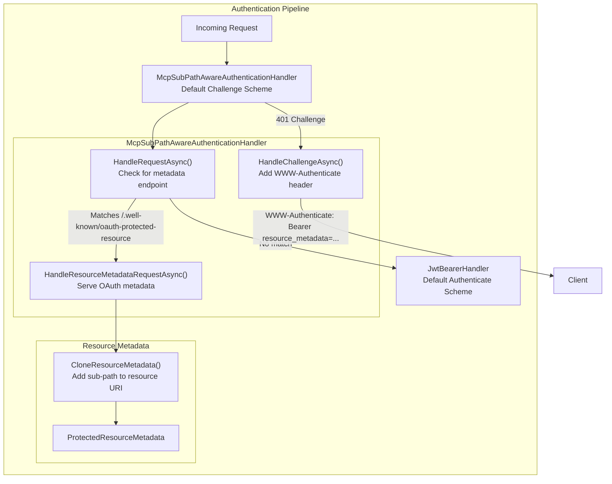
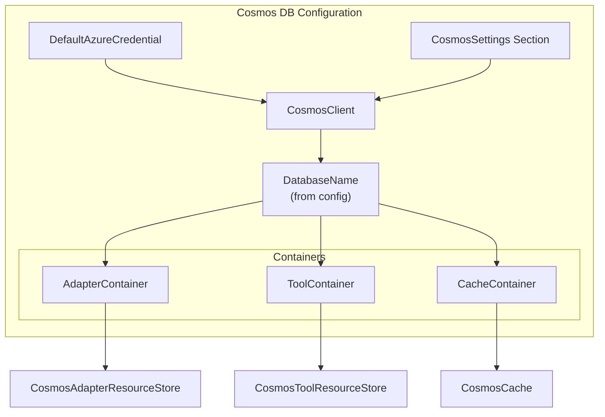
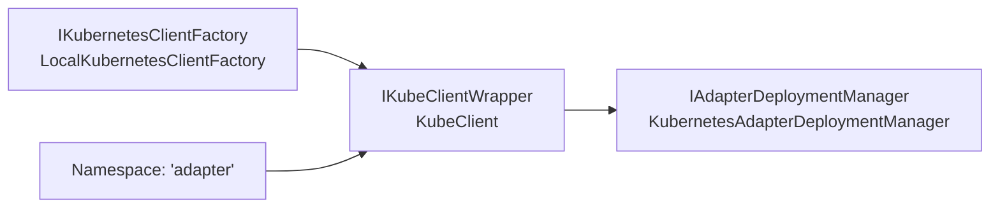
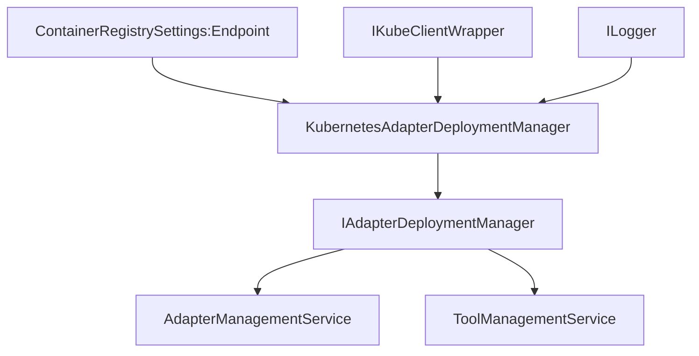
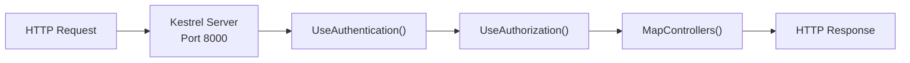
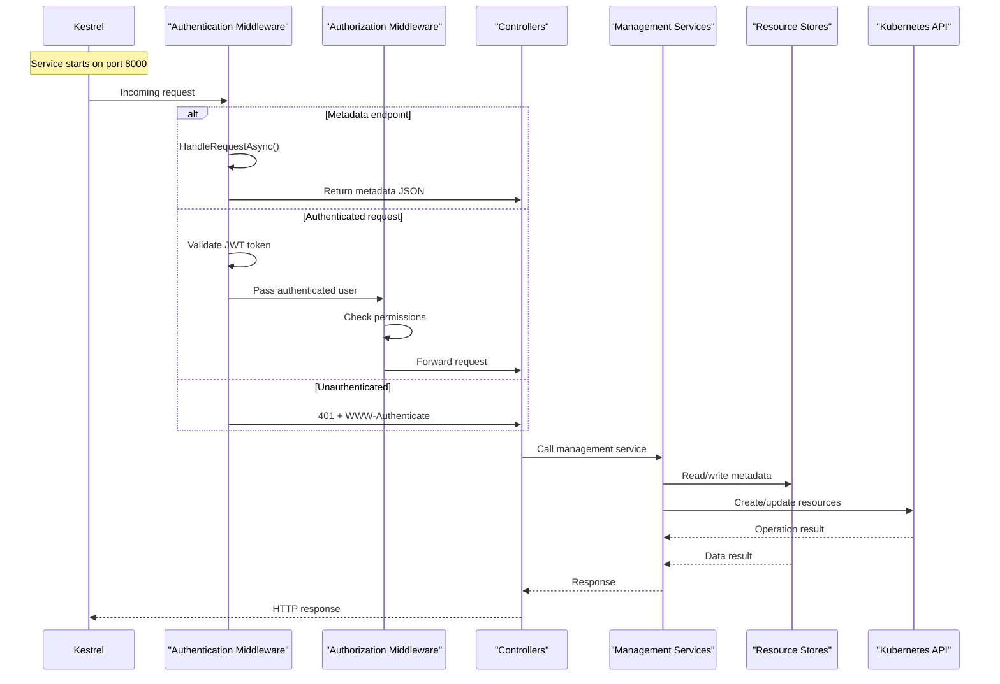

<!-- source: DeepWiki mcp.deepwiki.com · repo microsoft/mcp-gateway · page 4.1 Gateway Service · fetched 2026-10-26 -->

# Gateway Service

<details>
<summary>Relevant source files</summary>

The following files were used as context for generating this wiki page:

- [dotnet/Microsoft.McpGateway.Service/src/McpSubPathAwareAuthenticationHandler.cs](dotnet/Microsoft.McpGateway.Service/src/McpSubPathAwareAuthenticationHandler.cs)
- [dotnet/Microsoft.McpGateway.Service/src/Microsoft.McpGateway.Service.csproj](dotnet/Microsoft.McpGateway.Service/src/Microsoft.McpGateway.Service.csproj)
- [dotnet/Microsoft.McpGateway.Service/src/Program.cs](dotnet/Microsoft.McpGateway.Service/src/Program.cs)

</details>


## Purpose and Scope

The Gateway Service is the main ASP.NET Core application that serves as the entry point for the MCP Gateway system. It implements both the control plane (management API) and data plane (request routing) functionality in a single service. This document covers the service initialization, dependency injection configuration, environment-specific setup, and HTTP pipeline configuration.

For detailed information about the management APIs, see [Adapter Management Service](#4.2) and [Tool Management Service](#4.3). For routing implementation details, see [Session Management and Routing](#4.6). For authentication flow details, see [Authentication Flow](#7.1).

## Service Architecture

The Gateway Service is structured as a standard ASP.NET Core Web API application with environment-specific configurations for development (local) and production (Azure) deployments.



**Sources:** [dotnet/Microsoft.McpGateway.Service/src/Program.cs:1-138]()

## Service Initialization

The Gateway Service initialization occurs in `Program.cs`, which follows the standard ASP.NET Core minimal hosting model. The initialization sequence configures services, authentication, storage, and the HTTP pipeline.

### Startup Sequence



**Sources:** [dotnet/Microsoft.McpGateway.Service/src/Program.cs:21-137]()

### Core Service Registration

The following table summarizes the core services registered in the dependency injection container:

| Service Interface | Implementation | Scope | Purpose |
|------------------|----------------|-------|---------|
| `IKubernetesClientFactory` | `LocalKubernetesClientFactory` | Singleton | Creates Kubernetes API clients |
| `IAdapterSessionStore` | `DistributedMemorySessionStore` | Singleton | Manages session state for stateful routing |
| `IServiceNodeInfoProvider` | `AdapterKubernetesNodeInfoProvider` | Singleton | Provides information about Kubernetes service nodes |
| `ISessionRoutingHandler` | `AdapterSessionRoutingHandler` | Singleton | Handles session-aware request routing |
| `IKubeClientWrapper` | `KubeClient` | Singleton | Wraps Kubernetes API client with namespace configuration |
| `IPermissionProvider` | `SimplePermissionProvider` | Singleton | Implements authorization logic |
| `IAdapterDeploymentManager` | `KubernetesAdapterDeploymentManager` | Singleton | Manages adapter deployments in Kubernetes |
| `IAdapterManagementService` | `AdapterManagementService` | Singleton | Implements adapter lifecycle management |
| `IToolManagementService` | `ToolManagementService` | Singleton | Implements tool lifecycle management |
| `IAdapterRichResultProvider` | `AdapterRichResultProvider` | Singleton | Provides enriched adapter information |

**Sources:** [dotnet/Microsoft.McpGateway.Service/src/Program.cs:27-121]()

## Environment-Specific Configuration

The Gateway Service implements different configurations based on the hosting environment, detected via `builder.Environment.IsDevelopment()`.

### Development Environment

In development mode, the service uses simplified authentication and local storage:



Configuration details:

| Component | Configuration | Value |
|-----------|--------------|-------|
| Authentication Scheme | `DevelopmentAuthenticationHandler.SchemeName` | "Development" |
| Redis Connection String | `Redis:ConnectionString` | Default: "localhost:6379" |
| Redis Instance Name | N/A | "mcpgateway:" |
| Adapter Storage | `RedisAdapterResourceStore` | Uses Redis for adapter metadata |
| Tool Storage | `RedisToolResourceStore` | Uses Redis for tool metadata |
| Cache | `StackExchangeRedisCache` | Distributed cache using Redis |
| Logging | Console + Debug level | Full debug output |

**Sources:** [dotnet/Microsoft.McpGateway.Service/src/Program.cs:32-50]()

### Production Environment (Azure)

In production, the service integrates with Azure services for authentication, storage, and caching:



Production configuration sources:

| Component | Configuration Source | Key Properties |
|-----------|---------------------|----------------|
| Azure AD | `AzureAd` section | `TenantId`, `ClientId` |
| Public Origin | `PublicOrigin` | Base URL for resource metadata |
| Cosmos DB | `CosmosSettings` section | `AccountEndpoint`, `DatabaseName` |
| Container Registry | `ContainerRegistrySettings` | `Endpoint` |

**Sources:** [dotnet/Microsoft.McpGateway.Service/src/Program.cs:52-105]()

## Authentication Configuration

The Gateway Service implements two different authentication handlers based on the environment.

### Development Authentication Handler

In development, the `DevelopmentAuthenticationHandler` bypasses authentication for ease of local testing. This handler always returns successful authentication results without validating credentials.

**Sources:** [dotnet/Microsoft.McpGateway.Service/src/Program.cs:34-36]()

### Production Authentication (MCP + JWT)

Production uses a dual authentication scheme combining MCP protocol authentication with Azure AD JWT validation:



The `McpSubPathAwareAuthenticationHandler` extends the standard MCP authentication by making the resource metadata sub-path aware. When serving metadata at `/.well-known/oauth-protected-resource/adapters/my-adapter`, it clones the base metadata and adds the sub-path to the resource URI.

Key configuration in `McpAuthenticationOptions`:

| Property | Value | Purpose |
|----------|-------|---------|
| `ResourceMetadata.Resource` | `PublicOrigin` from config | Base resource URI |
| `ResourceMetadata.AuthorizationServers` | `https://login.microsoftonline.com/{TenantId}/v2.0` | Azure AD token endpoint |
| `ResourceMetadata.ScopesSupported` | `api://{ClientId}/.default` | Required OAuth scope |

**Sources:** 
- [dotnet/Microsoft.McpGateway.Service/src/Program.cs:53-71]()
- [dotnet/Microsoft.McpGateway.Service/src/McpSubPathAwareAuthenticationHandler.cs:1-181]()

### McpSubPathAwareAuthenticationHandler Implementation

The `McpSubPathAwareAuthenticationHandler` class implements three key methods:

| Method | Return Type | Purpose |
|--------|-------------|---------|
| `HandleRequestAsync()` | `Task<bool>` | Intercepts requests to metadata endpoints |
| `HandleAuthenticateAsync()` | `Task<AuthenticateResult>` | Returns `NoResult` (authentication forwarded to JWT handler) |
| `HandleChallengeAsync()` | `Task` | Adds `WWW-Authenticate` header with resource metadata URI |

The handler's `CloneResourceMetadata()` method creates a copy of the base `ProtectedResourceMetadata` with the sub-path appended to the resource URI:

```
Original Resource: https://gateway.example.com
Sub-Path: /adapters/my-adapter
Result Resource: https://gateway.example.com/adapters/my-adapter
```

**Sources:** [dotnet/Microsoft.McpGateway.Service/src/McpSubPathAwareAuthenticationHandler.cs:15-181]()

## Storage Layer Configuration

The Gateway Service uses different storage implementations based on the environment, both implementing the same interfaces for adapters and tools.

### Storage Abstractions

| Interface | Development Implementation | Production Implementation |
|-----------|---------------------------|---------------------------|
| `IAdapterResourceStore` | `RedisAdapterResourceStore` | `CosmosAdapterResourceStore` |
| `IToolResourceStore` | `RedisToolResourceStore` | `CosmosToolResourceStore` |
| `IDistributedCache` | `StackExchangeRedisCache` | `CosmosCache` |

### Development Storage (Redis)

Redis storage configuration uses a connection string from configuration (default: `localhost:6379`) and registers three services:

1. **RedisAdapterResourceStore**: Stores adapter metadata in Redis using JSON serialization
2. **RedisToolResourceStore**: Stores tool definitions in Redis
3. **StackExchangeRedisCache**: Implements `IDistributedCache` for session storage with instance prefix "mcpgateway:"

**Sources:** [dotnet/Microsoft.McpGateway.Service/src/Program.cs:38-46]()

### Production Storage (Cosmos DB)

Cosmos DB storage uses workload identity authentication (`DefaultAzureCredential`) and requires:



The `CosmosClient` is configured with:
- **Authentication**: `DefaultAzureCredential` (managed identity in AKS)
- **Serializer**: `CosmosSystemTextJsonSerializer` with null value ignoring
- **Account Endpoint**: From `CosmosSettings:AccountEndpoint` configuration
- **Database Name**: From `CosmosSettings:DatabaseName` configuration

Container-specific configurations:

| Container | Service | Logger Type |
|-----------|---------|-------------|
| `AdapterContainer` | `CosmosAdapterResourceStore` | `ILogger<CosmosAdapterResourceStore>` |
| `ToolContainer` | `CosmosToolResourceStore` | `ILogger<CosmosToolResourceStore>` |
| `CacheContainer` | `CosmosCache` | Created automatically if not exists |

**Sources:** [dotnet/Microsoft.McpGateway.Service/src/Program.cs:73-104]()

## Kubernetes Client Configuration

The Gateway Service requires Kubernetes API access to manage adapter and tool deployments. The Kubernetes client setup uses a factory pattern with namespace isolation:



The `KubeClient` wrapper is initialized with:
- **Factory**: `IKubernetesClientFactory` to create the underlying client
- **Namespace**: Hard-coded to "adapter" for all managed resources

**Sources:** [dotnet/Microsoft.McpGateway.Service/src/Program.cs:107-111]()

## Deployment Manager Configuration

The `KubernetesAdapterDeploymentManager` is responsible for creating and managing Kubernetes resources for adapters and tools:



Configuration:
- **Container Registry Endpoint**: From `ContainerRegistrySettings:Endpoint` (e.g., Azure Container Registry URL)
- **Kubernetes Client**: `IKubeClientWrapper` for namespace-scoped operations
- **Logging**: Structured logging for deployment operations

**Sources:** [dotnet/Microsoft.McpGateway.Service/src/Program.cs:113-117]()

## HTTP Pipeline Configuration

The Gateway Service configures a standard ASP.NET Core HTTP pipeline with authentication, authorization, and MVC controllers:



Pipeline components:

| Middleware | Order | Purpose |
|------------|-------|---------|
| `UseAuthentication()` | 1 | Validates authentication tokens and populates `HttpContext.User` |
| `UseAuthorization()` | 2 | Enforces authorization policies |
| `MapControllers()` | 3 | Routes requests to controller endpoints |

### Kestrel Configuration

The service is configured to listen on all interfaces at port 8000:

```
options.ListenAnyIP(8000);
```

This allows the service to accept connections from any network interface, suitable for containerized deployments where the internal IP may change.

**Sources:** [dotnet/Microsoft.McpGateway.Service/src/Program.cs:126-137]()

## Dependencies

The Gateway Service project references several key NuGet packages:

| Package | Purpose |
|---------|---------|
| `KubernetesClient` | Kubernetes API client library |
| `Microsoft.ApplicationInsights.AspNetCore` | Telemetry and monitoring |
| `Microsoft.Extensions.Caching.Cosmos` | Cosmos DB distributed cache |
| `Microsoft.Extensions.Caching.StackExchangeRedis` | Redis distributed cache |
| `Microsoft.Identity.Web` | Azure AD authentication |
| `ModelContextProtocol.AspNetCore` | MCP protocol support |

The service also references the `Microsoft.McpGateway.Management` project, which contains the core management logic for adapters and tools.

**Sources:** [dotnet/Microsoft.McpGateway.Service/src/Microsoft.McpGateway.Service.csproj:1-24]()

## Service Execution Flow

The following diagram shows the complete flow from service startup to request handling:



**Sources:** [dotnet/Microsoft.McpGateway.Service/src/Program.cs:1-138](), [dotnet/Microsoft.McpGateway.Service/src/McpSubPathAwareAuthenticationHandler.cs:1-181]()

---

