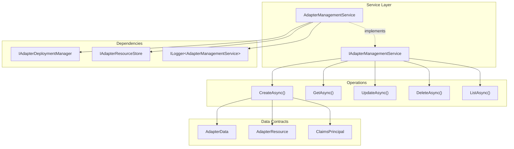
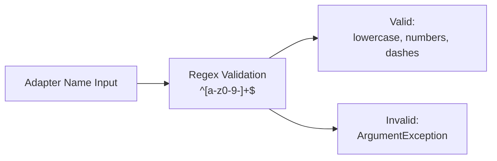
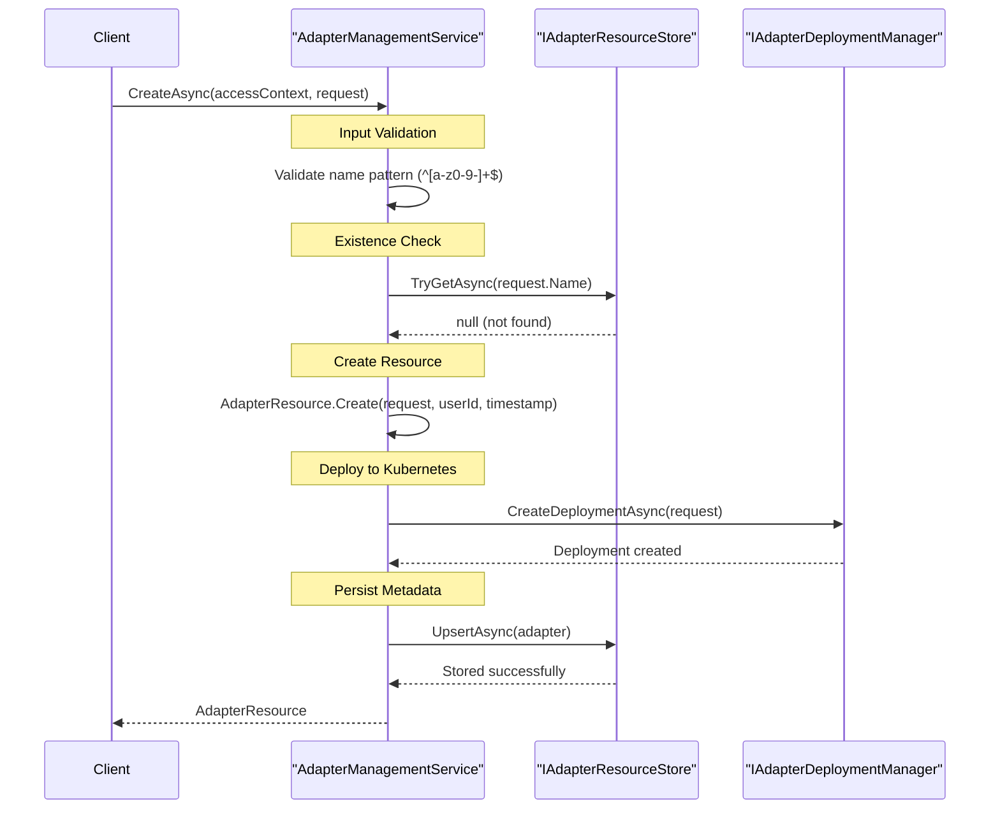
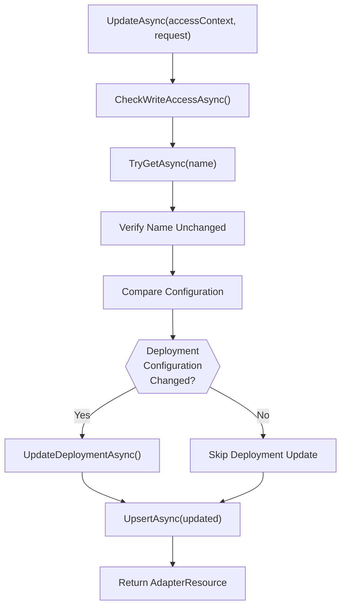
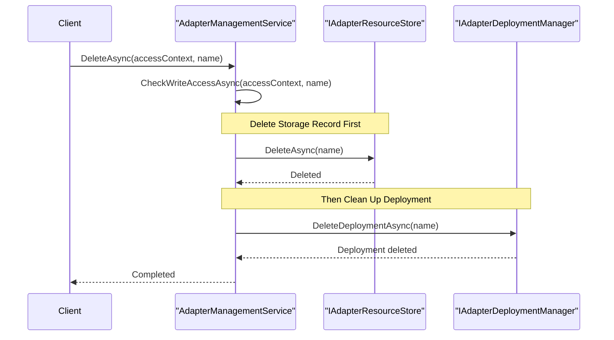
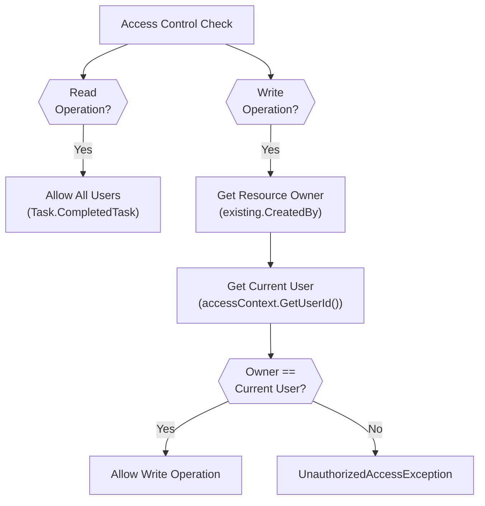
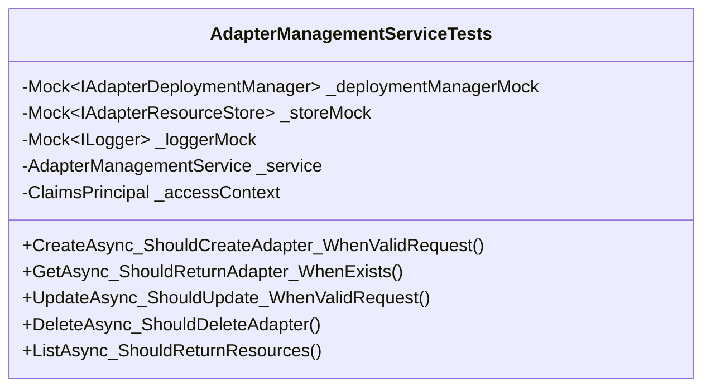

<!-- source: DeepWiki mcp.deepwiki.com · repo microsoft/mcp-gateway · page 4.2 Adapter Management Service · fetched 2026-10-26 -->

# Adapter Management Service

<details>
<summary>Relevant source files</summary>

The following files were used as context for generating this wiki page:

- [dotnet/Directory.Packages.props](dotnet/Directory.Packages.props)
- [dotnet/Microsoft.McpGateway.Management/src/Deployment/IAdapterDeploymentManager.cs](dotnet/Microsoft.McpGateway.Management/src/Deployment/IAdapterDeploymentManager.cs)
- [dotnet/Microsoft.McpGateway.Management/src/Extensions/IdentityExtensions.cs](dotnet/Microsoft.McpGateway.Management/src/Extensions/IdentityExtensions.cs)
- [dotnet/Microsoft.McpGateway.Management/src/Store/IAdapterResourceStore.cs](dotnet/Microsoft.McpGateway.Management/src/Store/IAdapterResourceStore.cs)
- [dotnet/Microsoft.McpGateway.Management/src/Store/InMemoryAdapterResourceStore.cs](dotnet/Microsoft.McpGateway.Management/src/Store/InMemoryAdapterResourceStore.cs)
- [dotnet/Microsoft.McpGateway.Management/test/KubernetesAdapterDeploymentManagerTests.cs](dotnet/Microsoft.McpGateway.Management/test/KubernetesAdapterDeploymentManagerTests.cs)
- [dotnet/Microsoft.McpGateway.Service/src/Controllers/ManagementController.cs](dotnet/Microsoft.McpGateway.Service/src/Controllers/ManagementController.cs)
- [dotnet/Microsoft.McpGateway.Service/src/HttpProxy.cs](dotnet/Microsoft.McpGateway.Service/src/HttpProxy.cs)

</details>


## Purpose and Scope

The `AdapterManagementService` is the core orchestrator for adapter lifecycle operations within the MCP Gateway's Control Plane. It provides CRUD operations for managing MCP adapter servers, coordinating between deployment management and metadata storage while enforcing security policies and business rules.

This document covers the service's architecture, dependencies, operations, and security model. For information about the underlying deployment mechanisms, see [Deployment Management](#3.2). For storage layer details, see [Storage Layer](#3.4).

## Overview

The `AdapterManagementService` serves as the primary business logic layer for adapter management operations. It implements the `IAdapterManagementService` interface and acts as a facade that coordinates between the deployment management layer and the storage layer while providing security, validation, and audit capabilities.



**Sources:** [dotnet/Microsoft.McpGateway.Management/src/Service/AdapterManagementService.cs:14-19](), [dotnet/Microsoft.McpGateway.Management/src/Service/IAdapterManagementService.cs:13-57]()

## Core Responsibilities

The `AdapterManagementService` handles five primary responsibilities:

| Responsibility | Description | Key Methods |
|----------------|-------------|-------------|
| **Input Validation** | Validates adapter names, configurations, and request data | Name pattern validation [line 26-27]() |
| **Security Enforcement** | Manages access control based on user identity and ownership | `CheckWriteAccessAsync`, `CheckReadAccessAsync` |
| **Business Logic** | Enforces rules like name uniqueness and update restrictions | Existence checks, immutable field validation |
| **Orchestration** | Coordinates between deployment and storage layers | All CRUD operations |
| **Audit Logging** | Provides comprehensive logging for operations and security events | Structured logging throughout |

### Name Validation

The service enforces a strict naming pattern for adapter names using regex validation:



**Sources:** [dotnet/Microsoft.McpGateway.Management/src/Service/AdapterManagementService.cs:16](), [dotnet/Microsoft.McpGateway.Management/src/Service/AdapterManagementService.cs:26-27]()

## Service Dependencies

The `AdapterManagementService` uses constructor dependency injection to receive its dependencies:

```mermaid
classDiagram
    class AdapterManagementService {
        -IAdapterDeploymentManager _deploymentManager
        -IAdapterResourceStore _store
        -ILogger _logger
        +CreateAsync(ClaimsPrincipal, AdapterData, CancellationToken)
        +GetAsync(ClaimsPrincipal, string, CancellationToken)
        +UpdateAsync(ClaimsPrincipal, AdapterData, CancellationToken)
        +DeleteAsync(ClaimsPrincipal, string, CancellationToken)
        +ListAsync(ClaimsPrincipal, CancellationToken)
        -CheckWriteAccessAsync(ClaimsPrincipal, string, CancellationToken)
        -CheckReadAccessAsync(ClaimsPrincipal, string, CancellationToken)
    }
    
    class IAdapterDeploymentManager {
        <<interface>>
        +CreateDeploymentAsync()
        +UpdateDeploymentAsync()
        +DeleteDeploymentAsync()
    }
    
    class IAdapterResourceStore {
        <<interface>>
        +TryGetAsync()
        +UpsertAsync()
        +DeleteAsync()
        +ListAsync()
    }
    
    AdapterManagementService --> IAdapterDeploymentManager
    AdapterManagementService --> IAdapterResourceStore
    AdapterManagementService --> "ILogger<AdapterManagementService>"
```

**Sources:** [dotnet/Microsoft.McpGateway.Management/src/Service/AdapterManagementService.cs:14-19]()

## Operation Flows

### Create Operation Flow

The `CreateAsync` method implements a comprehensive creation flow with validation, deployment, and storage:



**Sources:** [dotnet/Microsoft.McpGateway.Management/src/Service/AdapterManagementService.cs:21-46]()

### Update Operation Flow

The `UpdateAsync` method includes change detection to minimize unnecessary deployments:



The service checks for changes in: `ReplicaCount`, `ImageName`, `ImageVersion`, and `EnvironmentVariables` before triggering deployment updates.

**Sources:** [dotnet/Microsoft.McpGateway.Management/src/Service/AdapterManagementService.cs:59-89](), [dotnet/Microsoft.McpGateway.Management/src/Service/AdapterManagementService.cs:79-84]()

### Delete Operation Flow

The `DeleteAsync` method follows a specific order: storage deletion first, then deployment cleanup:



**Sources:** [dotnet/Microsoft.McpGateway.Management/src/Service/AdapterManagementService.cs:91-104]()

## Security Model

The service implements a user-based ownership security model where users can only modify adapters they created, but can read all adapters.

### Access Control Implementation



**Key Security Methods:**
- `CheckWriteAccessAsync()` - Validates ownership for create, update, delete operations
- `CheckReadAccessAsync()` - Currently allows all read access (returns `Task.CompletedTask`)

**Sources:** [dotnet/Microsoft.McpGateway.Management/src/Service/AdapterManagementService.cs:117-139]()

## Error Handling and Validation

The service implements comprehensive error handling and validation:

| Validation Type | Implementation | Exception Type |
|----------------|----------------|----------------|
| **Null Checks** | `ArgumentNullException.ThrowIfNull()` | `ArgumentNullException` |
| **Empty Strings** | `ArgumentException.ThrowIfNullOrEmpty()` | `ArgumentException` |
| **Name Pattern** | Regex validation `^[a-z0-9-]+$` | `ArgumentException` |
| **Duplicate Names** | Storage existence check | `ArgumentException` |
| **Non-existent Resources** | Storage lookup with null check | `ArgumentException` |
| **Immutable Fields** | Field comparison (e.g., Name changes) | `ArgumentException` |
| **Access Control** | User ownership validation | `UnauthorizedAccessException` |

**Sources:** [dotnet/Microsoft.McpGateway.Management/src/Service/AdapterManagementService.cs:23-34](), [dotnet/Microsoft.McpGateway.Management/src/Service/AdapterManagementService.cs:67-74](), [dotnet/Microsoft.McpGateway.Management/src/Service/AdapterManagementService.cs:122-130]()

## Testing and Quality Assurance

The service includes comprehensive unit tests covering all major operations and edge cases:



**Test Coverage Areas:**
- **Happy Path Operations** - All CRUD operations with valid inputs
- **Dependency Verification** - Ensures proper calls to `IAdapterDeploymentManager` and `IAdapterResourceStore`
- **Data Transformation** - Validates proper conversion between `AdapterData` and `AdapterResource`
- **Mock Setup** - Uses Moq framework for dependency isolation

**Sources:** [dotnet/Microsoft.McpGateway.Management/test/AdapterManagementServiceTests.cs:14-96]()

---

