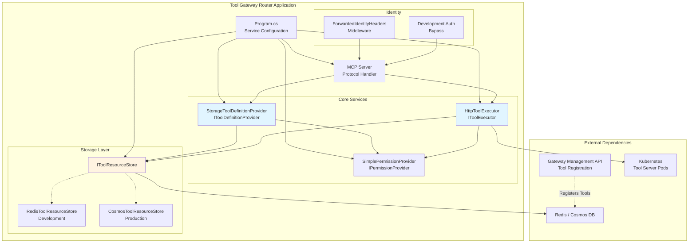
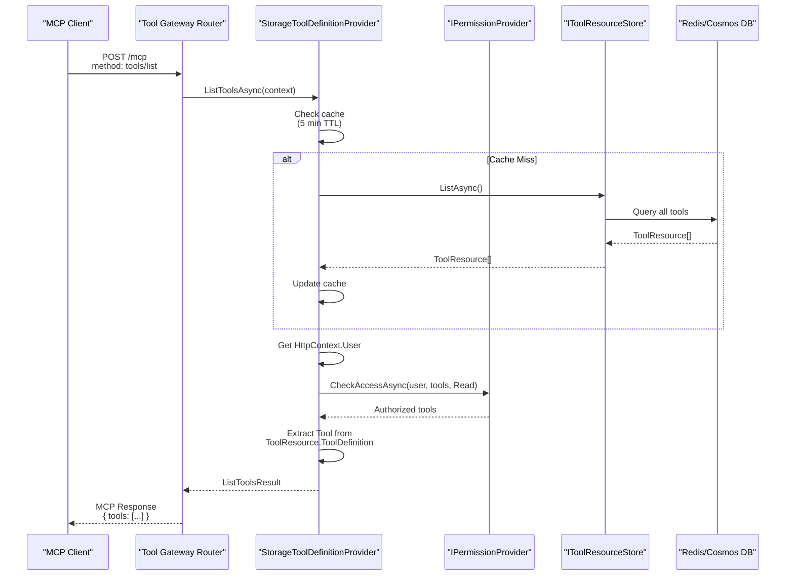
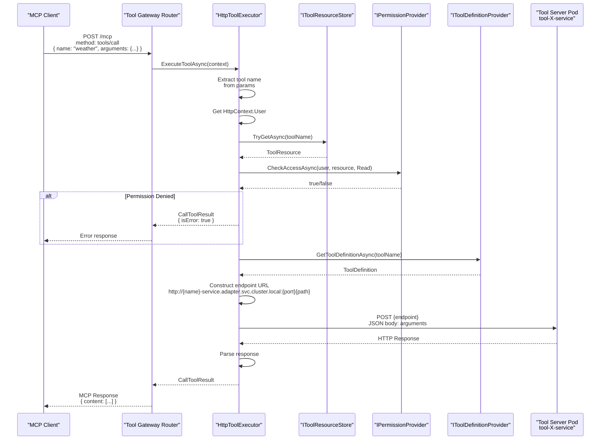
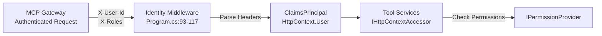
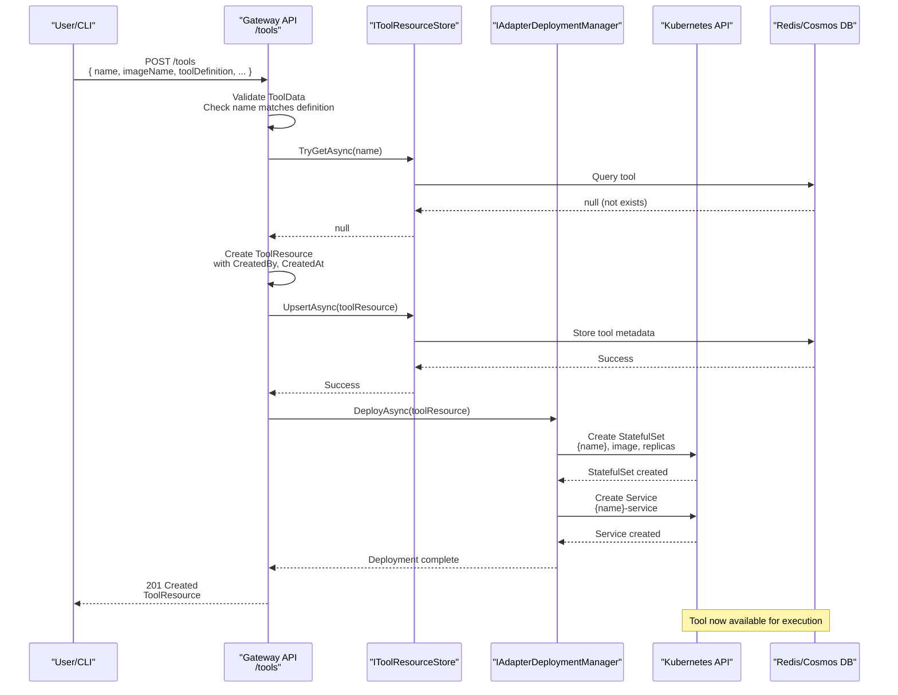
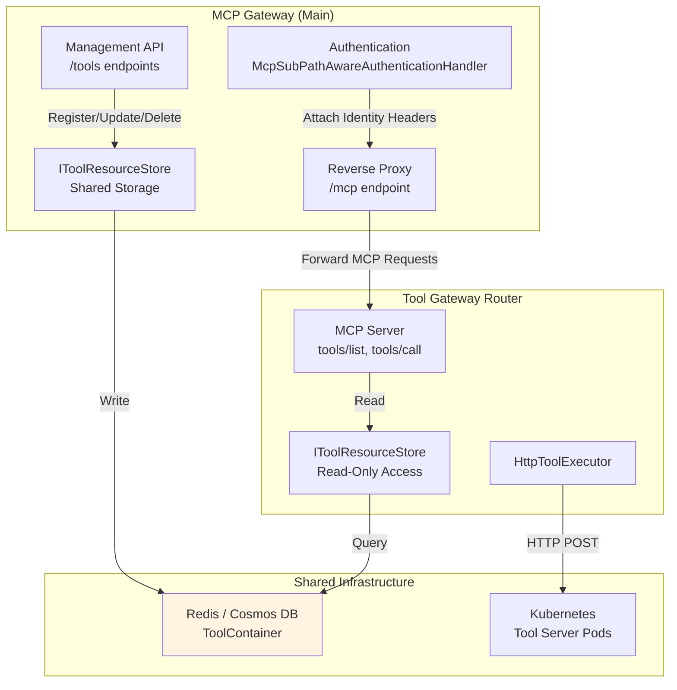

<!-- source: DeepWiki mcp.deepwiki.com · repo microsoft/mcp-gateway · page 4.3 Tool Management Service · fetched 2026-10-26 -->

# Tool Management Service

<details>
<summary>Relevant source files</summary>

The following files were used as context for generating this wiki page:

- [dotnet/Microsoft.McpGateway.Management/src/Store/CosmosAdapterResourceStore.cs](dotnet/Microsoft.McpGateway.Management/src/Store/CosmosAdapterResourceStore.cs)
- [dotnet/Microsoft.McpGateway.Service/src/appsettings.json](dotnet/Microsoft.McpGateway.Service/src/appsettings.json)
- [dotnet/Microsoft.McpGateway.Tools/src/Program.cs](dotnet/Microsoft.McpGateway.Tools/src/Program.cs)
- [dotnet/Microsoft.McpGateway.Tools/src/Services/HttpToolExecutor.cs](dotnet/Microsoft.McpGateway.Tools/src/Services/HttpToolExecutor.cs)
- [dotnet/Microsoft.McpGateway.Tools/src/Services/StorageToolDefinitionProvider.cs](dotnet/Microsoft.McpGateway.Tools/src/Services/StorageToolDefinitionProvider.cs)
- [dotnet/Microsoft.McpGateway.Tools/test/StorageToolDefinitionProviderTests.cs](dotnet/Microsoft.McpGateway.Tools/test/StorageToolDefinitionProviderTests.cs)
- [openapi/mcp-gateway.openapi.json](openapi/mcp-gateway.openapi.json)

</details>


## Purpose and Scope

The Tool Management Service is responsible for registering, storing, discovering, and executing MCP tools within the MCP Gateway system. This service provides the infrastructure for dynamic tool registration, permission-based tool discovery, and HTTP-based tool execution routing. It consists of three primary components: the Tool Gateway Router application that handles MCP tool requests, the storage layer that persists tool definitions, and the executor that forwards tool calls to deployed tool servers.

For information about deploying and managing tool server instances in Kubernetes, see [Kubernetes Deployment Manager](#4.4). For details about tool-related REST API endpoints, see [REST API Endpoints](#5.1). For the broader Tool Gateway System architecture including routing mechanics, see [Tool Gateway System](#2.4).

**Sources:** [dotnet/Microsoft.McpGateway.Tools/src/Program.cs:1-137](), [dotnet/Microsoft.McpGateway.Tools/src/Services/HttpToolExecutor.cs:1-166](), [dotnet/Microsoft.McpGateway.Tools/src/Services/StorageToolDefinitionProvider.cs:1-145]()

---

## Architecture Overview

The Tool Management Service operates as a standalone application (Tool Gateway Router) that implements the MCP Server protocol for tool listing and execution. It integrates with the main gateway's control plane for tool registration and lifecycle management while serving as an MCP protocol endpoint for tool execution.

### Tool Management Components



**Sources:** [dotnet/Microsoft.McpGateway.Tools/src/Program.cs:15-90](), [dotnet/Microsoft.McpGateway.Tools/src/Services/StorageToolDefinitionProvider.cs:13-45](), [dotnet/Microsoft.McpGateway.Tools/src/Services/HttpToolExecutor.cs:20-33]()

---

## Tool Resource Storage

Tools are stored as `ToolResource` objects that contain both deployment metadata and MCP tool definitions. The storage layer abstracts persistence through the `IToolResourceStore` interface with environment-specific implementations.

### Storage Implementation Matrix

| Environment | Implementation | Connection | Container/Key Prefix |
|-------------|----------------|------------|---------------------|
| Development | `RedisToolResourceStore` | `localhost:6379` | `mcpgateway:tools:` |
| Production | `CosmosToolResourceStore` | Azure Cosmos DB | `ToolContainer` |

### Tool Resource Structure

A `ToolResource` contains:

```
ToolResource
├── Id (string) - Unique identifier
├── Name (string) - Tool name
├── ImageName (string) - Container image
├── ImageVersion (string) - Image tag
├── ToolDefinition (ToolDefinition)
│   ├── Tool (MCP Tool)
│   │   ├── Name (string)
│   │   ├── Description (string)
│   │   └── InputSchema (JsonElement)
│   ├── Port (int) - Service port
│   └── Path (string) - Execution endpoint path
├── EnvironmentVariables (Dictionary)
├── ReplicaCount (int)
├── CreatedBy (string)
├── CreatedAt (DateTimeOffset)
└── LastUpdatedAt (DateTimeOffset)
```

### Storage Configuration

**Development (Redis):**

[dotnet/Microsoft.McpGateway.Tools/src/Program.cs:26-36]()
```csharp
var redisConnection = builder.Configuration.GetValue<string>("Redis:ConnectionString") ?? "localhost:6379";
builder.Services.AddStackExchangeRedisCache(options =>
{
    options.Configuration = redisConnection;
    options.InstanceName = "mcpgateway:";
});
builder.Services.AddSingleton<IToolResourceStore, RedisToolResourceStore>();
```

**Production (Cosmos DB):**

[dotnet/Microsoft.McpGateway.Tools/src/Program.cs:42-63]()
```csharp
var config = builder.Configuration.GetSection("CosmosSettings");
var credential = new DefaultAzureCredential();
var cosmosClient = new CosmosClient(config["AccountEndpoint"], credential, ...);

builder.Services.AddSingleton<IToolResourceStore>(sp =>
{
    var logger = sp.GetRequiredService<ILogger<CosmosToolResourceStore>>();
    return new CosmosToolResourceStore(
        cosmosClient,
        config["DatabaseName"]!,
        "ToolContainer",
        logger);
});
```

**Sources:** [dotnet/Microsoft.McpGateway.Tools/src/Program.cs:26-64](), [dotnet/Microsoft.McpGateway.Service/src/appsettings.json:15-18](), [openapi/mcp-gateway.openapi.json:541-627]()

---

## Tool Definition Provider

The `StorageToolDefinitionProvider` class implements `IToolDefinitionProvider` and is responsible for loading, caching, and filtering tool definitions based on user permissions.

### Tool Discovery Flow



**Sources:** [dotnet/Microsoft.McpGateway.Tools/src/Services/StorageToolDefinitionProvider.cs:49-126](), [dotnet/Microsoft.McpGateway.Tools/src/Program.cs:72-77]()

### Caching Mechanism

The provider implements a simple time-based cache with a 5-minute expiration:

[dotnet/Microsoft.McpGateway.Tools/src/Services/StorageToolDefinitionProvider.cs:18-25]()
```csharp
private const int CacheExpirationMinutes = 5;
private List<ToolResource>? _cachedToolResources;
private DateTime _lastLoadTime;
```

[dotnet/Microsoft.McpGateway.Tools/src/Services/StorageToolDefinitionProvider.cs:51-57]()
```csharp
var cacheExpiration = TimeSpan.FromMinutes(CacheExpirationMinutes);

if (_cachedToolResources != null && DateTime.UtcNow - _lastLoadTime < cacheExpiration)
{
    return await FilterToolDefinitionsAsync(_cachedToolResources, cancellationToken);
}
```

This caching strategy reduces storage queries while ensuring tool definitions remain reasonably up-to-date. The cache is refreshed on-demand when expired.

### Permission Filtering

Tool definitions are filtered based on user permissions before being returned:

[dotnet/Microsoft.McpGateway.Tools/src/Services/StorageToolDefinitionProvider.cs:128-142]()
```csharp
private async Task<List<ToolDefinition>> FilterToolDefinitionsAsync(
    IEnumerable<ToolResource> toolResources, 
    CancellationToken cancellationToken)
{
    var principal = _httpContextAccessor.HttpContext?.User;
    if (principal == null)
    {
        return [];
    }

    var allowedResources = await _permissionProvider.CheckAccessAsync(
        principal, toolResources, Operation.Read);
    return allowedResources
        .Where(resource => resource.ToolDefinition != null)
        .Select(resource => resource.ToolDefinition!)
        .ToList();
}
```

**Sources:** [dotnet/Microsoft.McpGateway.Tools/src/Services/StorageToolDefinitionProvider.cs:49-142]()

---

## Tool Execution

The `HttpToolExecutor` class implements `IToolExecutor` and handles the actual execution of tool calls by forwarding requests to tool server endpoints running in Kubernetes.

### Tool Execution Flow



**Sources:** [dotnet/Microsoft.McpGateway.Tools/src/Services/HttpToolExecutor.cs:36-154]()

### Endpoint URL Construction

Tool execution endpoints are constructed using Kubernetes DNS naming conventions:

[dotnet/Microsoft.McpGateway.Tools/src/Services/HttpToolExecutor.cs:88-95]()
```csharp
// Compose the execution endpoint URL
// Format: http://{toolName}-service.adapter.svc.cluster.local:{port}{path}
var executionEndpoint = $"http://{toolName}-service.adapter.svc.cluster.local:{toolDefinition.Port}{toolDefinition.Path}";

this.logger.LogInformation(
    "Forwarding tool {ToolName} to endpoint: {Endpoint}",
    toolName,
    executionEndpoint);
```

This format resolves to the Kubernetes Service created by the Deployment Manager for each tool, allowing the router to reach tool pods within the cluster. The default port is typically `8000` and the default path is often `/score` or tool-specific.

### Request Forwarding

[dotnet/Microsoft.McpGateway.Tools/src/Services/HttpToolExecutor.cs:97-107]()
```csharp
using var client = this.httpClientFactory.CreateClient();
var jsonContent = new StringContent(
    JsonSerializer.Serialize(requestContext.Params?.Arguments),
    Encoding.UTF8,
    "application/json");

var response = await client.PostAsync(
    executionEndpoint,
    jsonContent,
    cancellationToken);
```

The executor serializes the tool arguments from the MCP request and forwards them as JSON to the tool server's HTTP endpoint.

### Error Handling

The executor handles several error scenarios:

| Error Condition | Response |
|----------------|----------|
| Missing tool name | `CallToolResult` with error flag and message |
| Missing user context | Error result with "User context is required" |
| Tool not found in store | Error result with "Tool not found" |
| Permission denied | Error result with "You do not have permission" |
| Missing tool definition | Error result with "Tool definition is unavailable" |
| HTTP error (connection) | Error result with connection details |
| Non-success HTTP status | Error result with status code |
| Unexpected exception | Error result with exception message |

[dotnet/Microsoft.McpGateway.Tools/src/Services/HttpToolExecutor.cs:110-130]()
```csharp
if (!response.IsSuccessStatusCode)
{
    var errorContent = await response.Content.ReadAsStringAsync(cancellationToken);
    this.logger.LogError(
        "Inference server returned error for tool {ToolName}: {StatusCode} - {Error}",
        toolName,
        response.StatusCode,
        errorContent);

    return new CallToolResult
    {
        Content = [new TextContentBlock { Text = $"Error: Inference server returned {response.StatusCode}" }],
        IsError = true
    };
}
```

**Sources:** [dotnet/Microsoft.McpGateway.Tools/src/Services/HttpToolExecutor.cs:36-164]()

---

## Identity and Authentication

The Tool Gateway Router receives authenticated identity information from the main MCP Gateway via forwarded headers. This enables permission checks without requiring direct authentication.

### Forwarded Identity Headers



**Sources:** [dotnet/Microsoft.McpGateway.Tools/src/Program.cs:93-117]()

### Identity Middleware Implementation

[dotnet/Microsoft.McpGateway.Tools/src/Program.cs:93-117]()
```csharp
app.Use(async (context, next) =>
{
    if (context.Request.Headers.TryGetValue(ForwardedIdentityHeaders.UserId, out var forwardedUserId) 
        && !string.IsNullOrWhiteSpace(forwardedUserId))
    {
        var userId = forwardedUserId.ToString().Trim();
        if (!string.IsNullOrWhiteSpace(userId))
        {
            var identity = new ClaimsIdentity("Forwarded");
            identity.AddClaim(new Claim(ClaimTypes.NameIdentifier, userId));

            if (context.Request.Headers.TryGetValue(ForwardedIdentityHeaders.Roles, out var forwardedRoles))
            {
                var roles = forwardedRoles.ToString().Split(',', StringSplitOptions.RemoveEmptyEntries | StringSplitOptions.TrimEntries);
                foreach (var role in roles.Where(role => !string.IsNullOrWhiteSpace(role)))
                {
                    identity.AddClaim(new Claim(ClaimTypes.Role, role));
                }
            }

            context.User = new ClaimsPrincipal(identity);
        }
    }

    await next().ConfigureAwait(false);
});
```

This middleware extracts `ForwardedIdentityHeaders.UserId` and `ForwardedIdentityHeaders.Roles` from HTTP headers and constructs a `ClaimsPrincipal` that is available to all downstream services via `IHttpContextAccessor`.

### Development Authentication Bypass

For local development, the router includes a bypass that creates a default development user:

[dotnet/Microsoft.McpGateway.Tools/src/Program.cs:119-134]()
```csharp
if (app.Environment.IsDevelopment())
{
    app.Use(async (context, next) =>
    {
        if (!context.User?.Identities?.Any(identity => identity.IsAuthenticated) ?? true)
        {
            var devIdentity = new ClaimsIdentity("Development");
            devIdentity.AddClaim(new Claim(ClaimTypes.NameIdentifier, "dev"));
            devIdentity.AddClaim(new Claim(ClaimTypes.Name, "dev"));
            devIdentity.AddClaim(new Claim(ClaimTypes.Role, "mcp.dev"));
            context.User = new ClaimsPrincipal(devIdentity);
        }

        await next().ConfigureAwait(false);
    });
}
```

This creates a user with `ClaimTypes.NameIdentifier` of `"dev"` and role `"mcp.dev"` when no authenticated user exists in development mode.

**Sources:** [dotnet/Microsoft.McpGateway.Tools/src/Program.cs:93-134]()

---

## MCP Protocol Integration

The Tool Gateway Router implements the MCP Server protocol using the ModelContextProtocol SDK to handle `tools/list` and `tools/call` requests.

### MCP Server Configuration

[dotnet/Microsoft.McpGateway.Tools/src/Program.cs:72-83]()
```csharp
builder.Services.AddMcpServer()
    .WithListToolsHandler(static (c, ct) =>
    {
        var toolDefinitionProvider = c.Services!.GetRequiredService<IToolDefinitionProvider>();
        return toolDefinitionProvider?.ListToolsAsync(c, ct) 
            ?? throw new InvalidOperationException("Tool registry not properly registered.");
    })
    .WithCallToolHandler(static (c, ct) =>
    {
        var toolExecutor = c.Services!.GetRequiredService<IToolExecutor>();
        return toolExecutor?.ExecuteToolAsync(c, ct) 
            ?? throw new InvalidOperationException("Tool executor not properly registered.");
    })
    .WithHttpTransport();
```

The SDK automatically:
- Parses incoming JSON-RPC requests
- Routes to appropriate handlers based on method names
- Wraps responses in JSON-RPC format
- Provides `RequestContext<TParams>` with typed parameter access

### Supported MCP Methods

| Method | Handler | Purpose |
|--------|---------|---------|
| `tools/list` | `StorageToolDefinitionProvider.ListToolsAsync` | Returns list of available tools with schemas |
| `tools/call` | `HttpToolExecutor.ExecuteToolAsync` | Executes a specific tool with arguments |

### Service Registration

The router registers dependencies in the following order:

[dotnet/Microsoft.McpGateway.Tools/src/Program.cs:17-70]()
```csharp
builder.Services.AddLogging();
builder.Services.AddHttpContextAccessor();
builder.Services.AddSingleton<IPermissionProvider, SimplePermissionProvider>();
builder.Services.AddHttpClient();

// Environment-specific storage (Redis or Cosmos)
// ...

builder.Services.AddSingleton<IToolDefinitionProvider, StorageToolDefinitionProvider>();
builder.Services.AddSingleton<IToolExecutor, HttpToolExecutor>();
```

**Sources:** [dotnet/Microsoft.McpGateway.Tools/src/Program.cs:72-90]()

---

## Tool Registration Workflow

While tool execution happens in the Tool Gateway Router, tool registration is managed through the main MCP Gateway's REST API. The workflow follows this pattern:

### Tool Registration Sequence



**Sources:** [openapi/mcp-gateway.openapi.json:234-263]()

### Tool Definition Validation

When registering a tool, the `ToolDefinition` must include:

1. **Tool** (MCP Tool object):
   - `Name` (string, required) - Must match the top-level tool name
   - `Description` (string, optional) - Human-readable description
   - `InputSchema` (JsonElement, required) - JSON Schema for tool arguments

2. **Port** (int, optional, default: 8000) - HTTP port for the tool server
3. **Path** (string, optional) - Endpoint path for execution

Example tool definition structure:

```json
{
  "name": "weather-tool",
  "imageName": "myregistry.azurecr.io/weather-tool",
  "imageVersion": "v1.0",
  "toolDefinition": {
    "tool": {
      "name": "weather-tool",
      "description": "Get current weather information",
      "inputSchema": {
        "type": "object",
        "properties": {
          "location": {
            "type": "string",
            "description": "City name"
          }
        },
        "required": ["location"]
      }
    },
    "port": 8000,
    "path": "/execute"
  }
}
```

**Sources:** [openapi/mcp-gateway.openapi.json:541-697]()

---

## Configuration Reference

### Application Settings

The Tool Gateway Router uses the following configuration structure:

[dotnet/Microsoft.McpGateway.Service/src/appsettings.json:1-27]()
```json
{
  "Logging": {
    "LogLevel": {
      "Default": "Information",
      "Microsoft.AspNetCore": "Warning"
    }
  },
  "CosmosSettings": {
    "AccountEndpoint": "https://<your-account>.documents.azure.com:443/",
    "DatabaseName": "McpGatewayDb"
  },
  "Redis": {
    "ConnectionString": "localhost:6379"
  }
}
```

### Environment-Specific Configuration

| Setting | Development | Production |
|---------|-------------|------------|
| Storage Provider | `RedisToolResourceStore` | `CosmosToolResourceStore` |
| Storage Connection | `localhost:6379` | Azure Cosmos DB endpoint |
| Authentication | Development bypass | Forwarded headers |
| Logging Level | `Debug` | `Information` |
| Cache Backend | Redis | Cosmos DB CacheContainer |

### Kubernetes Service Port

The Tool Gateway Router listens on port 8000 for MCP protocol requests:

[dotnet/Microsoft.McpGateway.Tools/src/Program.cs:86-89]()
```csharp
builder.WebHost.ConfigureKestrel(options =>
{
    options.ListenAnyIP(8000);
});
```

This port is exposed through the Kubernetes Service and is routed to by the main gateway at the `/mcp` endpoint.

**Sources:** [dotnet/Microsoft.McpGateway.Tools/src/Program.cs:86-89](), [dotnet/Microsoft.McpGateway.Service/src/appsettings.json:1-27]()

---

## Testing

The Tool Management Service includes comprehensive unit tests that verify tool definition loading, caching, permission filtering, and execution logic.

### Key Test Scenarios

**StorageToolDefinitionProvider Tests:**
- Loading tools from storage with caching
- Permission-based filtering of tool lists
- Cache expiration and refresh behavior
- Single tool retrieval with permission checks
- Error handling for missing tools or storage failures
- MCP protocol response formatting

**Test Structure Example:**

[dotnet/Microsoft.McpGateway.Tools/test/StorageToolDefinitionProviderTests.cs:115-137]()
```csharp
[TestMethod]
public async Task GetToolDefinitionsAsync_ShouldReturnToolsFromStore()
{
    // Arrange
    var tools = new List<ToolResource>
    {
        CreateToolResource("tool1", "First tool"),
        CreateToolResource("tool2", "Second tool"),
        CreateToolResource("tool3", "Third tool")
    };

    _toolResourceStoreMock.Setup(x => x.ListAsync(It.IsAny<CancellationToken>()))
        .ReturnsAsync(tools);

    // Act
    var result = await _provider.GetToolDefinitionsAsync(CancellationToken.None);

    // Assert
    result.Should().HaveCount(3);
    result.Should().Contain(td => td.Tool.Name == "tool1" && td.Tool.Description == "First tool");
}
```

### Test Coverage Areas

| Component | Test Focus |
|-----------|-----------|
| `StorageToolDefinitionProvider` | Caching, filtering, MCP response format |
| `HttpToolExecutor` | Permission checks, URL construction, error handling |
| Permission filtering | User context, role-based access |
| Tool definitions | Schema validation, port/path defaults |

**Sources:** [dotnet/Microsoft.McpGateway.Tools/test/StorageToolDefinitionProviderTests.cs:19-620]()

---

## Integration with Main Gateway

The Tool Management Service integrates with the main MCP Gateway through several touchpoints:



**Integration Points:**

1. **Shared Storage**: Both the Gateway API and Tool Router access the same storage backend (Redis or Cosmos DB) but with different roles - the API writes, the router reads.

2. **Identity Forwarding**: The main gateway authenticates requests and forwards user identity via headers (`X-User-Id`, `X-Roles`), which the router uses for permission checks.

3. **Kubernetes Services**: Tool servers deployed by the Gateway's Deployment Manager are accessed by the router using Kubernetes DNS service names.

4. **MCP Protocol**: The main gateway routes `POST /mcp` requests to the tool router, which implements the MCP Server protocol for tool operations.

**Sources:** [dotnet/Microsoft.McpGateway.Tools/src/Program.cs:1-137](), [openapi/mcp-gateway.openapi.json:462-494]()

---

