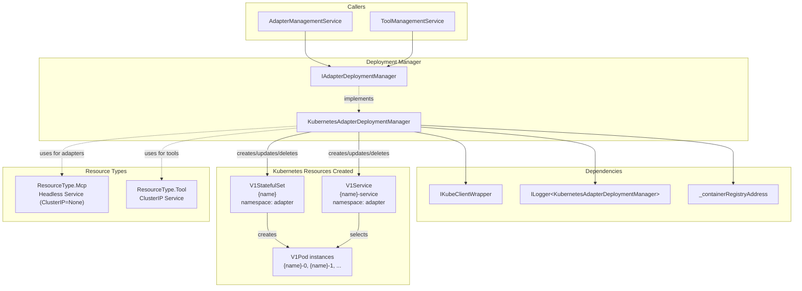
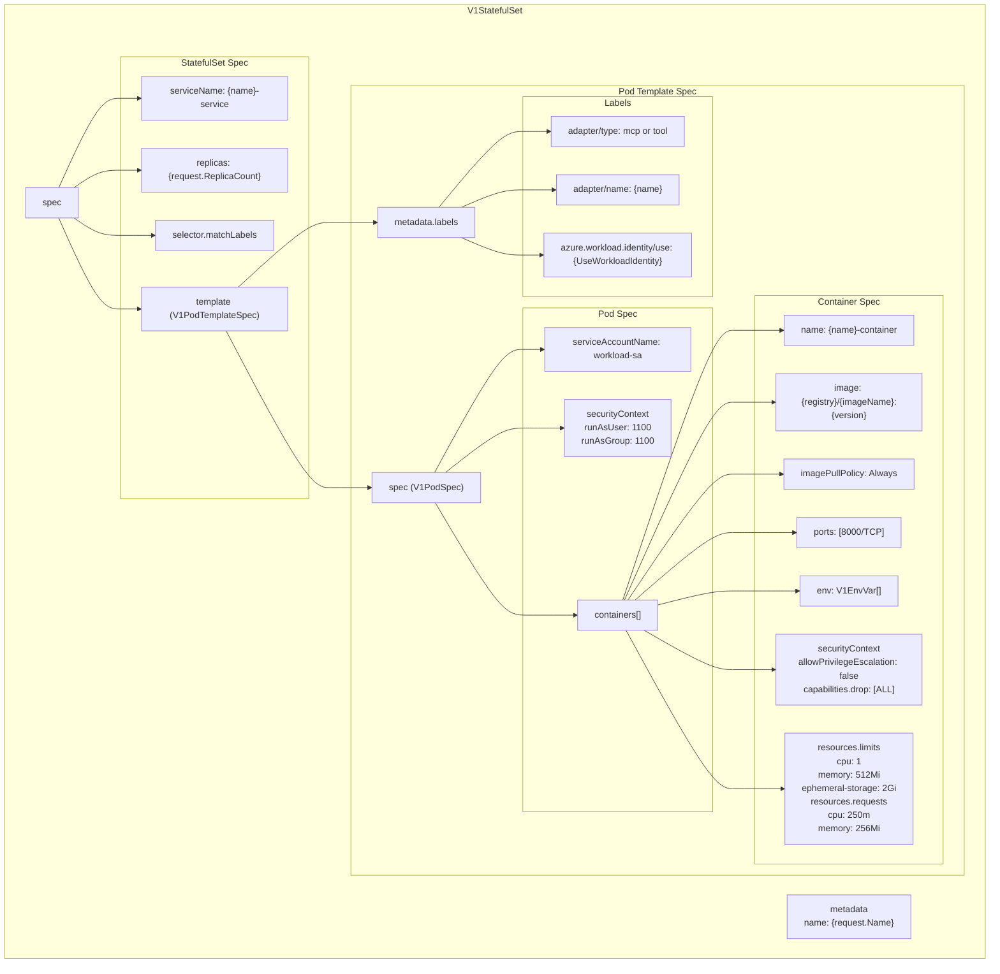
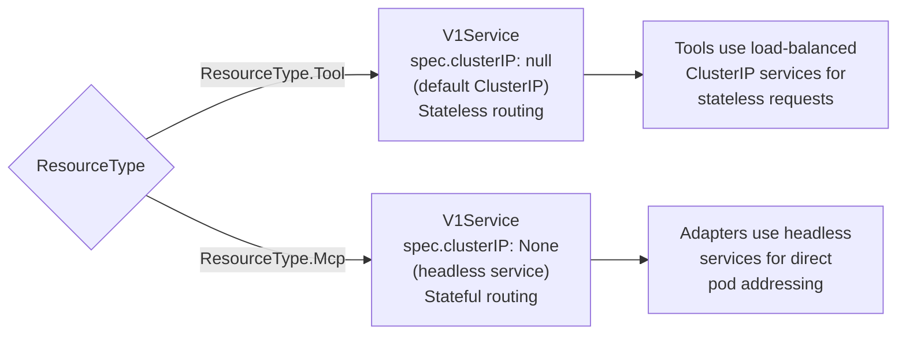
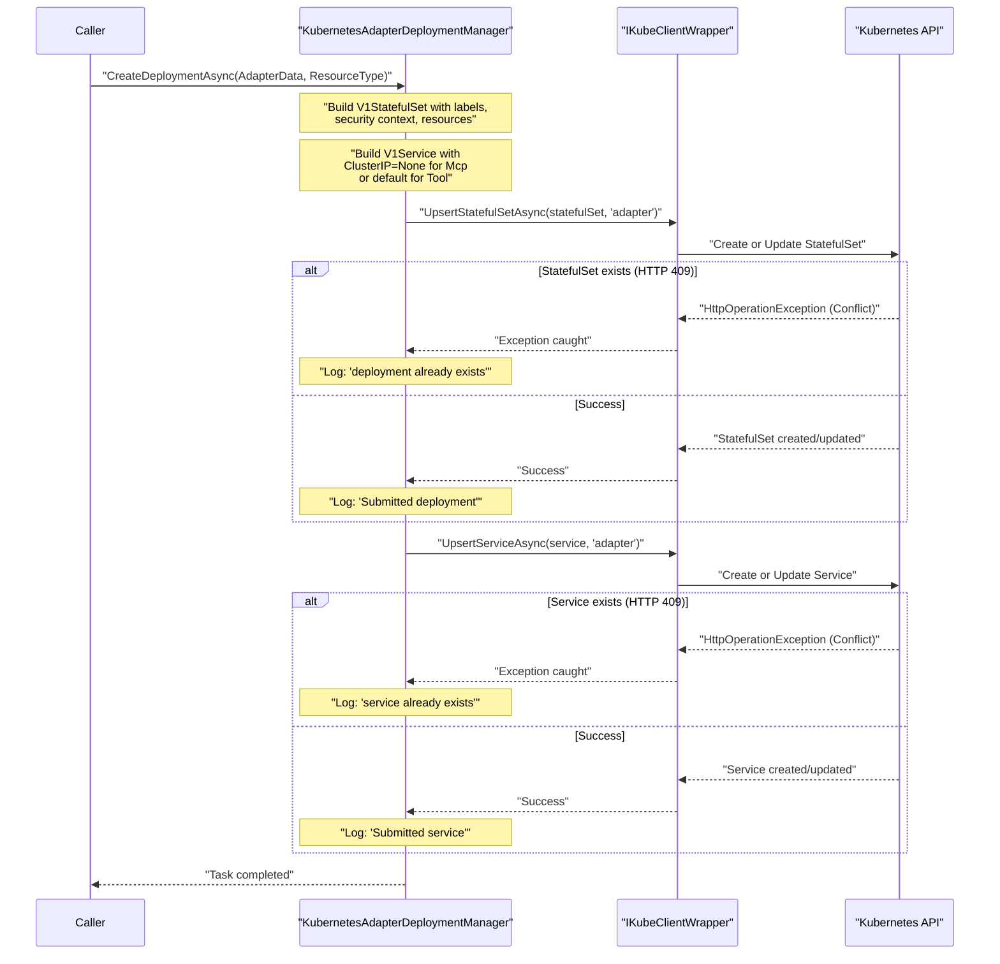
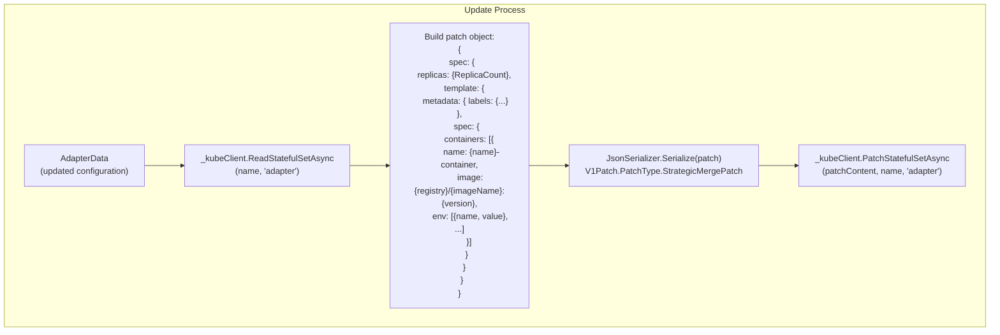
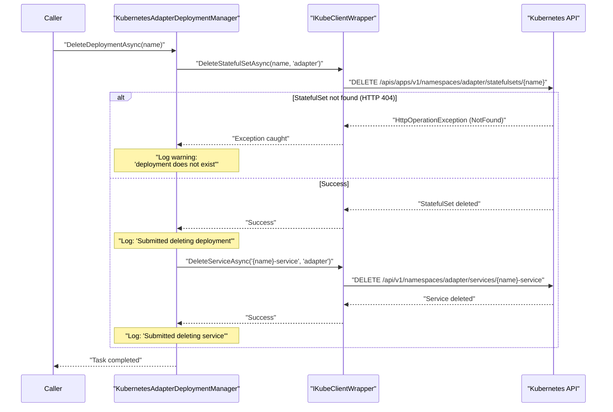
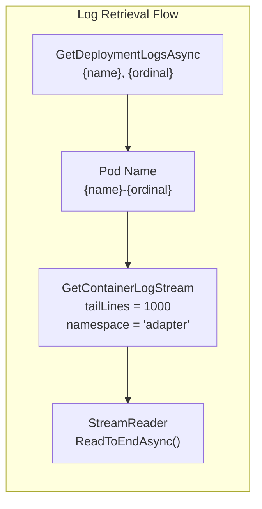

<!-- source: DeepWiki mcp.deepwiki.com · repo microsoft/mcp-gateway · page 4.4 Kubernetes Deployment Manager · fetched 2026-10-26 -->

# Kubernetes Deployment Manager

Relevant source files

The following files were used as context for generating this wiki page:

- [dotnet/Directory.Packages.props](dotnet/Directory.Packages.props)
- [dotnet/Microsoft.McpGateway.Management/src/Deployment/IAdapterDeploymentManager.cs](dotnet/Microsoft.McpGateway.Management/src/Deployment/IAdapterDeploymentManager.cs)
- [dotnet/Microsoft.McpGateway.Management/src/Deployment/KubernetesAdapterDeploymentManager.cs](dotnet/Microsoft.McpGateway.Management/src/Deployment/KubernetesAdapterDeploymentManager.cs)
- [dotnet/Microsoft.McpGateway.Management/src/Store/IAdapterResourceStore.cs](dotnet/Microsoft.McpGateway.Management/src/Store/IAdapterResourceStore.cs)
- [dotnet/Microsoft.McpGateway.Management/src/Store/InMemoryAdapterResourceStore.cs](dotnet/Microsoft.McpGateway.Management/src/Store/InMemoryAdapterResourceStore.cs)
- [dotnet/Microsoft.McpGateway.Management/test/KubernetesAdapterDeploymentManagerTests.cs](dotnet/Microsoft.McpGateway.Management/test/KubernetesAdapterDeploymentManagerTests.cs)

## Purpose and Scope

The `KubernetesAdapterDeploymentManager` implements the `IAdapterDeploymentManager` interface to manage the lifecycle of MCP server adapters and tools in Kubernetes. It creates and manages StatefulSets and Services in the `adapter` namespace, handling both MCP adapters (with stateful routing via headless services) and tools (with stateless routing via ClusterIP services).

This component translates adapter/tool deployment requests into Kubernetes resources with appropriate security contexts, resource limits, and networking configurations. For information about the higher-level orchestration that calls this manager, see page 4.2 (Adapter Management Service) and page 4.3 (Tool Management Service). For details about the Kubernetes client wrapper, see page 4.7 (Kubernetes Integration).

## Architecture and Components

**Title: KubernetesAdapterDeploymentManager Component Architecture**

**Sources:** [dotnet/Microsoft.McpGateway.Management/src/Deployment/IAdapterDeploymentManager.cs:1-53](), [dotnet/Microsoft.McpGateway.Management/src/Deployment/KubernetesAdapterDeploymentManager.cs:14-28]()

### Class Structure

The `KubernetesAdapterDeploymentManager` class is defined with the following structure:

| Component | Type | Purpose |
|-----------|------|---------|
| `AdapterNamespace` | `const string` | Fixed namespace "adapter" for all resources |
| `_kubeClient` | `IKubeClientWrapper` | Kubernetes API client wrapper |
| `_containerRegistryAddress` | `string` | Base URL for container image registry |
| `_logger` | `ILogger<KubernetesAdapterDeploymentManager>` | Structured logging |

**Sources:** [dotnet/Microsoft.McpGateway.Management/src/Deployment/KubernetesAdapterDeploymentManager.cs:14-28]()

## IAdapterDeploymentManager Interface

The `IAdapterDeploymentManager` interface defines the contract for deployment lifecycle management. The `KubernetesAdapterDeploymentManager` implements this interface to provide Kubernetes-specific functionality.

| Method | Parameters | Returns | Description |
|--------|------------|---------|-------------|
| `CreateDeploymentAsync` | `AdapterData request` `ResourceType resourceType` `CancellationToken` | `Task` | Creates StatefulSet and Service |
| `UpdateDeploymentAsync` | `AdapterData request` `ResourceType resourceType` `CancellationToken` | `Task` | Patches StatefulSet with new configuration |
| `DeleteDeploymentAsync` | `string name` `CancellationToken` | `Task` | Deletes StatefulSet and Service |
| `GetDeploymentStatusAsync` | `string name` `CancellationToken` | `Task<AdapterStatus>` | Queries StatefulSet status |
| `GetDeploymentLogsAsync` | `string name` `int ordinal` `CancellationToken` | `Task<string>` | Retrieves pod logs by ordinal |

The `ResourceType` enum distinguishes between `Mcp` (adapters with headless services) and `Tool` (tools with ClusterIP services), affecting the service type created.

**Sources:** [dotnet/Microsoft.McpGateway.Management/src/Deployment/IAdapterDeploymentManager.cs:8-52]()

## Resource Creation and Configuration

### StatefulSet Creation

The `CreateDeploymentAsync` method constructs a `V1StatefulSet` with comprehensive configuration including security contexts, resource limits, and pod specifications.

**Title: StatefulSet Resource Structure**

**Sources:** [dotnet/Microsoft.McpGateway.Management/src/Deployment/KubernetesAdapterDeploymentManager.cs:39-98]()

### Label Configuration

The StatefulSet and Service use specific labels for identification and workload identity:

| Label Key | Value | Purpose |
|-----------|-------|---------|
| `adapter/type` | `"mcp"` or `"tool"` | Distinguishes resource type based on `ResourceType` enum |
| `adapter/name` | `{request.Name}` | Resource identifier |
| `azure.workload.identity/use` | `"true"` or `"false"` | Controls Azure Workload Identity enablement |

**Sources:** [dotnet/Microsoft.McpGateway.Management/src/Deployment/KubernetesAdapterDeploymentManager.cs:32-37]()

### Security Context Configuration

The deployment manager enforces security best practices through pod and container security contexts:

**Pod Security Context:**
- `runAsUser: 1100`
- `runAsGroup: 1100`

**Container Security Context:**
- `allowPrivilegeEscalation: false`
- `capabilities.drop: ["ALL"]`

**Sources:** [dotnet/Microsoft.McpGateway.Management/src/Deployment/KubernetesAdapterDeploymentManager.cs:53-78]()

### Resource Limits and Requests

Each container has defined resource limits and requests:

| Resource Type | Limit | Request |
|---------------|-------|---------|
| CPU | 1 core | 250m (0.25 core) |
| Memory | 512Mi | 256Mi |
| Ephemeral Storage | 2Gi | _(none)_ |

**Sources:** [dotnet/Microsoft.McpGateway.Management/src/Deployment/KubernetesAdapterDeploymentManager.cs:79-92]()

### Service Creation

Services are created with different types based on the `ResourceType`:

**Title: Service Type Selection**

**Sources:** [dotnet/Microsoft.McpGateway.Management/src/Deployment/KubernetesAdapterDeploymentManager.cs:100-122]()

The service configuration:
- **Name**: `{name}-service`
- **Namespace**: `adapter`
- **Port**: `8000/TCP`
- **Target Port**: `8000`
- **Selector**: Matches StatefulSet pod labels

**Sources:** [dotnet/Microsoft.McpGateway.Management/src/Deployment/KubernetesAdapterDeploymentManager.cs:102-122]()

## Deployment Lifecycle Operations

### Create Deployment Flow

The `CreateDeploymentAsync` method orchestrates resource creation with conflict handling for idempotency.

**Title: CreateDeploymentAsync Sequence**

**Sources:** [dotnet/Microsoft.McpGateway.Management/src/Deployment/KubernetesAdapterDeploymentManager.cs:30-144]()

### Update Deployment Flow

The `UpdateDeploymentAsync` method uses Kubernetes strategic merge patch to update the StatefulSet configuration.

**Title: UpdateDeploymentAsync Patch Structure**

The patch updates:
- `spec.replicas` - New replica count
- `spec.template.metadata.labels` - Updated labels including resource type
- `spec.template.spec.containers[0].image` - New container image
- `spec.template.spec.containers[0].env` - New environment variables

**Sources:** [dotnet/Microsoft.McpGateway.Management/src/Deployment/KubernetesAdapterDeploymentManager.cs:146-186]()

### Delete Deployment Flow

The `DeleteDeploymentAsync` method removes both StatefulSet and Service resources.

**Title: DeleteDeploymentAsync Sequence**

**Sources:** [dotnet/Microsoft.McpGateway.Management/src/Deployment/KubernetesAdapterDeploymentManager.cs:188-202]()

## Status and Logging

### Deployment Status

The `GetDeploymentStatusAsync` method returns an `AdapterStatus` with replica health information:

| Status Field | Source | Description |
|--------------|--------|-------------|
| `ReadyReplicas` | `statefulSet.Status.ReadyReplicas` | Number of ready replicas |
| `UpdatedReplicas` | `statefulSet.Status.UpdatedReplicas` | Number of updated replicas |
| `AvailableReplicas` | `statefulSet.Status.AvailableReplicas` | Number of available replicas |
| `Image` | `statefulSet.Spec.Template.Spec.Containers[0].Image` | Current container image |
| `ReplicaStatus` | Computed | "Healthy" or "Degraded: {ready}/{total} ready" |

**Sources:** [dotnet/Microsoft.McpGateway.Management/src/Deployment/KubernetesAdapterDeploymentManager.cs:166-183]()

### Log Retrieval

The `GetDeploymentLogsAsync` method retrieves container logs from specific StatefulSet pods using the naming convention `{adapterName}-{ordinal}`:

**Sources:** [dotnet/Microsoft.McpGateway.Management/src/Deployment/KubernetesAdapterDeploymentManager.cs:185-192]()

---

