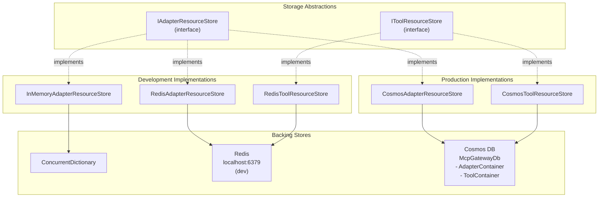
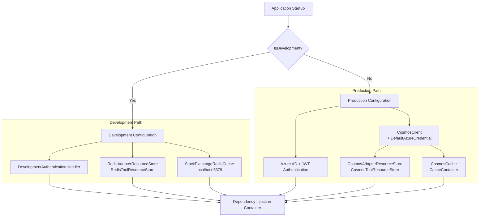
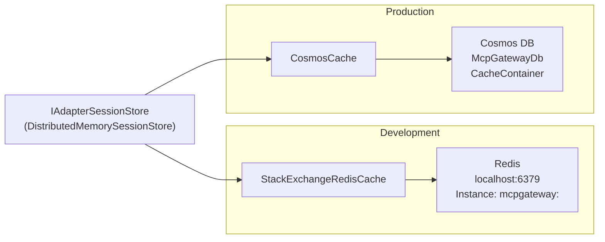
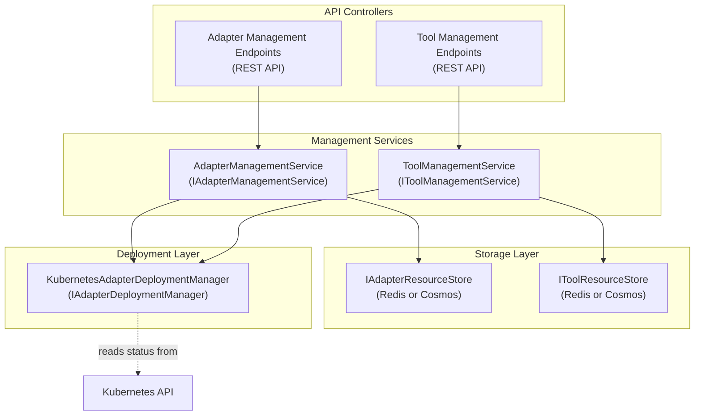

<!-- source: DeepWiki mcp.deepwiki.com · repo microsoft/mcp-gateway · page 4.5 Storage Layer · fetched 2026-10-26 -->

# Storage Layer

<details>
<summary>Relevant source files</summary>

The following files were used as context for generating this wiki page:

- [dotnet/Directory.Packages.props](dotnet/Directory.Packages.props)
- [dotnet/Microsoft.McpGateway.Management/src/Deployment/IAdapterDeploymentManager.cs](dotnet/Microsoft.McpGateway.Management/src/Deployment/IAdapterDeploymentManager.cs)
- [dotnet/Microsoft.McpGateway.Management/src/Store/IAdapterResourceStore.cs](dotnet/Microsoft.McpGateway.Management/src/Store/IAdapterResourceStore.cs)
- [dotnet/Microsoft.McpGateway.Management/src/Store/InMemoryAdapterResourceStore.cs](dotnet/Microsoft.McpGateway.Management/src/Store/InMemoryAdapterResourceStore.cs)
- [dotnet/Microsoft.McpGateway.Management/test/KubernetesAdapterDeploymentManagerTests.cs](dotnet/Microsoft.McpGateway.Management/test/KubernetesAdapterDeploymentManagerTests.cs)
- [dotnet/Microsoft.McpGateway.Service/src/McpSubPathAwareAuthenticationHandler.cs](dotnet/Microsoft.McpGateway.Service/src/McpSubPathAwareAuthenticationHandler.cs)
- [dotnet/Microsoft.McpGateway.Service/src/Program.cs](dotnet/Microsoft.McpGateway.Service/src/Program.cs)

</details>


## Purpose and Scope

The Storage Layer provides abstractions and implementations for persisting adapter and tool metadata in the MCP Gateway. This layer defines storage contracts through interfaces and provides multiple implementations optimized for different deployment environments: Redis for development and Cosmos DB for production.

For information about how stored resources are deployed to Kubernetes, see [Kubernetes Deployment Manager](#4.4). For details on the management APIs that consume this storage layer, see [Adapter Management Service](#4.2) and [Tool Management Service](#4.3).

## Storage Abstractions

The Storage Layer defines two primary interface contracts that abstract resource persistence operations:

### IAdapterResourceStore

The `IAdapterResourceStore` interface defines the contract for storing and retrieving adapter resource metadata.

**Interface Contract:**

| Method | Purpose | Returns |
|--------|---------|---------|
| `TryGetAsync(string name, CancellationToken)` | Retrieves an adapter by name | `AdapterResource?` (null if not found) |
| `UpsertAsync(AdapterResource adapter, CancellationToken)` | Creates or updates an adapter | `Task` |
| `DeleteAsync(string name, CancellationToken)` | Removes an adapter by name | `Task` |
| `ListAsync(CancellationToken)` | Lists all adapters | `IEnumerable<AdapterResource>` |

The interface supports standard CRUD operations with asynchronous execution and cancellation support. All operations are keyed by the adapter name, which serves as the unique identifier.

**Sources:** [dotnet/Microsoft.McpGateway.Management/src/Store/IAdapterResourceStore.cs:1-42]()

### IToolResourceStore

The `IToolResourceStore` interface mirrors `IAdapterResourceStore` but operates on tool resources. It defines the same method signatures but works with `ToolResource` objects instead of `AdapterResource` objects.

**Common Patterns:**

Both storage interfaces follow these design principles:
- **Async-first**: All operations return `Task` or `Task<T>` for non-blocking I/O
- **Cancellation support**: All methods accept `CancellationToken` for cooperative cancellation
- **Nullable return types**: Read operations return nullable types to indicate "not found" scenarios
- **Upsert semantics**: Update operations follow create-or-replace semantics rather than requiring separate create/update methods

## Storage Implementations

### Storage Implementation Architecture



**Sources:** [dotnet/Microsoft.McpGateway.Service/src/Program.cs:32-105](), [dotnet/Microsoft.McpGateway.Management/src/Store/InMemoryAdapterResourceStore.cs:1-37]()

### InMemoryAdapterResourceStore

The in-memory implementation uses a `ConcurrentDictionary<string, AdapterResource>` to store adapter metadata in process memory. This implementation is primarily used for testing scenarios.

**Key characteristics:**
- Thread-safe operations via `ConcurrentDictionary`
- No persistence across process restarts
- Zero external dependencies
- Synchronous operations wrapped in `Task` for interface compatibility

**Implementation details:**
```
TryGetAsync: Calls ConcurrentDictionary.TryGetValue
UpsertAsync: Uses dictionary indexer for insert/update
DeleteAsync: Calls ConcurrentDictionary.TryRemove
ListAsync: Returns all dictionary values
```

**Sources:** [dotnet/Microsoft.McpGateway.Management/src/Store/InMemoryAdapterResourceStore.cs:9-36]()

### RedisAdapterResourceStore and RedisToolResourceStore

Redis implementations provide persistent storage for development environments using a Redis cache server. These stores serialize resources to JSON and use Redis key-value operations for storage.

**Configuration (Development):**
- Connection string: `localhost:6379` (configurable via `Redis:ConnectionString`)
- Instance name prefix: `mcpgateway:`
- All keys are prefixed with the instance name

**Sources:** [dotnet/Microsoft.McpGateway.Service/src/Program.cs:38-46]()

### CosmosAdapterResourceStore and CosmosToolResourceStore

Cosmos DB implementations provide production-grade persistent storage with global distribution, automatic indexing, and high availability.

**Database Structure:**

| Component | Purpose |
|-----------|---------|
| Database | `McpGatewayDb` (configured via `CosmosSettings:DatabaseName`) |
| AdapterContainer | Stores `AdapterResource` documents |
| ToolContainer | Stores `ToolResource` documents |
| CacheContainer | Stores distributed cache entries (see Caching Layer) |

**Authentication:**
- Uses `DefaultAzureCredential` for credential-based authentication
- Supports Managed Identity and Workload Identity in Azure
- No connection strings or secrets in configuration

**Serialization:**
- Uses `CosmosSystemTextJsonSerializer` with System.Text.Json
- Configured to ignore null values during serialization
- JSON serializer options: `JsonIgnoreCondition.WhenWritingNull`

**Sources:** [dotnet/Microsoft.McpGateway.Service/src/Program.cs:73-96]()

## Environment-Specific Configuration

### Configuration Flow



**Sources:** [dotnet/Microsoft.McpGateway.Service/src/Program.cs:32-105]()

### Development Environment Setup

In development mode (`IsDevelopment()` returns true), the system configures:

**Storage:**
```csharp
// Registered as singletons
IAdapterResourceStore -> RedisAdapterResourceStore
IToolResourceStore -> RedisToolResourceStore
```

**Redis Cache Configuration:**
```csharp
Configuration: "localhost:6379" (from Redis:ConnectionString)
InstanceName: "mcpgateway:"
```

**Logging:**
- Console logging enabled
- Minimum level: Debug

**Sources:** [dotnet/Microsoft.McpGateway.Service/src/Program.cs:32-50]()

### Production Environment Setup

In production mode, the system configures:

**Cosmos DB Client Creation:**
```csharp
endpoint: CosmosSettings:AccountEndpoint (from configuration)
credential: DefaultAzureCredential
serializer: CosmosSystemTextJsonSerializer with null-ignoring options
```

**Storage Registration:**
```csharp
IAdapterResourceStore -> CosmosAdapterResourceStore
  - Database: CosmosSettings:DatabaseName
  - Container: "AdapterContainer"

IToolResourceStore -> CosmosToolResourceStore
  - Database: CosmosSettings:DatabaseName
  - Container: "ToolContainer"
```

**Authentication:**
- Azure AD with JWT Bearer tokens
- MCP protocol authentication handler

**Sources:** [dotnet/Microsoft.McpGateway.Service/src/Program.cs:52-105]()

## Caching Layer

The Storage Layer includes a distributed caching layer used for session management and temporary data storage. This cache is separate from the resource stores but uses the same backing infrastructure.

### Cache Configuration by Environment



**Sources:** [dotnet/Microsoft.McpGateway.Service/src/Program.cs:38-104]()

### Development Cache (StackExchangeRedisCache)

**Configuration:**
```
Type: Microsoft.Extensions.Caching.StackExchangeRedis
Connection: localhost:6379 (configurable)
Instance Name: "mcpgateway:"
Usage: Session storage, temporary data
```

All cache keys are automatically prefixed with the instance name to avoid collisions with other applications using the same Redis instance.

**Sources:** [dotnet/Microsoft.McpGateway.Service/src/Program.cs:39-43](), [dotnet/Directory.Packages.props:11]()

### Production Cache (CosmosCache)

**Configuration:**
```
Type: Microsoft.Extensions.Caching.Cosmos
Database: CosmosSettings:DatabaseName
Container: "CacheContainer"
CreateIfNotExists: true
Authentication: DefaultAzureCredential via CosmosClientBuilder
```

The Cosmos cache implementation provides:
- Automatic container creation if it doesn't exist
- TTL-based expiration for cache entries
- Consistent authentication with resource stores
- Integration with Azure's global distribution

**Sources:** [dotnet/Microsoft.McpGateway.Service/src/Program.cs:98-104](), [dotnet/Directory.Packages.props:10]()

## Integration with Management Services

### Service Dependency Graph



**Sources:** [dotnet/Microsoft.McpGateway.Service/src/Program.cs:107-119]()

### Storage Layer Responsibilities

The Storage Layer is responsible for:

1. **Metadata Persistence**: Storing adapter and tool configuration, including:
   - Container image names and versions
   - Environment variables
   - Replica counts
   - Creator information
   - Required roles for access control

2. **Resource Retrieval**: Providing fast lookup of resources by name for:
   - Authorization checks (via `SimplePermissionProvider`)
   - Status queries
   - Routing decisions
   - Management operations

3. **State Consistency**: Ensuring stored metadata remains synchronized with Kubernetes deployments through:
   - Atomic upsert operations
   - Transactional semantics (where supported by backing store)
   - Idempotent operations

4. **Cross-Environment Portability**: Abstracting storage implementation details so that:
   - The same business logic works in development and production
   - Tests can use in-memory implementations
   - Production can scale independently of application logic

### Transaction Patterns

Storage operations follow these patterns when integrated with management services:

**Create Flow:**
```
1. Validate request (AdapterManagementService)
2. UpsertAsync to storage (persist metadata)
3. CreateDeploymentAsync to Kubernetes (deploy workload)
4. Return success/failure
```

**Update Flow:**
```
1. TryGetAsync from storage (check existence)
2. Validate permissions
3. UpsertAsync to storage (update metadata)
4. UpdateDeploymentAsync to Kubernetes (update workload)
```

**Delete Flow:**
```
1. DeleteDeploymentAsync from Kubernetes (remove workload)
2. DeleteAsync from storage (remove metadata)
```

The storage layer does not enforce ordering constraints or transactions across storage and Kubernetes operations. Management services are responsible for handling partial failure scenarios.

**Sources:** [dotnet/Microsoft.McpGateway.Management/src/Deployment/IAdapterDeploymentManager.cs:1-53]()

## Storage Data Model

### AdapterResource Structure

The `AdapterResource` type represents the persisted metadata for an adapter:

**Key Properties:**
- `Name`: Unique identifier (primary key)
- `ImageName`: Container image name (without registry prefix)
- `ImageVersion`: Container image tag
- `ReplicaCount`: Number of pod replicas
- `EnvironmentVariables`: Key-value pairs for container environment
- `Creator`: User ID of the resource creator
- `RequiredRoles`: Application roles required for access
- `UseWorkloadIdentity`: Boolean flag for Azure Workload Identity integration

This structure is serialized to JSON for storage in both Redis and Cosmos DB implementations. The same data model is used across all storage implementations to ensure portability.

**Sources:** [dotnet/Microsoft.McpGateway.Management/test/KubernetesAdapterDeploymentManagerTests.cs:32-39]()

### ToolResource Structure

The `ToolResource` type follows a similar structure to `AdapterResource` but includes additional tool-specific metadata:

- Tool definition schema
- HTTP endpoint configuration
- Tool-specific labels for Kubernetes resources

Tool resources are stored in separate containers/key spaces from adapter resources to allow independent scaling and management.

## Package Dependencies

The Storage Layer relies on the following NuGet packages:

| Package | Version | Purpose |
|---------|---------|---------|
| `Microsoft.Azure.Cosmos` | 3.51.0 | Cosmos DB client SDK |
| `Microsoft.Extensions.Caching.Cosmos` | 1.7.0 | Cosmos-backed distributed cache |
| `Microsoft.Extensions.Caching.StackExchangeRedis` | 9.0.10 | Redis-backed distributed cache |

**Sources:** [dotnet/Directory.Packages.props:9-11]()

---

