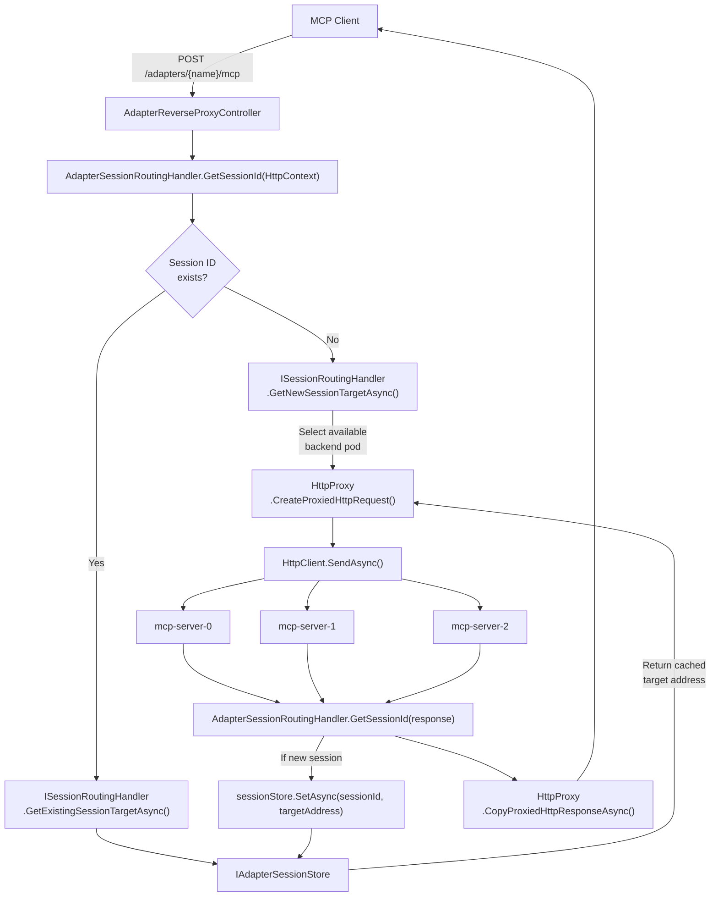
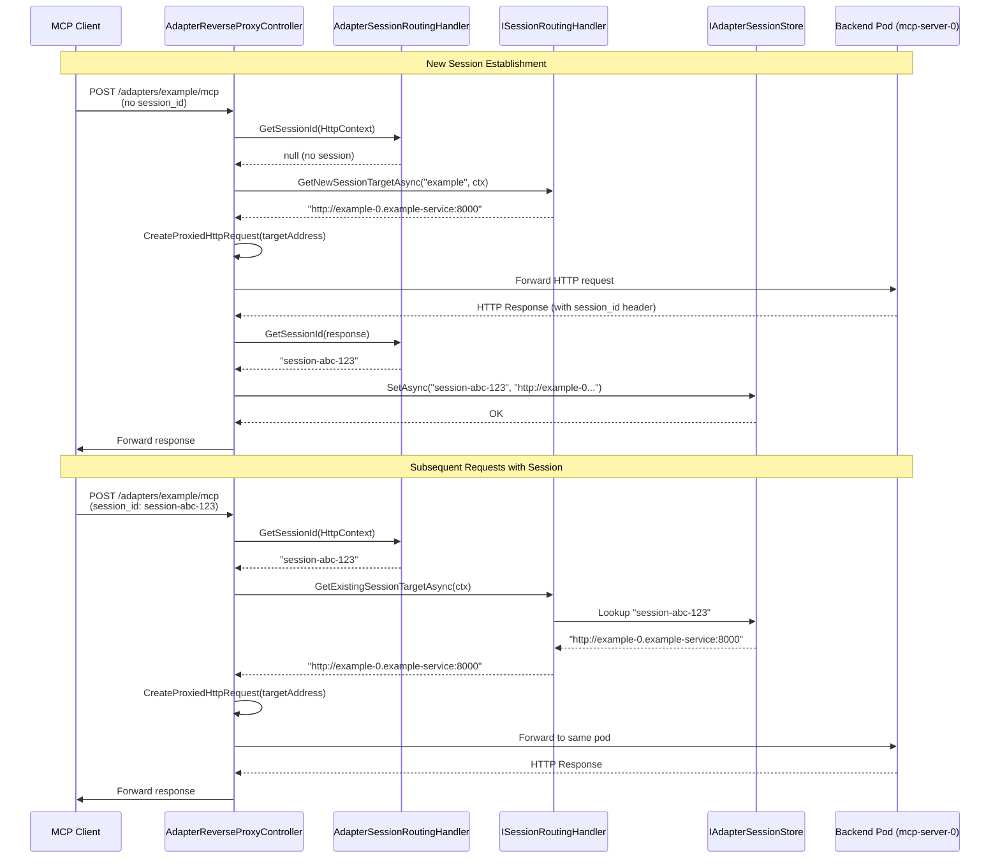
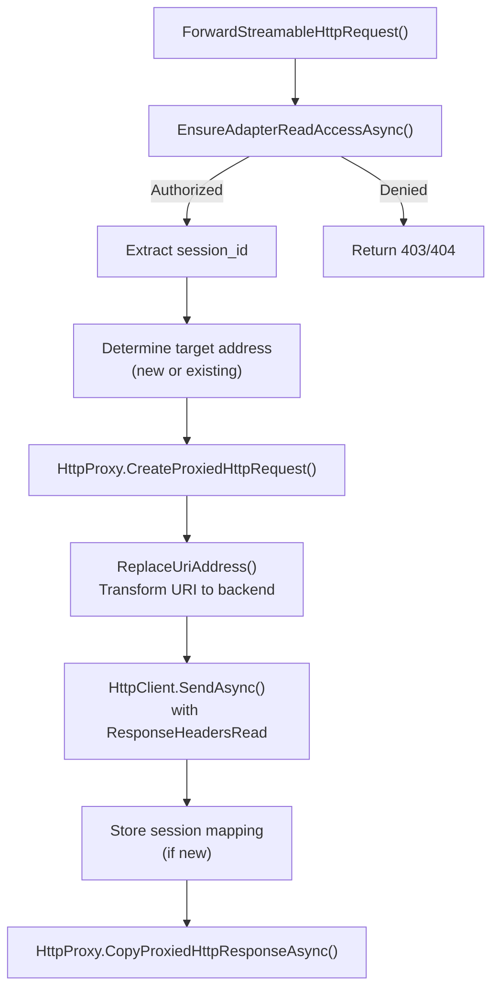

<!-- source: DeepWiki mcp.deepwiki.com · repo microsoft/mcp-gateway · page 4.6 Session Management and Routing · fetched 2026-10-26 -->

# Session Management and Routing

<details>
<summary>Relevant source files</summary>

The following files were used as context for generating this wiki page:

- [README.md](README.md)
- [dotnet/Microsoft.McpGateway.Service/src/Controllers/AdapterReverseProxyController.cs](dotnet/Microsoft.McpGateway.Service/src/Controllers/AdapterReverseProxyController.cs)

</details>


## Purpose and Scope

This document describes the session management and routing system that enables stateful MCP connections through the gateway. Session management ensures that all requests with the same `session_id` are consistently routed to the same backend MCP server or tool gateway router instance, maintaining conversation context and state.

This page focuses on the session lifecycle, routing mechanisms, and storage abstractions. For information about the overall data plane architecture, see [Data Plane](#2.2). For details about the reverse proxy implementation and HTTP forwarding, see [Gateway Service](#4.1). For storage implementations, see [Storage Layer](#4.5).

Sources: [README.md:1-617](), [dotnet/Microsoft.McpGateway.Service/src/Controllers/AdapterReverseProxyController.cs:1-116]()

---

## Overview

The MCP Gateway implements **session-aware stateful routing** to maintain persistent connections between clients and backend MCP servers. When a client establishes a connection, the gateway assigns that session to a specific backend pod. All subsequent requests with the same session identifier are routed to that same pod, preserving conversation state.

### Key Components

| Component | Interface/Class | Purpose |
|-----------|----------------|---------|
| Session Store | `IAdapterSessionStore` | Persists session-to-target mappings |
| Routing Handler | `ISessionRoutingHandler` | Implements routing logic for new and existing sessions |
| Reverse Proxy Controller | `AdapterReverseProxyController` | HTTP controller that orchestrates session routing and request forwarding |
| Session ID Extractor | `AdapterSessionRoutingHandler` | Extracts session IDs from HTTP requests and responses |

Sources: [dotnet/Microsoft.McpGateway.Service/src/Controllers/AdapterReverseProxyController.cs:14-28]()

---

## Session Routing Architecture



**Session Routing Flow**

This diagram shows how the gateway routes requests based on session state. New sessions are assigned to available backends, while existing sessions are routed to their previously assigned pod.

Sources: [dotnet/Microsoft.McpGateway.Service/src/Controllers/AdapterReverseProxyController.cs:35-66]()

---

## Session Lifecycle



**Session Lifecycle Sequence**

This sequence diagram illustrates the two phases of session management: initial session establishment and subsequent session-based routing.

Sources: [dotnet/Microsoft.McpGateway.Service/src/Controllers/AdapterReverseProxyController.cs:35-66]()

---

## Session Identification

The gateway extracts session identifiers from HTTP requests and responses using the `AdapterSessionRoutingHandler` class.

### Session ID Extraction from Requests

The session ID is extracted from incoming requests by examining HTTP headers or other request metadata. The specific implementation details are in the `AdapterSessionRoutingHandler.GetSessionId(HttpContext)` method.

```csharp
var sessionId = AdapterSessionRoutingHandler.GetSessionId(HttpContext);
```

[dotnet/Microsoft.McpGateway.Service/src/Controllers/AdapterReverseProxyController.cs:40]()

### Session ID Extraction from Responses

When a new session is established, the backend MCP server returns a session identifier in the response. The gateway extracts this to create the session-to-target mapping:

```csharp
sessionId = AdapterSessionRoutingHandler.GetSessionId(response);
if (!string.IsNullOrEmpty(sessionId))
    await sessionStore.SetAsync(sessionId, targetAddress, cancellationToken).ConfigureAwait(false);
```

[dotnet/Microsoft.McpGateway.Service/src/Controllers/AdapterReverseProxyController.cs:60-62]()

Sources: [dotnet/Microsoft.McpGateway.Service/src/Controllers/AdapterReverseProxyController.cs:40-62]()

---

## Routing Handler

The `ISessionRoutingHandler` interface provides methods for determining target addresses for both new and existing sessions.

### New Session Routing

For requests without a session ID, the routing handler selects an available backend pod:

```csharp
targetAddress = await sessionRoutingHandler.GetNewSessionTargetAsync(
    name ?? ToolGateway, 
    HttpContext, 
    cancellationToken
).ConfigureAwait(false);
```

The first parameter is the adapter name (e.g., `"mcp-example"`) or `"toolgateway"` for tool gateway router routing. The handler determines which pod to assign based on availability and load distribution.

[dotnet/Microsoft.McpGateway.Service/src/Controllers/AdapterReverseProxyController.cs:43]()

### Existing Session Routing

For requests with a session ID, the routing handler retrieves the previously assigned target from the session store:

```csharp
targetAddress = await sessionRoutingHandler.GetExistingSessionTargetAsync(
    HttpContext, 
    cancellationToken
).ConfigureAwait(false);
```

[dotnet/Microsoft.McpGateway.Service/src/Controllers/AdapterReverseProxyController.cs:45]()

### Service Unavailable Handling

If no target is available (either no healthy pods for new sessions, or session not found for existing sessions), the controller returns `503 Service Unavailable`:

```csharp
if (targetAddress == null)
{
    HttpContext.Response.StatusCode = StatusCodes.Status503ServiceUnavailable;
    return;
}
```

[dotnet/Microsoft.McpGateway.Service/src/Controllers/AdapterReverseProxyController.cs:47-51]()

Sources: [dotnet/Microsoft.McpGateway.Service/src/Controllers/AdapterReverseProxyController.cs:40-51]()

---

## Session Store

The `IAdapterSessionStore` interface provides session persistence, storing the mapping between session IDs and backend target addresses.

### Storage Operations

| Method | Purpose | Usage |
|--------|---------|-------|
| `SetAsync(sessionId, targetAddress, cancellationToken)` | Store session-to-target mapping | Called after extracting session ID from initial response |
| `GetAsync(sessionId, cancellationToken)` | Retrieve target for session | Called by `ISessionRoutingHandler.GetExistingSessionTargetAsync()` |

### Storage Implementations

The session store has multiple implementations depending on the deployment environment:

| Environment | Implementation | Backing Store |
|-------------|----------------|---------------|
| Development | Redis-based | Local Redis instance |
| Production | Cosmos DB-based | Azure Cosmos DB with distributed cache |

For detailed information about storage implementations, see [Storage Layer](#4.5).

Sources: [dotnet/Microsoft.McpGateway.Service/src/Controllers/AdapterReverseProxyController.cs:16,24,62](), [README.md:163-165]()

---

## Integration with Reverse Proxy

The `AdapterReverseProxyController` orchestrates session management while forwarding HTTP traffic.

### Request Forwarding Workflow



**Request Forwarding Workflow**

This diagram shows the complete flow of an HTTP request through the reverse proxy, including session management steps.

Sources: [dotnet/Microsoft.McpGateway.Service/src/Controllers/AdapterReverseProxyController.cs:35-66]()

### Controller Endpoints

The controller supports two routing patterns:

| Route | Purpose | Session Target |
|-------|---------|----------------|
| `POST /adapters/{name}/mcp` | Direct adapter access | Specific adapter pods (e.g., `mcp-example-0`) |
| `POST /mcp` | Tool gateway router | Tool gateway router pods (`toolgateway-0`, `toolgateway-1`) |

Both endpoints use the same session routing logic but route to different backend services:

```csharp
[HttpPost("mcp")]
[HttpPost("adapters/{name}/mcp")]
public async Task ForwardStreamableHttpRequest(string? name, CancellationToken cancellationToken)
{
    // When name is null (POST /mcp), routes to "toolgateway"
    targetAddress = await sessionRoutingHandler.GetNewSessionTargetAsync(
        name ?? ToolGateway, 
        HttpContext, 
        cancellationToken
    );
}
```

[dotnet/Microsoft.McpGateway.Service/src/Controllers/AdapterReverseProxyController.cs:33-43]()

Sources: [dotnet/Microsoft.McpGateway.Service/src/Controllers/AdapterReverseProxyController.cs:22,33-43]()

---

## URI Transformation

When forwarding requests to backend pods, the gateway transforms the incoming URI to remove the gateway-specific path segments.

### Transformation Logic

The `ReplaceUriAddress` method performs URI transformation:

1. **Extract base address**: Uses the target address from session routing (e.g., `http://example-0.example-service:8000`)
2. **Remove gateway segments**: Strips `/adapters/{name}` from the path
3. **Preserve remaining path**: Keeps `/mcp/...` and subsequent segments
4. **Handle special cases**: Adds trailing `/` for `/messages` endpoints

```csharp
private static Uri ReplaceUriAddress(Uri originalUri, string newAddress)
{
    var segments = originalUri.AbsolutePath.Split('/', StringSplitOptions.RemoveEmptyEntries);
    var newBaseUri = new Uri(newAddress, UriKind.Absolute);
    var path = '/' + string.Join('/', segments.Skip(2));
    
    if (path.EndsWith("/messages"))
        path += "/";
    
    var newUriBuilder = new UriBuilder(newBaseUri.Scheme, newBaseUri.Host, newBaseUri.Port)
    {
        Path = path,
        Query = originalUri.Query.TrimStart('?'),
        Fragment = originalUri.Fragment.TrimStart('#')
    };
    
    return newUriBuilder.Uri;
}
```

### Example Transformation

| Original URI (gateway) | Target Address | Transformed URI (backend) |
|------------------------|----------------|---------------------------|
| `http://gateway/adapters/example/mcp/messages` | `http://example-0:8000` | `http://example-0:8000/mcp/messages/` |
| `http://gateway/adapters/example/mcp/sse` | `http://example-0:8000` | `http://example-0:8000/mcp/sse` |
| `http://gateway/mcp/messages` | `http://toolgateway-0:8000` | `http://toolgateway-0:8000/mcp/messages/` |

[dotnet/Microsoft.McpGateway.Service/src/Controllers/AdapterReverseProxyController.cs:93-113]()

Sources: [dotnet/Microsoft.McpGateway.Service/src/Controllers/AdapterReverseProxyController.cs:53,93-113]()

---

## Authorization Integration

Session routing integrates with the authorization system to ensure users can only access adapters they have permission to use.

### Permission Check

Before routing requests, the controller verifies read access:

```csharp
private async Task<bool> EnsureAdapterReadAccessAsync(string? name, CancellationToken cancellationToken)
{
    if (string.IsNullOrWhiteSpace(name))
    {
        return true; // Tool gateway route, no specific adapter check
    }
    
    var adapter = await adapterResourceStore.TryGetAsync(name, cancellationToken);
    if (adapter == null)
    {
        HttpContext.Response.StatusCode = StatusCodes.Status404NotFound;
        return false;
    }
    
    if (!await permissionProvider.CheckAccessAsync(HttpContext.User, adapter, Operation.Read))
    {
        HttpContext.Response.StatusCode = StatusCodes.Status403Forbidden;
        return false;
    }
    
    return true;
}
```

### Response Codes

| Scenario | HTTP Status | Description |
|----------|-------------|-------------|
| Adapter not found | 404 Not Found | Requested adapter does not exist |
| Permission denied | 403 Forbidden | User lacks read access to adapter |
| No available backends | 503 Service Unavailable | All backend pods are unavailable |
| Success | 200 OK | Request successfully routed and proxied |

[dotnet/Microsoft.McpGateway.Service/src/Controllers/AdapterReverseProxyController.cs:68-91]()

For more details on authorization, see [Authorization and RBAC](#7.2).

Sources: [dotnet/Microsoft.McpGateway.Service/src/Controllers/AdapterReverseProxyController.cs:37-38,68-91]()

---

## HTTP Client Configuration

The reverse proxy uses a dedicated HTTP client for forwarding requests to backend pods:

```csharp
using var client = httpClientFactory.CreateClient(Constants.HttpClientNames.AdapterProxyClient);
var response = await client.SendAsync(
    proxiedRequest, 
    HttpCompletionOption.ResponseHeadersRead, 
    cancellationToken
);
```

Key configuration aspects:

- **Named HTTP client**: `Constants.HttpClientNames.AdapterProxyClient` enables centralized configuration
- **Response header read mode**: `HttpCompletionOption.ResponseHeadersRead` enables streaming responses without buffering the entire response body
- **Cancellation support**: Respects the request cancellation token for proper cleanup

[dotnet/Microsoft.McpGateway.Service/src/Controllers/AdapterReverseProxyController.cs:55-56]()

Sources: [dotnet/Microsoft.McpGateway.Service/src/Controllers/AdapterReverseProxyController.cs:23,55-56]()

---

## Session Management Benefits

The session management system provides several key benefits:

1. **State Preservation**: Maintains conversation context across multiple requests
2. **Efficient Routing**: Avoids state synchronization overhead between pods
3. **Scalability**: Supports multiple backend instances with session affinity
4. **Reliability**: Graceful handling of session not found and service unavailable scenarios
5. **Flexibility**: Same routing mechanism works for both adapters and tool gateway router

Sources: [README.md:1-29]()

---

