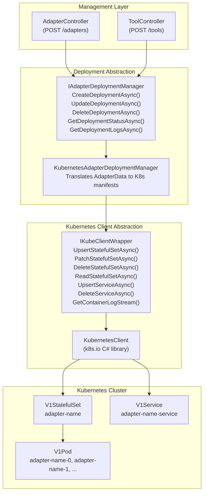
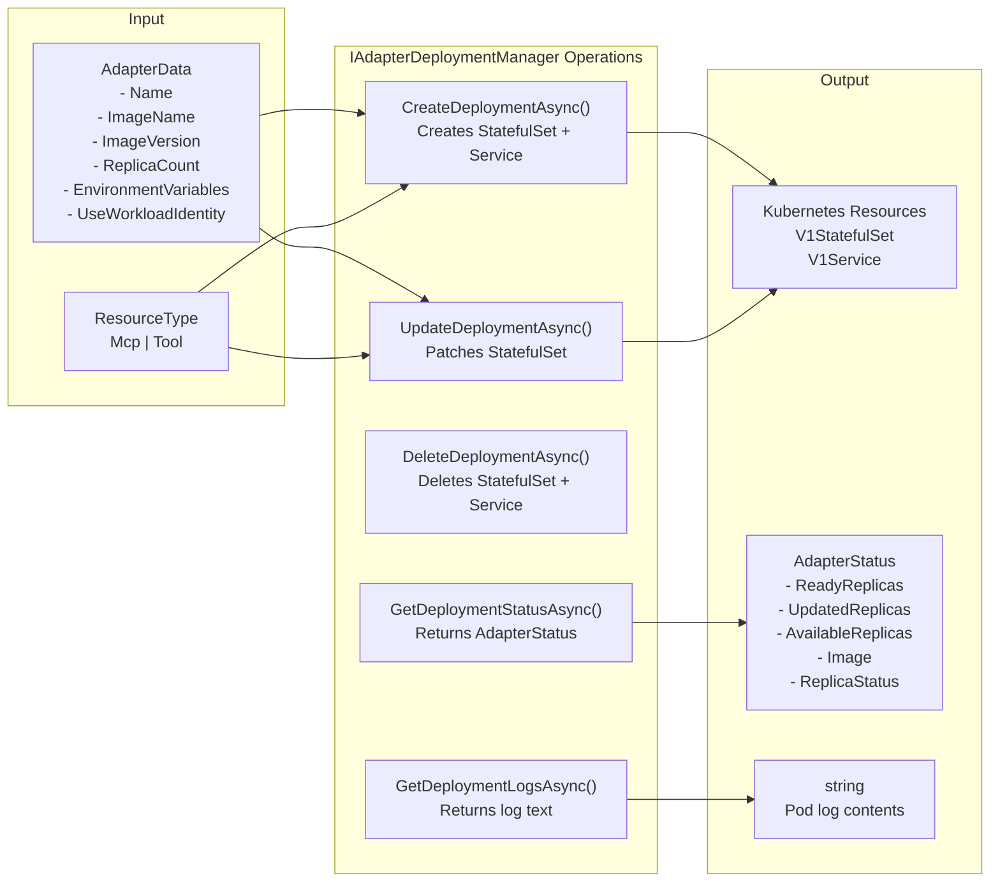
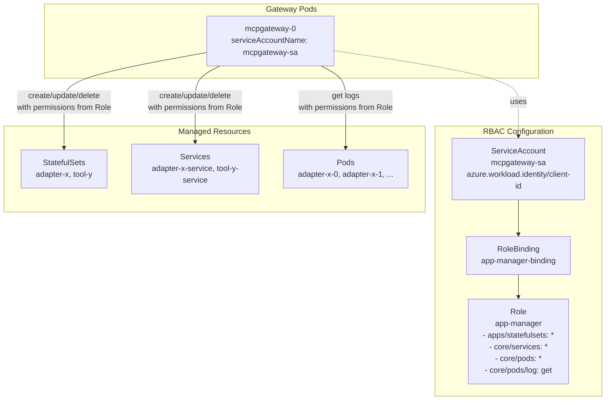
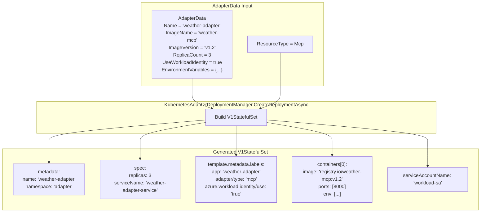
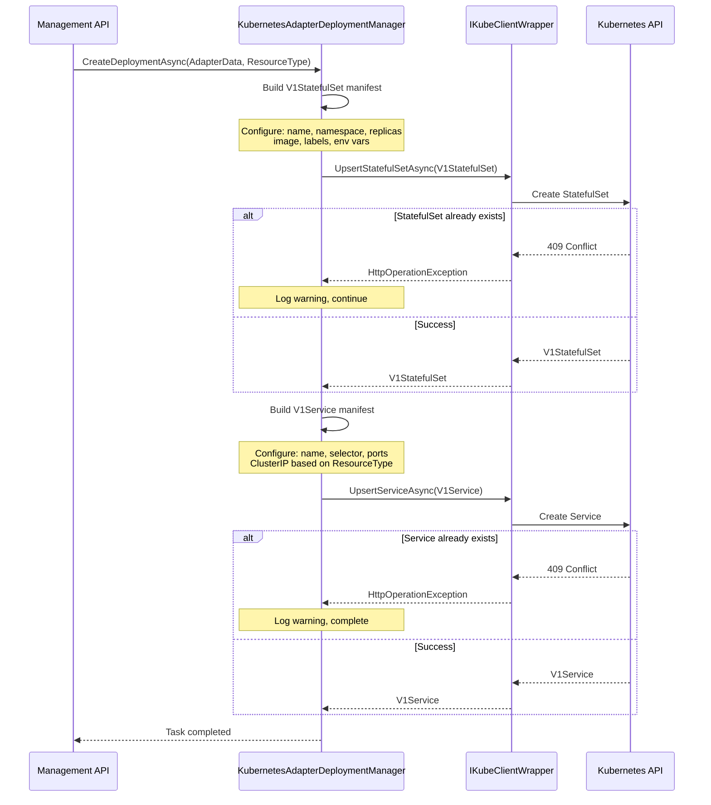
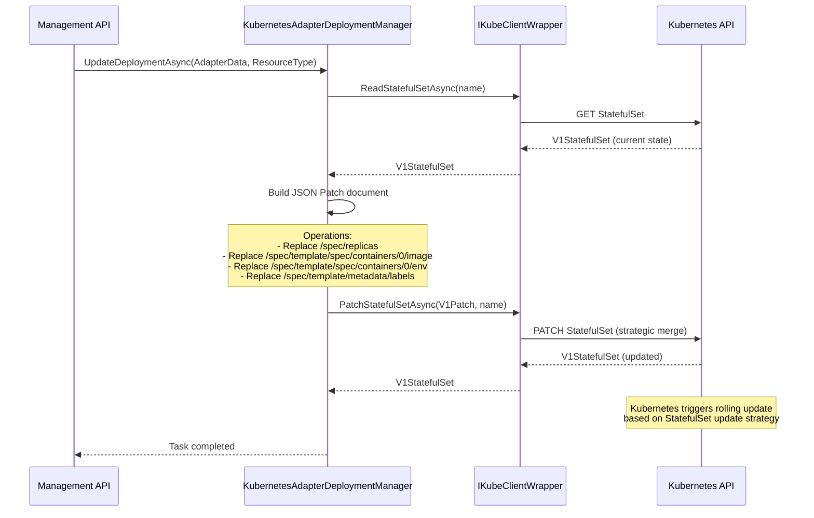
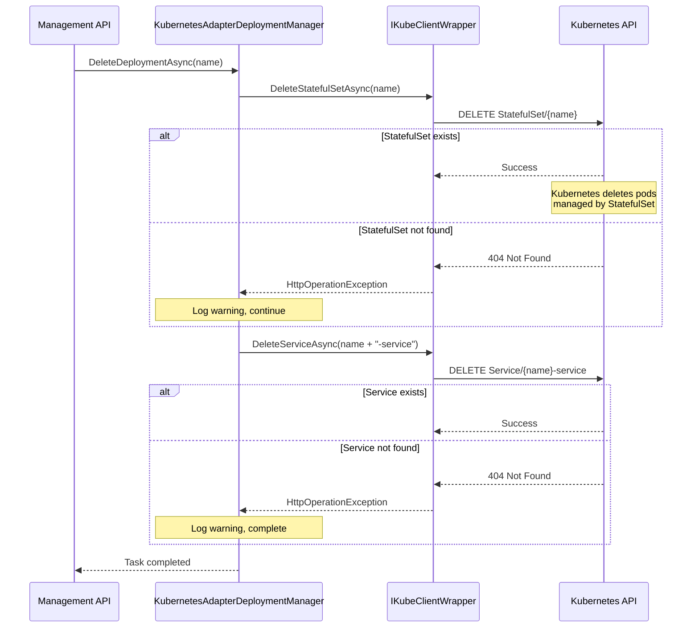
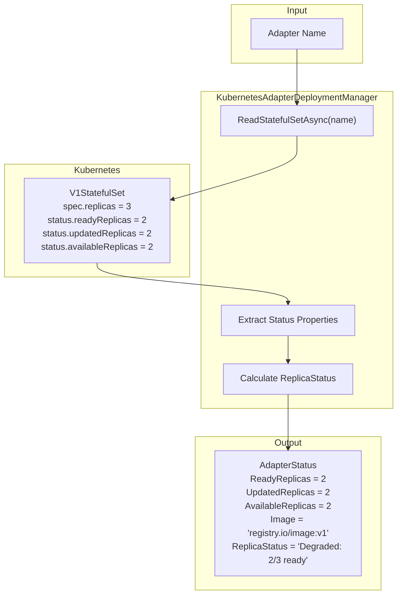
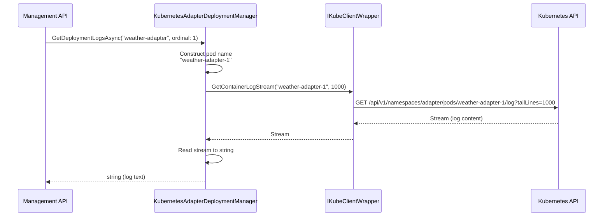

<!-- source: DeepWiki mcp.deepwiki.com · repo microsoft/mcp-gateway · page 4.7 Kubernetes Integration · fetched 2026-10-26 -->

# Kubernetes Integration

<details>
<summary>Relevant source files</summary>

The following files were used as context for generating this wiki page:

- [deployment/k8s/cloud-deployment-template.yml](deployment/k8s/cloud-deployment-template.yml)
- [dotnet/Directory.Packages.props](dotnet/Directory.Packages.props)
- [dotnet/Microsoft.McpGateway.Management/src/Deployment/IAdapterDeploymentManager.cs](dotnet/Microsoft.McpGateway.Management/src/Deployment/IAdapterDeploymentManager.cs)
- [dotnet/Microsoft.McpGateway.Management/src/Store/IAdapterResourceStore.cs](dotnet/Microsoft.McpGateway.Management/src/Store/IAdapterResourceStore.cs)
- [dotnet/Microsoft.McpGateway.Management/src/Store/InMemoryAdapterResourceStore.cs](dotnet/Microsoft.McpGateway.Management/src/Store/InMemoryAdapterResourceStore.cs)
- [dotnet/Microsoft.McpGateway.Management/test/KubernetesAdapterDeploymentManagerTests.cs](dotnet/Microsoft.McpGateway.Management/test/KubernetesAdapterDeploymentManagerTests.cs)

</details>


## Purpose and Scope

This document describes how the MCP Gateway integrates with the Kubernetes API to dynamically provision and manage workload resources. It covers the abstractions used to interact with Kubernetes, the resource topology created by the gateway, and the lifecycle operations for adapters and tools deployed as Kubernetes workloads.

For information about the overall deployment architecture, see [Kubernetes Configuration](#3.2). For details on the authentication mechanisms used by workloads, see [Workload Identity](#7.3). For the deployment manager's role in adapter lifecycle, see [Adapter Management Service](#4.2).

## Overview

The MCP Gateway functions as a **meta-orchestrator** that programmatically creates and manages Kubernetes resources on behalf of users. When users register adapters or tools through the Management API, the gateway translates these high-level requests into Kubernetes StatefulSets and Services, deploys them into the cluster, and monitors their status.

The integration is built on two key abstractions:
- **`IKubeClientWrapper`** - A wrapper around the KubernetesClient library that provides methods for creating, reading, updating, and deleting Kubernetes resources
- **`IAdapterDeploymentManager`** - A higher-level interface that orchestrates deployment operations and translates `AdapterData` requests into Kubernetes manifests



**Sources:** [dotnet/Microsoft.McpGateway.Management/src/Deployment/IAdapterDeploymentManager.cs:1-53](), [deployment/k8s/cloud-deployment-template.yml:1-176]()

## Core Abstractions

### IKubeClientWrapper

The `IKubeClientWrapper` interface provides a thin abstraction over the Kubernetes .NET client library. It exposes methods for managing StatefulSets, Services, and retrieving pod logs. This abstraction enables unit testing without requiring an actual Kubernetes cluster.

| Method | Purpose | Return Type |
|--------|---------|-------------|
| `UpsertStatefulSetAsync` | Create or update a StatefulSet | `Task<V1StatefulSet>` |
| `PatchStatefulSetAsync` | Apply a JSON patch to an existing StatefulSet | `Task<V1StatefulSet>` |
| `ReadStatefulSetAsync` | Retrieve a StatefulSet by name | `Task<V1StatefulSet>` |
| `DeleteStatefulSetAsync` | Delete a StatefulSet | `Task` |
| `UpsertServiceAsync` | Create or update a Service | `Task<V1Service>` |
| `DeleteServiceAsync` | Delete a Service | `Task` |
| `GetContainerLogStream` | Retrieve pod logs as a stream | `Task<Stream>` |

The wrapper is used by `KubernetesAdapterDeploymentManager` to perform all Kubernetes operations. The KubernetesClient NuGet package (version 18.0.5) provides the underlying API client.

**Sources:** [dotnet/Microsoft.McpGateway.Management/test/KubernetesAdapterDeploymentManagerTests.cs:18-27](), [dotnet/Directory.Packages.props:7]()

### IAdapterDeploymentManager

The `IAdapterDeploymentManager` interface defines the contract for managing the complete lifecycle of adapter and tool deployments. It operates at a higher abstraction level than the Kubernetes API, accepting `AdapterData` objects and translating them into appropriate Kubernetes resources.



**Sources:** [dotnet/Microsoft.McpGateway.Management/src/Deployment/IAdapterDeploymentManager.cs:1-53]()

## RBAC Configuration

The MCP Gateway requires specific Kubernetes RBAC permissions to manage resources in the `adapter` namespace. These permissions are configured through a `ServiceAccount`, `Role`, and `RoleBinding`.

### ServiceAccount: mcpgateway-sa

The gateway pods run under the `mcpgateway-sa` service account, which is annotated with the Azure Workload Identity client ID for authentication to Azure services.

[deployment/k8s/cloud-deployment-template.yml:60-65]()

### Role: app-manager

The `app-manager` Role defines the permissions granted to the gateway:

| API Group | Resources | Verbs |
|-----------|-----------|-------|
| `apps` | `statefulsets` | `get`, `list`, `create`, `update`, `delete`, `patch`, `watch` |
| `""` (core) | `services`, `pods` | `get`, `list`, `create`, `update`, `delete`, `watch` |
| `""` (core) | `pods/log` | `get`, `watch` |

[deployment/k8s/cloud-deployment-template.yml:75-89]()

### RoleBinding: app-manager-binding

The `app-manager-binding` RoleBinding associates the `mcpgateway-sa` ServiceAccount with the `app-manager` Role, granting the gateway the permissions defined above.

[deployment/k8s/cloud-deployment-template.yml:91-103]()



**Sources:** [deployment/k8s/cloud-deployment-template.yml:60-103]()

## Resource Management

### StatefulSet Configuration

The `KubernetesAdapterDeploymentManager` creates `V1StatefulSet` resources for both adapters and tools. The StatefulSet configuration varies based on the `ResourceType` parameter.

#### Common StatefulSet Properties

All StatefulSets include:
- **Name**: Derived from `AdapterData.Name`
- **Namespace**: `"adapter"`
- **Replicas**: Specified in `AdapterData.ReplicaCount`
- **Image**: Constructed as `{containerRegistry}/{AdapterData.ImageName}:{AdapterData.ImageVersion}`
- **Container Port**: `8000`
- **Environment Variables**: Passed from `AdapterData.EnvironmentVariables`

[dotnet/Microsoft.McpGateway.Management/test/KubernetesAdapterDeploymentManagerTests.cs:30-45]()

#### Resource Type Differences

The `ResourceType` enum (`Mcp` or `Tool`) affects two aspects of the StatefulSet configuration:

1. **Pod Label `adapter/type`**:
   - `ResourceType.Mcp` → `"adapter/type": "mcp"`
   - `ResourceType.Tool` → `"adapter/type": "tool"`

[dotnet/Microsoft.McpGateway.Management/test/KubernetesAdapterDeploymentManagerTests.cs:138-179]()

2. **Azure Workload Identity**:
   - If `AdapterData.UseWorkloadIdentity == true`, the pod is labeled with `"azure.workload.identity/use": "true"` and uses the `workload-sa` ServiceAccount
   - Otherwise, the label is set to `"false"` and uses the default `mcpgateway-sa` ServiceAccount

[dotnet/Microsoft.McpGateway.Management/test/KubernetesAdapterDeploymentManagerTests.cs:92-135]()



**Sources:** [dotnet/Microsoft.McpGateway.Management/test/KubernetesAdapterDeploymentManagerTests.cs:30-201]()

### Service Configuration

The gateway creates a Kubernetes Service for each adapter or tool. The Service type depends on the `ResourceType`:

| ResourceType | Service Type | ClusterIP | Purpose |
|--------------|--------------|-----------|---------|
| `Mcp` (Adapter) | Headless | `"None"` | Enables pod-specific DNS resolution for session affinity |
| `Tool` | ClusterIP | (auto-assigned) | Standard load-balanced service |

#### Headless Services for Adapters

Adapters use headless services (`clusterIP: None`) to enable the gateway to route requests to specific pod instances based on session affinity. This allows stateful connections to be maintained with the same adapter instance.

[dotnet/Microsoft.McpGateway.Management/test/KubernetesAdapterDeploymentManagerTests.cs:69-89]()

#### ClusterIP Services for Tools

Tools use standard ClusterIP services, allowing Kubernetes to load-balance requests across replicas. This is appropriate because tool execution is typically stateless.

[dotnet/Microsoft.McpGateway.Management/test/KubernetesAdapterDeploymentManagerTests.cs:48-67]()

**Example Service Configuration:**

For an adapter named `weather-adapter` with `ResourceType.Mcp`:
```yaml
apiVersion: v1
kind: Service
metadata:
  name: weather-adapter-service
  namespace: adapter
spec:
  clusterIP: None  # Headless service
  selector:
    app: weather-adapter
  ports:
    - protocol: TCP
      port: 8000
      targetPort: 8000
```

**Sources:** [dotnet/Microsoft.McpGateway.Management/test/KubernetesAdapterDeploymentManagerTests.cs:48-89](), [deployment/k8s/cloud-deployment-template.yml:163-175]()

## Deployment Lifecycle

### Creation Flow

When a new adapter or tool is registered via the Management API, the following sequence occurs:



The `CreateDeploymentAsync` method handles conflicts gracefully. If a StatefulSet or Service already exists (409 Conflict response), the operation logs a warning and continues, assuming the resource was created by a previous request.

**Sources:** [dotnet/Microsoft.McpGateway.Management/test/KubernetesAdapterDeploymentManagerTests.cs:259-309]()

### Update Flow

When an existing adapter or tool is updated (e.g., image version change, replica count adjustment), the gateway uses Kubernetes patch operations:



The patch operation updates the StatefulSet specification, triggering a rolling update managed by Kubernetes. The Service resource is not updated during this operation, as it remains unchanged.

**Sources:** [dotnet/Microsoft.McpGateway.Management/test/KubernetesAdapterDeploymentManagerTests.cs:312-334]()

### Deletion Flow

When an adapter or tool is deleted, both the StatefulSet and Service are removed:



The deletion operation is idempotent. If resources do not exist (404 Not Found), the operation logs a warning and completes successfully.

**Sources:** [dotnet/Microsoft.McpGateway.Management/test/KubernetesAdapterDeploymentManagerTests.cs:403-427]()

## Status Monitoring

The `GetDeploymentStatusAsync` method retrieves the current status of a deployed adapter or tool by reading the StatefulSet resource and extracting status information.

### Status Response Structure

The method returns an `AdapterStatus` object containing:

| Property | Source | Description |
|----------|--------|-------------|
| `ReadyReplicas` | `statefulSet.Status.ReadyReplicas` | Number of ready pod replicas |
| `UpdatedReplicas` | `statefulSet.Status.UpdatedReplicas` | Number of updated pod replicas |
| `AvailableReplicas` | `statefulSet.Status.AvailableReplicas` | Number of available pod replicas |
| `Image` | `statefulSet.Spec.Template.Spec.Containers[0].Image` | Container image name and tag |
| `ReplicaStatus` | Calculated | `"Healthy"` or `"Degraded: X/Y ready"` |

### Health Determination

The replica status is determined by comparing ready replicas to desired replicas:
- **Healthy**: `readyReplicas == spec.replicas`
- **Degraded**: `readyReplicas < spec.replicas` (format: `"Degraded: {ready}/{desired} ready"`)

[dotnet/Microsoft.McpGateway.Management/test/KubernetesAdapterDeploymentManagerTests.cs:430-538]()



**Sources:** [dotnet/Microsoft.McpGateway.Management/test/KubernetesAdapterDeploymentManagerTests.cs:430-570]()

## Log Retrieval

The `GetDeploymentLogsAsync` method fetches logs from a specific pod instance within a StatefulSet deployment. It uses the pod naming convention `{name}-{ordinal}` to identify the target pod.

### Pod Selection

StatefulSets in Kubernetes name pods using a deterministic pattern: `{statefulset-name}-{ordinal}`. The ordinal parameter allows callers to specify which pod instance's logs to retrieve.

For example, if an adapter named `weather-adapter` has 3 replicas:
- `weather-adapter-0` (ordinal 0)
- `weather-adapter-1` (ordinal 1)
- `weather-adapter-2` (ordinal 2)

[dotnet/Microsoft.McpGateway.Management/test/KubernetesAdapterDeploymentManagerTests.cs:573-603]()

### Log Stream Processing

The method:
1. Constructs the pod name: `{name}-{ordinal}`
2. Calls `IKubeClientWrapper.GetContainerLogStream` with a line limit of 1000
3. Reads the stream to completion
4. Returns the log text as a string



**Sources:** [dotnet/Microsoft.McpGateway.Management/test/KubernetesAdapterDeploymentManagerTests.cs:573-603]()

## Error Handling

The `KubernetesAdapterDeploymentManager` implements defensive error handling for common Kubernetes API scenarios:

### Conflict Handling (409 Conflict)

When creating resources, the manager handles conflicts gracefully:
- **StatefulSet conflict**: Logs a warning and continues to create the Service
- **Service conflict**: Logs a warning and completes the operation

This idempotent behavior allows operations to be retried safely.

[dotnet/Microsoft.McpGateway.Management/test/KubernetesAdapterDeploymentManagerTests.cs:259-309]()

### Not Found Handling (404 Not Found)

When deleting resources, the manager treats "not found" responses as successful:
- **StatefulSet not found**: Logs a warning and continues to delete the Service
- **Service not found**: Logs a warning and completes the operation

This allows deletion operations to be idempotent and safe to retry.

[dotnet/Microsoft.McpGateway.Management/test/KubernetesAdapterDeploymentManagerTests.cs:411-427]()

### Constructor Validation

The manager validates constructor parameters to prevent misuse:

```csharp
// Throws ArgumentException if containerRegistry is null or empty
// Throws ArgumentNullException if kubeClient is null
// Throws ArgumentNullException if logger is null
new KubernetesAdapterDeploymentManager(containerRegistry, kubeClient, logger);
```

[dotnet/Microsoft.McpGateway.Management/test/KubernetesAdapterDeploymentManagerTests.cs:606-635]()

## Configuration

### Container Registry

The `KubernetesAdapterDeploymentManager` is initialized with a container registry endpoint (e.g., `"mgreg{identifier}.azurecr.io"`). This endpoint is prepended to image names when constructing container images:

```
{containerRegistry}/{imageName}:{imageVersion}
```

The registry configuration is provided via the `ContainerRegistrySettings__Endpoint` configuration value, typically set in the ConfigMap.

[deployment/k8s/cloud-deployment-template.yml:121]()

### Namespace

All resources managed by the gateway are created in the `"adapter"` namespace. This namespace is defined in the deployment template and hard-coded in the `KubernetesAdapterDeploymentManager` implementation.

[deployment/k8s/cloud-deployment-template.yml:2-4]()

### Gateway Deployment Configuration

The gateway itself runs as a Deployment in the `adapter` namespace:

| Property | Value | Purpose |
|----------|-------|---------|
| Name | `mcpgateway` | Deployment name |
| Replicas | 1 | Number of gateway instances |
| Image | `ghcr.io/microsoft/mcp-gateway:latest` | Gateway container image |
| Service Account | `mcpgateway-sa` | RBAC identity |
| Service Type | `LoadBalancer` | Exposed via internal Azure Load Balancer |
| Service IP | `10.0.1.100` | Fixed internal IP for Application Gateway backend |

[deployment/k8s/cloud-deployment-template.yml:6-57]()

The gateway pods are labeled with `azure.workload.identity/use: "true"` to enable Azure Workload Identity for authentication to Azure services (Cosmos DB, Container Registry, Application Insights).

**Sources:** [deployment/k8s/cloud-deployment-template.yml:6-123]()

---

