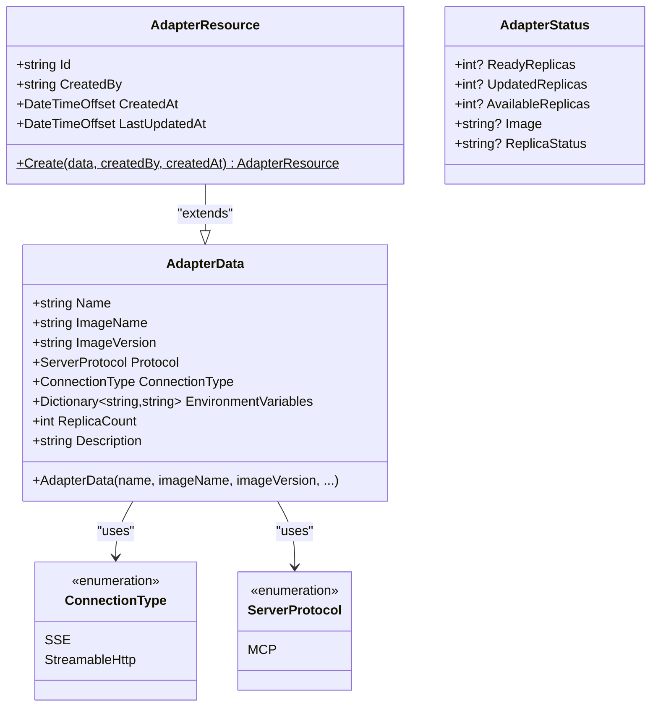
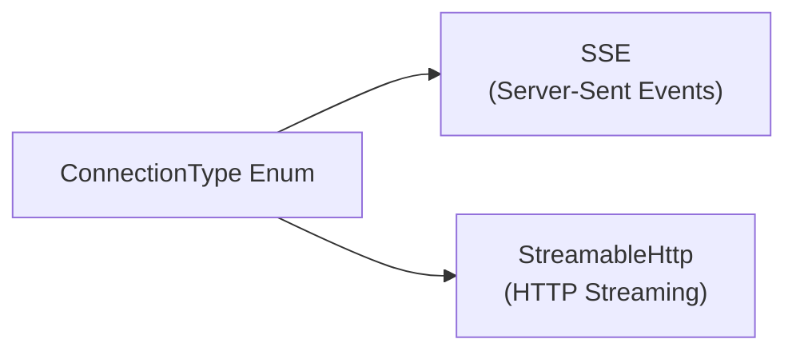
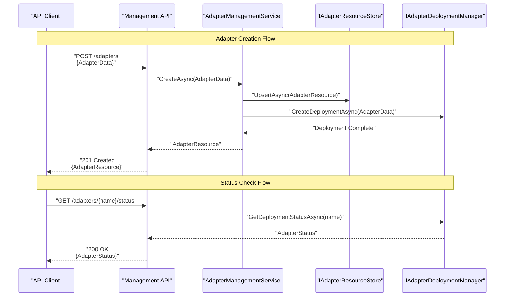

<!-- source: DeepWiki mcp.deepwiki.com · repo microsoft/mcp-gateway · page 5 API Reference · fetched 2026-10-26 -->

# API Reference

<details>
<summary>Relevant source files</summary>

The following files were used as context for generating this wiki page:

- [README.md](README.md)
- [dotnet/Microsoft.McpGateway.Management/src/Store/CosmosAdapterResourceStore.cs](dotnet/Microsoft.McpGateway.Management/src/Store/CosmosAdapterResourceStore.cs)
- [dotnet/Microsoft.McpGateway.Service/src/appsettings.json](dotnet/Microsoft.McpGateway.Service/src/appsettings.json)
- [openapi/mcp-gateway.openapi.json](openapi/mcp-gateway.openapi.json)

</details>


This document provides comprehensive reference documentation for the data contracts, interfaces, and API definitions used throughout the MCP Gateway system. This includes input/output data transfer objects (DTOs), entity models, status contracts, and enumeration definitions that form the core API surface.

For implementation details of the services that use these contracts, see [Core Components](#3). For HTTP API endpoints and routing information, see [System Architecture](#2).

## Data Contracts Overview

The MCP Gateway API is built around three primary data contracts that represent different aspects of adapter management:



**Data Contract Flow:**
AdapterData → AdapterResource → AdapterStatus

Sources: [dotnet/Microsoft.McpGateway.Management/src/Contracts/AdapterData.cs:1-102](), [dotnet/Microsoft.McpGateway.Management/src/Contracts/AdapterResource.cs:1-58](), [dotnet/Microsoft.McpGateway.Management/src/Contracts/AdapterStatus.cs:1-21]()

## Core Data Contracts

### AdapterData

The `AdapterData` class serves as the primary input contract for adapter creation and update operations. It contains all the configuration required to deploy an MCP server adapter.

| Property | Type | Required | Description | Validation |
|----------|------|----------|-------------|------------|
| `Name` | `string` | Yes | Adapter identifier | Must match regex `^[a-z0-9-]+$` |
| `ImageName` | `string` | Yes | Container image name | - |
| `ImageVersion` | `string` | Yes | Container image version/tag | - |
| `Protocol` | `ServerProtocol` | No | Communication protocol | Defaults to `MCP` |
| `ConnectionType` | `ConnectionType` | No | Connection method | Defaults to `StreamableHttp` |
| `EnvironmentVariables` | `Dictionary<string, string>` | No | Environment variables for container | Defaults to empty dictionary |
| `ReplicaCount` | `int` | No | Number of replicas to deploy | Defaults to `1` |
| `Description` | `string` | No | Human-readable description | Defaults to empty string |

**JSON Serialization Order:** Properties are serialized in a specific order using `JsonPropertyOrder` attributes for consistent API responses.

Sources: [dotnet/Microsoft.McpGateway.Management/src/Contracts/AdapterData.cs:12-88]()

### AdapterResource

The `AdapterResource` class extends `AdapterData` and represents the persisted entity with additional metadata fields for tracking and audit purposes.

| Property | Type | Description |
|----------|------|-------------|
| `Id` | `string` | Unique identifier (typically same as `Name`) |
| `CreatedBy` | `string` | User ID who created the adapter |
| `CreatedAt` | `DateTimeOffset` | Creation timestamp |
| `LastUpdatedAt` | `DateTimeOffset` | Last modification timestamp |

**Factory Method:** The static `Create` method provides a convenient way to construct `AdapterResource` instances from `AdapterData`:

```csharp
AdapterResource.Create(AdapterData data, string createdBy, DateTimeOffset createdAt)
```

Sources: [dotnet/Microsoft.McpGateway.Management/src/Contracts/AdapterResource.cs:8-57]()

### AdapterStatus

The `AdapterStatus` class represents the runtime deployment status of an adapter in the Kubernetes cluster.

| Property | Type | Description |
|----------|------|-------------|
| `ReadyReplicas` | `int?` | Number of ready pod replicas |
| `UpdatedReplicas` | `int?` | Number of updated pod replicas |
| `AvailableReplicas` | `int?` | Number of available pod replicas |
| `Image` | `string?` | Currently deployed container image |
| `ReplicaStatus` | `string?` | Overall status description |

All properties are nullable to handle cases where status information is unavailable or still being retrieved from Kubernetes.

Sources: [dotnet/Microsoft.McpGateway.Management/src/Contracts/AdapterStatus.cs:9-20]()

## Enumeration Types

### ConnectionType

Defines the connection method used for communicating with MCP servers:



| Value | Description |
|-------|-------------|
| `SSE` | Server-Sent Events connection |
| `StreamableHttp` | HTTP streaming connection (default) |

Sources: [dotnet/Microsoft.McpGateway.Management/src/Contracts/AdapterData.cs:91-95]()

### ServerProtocol

Defines the communication protocol used by the MCP server:

| Value | Description |
|-------|-------------|
| `MCP` | Model Context Protocol (default and currently only supported protocol) |

Sources: [dotnet/Microsoft.McpGateway.Management/src/Contracts/AdapterData.cs:97-101]()

## Contract Relationships and Usage Patterns



**Key Usage Patterns:**

1. **Input Validation:** `AdapterData` includes validation attributes for `Name` property using regular expressions
2. **Entity Persistence:** `AdapterResource` adds audit fields to `AdapterData` for database storage
3. **Status Reporting:** `AdapterStatus` provides runtime information independent of configuration data
4. **JSON Serialization:** All contracts use `System.Text.Json` with custom property ordering

Sources: [dotnet/Microsoft.McpGateway.Management/src/Contracts/AdapterData.cs:17-18](), [dotnet/Microsoft.McpGateway.Management/src/Contracts/AdapterResource.cs:39-54]()

---

